# Crash reporting: class diagram

Components added by issue #243 (Crashlytics base setup). Reports from every
organization and plan go to the central project `monamienet-app` (the
`[DEFAULT]` Firebase app) and carry no personal data.

```mermaid
classDiagram
    direction LR

    class CrashReportingService {
        <<interface>>
        +start() Future~void~
        +setCustomKey(String key, String value) Future~void~
        +recordFlutterFatalError(FlutterErrorDetails details) Future~void~
        +recordError(Object error, StackTrace? stackTrace, bool fatal) Future~void~
    }

    class FirebaseCrashReportingService {
        -FirebaseCrashlytics _crashlytics
        +start() Future~void~
        +recordFlutterFatalError(FlutterErrorDetails details) Future~void~
        +recordError(Object error, StackTrace? stackTrace, bool fatal) Future~void~
    }

    class NoOpCrashReportingService {
        +start() Future~void~
        +recordFlutterFatalError(FlutterErrorDetails details) Future~void~
        +recordError(Object error, StackTrace? stackTrace, bool fatal) Future~void~
    }

    class FirebaseCrashlytics {
        <<plugin firebase_crashlytics>>
        +setCrashlyticsCollectionEnabled(bool enabled)
        +recordFlutterFatalError(FlutterErrorDetails details)
        +recordError(Object error, StackTrace? stack, bool fatal)
    }

    class appDependencies {
        <<function, lib/config/dependencies.dart>>
        +appDependencies(CrashReportingService crashReporting, ...) List~Provider~
    }

    class createCrashReportingService {
        <<function, lib/config/dependencies.dart>>
        +createCrashReportingService() CrashReportingService
    }

    class installCrashReporting {
        <<function, crash_reporting_installer.dart>>
        +installCrashReporting(CrashReportingService service, CrashIsolate isolate) Future~void~
        start(), setCustomKey("isolate", tag)
        FlutterError.onError
        PlatformDispatcher.instance.onError
    }

    class CrashIsolate {
        <<enumeration>>
        ui
        trackingService
        +tag String
    }

    class main {
        <<function, lib/main.dart>>
    }

    class onStart {
        <<function, foreground_service.dart>>
        tracking service isolate
        records survived failures as non-fatal
    }

    class TestApp {
        <<test, test/support/test_app.dart>>
        +dependencies
    }

    CrashReportingService <|.. FirebaseCrashReportingService : implements
    CrashReportingService <|.. NoOpCrashReportingService : implements
    FirebaseCrashReportingService --> FirebaseCrashlytics : forwards to

    createCrashReportingService ..> FirebaseCrashReportingService : creates on mobile
    createCrashReportingService ..> NoOpCrashReportingService : creates on web (kIsWeb)

    main ..> createCrashReportingService : calls after CentralFirebase.initialize()
    main ..> installCrashReporting : isolate ui
    onStart ..> FirebaseCrashReportingService : creates its own
    onStart ..> installCrashReporting : isolate trackingService
    installCrashReporting --> CrashReportingService : start, setCustomKey, handlers
    installCrashReporting ..> CrashIsolate : tag
    main ..> appDependencies : passes crashReporting

    appDependencies o-- CrashReportingService : Provider.value
    TestApp o-- NoOpCrashReportingService : Provider.value
```

## Reading the diagram

- **Contract and implementations** live in `lib/data/services/crash_reporting/`,
  one file each. Only the Firebase implementation imports the plugin, as
  `tool/check_layers.dart` requires.
- **Error flow**: `installCrashReporting` sets `FlutterError.onError` to
  `recordFlutterFatalError` and `PlatformDispatcher.instance.onError` to
  `recordError(fatal: true)`; both end in the plugin's fatal path. Handlers
  are per isolate, so `main` (`ui`) and the tracking service's `onStart`
  (`tracking_service`) each install their own, and every report carries the
  custom key `isolate`.
- **Survived failures**: the tracking service records, as non-fatal reports,
  failures it only logged before (group write failures, plan, groups and
  settings reads, position stream errors).
- **Debug builds**: `FirebaseCrashReportingService.start()` turns collection
  off when `kDebugMode`.
- **Why `main` creates the service**: it must exist before `runApp`, so
  `appDependencies` receives it instead of building it.
- **Tests**: `TestApp` provides `NoOpCrashReportingService`, and
  `test/config/dependencies_test.dart` checks `appDependencies` provides the
  same types.
