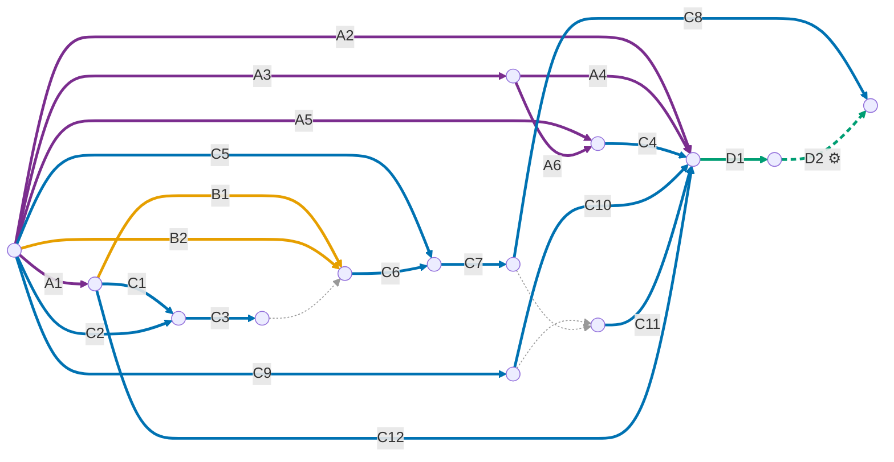

# Internal Testing Release

This guide takes an app from zero to the Google Play **internal testing** track and shows how each new
version is published after that. Almost everything is done once. **For each new version, the only manual
step is merging a PR into `main`**: the rest is automatic. How the automation works is explained in
[understanding-ci.md](understanding-ci.md).

## Overview

Steps are identified by group, according to how often they are done:

| Group | Frequency | Steps |
| :--- | :--- | :--- |
| **A** | Once for the company | A1 keystore · A2 to A6 CI foundation in Google Cloud |
| **B** | Once per machine or clone | B1 `key.properties` · B2 Firebase CLI sign-in |
| **C** | Once for the app (`org.monamienet.app`) | C1 to C4 Firebase · C5 to C7 first release, manual · C8 Play SHAs · C9 to C12 app CI |
| **D** | On every new version | D1 merge the PR · D2 automatic release ⚙️ |

| On every new version | Before CI | With CI |
| :--- | :--- | :--- |
| Manual steps | 5: bump the versionCode, build the bundle, upload, fill in release notes and release | 1: merge the PR |

### Dependencies between steps



**How to read it:**
- **Edges** are steps, labeled with the step ID. **Nodes** are instants: the moment the following steps
  can start.
- A node is only reached when **all** edges arriving at it have finished.
- Edges leaving the same node can be done **in parallel**.
- A **thin dotted edge with no label** is a dependency only, with no work. For example, inviting the service
  account (C11) requires that it already exists (C9) and that the app is already on Play (C7), and the
  first build should only fetch the Firebase config after the SHAs are registered (C3).
- Colors:
  - 🟣 once for the company;
  - 🟠 once per machine;
  - 🔵 once for the app;
  - 🟢 every version. The **dashed** edge (D2) is run automatically by CI. D1 and D2 repeat for every version.

## Values used

The commands in this guide use the variables below. Paste the block into your terminal before starting:

```bash
# Company
GCP_PROJECT=ci-cd-management      # Google Cloud project dedicated to CI
GCP_PROJECT_NUMBER=787253151660   # gcloud projects describe $GCP_PROJECT --format='value(projectNumber)'
POOL=github-actions               # workload identity pool (A3)
PROVIDER=github                   # GitHub provider (A4)
GITHUB_ORG_ID=336690459           # gh api orgs/monamienet --jq .id
CONFIG_ROLE=firebaseAppConfigReader   # custom role that reads Firebase app configs (A5)
CONFIG_SA_NAME=wlif-monamie-app-config  # service account that fetches them in CI (A6)
CONFIG_SA_EMAIL=$CONFIG_SA_NAME@$GCP_PROJECT.iam.gserviceaccount.com

# App
REPO=monamienet/monamie-app
SUBJECT_PREFIX=$(gh api repos/$REPO/actions/oidc/customization/sub --jq .sub_claim_prefix)  # start of the token subject (C10)
FIREBASE_PROJECT=monamienet-app        # central project: sign-in and the partner registry
SA_NAME=wlif-monamie-app-play     # deploy service account (C9)
SA_EMAIL=$SA_NAME@$GCP_PROJECT.iam.gserviceaccount.com
```

There is a single app for every partner. Onboarding a partner needs no change here and no release:
see [white-label.md](white-label.md).

---

## A. Once for the company

### A1. Generate the upload keystore

The keystore signs the bundles uploaded to Play and is the same for all of the company's apps. **Keep a
backup off the machine:** without it, no app can receive new versions.

```bash
keytool -genkey -v \
  -keystore <PATH>/upload.jks \
  -keyalg RSA -keysize 2048 -validity 10000 \
  -alias <ALIAS> \
  -dname "CN=MonAmieNet, O=MonAmieNet, C=BR" \
  -storepass '<PASSWORD>' -keypass '<PASSWORD>'
```

### A2. Enable the Play API in the CI project

Without the API enabled, Google refuses the publishing calls made by CI.

```bash
gcloud services enable androidpublisher.googleapis.com --project=$GCP_PROJECT
```

### A3. Create the workload identity pool

The pool groups the external identities (here, GitHub workflows) that Google Cloud accepts. It serves
every pipeline of the organization.

```bash
gcloud iam workload-identity-pools create $POOL \
  --project=$GCP_PROJECT \
  --location=global \
  --display-name="GitHub Actions" \
  --description="GitHub Actions workflows of the monamienet organization"
```

### A4. Create the GitHub provider

The provider makes the pool trust GitHub Actions tokens, but only those from the `monamienet`
organization. The condition uses the numeric ID because, unlike the name, it is never reused.

```bash
gcloud iam workload-identity-pools providers create-oidc $PROVIDER \
  --project=$GCP_PROJECT \
  --location=global \
  --workload-identity-pool=$POOL \
  --display-name="GitHub" \
  --issuer-uri="https://token.actions.githubusercontent.com/" \
  --attribute-mapping="google.subject=assertion.sub,attribute.repository_id=assertion.repository_id,attribute.repository_owner_id=assertion.repository_owner_id" \
  --attribute-condition="assertion.repository_owner_id=='$GITHUB_ORG_ID'"
```

**Check A2 to A4:**

```bash
gcloud services list --enabled --project=$GCP_PROJECT --filter="config.name=androidpublisher.googleapis.com"
gcloud iam workload-identity-pools providers describe $PROVIDER --workload-identity-pool=$POOL \
  --location=global --project=$GCP_PROJECT --format="yaml(state,attributeCondition)"
```

The expected result is the API listed, `state: ACTIVE` and the condition with the organization ID.

### A5. Create the `firebaseAppConfigReader` role

Every build fetches the central project's `google-services.json` (C4). CI does that with a role that has exactly the two permissions the Firebase CLI uses for it: listing the apps
(`firebase.clients.list`) and reading an app's config (`firebase.clients.get`). The predefined
`roles/firebase.viewer` is **not** used: it also reads product data, such as the Firestore documents with
the teams' location history. The central `resolvePartners` function uses the same role, bound on each
partner project, to read partners' Firebase options at runtime (white-label.md).

The role is defined where the partner projects live. Find out with:

```bash
gcloud projects describe $FIREBASE_PROJECT --format='value(parent.type,parent.id)'
```

If the result is `organization <ID>`, create the role once, in the organization. That needs
`roles/iam.organizationRoleAdmin`, which Organization Administrator does **not** include. If you lack it
and can edit the organization's IAM, grant it to yourself only for this step and revoke it right after
(the last command):

```bash
ORG_ID=<ID>
ME=$(gcloud config get-value account)
gcloud organizations add-iam-policy-binding $ORG_ID --member=user:$ME \
  --role=roles/iam.organizationRoleAdmin --condition=None --format=none
gcloud iam roles create $CONFIG_ROLE \
  --organization=$ORG_ID \
  --title="Firebase app config reader" \
  --description="Lists Firebase apps and reads their config at build time. Not roles/firebase.viewer, which also reads product data. Docs: docs/pt-br/publicar-teste-interno.md" \
  --permissions=firebase.clients.list,firebase.clients.get \
  --stage=GA
gcloud iam roles describe $CONFIG_ROLE --organization=$ORG_ID --format='value(includedPermissions)'
gcloud organizations remove-iam-policy-binding $ORG_ID --member=user:$ME \
  --role=roles/iam.organizationRoleAdmin --condition=None --format=none
CONFIG_ROLE_PATH=organizations/$ORG_ID/roles/$CONFIG_ROLE
```

The `describe` must list exactly `firebase.clients.get` and `firebase.clients.list`. Run it before
revoking the grant: after that, you can no longer read the role.

Otherwise, create it in each partner project: the same command with `--project=$FIREBASE_PROJECT`
instead of `--organization`, and `CONFIG_ROLE_PATH=projects/$FIREBASE_PROJECT/roles/$CONFIG_ROLE`.

Defining the role in the organization does not grant anything: the permission only exists where the role
is bound (C4), and it is bound per project, never on the organization or a folder.

If a CI call later fails with 403, add **only** the permission named in the error
(`gcloud iam roles update ... --add-permissions=<permission>`) and record why in the role description.

### A6. Create the Firebase config service account

It is the identity CI uses to fetch the Firebase config **before** the build. It is separate from the
publisher account (C9): the build runs third-party code (Gradle plugins, pub packages), so it only holds
a credential that reads configs, and a leak of either credential cannot do the other's job.

```bash
# Service account calls count against the API of the project that owns the account.
gcloud services enable firebase.googleapis.com --project=$GCP_PROJECT

gcloud iam service-accounts create $CONFIG_SA_NAME \
  --project=$GCP_PROJECT \
  --display-name="monamie-app Firebase config reader" \
  --description="Reads the partners' Firebase app configs at build time for $REPO from GitHub Actions via WIF. Docs: docs/pt-br/publicar-teste-interno.md"

# Same subject as C10: only jobs in the play-internal environment of this repository.
gcloud iam service-accounts add-iam-policy-binding $CONFIG_SA_EMAIL \
  --project=$GCP_PROJECT \
  --role=roles/iam.workloadIdentityUser \
  --member="principal://iam.googleapis.com/projects/$GCP_PROJECT_NUMBER/locations/global/workloadIdentityPools/$POOL/subject/$SUBJECT_PREFIX:environment:play-internal"
```

**Check:** `gcloud iam service-accounts get-iam-policy $CONFIG_SA_EMAIL --project=$GCP_PROJECT` lists only the
`roles/iam.workloadIdentityUser` binding with that `principal://...`.

## B. Once per machine or clone

### B1. Create `android/key.properties`

This file tells Gradle where the keystore is. It is in `.gitignore`, so each machine needs its own. It is
only needed for **local** release builds, such as the first release (C6), because CI assembles its own
from the secrets (C12).

```properties
storePassword=<PASSWORD>
keyPassword=<PASSWORD>
keyAlias=<ALIAS>
storeFile=<PATH>/upload.jks
```

> **Fail-fast:** without this file, or with an empty property, every release build fails with the message
> `Release signing: ...`. There is no fallback to the debug key, whose bundle Play would reject. Debug
> builds (`flutter run`) do not need the keystore.

### B2. Sign in to the Firebase CLI

Every build needs the central project's `google-services.json` (`monamienet-app`, used for sign-in),
which is not versioned: it holds API keys. Partners' projects are not involved: the app binds them at
runtime. When the file is missing, Gradle fetches it with `dart run tool/partner.dart firebase`, which
calls the Firebase CLI with **your own** account:

```bash
firebase --version || npm install -g firebase-tools
firebase login            # or firebase login --reauth when the credentials have expired
```

The file is saved in `android/app/google-services.json` (gitignored) and reused by later builds, even
offline. To fetch it again, for example after registering new SHAs (C3, C8), build with
`REFRESH_FIREBASE_CONFIG=1` or run `dart run tool/partner.dart firebase`. The command checks the
project, the package and the OAuth web client before writing, and only prints the app ID.

## C. Once for the app

There are three tracks that can run in parallel: Firebase (C1 to C4), first release (C5 to C8) and app CI
(C9 to C12). The diagram shows what depends on what.

### C1. Get the upload key SHAs

```bash
keytool -list -v -keystore <PATH>/upload.jks -alias <ALIAS> | grep -E "SHA1|SHA256"
```

### C2. Get the Android app ID in Firebase

```bash
firebase apps:list ANDROID --project $FIREBASE_PROJECT
APP_ID=<value of the "App ID" column>
```

### C3. Register the SHAs in Firebase

Google sign-in only works for apps whose signature Firebase knows.

```bash
firebase apps:android:sha:create $APP_ID <SHA1> --project $FIREBASE_PROJECT
firebase apps:android:sha:create $APP_ID <SHA256> --project $FIREBASE_PROJECT
```

### C4. Let CI read the Firebase config

Nothing is committed: each build fetches `google-services.json` from `$FIREBASE_PROJECT` (B2). For CI to
do the same, bind the A5 role to the config service account (A6) **on this project only**:

```bash
gcloud projects add-iam-policy-binding $FIREBASE_PROJECT \
  --member=serviceAccount:$CONFIG_SA_EMAIL \
  --role=$CONFIG_ROLE_PATH \
  --condition=None
```

**Check:** the command below shows only the `firebaseAppConfigReader` role:

```bash
gcloud projects get-iam-policy $FIREBASE_PROJECT --flatten=bindings \
  --filter="bindings.members:serviceAccount:$CONFIG_SA_EMAIL" --format='value(bindings.role)'
```

### C5. Create the tester list

In the Play Console, create a list of tester emails and associate it with the **internal testing** track.

### C6. Build the first bundle

Play only accepts uploads through the API after the app receives its first bundle through the Play
Console, so **the first version is manual**.

1. In `pubspec.yaml`, set `version: a.b.c+d`. `a.b.c` is the *versionName*, shown in the store, and `d`
   is the *versionCode*. Use a `d` **below 101**, because numbers from 101 up are used by CI.
2. Build the bundle:

    ```bash
    flutter build appbundle --release
    ```

    The output is `build/app/outputs/bundle/release/app-release.aab`.

### C7. Upload and release the first bundle

In the Play Console, open **internal testing**, create a release, upload the `.aab`, fill in the release
notes and click **Save → Release**.

### C8. Register the Google Play signing SHAs in Firebase

Play re-signs the app with a Google key (*Play App Signing*). Without that key's SHAs in Firebase, Google
sign-in fails on testers' devices. Copy the SHA1 and SHA256 from *Play Console → App integrity → App
signing* and register them:

```bash
firebase apps:android:sha:create $APP_ID <PLAY_SHA1> --project $FIREBASE_PROJECT
firebase apps:android:sha:create $APP_ID <PLAY_SHA256> --project $FIREBASE_PROJECT
```

CI fetches the updated config on every run. On your machine, fetch it again as described in B2.

### C9. Create the deploy service account

This is the identity that publishes to Play. Each pipeline has its own, and it gets no Google Cloud roles.
The reason is in [understanding-ci.md](understanding-ci.md#why-a-dedicated-service-account).

```bash
gcloud iam service-accounts create $SA_NAME \
  --project=$GCP_PROJECT \
  --display-name="monamie-app Play publisher" \
  --description="Publishes $REPO to the Play internal track from GitHub Actions via WIF. Docs: docs/pt-br/publicar-teste-interno.md"
```

### C10. Allow only the `play-internal` environment to impersonate the service account

The `--member` is the exact *subject* GitHub puts in the token of a job running in this repository's
`play-internal` environment. Any other job is refused. The subject has the form
`<prefix>:environment:play-internal`. This repository uses GitHub's **immutable** format, in which the
prefix includes the numeric IDs of the organization and repository (`repo:monamienet@336690459/monamie-app@1407450217`).
That is why the prefix is read from the API (`SUBJECT_PREFIX`) instead of written by hand: with the old
format, `repo:monamienet/monamie-app`, Google refuses the job.

```bash
gcloud iam service-accounts add-iam-policy-binding $SA_EMAIL \
  --project=$GCP_PROJECT \
  --role=roles/iam.workloadIdentityUser \
  --member="principal://iam.googleapis.com/projects/$GCP_PROJECT_NUMBER/locations/global/workloadIdentityPools/$POOL/subject/$SUBJECT_PREFIX:environment:play-internal"
```

**Check:** `gcloud iam service-accounts get-iam-policy $SA_EMAIL --project=$GCP_PROJECT` must list a
`roles/iam.workloadIdentityUser` binding with that `principal://...`. If only the `etag` appears, the
command was not applied.

### C11. Invite the service account in the Play Console

1. In the Play Console, open **Users and permissions → Invite new users**.
2. Enter the service account email (`echo $SA_EMAIL`).
3. Under **App permissions**, add the app and check **only** the permission to release to testing tracks.
4. Click **Invite user**.

The permission may take up to 48 hours to take effect.

### C12. Create the GitHub environment and secrets

The `play-internal` environment holds the signing secrets and can only be used by `main`. **This
restriction is mandatory:** the permission from C10 trusts the environment, and the restriction is what
stops other branches from publishing.

| Secret | Value |
| :--- | :--- |
| `ANDROID_KEYSTORE_B64` | the keystore encoded in base64 |
| `ANDROID_KEYSTORE_PASSWORD` | `storePassword` from `key.properties` |
| `ANDROID_KEY_PASSWORD` | `keyPassword` from `key.properties` |
| `ANDROID_KEY_ALIAS` | `keyAlias` from `key.properties` |

In the UI, use *Settings → Environments*. From the terminal, at the repository root, the values go straight
from `key.properties` to GitHub without showing on screen:

```bash
prop() { grep "^$1=" android/key.properties | cut -d= -f2- | tr -d '\r\n'; }

gh api -X PUT repos/$REPO/environments/play-internal \
  -F 'deployment_branch_policy[protected_branches]=false' \
  -F 'deployment_branch_policy[custom_branch_policies]=true'
gh api -X POST repos/$REPO/environments/play-internal/deployment-branch-policies -f name=main

prop storePassword | gh secret set ANDROID_KEYSTORE_PASSWORD --env play-internal --repo $REPO
prop keyPassword   | gh secret set ANDROID_KEY_PASSWORD      --env play-internal --repo $REPO
prop keyAlias      | gh secret set ANDROID_KEY_ALIAS         --env play-internal --repo $REPO
base64 -w0 "$(prop storeFile)" | gh secret set ANDROID_KEYSTORE_B64 --env play-internal --repo $REPO
```

**Check:** `gh secret list --env play-internal --repo $REPO` must list the 4 secrets, and
`gh api repos/$REPO/environments/play-internal/deployment-branch-policies --jq '.branch_policies[].name'`
must print `main`.

## D. On every new version

### D1. Merge the PR into `main`

This is the only manual step. To change the versionName (for example, from `1.0.0` to `1.1.0`), edit the
`version:` in `pubspec.yaml` in the PR itself. The versionCode is automatic.

### D2. Automatic release ⚙️

The merge triggers the workflow, which runs the tests, builds and signs the bundle, uploads it to Play and
releases the version to testers. Nothing needs to be done, but it is worth knowing:

- **Monitoring:** under *Actions → Deploy to Play (internal)*, each run shows the logs of every step. If
  anything fails, nothing is uploaded and whoever pushed gets an email.
- **Publishing again without a merge**, for example after fixing a permission: use *Run workflow* on `main`.
- **Release notes:** optional on the internal track, and the workflow does not fill them in. If you want
  notes, edit the release in the Play Console.
- ⚠️ **Do not rename the workflow file.** The run number, used as versionCode, is counted per file.
  Renaming it restarts the count at 1, and Play refuses duplicate versionCodes.

**Without CI:** if the workflow is unavailable, repeat C6 and C7 with a versionCode greater than the last
uploaded version's, which is shown in the Play Console.

---

## Common problems

| Message | Cause and fix |
| :--- | :--- |
| `Release signing: ...` | `key.properties` or the keystore is incomplete. Locally, check B1. On CI, check the C12 secrets. |
| `Secret ANDROID_... is empty` | The secret was not added to the `play-internal` environment, or it was added as a repository secret (C12). |
| `The given credential is rejected by the attribute condition` | The token did not come from the `monamienet` organization. Check the provider condition (A4). |
| `Permission 'iam.serviceAccounts.getAccessToken' denied` | The subject allowed in C10 is not the one GitHub sends. Check that the binding uses the prefix from the API (`echo $SUBJECT_PREFIX`) and that the job ran in the `play-internal` environment. |
| `The caller does not have permission` | The service account has no permission in the Play Console yet, or it has not propagated (C11). |
| `Version code ... has already been used` | The versionCode was already used. Usually the workflow file was renamed. Raise the `+ 100` in the workflow. |
| `Only releases with status draft may be created on draft app` | The app is still a draft on Play. Finish the first release (C7). |
| The app installs but Google sign-in fails | SHAs are missing in Firebase: from the upload key (C3) or from Google Play signing (C8). Locally, also fetch the config again (B2). |
| `'firebase apps:list' failed: ...` (task `fetchFirebaseConfig`) | Locally, sign in again (B2). On CI, the config service account cannot read the project: check A6 and C4. |
| `No Android app with package 'org.monamienet.app' ...` | The central project (`monamienet-app`) has no Android app with that package. Register it (C2). |
| `Could not run 'firebase'` | The Firebase CLI is not installed (B2). |
