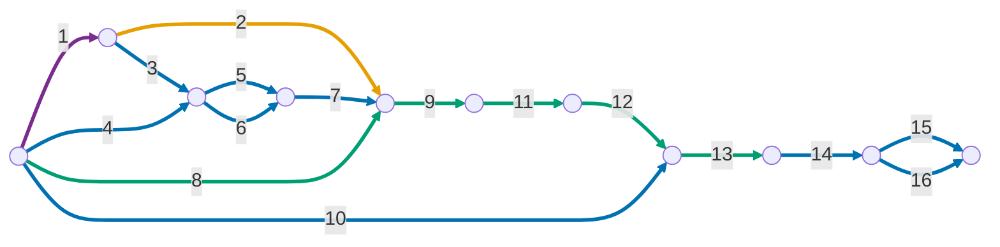

# Internal Testing Release

### In the Flutter project

1. Generate a keystore with the command 

    ```
    keytool -genkey -v \
      -keystore <OUTPUT_PATH> \
      -keyalg RSA -keysize 2048 -validity 10000 \
      -alias <ALIAS> \
      -dname "CN=MonAmieNet, O=MonAmieNet, C=BR" \
      -storepass '<PASSWORD>' -keypass '<PASSWORD>'
    ```

    > **Important:** Back up the keystore generated in the previous step!

1. Inside the Dart/Flutter project, create the file `android/key.properties` with the following content:

    ```
    storePassword=<PASSWORD>
    keyPassword=<PASSWORD>
    keyAlias=<ALIAS>
    storeFile=<OUTPUT_PATH>
    ```

    > **Important:** Add `key.properties` and `.jks` files to `.gitignore`.

    > **Fail-fast:** without this file, or with an empty property, **every release build fails** with the
    > message `Release signing: ...`, raised by the `validateReleaseSigning` task in `android/app/build.gradle.kts`.
    > There is no longer a fallback to the debug key, whose bundle Play would reject. Debug builds do not need the keystore.

1. Look up the SHA1 and SHA256 keys with the command `keytool -list -v -keystore <keystore_path> -alias <ALIAS> | grep -E "SHA1|SHA256"`

1. Look up the `<APP_ID>` using `firebase apps:list ANDROID --project PROJECT_ID`

1. Register the SHA1 key on the Android app in the Firebase project with `firebase apps:android:sha:create <APP_ID> <SHA1> --project <PROJECT_ID>`

1. Register the SHA256 key on the Android app in the Firebase project with `firebase apps:android:sha:create <APP_ID> <SHA256> --project <PROJECT_ID>`

1. Update `google-services.json` using `firebase apps:sdkconfig ANDROID <APP_ID> --project <PROJECT_ID> --out android/app/google-services.json`

1. Update the version in `pubspec.yaml`, keeping in mind that:
    - the version has the form `a.b.c+d`, where `a.b.c` is the ***versionName*** and d is the ***versionCode***
    - changing the ***versionName*** is optional
    - increasing the ***versionCode*** strictly is mandatory

1. Build the bundle with `flutter build appbundle --release`

### In the Google Play Console:

10. Create a tester list and associate it with the internal testing track

1. Upload the bundle generated in the previous step

1. Fill in the release notes

1. Save → Release

1. Copy the SHA1 and SHA256 keys that Google signs the app with, under *Play Console > App integrity > App signing*

1. Register the SHA1 key (signed by Google) on the Android app in the Firebase project with `firebase apps:android:sha:create <APP_ID> <SHA1> --project <PROJECT_ID>`

1. Register the SHA256 key (signed by Google) on the Android app in the Firebase project with `firebase apps:android:sha:create <APP_ID> <SHA256> --project <PROJECT_ID>`


### Automatic release (CI)

The workflow [`.github/workflows/deploy-play-internal.yml`](../../.github/workflows/deploy-play-internal.yml)
publishes to the internal testing track on every merge into `main`. What it does, line by line, is in
[understanding-ci.md](understanding-ci.md).

With CI set up, **steps 8, 9, 11 and 13 are no longer manual**:
- the versionCode becomes `run number + 100`, and the pubspec's `+N` is ignored on CI;
- the build, upload and release are done by the workflow.

Step 12 (release notes) is optional on the internal track, and the workflow does not fill it in. The
one-off steps (1 to 7, 10, 14 to 16) still apply.

#### One-time setup

Authentication with Google Play is **keyless**, through Workload Identity Federation. Each piece is explained
in [understanding-ci.md](understanding-ci.md#6-how-github-gets-permission-to-publish-on-play-keyless).
The commands use `gcloud` with an account that can administer IAM in the `ci-cd-management` project.

1. **Enable the Play API in the project:**

    ```bash
    gcloud services enable androidpublisher.googleapis.com --project=ci-cd-management
    ```

1. **Create the GitHub provider** in the `github-actions-pool` pool. The condition only accepts tokens from
   the `monamienet` organization, identified by its numeric ID `336690459`, because the ID, unlike the name,
   is never reused:

    ```bash
    gcloud iam workload-identity-pools providers create-oidc github \
      --project=ci-cd-management \
      --location=global \
      --workload-identity-pool=github-actions-pool \
      --display-name="GitHub" \
      --issuer-uri="https://token.actions.githubusercontent.com/" \
      --attribute-mapping="google.subject=assertion.sub,attribute.repository_id=assertion.repository_id,attribute.repository_owner_id=assertion.repository_owner_id" \
      --attribute-condition="assertion.repository_owner_id=='336690459'"
    ```

    > The pool is shared with other pipelines of the organization. If the `github` provider already exists,
    > skip this step and check that its condition restricts the organization.

1. **Create the service account dedicated** to this pipeline. It gets no Google Cloud roles:

    ```bash
    gcloud iam service-accounts create wlif-monamie-app-play \
      --project=ci-cd-management \
      --display-name="monamie-app Play publisher" \
      --description="Publishes monamie-app to the Play internal track from GitHub Actions via WIF. Docs: monamienet/monamie-app docs/pt-br/publicar-teste-interno.md"
    ```

1. **Allow only this repository's `play-internal` environment to impersonate the service account:**

    ```bash
    gcloud iam service-accounts add-iam-policy-binding \
      wlif-monamie-app-play@ci-cd-management.iam.gserviceaccount.com \
      --project=ci-cd-management \
      --role=roles/iam.workloadIdentityUser \
      --member="principal://iam.googleapis.com/projects/787253151660/locations/global/workloadIdentityPools/github-actions-pool/subject/repo:monamienet/monamie-app:environment:play-internal"
    ```

1. **Invite the service account in the Play Console:** under *Users and permissions → Invite new users*:
   - enter the email `wlif-monamie-app-play@ci-cd-management.iam.gserviceaccount.com`;
   - under *App permissions*, add the app and check **only** *Release to testing tracks*;
   - send the invite. According to Google, permission changes may take up to 48 hours to take effect.

1. **GitHub environment and secrets:** under *Settings → Environments → `play-internal`*:
   - under *Deployment branches and tags*, choose *Selected branches and tags* and add `main`. **This rule is
     mandatory:** the permission from step 4 trusts the environment, and this rule is what stops other branches
     from publishing;
   - under *Environment secrets*, add the signing secrets:

    | Secret | Value |
    | :--- | :--- |
    | `ANDROID_KEYSTORE_B64` | the output of `base64 -w0 <storeFile from key.properties>` |
    | `ANDROID_KEYSTORE_PASSWORD` | `storePassword` from `key.properties` |
    | `ANDROID_KEY_PASSWORD` | `keyPassword` from `key.properties` |
    | `ANDROID_KEY_ALIAS` | `keyAlias` from `key.properties` |

    From the terminal, without copying and pasting passwords, at the repository root:

    ```bash
    REPO=monamienet/monamie-app
    prop() { grep "^$1=" android/key.properties | cut -d= -f2- | tr -d '\r\n'; }

    gh api -X PUT repos/$REPO/environments/play-internal \
      -F 'deployment_branch_policy[protected_branches]=false' \
      -F 'deployment_branch_policy[custom_branch_policies]=true'
    gh api -X POST repos/$REPO/environments/play-internal/deployment-branch-policies -f name=main

    prop storePassword | gh secret set ANDROID_KEYSTORE_PASSWORD --env play-internal --repo $REPO
    prop keyPassword   | gh secret set ANDROID_KEY_PASSWORD      --env play-internal --repo $REPO
    prop keyAlias      | gh secret set ANDROID_KEY_ALIAS         --env play-internal --repo $REPO
    base64 -w0 "$(prop storeFile)" | gh secret set ANDROID_KEYSTORE_B64 --env play-internal --repo $REPO
    ```

1. **Play prerequisite:** the API only accepts uploads after the app's first manual upload (steps 10 to 13).

#### Running and monitoring

- **Automatic:** every PR merge into `main`.
- **Manual:** *Actions → Deploy to Play (internal) → Run workflow*, on the `main` branch. On other branches
  the run stops at the environment, which only accepts `main`.
- Each run shows the logs of every step. Uploaded versions are listed in the Play Console under *Internal testing*.

> ⚠️ **Do not rename the workflow file.** The run number, used as versionCode, is counted per file:
> renaming it restarts the count at 1, and Play would refuse duplicate versionCodes.

#### Common problems

| Message | Cause and fix |
| :--- | :--- |
| `Secret ANDROID_... is empty` | The secret was not added to the `play-internal` environment, or it was added as a repository secret instead of an environment secret. |
| `Release signing: ...` | `key.properties` or the keystore is incomplete. Check the signing secrets. |
| `The given credential is rejected by the attribute condition` | The token did not come from the `monamienet` organization. Check the provider condition (step 2). |
| `Permission 'iam.serviceAccounts.getAccessToken' denied` | The permission from step 4 is missing, or the job did not run in the `play-internal` environment (the token subject changes). |
| `Version code ... has already been used` | A bundle with that versionCode already exists. This usually happens because the workflow file was renamed. Raise the `+ 100` offset in the workflow. |
| `The caller does not have permission` | The service account has no permission on the app in the Play Console yet, or it has not propagated (step 5). |
| `Only releases with status draft may be created on draft app` | The app is still a draft on Play. Finish the first manual release. |
| The app installs but Google sign-in fails | The Google Play signing SHAs are missing in Firebase (steps 14 to 16); this is not a CI problem. |

### How often each step runs

Numbering follows the steps above (1 to 9 in the Flutter project, 10 to 16 in the Google Play Console).

| Frequency | Steps | Notes |
| :--- | :--- | :--- |
| Once for the company | 1 | The keystore is the same for all apps and tracks. Back it up right after generating it. |
| Once per machine or repository clone | 2 | `key.properties` is not versioned, so each environment needs its own. |
| Once per app (client) | 3, 4, 5, 6, 7, 10, 14, 15, 16 | Steps 14 to 16 can only be done after the first upload to the Play Console. |
| On every new version | 8, 9, 11, 12, 13 | Step 8 requires a `versionCode` greater than that of any bundle already uploaded. |

### Temporal dependency between steps

Step numbering is the same as in this guide.

#### How to read

- **Edges** are the steps (label = step number, as in the list above). **Nodes** are instants: the start of steps that depend on what has finished.
- A node is only reached when **all** the edges that arrive at it have finished.
- Edges leaving the same node can be done **in parallel**.



Edge colors, according to the frequency table:

- 🟣 Once for the company (step 1)
- 🟠 Once per machine or repository clone (step 2)
- 🔵 Once per app (steps 3, 4, 5, 6, 7, 10, 14, 15 and 16)
- 🟢 On every new version (steps 8, 9, 11, 12 and 13)
