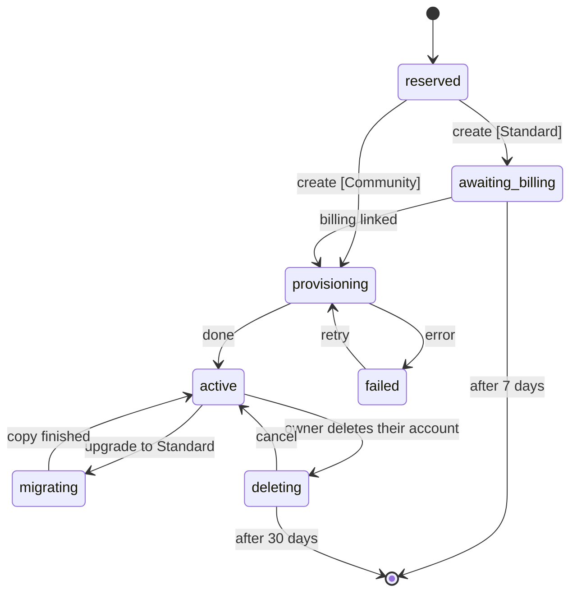

# One app, many organizations

MonAmie publishes one app, `org.monamienet.app` ("MonAmie"). Each organization (a client) keeps its own Firebase project, its own data and its own bill. The app learns which organization a user belongs to **after** the user signs in, and only then shows the organization's name, colors and logo.

This guide explains how that works, what MonAmie sets up once, and how to onboard an organization without releasing the app. The decisions behind it are in issue #28.

## 1. Organization vs. user

| | Organization | User |
|---|---|---|
| What | a client organization | a person |
| Example | AquariusTur | Maria |
| Owns | branding, Firebase project `monamienet-<id>` (or its share of `monamienet-community`), its groups | a Google account |
| Signs in? | no | yes |

A Google account says nothing about an organization. The bridge is **membership documents** in the organization's project, keyed by `personKey(email)`: the lowercase-hex SHA-256 of the trimmed, lowercased e-mail (for example, `ana@example.com` → `8e43ca37…a018e11`), so no e-mail appears in a document name:

- `organizations/<id>/organizationMemberships/<personKey>` = `{email, role, addedAt}`. Having one is belonging to the organization. `role` is `admin` (an **administrator**: manages the organization and sees every group; the owner, who created it, is the first) or `member`;
- `organizations/<id>/groups/<groupId>` = `{name, createdAt}`, one per **group** (a Firestore auto id, never reused), and inside it `groupMemberships/<personKey>` = `{email, organizationId, roles, addedAt}`. `publisher` shares one's own location in the group, `subscriber` sees the group's map; having both is "both". (`maintainer` is reserved for #165.)

Only the central functions (invites, groups, creation, account deletion) and `dart run tool/organization.dart add-admin` write them; the rules let no client do it. The central project keeps an index, `accounts/<personKey>` = `{email, organizationIds}`, so sign-in finds a person's organizations without opening every project. It is written after the organization project, so when the two disagree the organization project wins: the app drops an id it finds no membership for, and `check` reports a membership missing from the index.

## 2. What happens when a user signs in

1. **Google sign-in** to the central project `monamienet-app`. The screen is MonAmie-branded: no organization is known yet.
2. **`resolveOrganizations`** (central function) reads the user's `accounts/<personKey>` in the central project, keeps the organizations whose status in the central registry `organizations/{id}` is not `reserved`, and returns each one's status and, for the ones it can bind, its Firebase options. The app enters only `active` organizations (section 7).
3. The app reads each organization's **`organizations/<id>/config/branding`** (public). With no organization the user lands on *Sem organização*, still signed in to MonAmie, where they can create their organization or check again after being invited; with one or more, *Escolher organização* shows each organization's name and logo, below any pending invites. These screens are MonAmie's own ("Encontro" identity: navy, cream, coral); the organization's brand only appears once the user is known to belong to it.
4. **Binding:** the organization's Firebase project (a named Firebase app `organization-<id>`) and its branding are bound together. The app signs in to the organization project with the same Google ID token (the organization allows the central web client). From then on the security rules read the person's membership documents on every request to decide what they may see and write; there are no custom claims to refresh.
5. **Remembering:** the binding is saved on the device. Next launches open directly in the organization's brand, without the central project.

The app **forgets** the organization on sign-out (back to the login), on *Trocar de organização* (sign-out, then the account chooser and the picker), and when the user lost access: their `organizationMemberships/<personKey>` disappears (the app listens to it). Losing access, at sign-in or later, always ends on *Sem organização* with a message naming the organization, never on the login with a generic error (#78). Nothing is cached: a removal holds from the next read.

The launcher icon, the app name on the home screen, the Play listing and the native splash are always MonAmie: Android reads them from the installed package. The two names are never shown side by side: MonAmie's own screens say "MonAmie", and once an organization is bound the app shows only the organization's name ("AquariusTur", never "MonAmie AquariusTur").

## 3. Where each value lives

| Kind | Examples | Where |
|---|---|---|
| Organization's choice | name (required), catalog theme, logo (optional) | `organizations/<id>/config/branding` in the organization's project (section 9) |
| MonAmie's choice | organization status (section 7) | `organizations/{id}` in `monamienet-app` |
| MonAmie's choice | theme catalog (section 8) | `themes/{id}` in `monamienet-app` |
| Derived by rule | `monamienet-<id>`, `personKey(email)` | code |
| Written only by the central functions (and `add-admin`) | memberships and groups (section 1) | the organization's project; the index `accounts/{personKey}` in `monamienet-app` |
| Fetched at build time | central `google-services.json` | `android/app/google-services.json` (gitignored) |
| Fetched at runtime | organization's Firebase options | `resolveOrganizations`, then the device |

Branding is a **name**, a **theme** from the catalog (section 8) and, optionally, **one logo**: a square 512 px PNG at `organizations/<id>/logo.png` in the organization's Cloud Storage (public read; written only by an administrator, `image/png` up to 1 MB). Administrators change all three in the app, *Aparência*: the device converts any picked file (SVG, PNG, JPEG, WebP, HEIC where Android decodes it) to that PNG, so an SVG is never stored; the `setBranding` function checks the theme against the active catalog and bumps `logoVersion`, which tells devices to fetch the new logo. Fallbacks: no or unknown theme → Grafite; no logo, or one that does not decode → the name's initial in a tile of the theme's color; no name → the id capitalized. The resolved colors and the logo are stored with the binding, so the first screen is branded without network; changes reach each device on its next launch.

## 4. One-time setup of the central project (maintainer)

Done for `monamienet-app` on 2026-10-21; the log is in issue #65. Kept here to rebuild it if ever needed.

1. Create the project and link billing:
   ```sh
   gcloud projects create monamienet-app --organization=<org id> --name="MonAmie"
   gcloud billing projects link monamienet-app --billing-account=<account>
   firebase projects:addfirebase monamienet-app
   ```
   A billing account can only hold a few projects; "Cloud billing quota exceeded" means unlinking one or asking Google for more. The id `app` is reserved: no organization can use it.
2. Enable the APIs and create Firestore in `us-central1`, the region of every function of this app (it holds the registry, the theme catalog, invites, scheduled account deletions and the `accounts` index; only the central functions read the last three):
   ```sh
   gcloud services enable firestore.googleapis.com identitytoolkit.googleapis.com cloudfunctions.googleapis.com \
     cloudbuild.googleapis.com artifactregistry.googleapis.com run.googleapis.com eventarc.googleapis.com \
     firebase.googleapis.com cloudidentity.googleapis.com --project=monamienet-app
   gcloud firestore databases create --location=us-central1 --project=monamienet-app
   ```
3. Register the Android app `org.monamienet.app` and one web app (`firebase apps:create`), and add the SHA-1s of the debug key, the upload key and, after the first Play upload, Play App Signing (`firebase apps:android:sha:create`; see `publish-internal-testing.md`, steps C1–C3 and C8).
4. Console → Authentication → enable **Google** (public name "MonAmie"). Firebase creates the web OAuth client and already authorizes `localhost`, `localhost:5000` and the `firebaseapp.com` domain; add only a custom hosting domain.
5. The Google Cloud organization gives default service accounts **no roles** (policy `iam.automaticIamGrantsForDefaultServiceAccounts`). Grant the function's account (`<project number>-compute@developer.gserviceaccount.com`) `roles/cloudbuild.builds.builder`, `roles/datastore.user` and `roles/logging.logWriter` on `monamienet-app`, and the custom role `firebaseAppConfigReader` on **each organization project only** (onboarding step 8).
6. Create the service account of `expireOrganizations` and enable Cloud Scheduler (section 7):
   ```sh
   gcloud services enable cloudscheduler.googleapis.com cloudresourcemanager.googleapis.com --project=monamienet-app
   gcloud iam service-accounts create partner-expirer --project=monamienet-app --display-name="Partner expirer"
   gcloud projects add-iam-policy-binding monamienet-app --role=roles/datastore.user \
     --member=serviceAccount:partner-expirer@monamienet-app.iam.gserviceaccount.com
   ```
   Deploy (answer **1** day to the container image cleanup question on the first deploy), then seed the theme catalog (section 8):
   ```sh
   (cd central/functions && npm ci)
   (cd central && firebase deploy --project monamienet-app --only functions,firestore)
   dart run tool/organization.dart themes
   ```
7. CI: bind `firebaseAppConfigReader` for `wlif-monamie-app-config@ci-cd-management.iam.gserviceaccount.com` on `monamienet-app`. Remove its binding from `monamienet-aquariustur` **only after** PR #74 is merged: until then, `main` still builds the old app from that project.
8. Play Console: create the app `org.monamienet.app`, upload the first bundle manually (`--build-number=100`), fill in Data safety and the **background location** declaration, and give the publisher service account access. Then unpublish `org.monamienet.aquariustur`.

## 5. Onboarding an organization (no app release)

Steps 1–8 cover the three required things: project, an administrator and name. Step 9 is the gate.

**Organization's Firebase project**
1. Create `monamienet-<id>` on the organization's billing account.
2. Enable Firestore and the Google sign-in provider. Under **Allowed client IDs** (console only), add the central web client id: central project → Authentication → Google → Web SDK configuration.
3. Register the Android app `org.monamienet.app` **without a SHA-1** (the package + SHA-1 pair can only have an OAuth client in one project: the central one) and **exactly one** web app. `flutterfire configure` creates one web app per platform (e.g. "windows"); remove the extra ones, or `check`, `activate` and `resolveOrganizations` fail.
4. Grant the function's account (`<organization project number>-compute@developer.gserviceaccount.com`) `roles/datastore.user` (`setBranding` reads the caller's membership and writes the branding), `roles/cloudbuild.builds.builder` and `roles/logging.logWriter`. Grant the central accounts `roles/datastore.user` on this project: `groups-admin@monamienet-app.iam.gserviceaccount.com` (the central functions write memberships and groups here) and `partner-expirer@monamienet-app.iam.gserviceaccount.com` (with `roles/firebaseauth.admin` too: account erasure, section 12). Enable Cloud Storage (the default bucket holds the logo).
5. Deploy the rules, the indexes, the Storage rules and `setBranding` from the repository root (first deploy: answer **1** day to the cleanup question):
   ```sh
   (cd functions && npm ci)
   firebase deploy --project monamienet-<id> --only firestore:rules,firestore:indexes,storage,functions
   ```
   On the **first** deploy of `storage.rules`, the CLI asks to let Cloud Storage read Firestore, because the logo rule reads the uploader's membership (a "cross-service" rule). Answer **yes**: it grants the project's Cloud Storage service agent a role to read Firestore (the CLI names it). Without it every logo upload is refused. The console offers the same grant under Storage → Rules. Building the `groupMemberships` and `positions` indexes takes a few minutes after the deploy; until then the app's "my groups" query and account erasure fail with "index not ready".

**Administrators**

6. Make the first administrator (the owner):
   ```sh
   dart run tool/organization.dart add-admin <id> <e-mail>
   ```
   It writes their `admin` membership in the organization's project, then adds the organization to their `accounts` entry in `monamienet-app`, the same two writes the central functions make. Add `--community` while a Community organization has no registry entry yet. Everyone else joins through invites from the app, and groups are created in the app (section 10); no Google Group is involved.
7. Grant `firebaseAppConfigReader` to the central function's account on **this project only**.

**Branding and activation**

8. Publish the name and theme (an administrator adds the logo later in the app):
   ```sh
   dart run tool/organization.dart publish <id> --name "<Name>" --theme <themeId>
   ```
   `--theme` is one of the catalog ids (section 8); add `--dry-run` to check first. Publishing again updates the brand on every device's next launch and also removes the fields of the old format (`colors`, `logoSvg`, `iconSvg`).
9. Check and activate (activation runs the same checks and refuses on failure):
    ```sh
    dart run tool/organization.dart check <id>
    dart run tool/organization.dart activate <id>
    ```
    `activate` sets the organization's status to `active` (section 7). It refuses a retired id and an organization in `awaiting_billing`, `migrating` or `deleting`.

`check` lists every problem at once: the two apps, at least one administrator, every membership present in its person's `accounts` entry (each problem prints the e-mail next to its key, since a key alone is a hash), and the branding name.

The tool uses your `firebase login` and `gcloud auth login` accounts. `check` and `add-admin` read and write memberships and `accounts`, which no client may read, so your account needs Firestore access (`roles/datastore.user`, or owner) on the organization's project and on `monamienet-app`.

## 6. Building and deploying

- **Android:** `flutter build apk` (no `--flavor`). The build fetches the central `google-services.json` when it is missing; `REFRESH_FIREBASE_CONFIG=1` refreshes it.
- **Web:** `dart run tool/organization.dart web` writes `web/central/firebase.json` (central Firebase options and the Google client id), then `flutter build web`. See `run-web-locally.md`.
- **Functions:** CI only ships the app. After a merge that changes `central/`, redeploy the central project (section 4, step 6); after one that changes `functions/`, `firestore.rules`, `firestore.indexes.json` or `storage.rules`, redeploy **every** organization project and `monamienet-community` (section 5, step 5).

## 7. Organization status

Each organization's entry in the central registry, `organizations/{id}` in `monamienet-app`, has one `status` field. Only the central functions change it, through `transitionOrganizationStatus` (`central/functions/organization_status.js`), which refuses any transition not drawn below. The one exception is `tool/organization.dart activate`, MonAmieNet's manual path: it sets `active` on an organization with no status yet, or in `provisioning`, `failed` or `active`.



| `status` | Meaning | The app shows |
| :--- | :--- | :--- |
| `reserved` | id reserved, creation starting (seconds) | nothing yet (`resolveOrganizations` leaves it out) |
| `awaiting_billing` | Standard only: project created, waiting for the organization to link billing | *Ativar faturamento* |
| `provisioning` | setting up Firestore, rules, functions and the owner's membership | *Ativar faturamento*, progress part |
| `active` | working | the map |
| `migrating` | Community → Standard copy in progress | the map, read-only; sharing paused |
| `failed` | a provisioning step failed after retries; MonAmieNet is alerted | *Falha na criação* |
| `deleting` | the owner deleted their account; `deleteAt` = request + 30 days | *Em exclusão* |

**The end is a deleted document, not a status.** Entering `awaiting_billing` or `deleting` sets `deleteAt` (7 or 30 days later); leaving them removes it. Every day at 03:00 (São Paulo) the scheduled function `expireOrganizations` takes the organizations whose `deleteAt` has passed, deletes their Google Cloud project (or their Community subtree), removes their id from every `accounts` entry, deletes `organizations/{id}` and writes `retiredOrganizationIds/{id}` with only `retiredAt`. A deleted project's id can never be reused, so a retired id is refused for good: creation checks it at the name step, and `activate` refuses it too. Google keeps a deleted project restorable for up to 30 more days before erasing it.

`expireOrganizations` runs as its own service account, `partner-expirer@monamienet-app.iam.gserviceaccount.com`, with `roles/datastore.user` on `monamienet-app`. It can only delete projects where it holds `roles/resourcemanager.projectDeleter`, granted by the in-app creation on the projects it creates. Never grant it on an organization onboarded by hand: those are not meant to expire.

### Migrating from the `active` flag (one-off)

Registries written before the lifecycle have `active: true` and no `status`. After deploying `central/` with this change, run `activate` for every organization listed in `organizations/` (Firebase console → `monamienet-app` → Firestore): it runs the checks and rewrites the entry as `status: "active"`, removing `active`. Until then the organization is hidden from sign-in, so run both back to back.

## 8. Theme catalog

Organizations pick one of a fixed set of themes, never free colors. The catalog lives in the central project, `themes/{id}`, so MonAmieNet can adjust a tone without an app release:

| id | name | primary | dark | light |
| :--- | :--- | :--- | :--- | :--- |
| `oceano` | Oceano | `#315399` | `#131A34` | `#D4DBE9` |
| `turquesa` | Turquesa | `#0B7F7B` | `#093A3E` | `#CDF0EF` |
| `floresta` | Floresta | `#2F7347` | `#163123` | `#D6E7DC` |
| `oliva` | Oliva | `#5E6B1F` | `#2B3512` | `#E6EAD3` |
| `ambar` | Âmbar | `#9A5B00` | `#433104` | `#F3E2CA` |
| `petroleo` | Petróleo | `#1F6A85` | `#102837` | `#D2E5EB` |
| `ameixa` | Ameixa | `#74408F` | `#2A1730` | `#E1D7E6` |
| `grafite` | Grafite | `#3F4754` | `#1F2128` | `#DCDEE2` |

- Each document also has `onPrimary` and `onDark` (white for all eight: every theme passes WCAG AA for white text on `primary` and `dark`, and for `dark` text on `light`), `order` (picker position) and `active`.
- **Seeding** is repeatable: `dart run tool/organization.dart themes` (add `--dry-run` to print). The tones live in `tool/src/themes_command.dart`; change them there and seed again.
- **Retiring** a theme: set `active: false` (in the tool too, or the next seed revives it). It disappears from the picker but still resolves for the organizations that use it; never delete a theme document.
- **Unknown or missing `themeId`**: the app uses Grafite and never blocks. The resolved colors are stored with the binding, so the first screen is branded without network even when the catalog cannot be read.
- **Reading** is public (names and colors only): the app reads it, and the organization functions that save a `themeId` check it against the active themes, because an organization project's rules cannot read the central database.

## 9. Plans and the data layout

| | **Community** (free) | **Standard** |
| :--- | :--- | :--- |
| Firebase project | `monamienet-community`, shared by every Community organization, paid by MonAmieNet | the organization's own `monamienet-<id>`, on the organization's billing account |
| Tracking | at most one position every 15 minutes (*Economia*) | every preset |
| Registry | `organizations/{id}.plan = "community"` | `plan = "standard"` (or no `plan`, for entries made before plans) |

**One layout for both.** Every organization keeps its data under `organizations/{organizationId}/` of its project:

```
organizations/{organizationId}/config/branding      public: name and look
organizations/{organizationId}/config/plan          Community only: {minIntervalMinutes: 15}
organizations/{organizationId}/config/tracking      administrators' choice: {intervalMinutes, distanceMeters}; default 15 min, 100 m (Economia)
organizations/{organizationId}/organizationMemberships/{personKey}   who belongs: {email, role}
organizations/{organizationId}/groups/{groupId}                      a group: {name, createdAt}
organizations/{organizationId}/groups/{groupId}/groupMemberships/{personKey}   {email, organizationId, roles}
organizations/{organizationId}/groups/{groupId}/positions/{personKey}          last position in the group (receivedAt = server time; removedAt set when the person stops publishing there)
organizations/{organizationId}/groups/{groupId}/positions/{personKey}/trail/{pointId}
organizations/{organizationId}/groups/{groupId}/positions/{personKey}/trailDays/{yyyy-mm-dd}  one summary per day with trails (history calendar dots)
```

- **Rules** scope every path by organization: they read the caller's `organizationMemberships/<personKey>` **of that organization** (and, for positions, the `groupMemberships/<personKey>` of that group). Members read `config/tracking` and `config/plan`; administrators write `config/tracking` and read every group; a group's positions, trail and calendar need `subscriber` there (or being an administrator); writing one's own position needs `publisher`. A person reads only the groups they belong to.
- **Community interval, enforced by the rules**: a new position must carry `receivedAt == request.time` and come at least `minIntervalMinutes` after the previous one; a trail point is only accepted in the same batch as the position it records (`getAfter`). The app reads the same value and does not try sooner.
- **`resolveOrganizations`** returns the Community project's Firebase options for Community organizations (each still gets its own named app `organization-<id>` on the device).
- **Expiry** (section 7) deletes a Community organization's `organizations/{id}/**` in the shared project instead of a project; the `partner-expirer` account needs `roles/datastore.user` on `monamienet-community`.

**Setting up `monamienet-community`** (once): create the project on MonAmieNet's billing account (it needs a free slot on that account), add Firebase, Firestore in `southamerica-east1`, the Google provider with the central web client in *Allowed client IDs*, the Android app `org.monamienet.app` without a SHA-1 and exactly one web app, the same IAM as an organization project (section 5, steps 4 and 7; `groups-admin@` and `partner-expirer@` included), then deploy `firestore.rules`, `firestore.indexes.json`, `storage.rules` and `functions/` to it. Add a **budget alert**: the free Firestore quota (50,000 reads and 20,000 writes a day) is shared by every Community organization.

**Moving a Standard organization to Community** (by hand; no tool yet). Since both plans use the same layout, the move is a copy to the same paths in another project plus one registry field:

1. Copy every document under `organizations/<id>/` of `monamienet-<id>` (memberships and groups included) to the same path in `monamienet-community`, keeping fields and types (Firestore REST `batchWrite`).
2. Write `organizations/<id>/config/plan` = `{minIntervalMinutes: 15}`, and raise `config/tracking.intervalMinutes` to at least 15 if it is lower (the rules refuse a lower value on the next save; use 15 min / 100 m, *Economia*).
3. Copy `organizations/<id>/logo.png` to the Community bucket with content type `image/png`. A project without billing answers HTTP 402 even on the public logo URL, so link billing first if it was removed.
4. Compare the copy with the source document by document, then set `plan: "community"` in the central registry `organizations/<id>` (`monamienet-app`). `resolveOrganizations` reads the plan at every call, so the next organization pick gets the Community project.
5. Tell the people of the organization to tap *Trocar de organização* and pick it again (on Android, close the app first): devices keep the project they were bound to until then (#145).
6. Delete `monamienet-<id>` (`gcloud projects delete`); Google keeps it restorable for 30 days.

**This is the point of no return for the id**: a Standard organization's project is always `monamienet-<id>` (`projectIdFor` in `central/functions/organization_options.js`), and a deleted project id can never be reused. After step 6 the organization cannot return to Standard under the same id unless that rule changes (#104). `aquariustur` and `monamietest` were moved this way on 2026-10-30.

## 10. Groups and invites (from the app)

Administrators (*administradores*) manage groups and invites in the app. The work happens in the central project's functions, never on the device:

- **Who may call them**: only the organization's administrators (their `organizationMemberships/<personKey>` in the organization's project has `role: "admin"`), while its registry entry `organizations/{id}` is `active`. Each call only touches that organization. `listGroups`, `createGroup`, `renameGroup`, `groupDeletionImpact`, `deleteGroup`, `setMemberRoles`, `removeMember`, `sendInvites`, `listInvites`, `resendInvite` and `cancelInvite` all take `{organizationId}`; errors come back as `invalid-argument` with `{field}` (`name`, `duplicate`, `roles`, `group`, `member`, …), `failed-precondition` for `full` (99 groups), `permission-denied` for a non-administrator.
- **Identity**: `groups-admin@monamienet-app.iam.gserviceaccount.com` (an old name; a dedicated account is a follow-up), with `roles/datastore.user` on `monamienet-app` (registry, invites, `accounts`), on `monamienet-community` and on each Standard project (memberships and groups). It reaches each organization's project through a second Admin SDK app pointed at that project, chosen from the registry's `plan`.
- **Groups**: a Firestore document with an auto id; its name has 2 to 40 characters, at least 2 letters, unique ignoring case, accents and spaces). Renaming changes only the name. Deleting first shows who leaves the organization (people in no other group; never an administrator), removes them from it, cancels the group's pending invites, then deletes the group with everything under it (memberships, positions, trails); repeating it finishes a deletion that stopped halfway. Changing someone's roles keeps a `maintainer` role; losing `publisher` (or being removed from the group) marks their position there with `removedAt`, so the map hides it and the history keeps it. Removing someone from their last group also removes them from the organization, unless they administer it. The app reads group names straight from Firestore.
- **Invites**: `invites/{id}` in the central project (an invited person belongs to nothing yet, so their organization project cannot hold it): `{organizationId, organizationName, groupId, groupName, email, roles, inviterEmail, inviterName, createdAt, expiresAt, status}`, roles among `publisher` and `subscriber`. They expire after **14 days** (*Reenviar* starts 14 new days; *Cancelar* voids them). **Membership starts on acceptance**: the person signs in with the invited account, sees the invite on *Sem organização* or at the top of *Escolher organização*, taps *Aceitar e entrar*, and `acceptInvite` writes, in one batch in the organization's project, their organization membership (`member`, unless they already have one) and their group membership (the invite's roles added to theirs), then the organization in their `accounts` entry. It holds at once: the rules read those documents, so there is nothing to wait for. An invite whose group was deleted is refused.
- **E-mail**: sent through the Gmail API of the Workspace as the mailbox `MAIL_SENDER_SUBJECT`, shown as `MAIL_FROM` (a "send mail as" alias of that mailbox) — both in `central/functions/.env`. The functions sign the delegation JWT through the IAM Credentials API as `mail-sender@monamienet-app.iam.gserviceaccount.com` (keyless; `groups-admin@` holds `roles/iam.serviceAccountTokenCreator` on it). In the Admin console, Security → Access and data control → API controls → Domain-wide delegation, the client id of `mail-sender@` must be allowed **only** `https://www.googleapis.com/auth/gmail.send`. Delegation is domain-wide in Workspace; the code only ever uses the configured mailbox. Without it the invite still works (the person sees it on sign-in) and the administrator is told the e-mail did not go out.

## 11. Creating an organization in the app

Anyone signed in can create an organization from *Sem organização* or *Escolher organização*: *Nome* (with the identifier suggested from the name and checked as it is typed: letters only, 3 to 20, free and never retired), *Tema*, *Plano*, *Revisão*. The central function `createOrganization` (running as `groups-admin@`) validates everything again, reserves the identifier in the registry (`null → reserved`, which refuses taken and retired ids) and records the creator as `ownerEmail`. The creator becomes the owner (*titular*) and its first administrator (*administrador*): administrators manage groups, invites and appearance. The owner is always an administrator, and no function demotes or removes them; being the owner also means that deleting their account deletes the organization.

- **Community**: `provisioning`, then `organizations/<id>/config/branding` and `config/plan` (15-minute minimum) in `monamienet-community`, then the owner's `organizationMemberships/<personKey>` with `role: "admin"` and the organization in their `accounts` entry, then `active`; the app enters the new organization at once. A failure at the first writes is step `data`, at the membership step `membership`.
- **Standard**: not automated yet. Creating a project in the Google Cloud organization, granting the owner `roles/billing.projectManager`, waiting for billing (Cloud Workflows with the scheduled `getBillingInfo` check) and deploying rules and functions need a provisioning identity that MonAmieNet has not set up. Until then a Standard creation stops as `failed` (step `project`) with the identifier reserved, and MonAmieNet finishes it by hand with sections 5 and 7 (`add-admin` makes the owner its administrator).
- **Failure**: any failing step leaves `failed` with `failure: {step, message}` in the registry and the error in the function's log; the app shows *Falha na criação* ("MonAmieNet was alerted"), and the identifier stays reserved. Retrying (`failed → provisioning`) is a MonAmieNet action for now.

## 12. Deleting an account

Anyone can delete their account in the app (*Minha conta* → *Excluir conta*). Nothing is erased at once: there are **30 days** to cancel, and the app shows *Em exclusão* (with *Cancelar exclusão*) whenever the person signs in during that time. The central functions do the work:

- **`requestAccountDeletion`** (as `groups-admin@`): for every organization in the person's `accounts` entry, removes their group memberships (their positions are marked `removedAt`, so they leave the maps) and, unless they own it, their organization membership and that id in `accounts`, right away; records what was removed in `accountDeletions/{personKey}` (`email`, `deleteAt`, `memberships`: `[{organizationId, role, groups: [{groupId, roles}]}]`, `ownedOrganizationIds`). The **owner** (*titular*) deletes their organization with the account (it cannot be left without an owner) and confirms by typing its identifier: they stay its administrator, the organization goes `active → deleting`, so nobody signs in to it any more, and `expireOrganizations` erases it when its own 30 days end (section 7).
- **`cancelAccountDeletion`**: within the 30 days, writes the recorded memberships back (skipping groups deleted meanwhile), brings the owned organizations back to `active` and deletes the record.
- **`eraseAccounts`** (daily, as `partner-expirer@`): for each record past `deleteAt`, deletes in every organization they belonged to their memberships, their positions in every group with trail and day summaries (a collection-group query on `positions` by `email`), and their sign-in in that project; then their `accounts` entry, their central sign-in and the record. `partner-expirer@` needs `roles/datastore.user` and `roles/firebaseauth.admin` on each organization project and on `monamienet-community`, and `roles/firebaseauth.admin` on `monamienet-app`.

The public deletion request page required by Google Play (for people without the app installed) belongs to the site, not to this repository.
