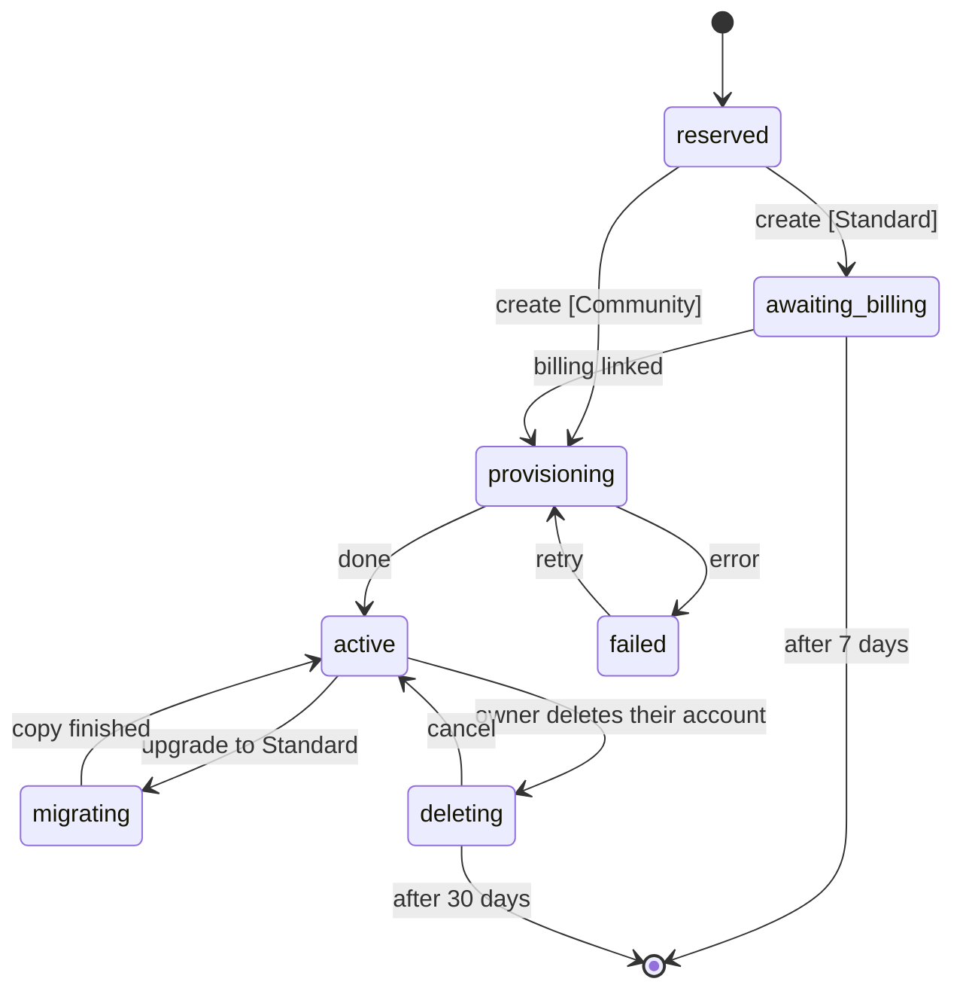

# One app, many partners

MonAmie publishes one app, `org.monamienet.app` ("MonAmie"). Each partner (a client organization) keeps its own Firebase project, its own data and its own bill. The app learns which partner a user belongs to **after** the user signs in, and only then shows the partner's name, colors and logo.

This guide explains how that works, what MonAmie sets up once, and how to onboard a partner without releasing the app. The decisions behind it are in issue #28.

## 1. Partner vs. user

| | Partner | User |
|---|---|---|
| What | a client organization | a person |
| Example | AquariusTur | Maria |
| Owns | branding, Firebase project `monamienet-<id>`, root group `<id>00@monamienet.org` | a Google account |
| Signs in? | no | yes |

A Google account says nothing about a partner. The bridge is the **groups**, in three levels, with everyone a plain `MEMBER`:

- `<id>00@monamienet.org`, the **root group**: its members are the partner's **administrators**, who watch every team and manage the partner (the owner, who created it, is the first);
- `<id>01@` … `<id>99@`, one per **team**: holds the team's name, no direct members;
- `<id>NNr@` (**watch** the team's map) and `<id>NNw@` (**share** one's own location in the team), the two leaves of each team. Being in both is "both".

Adding a person's e-mail to a leaf (or to the root) is what makes them a user of that partner; what they can do comes from which group it is. A group address splits by `^([a-z]+)(\d{2})([rw])?$`, which works because partner ids are lowercase letters only: `aquariustur01w@monamienet.org` → partner `aquariustur`, team `01`, share.

## 2. What happens when a user signs in

1. **Google sign-in** to the central project `monamienet-app`. The screen is MonAmie-branded: no partner is known yet.
2. **`resolvePartners`** (central function) asks the groups gateway for the user's groups, turns the names into partner ids, keeps the ones whose status in the central registry `partners/{id}` is not `reserved`, and returns each one's status and, for the ones it can bind, its Firebase options. The app enters only `active` partners (section 7).
3. The app reads each partner's **`partners/<id>/config/branding`** (public). With no partner the user lands on *Sem organização*, still signed in to MonAmie, where they can create their organization or check again after being invited; with one or more, *Escolher organização* shows each partner's name and logo, below any pending invites. These screens are MonAmie's own ("Encontro" identity: navy, cream, coral); the partner's brand only appears once the user is known to belong to it.
4. **Binding:** the partner's Firebase project (a named Firebase app `partner-<id>`), its root group and its branding are bound together. The app signs in to the partner project with the same Google ID token (the partner allows the central web client) and runs the partner's `syncClaims`, which decides what the user may see, exactly as before.
5. **Remembering:** the binding is saved on the device. Next launches open directly in the partner's brand, without the central project.

The app **forgets** the partner on sign-out (back to the login), on *Trocar de organização* (sign-out, then the account chooser and the picker), and when the user lost access: a group refresh finds no group of the partner anymore, or `syncClaims` returns no capability. Losing access, at sign-in or later, always ends on *Sem organização* with a message naming the partner, never on the login with a generic error (#78). `resolvePartners` caches each user's groups for only 60 seconds, so a removed user is routed to the partner for at most a minute, and even then gets no capability.

The launcher icon, the app name on the home screen, the Play listing and the native splash are always MonAmie: Android reads them from the installed package. The two names are never shown side by side: MonAmie's own screens say "MonAmie", and once a partner is bound the app shows only the partner's name ("AquariusTur", never "MonAmie AquariusTur").

## 3. Where each value lives

| Kind | Examples | Where |
|---|---|---|
| Partner's choice | name (required), catalog theme, logo (optional) | `partners/<id>/config/branding` in the partner's project (section 9) |
| MonAmie's choice | partner status (section 7) | `partners/{id}` in `monamienet-app` |
| MonAmie's choice | theme catalog (section 8) | `themes/{id}` in `monamienet-app` |
| Derived by rule | `monamienet-<id>`, `<id>00@monamienet.org`, id from a group name | code |
| Fetched at build time | central `google-services.json` | `android/app/google-services.json` (gitignored) |
| Fetched at runtime | partner's Firebase options | `resolvePartners`, then the device |

Branding is a **name**, a **theme** from the catalog (section 8) and, optionally, **one logo**: a square 512 px PNG at `partners/<id>/logo.png` in the partner's Cloud Storage (public read; written only by an administrator, `image/png` up to 1 MB). Administrators change all three in the app, *Aparência*: the device converts any picked file (SVG, PNG, JPEG, WebP, HEIC where Android decodes it) to that PNG, so an SVG is never stored; the `setBranding` function checks the theme against the active catalog and bumps `logoVersion`, which tells devices to fetch the new logo. Fallbacks: no or unknown theme → Grafite; no logo, or one that does not decode → the name's initial in a tile of the theme's color; no name → the id capitalized. The resolved colors and the logo are stored with the binding, so the first screen is branded without network; changes reach each device on its next launch.

## 4. One-time setup of the central project (maintainer)

Done for `monamienet-app` on 2026-10-21; the log is in issue #65. Kept here to rebuild it if ever needed.

1. Create the project and link billing:
   ```sh
   gcloud projects create monamienet-app --organization=<org id> --name="MonAmie"
   gcloud billing projects link monamienet-app --billing-account=<account>
   firebase projects:addfirebase monamienet-app
   ```
   A billing account can only hold a few projects; "Cloud billing quota exceeded" means unlinking one or asking Google for more. The id `app` is reserved: no partner can use it.
2. Enable the APIs and create Firestore in `us-central1`, the region of every function of this app (it only holds `partners/{id}`, no personal data):
   ```sh
   gcloud services enable firestore.googleapis.com identitytoolkit.googleapis.com cloudfunctions.googleapis.com \
     cloudbuild.googleapis.com artifactregistry.googleapis.com run.googleapis.com eventarc.googleapis.com \
     firebase.googleapis.com cloudidentity.googleapis.com --project=monamienet-app
   gcloud firestore databases create --location=us-central1 --project=monamienet-app
   ```
3. Register the Android app `org.monamienet.app` and one web app (`firebase apps:create`), and add the SHA-1s of the debug key, the upload key and, after the first Play upload, Play App Signing (`firebase apps:android:sha:create`; see `publish-internal-testing.md`, steps C1–C3 and C8).
4. Console → Authentication → enable **Google** (public name "MonAmie"). Firebase creates the web OAuth client and already authorizes `localhost`, `localhost:5000` and the `firebaseapp.com` domain; add only a custom hosting domain.
5. The organization gives default service accounts **no roles** (policy `iam.automaticIamGrantsForDefaultServiceAccounts`). Grant the function's account (`<project number>-compute@developer.gserviceaccount.com`) `roles/cloudbuild.builds.builder`, `roles/datastore.user` and `roles/logging.logWriter` on `monamienet-app`, and the custom role `firebaseAppConfigReader` on **each partner project only** (onboarding step 8).
6. Create the service account of `expirePartners` and enable Cloud Scheduler (section 7):
   ```sh
   gcloud services enable cloudscheduler.googleapis.com cloudresourcemanager.googleapis.com --project=monamienet-app
   gcloud iam service-accounts create partner-expirer --project=monamienet-app --display-name="Partner expirer"
   gcloud projects add-iam-policy-binding monamienet-app --role=roles/datastore.user \
     --member=serviceAccount:partner-expirer@monamienet-app.iam.gserviceaccount.com
   ```
   Deploy (answer **1** day to the container image cleanup question on the first deploy), then seed the theme catalog (section 8):
   ```sh
   (cd central/functions && npm ci)
   (cd central && firebase deploy --project monamienet-app --only functions,firestore)
   dart run tool/partner.dart themes
   ```
7. CI: bind `firebaseAppConfigReader` for `wlif-monamie-app-config@ci-cd-management.iam.gserviceaccount.com` on `monamienet-app`. Remove its binding from `monamienet-aquariustur` **only after** PR #74 is merged: until then, `main` still builds the old app from that project.
8. Play Console: create the app `org.monamienet.app`, upload the first bundle manually (`--build-number=100`), fill in Data safety and the **background location** declaration, and give the publisher service account access. Then unpublish `org.monamienet.aquariustur`.
9. Check that the groups gateway accepts Firebase ID tokens from `monamienet-app` (see issue #72).

## 5. Onboarding a partner (no app release)

Steps 1–9 cover the three required things: project, root group and name. Step 10 is the gate.

**Partner's Firebase project**
1. Create `monamienet-<id>` on the partner's billing account.
2. Enable Firestore and the Google sign-in provider. Under **Allowed client IDs** (console only), add the central web client id: central project → Authentication → Google → Web SDK configuration.
3. Register the Android app `org.monamienet.app` **without a SHA-1** (the package + SHA-1 pair can only have an OAuth client in one project: the central one) and **exactly one** web app. `flutterfire configure` creates one web app per platform (e.g. "windows"); remove the extra ones, or `check`, `activate` and `resolvePartners` fail.
4. Grant the function's account (`<partner project number>-compute@developer.gserviceaccount.com`) `roles/firebaseauth.admin` (`syncClaims` writes custom claims), `roles/datastore.user` (`setBranding` writes the branding), `roles/cloudbuild.builds.builder` and `roles/logging.logWriter`. Enable Cloud Storage (the default bucket holds the logo) and deploy `storage.rules` with the rest.
5. Deploy the rules and `syncClaims` from the repository root (first deploy: answer **1** day to the cleanup question):
   ```sh
   (cd functions && npm ci)
   firebase deploy --project monamienet-<id> --only firestore:rules,storage,functions
   ```

**Groups and access**

6. Create the root group `<id>00@monamienet.org` with the owner (its first administrator), and for each team `<id>NN@` (inside the root) its leaves `<id>NNr@` and `<id>NNw@` (inside the team), with the people in the leaves. Everyone is a `MEMBER`; allow members outside the organization on every group. A partner set up before the three-level model is moved with `dart run tool/partner.dart migrate-groups <id>` (prints the plan; `--apply` runs it).
7. If the groups gateway keeps a list of accepted projects, add `monamienet-<id>`.
8. Grant `firebaseAppConfigReader` to the central function's account on **this project only**.

**Branding and activation**

9. Publish the name and theme (an administrator adds the logo later in the app):
   ```sh
   dart run tool/partner.dart publish <id> --name "<Name>" --theme <themeId>
   ```
   `--theme` is one of the catalog ids (section 8); add `--dry-run` to check first. Publishing again updates the brand on every device's next launch and also removes the fields of the old format (`colors`, `logoSvg`, `iconSvg`).
10. Check and activate (activation runs the same checks and refuses on failure):
    ```sh
    dart run tool/partner.dart check <id>
    dart run tool/partner.dart activate <id>
    ```
    `activate` sets the partner's status to `active` (section 7). It refuses a retired id and a partner in `awaiting_billing`, `migrating` or `deleting`.

The tool uses your `firebase login` and `gcloud auth login` accounts. Reading the root group needs the Google Workspace admin role **Groups Reader** on your account (admin.google.com → Account → Admin roles); being an organization admin in Google Cloud does not cover it, and without it `check` says the group does not exist. The same misleading message appears when `cloudidentity.googleapis.com` is disabled in `monamienet-app`, the project that pays for the tool's group lookups.

## 6. Building and deploying

- **Android:** `flutter build apk` (no `--flavor`). The build fetches the central `google-services.json` when it is missing; `REFRESH_FIREBASE_CONFIG=1` refreshes it.
- **Web:** `dart run tool/partner.dart web` writes `web/central/firebase.json` (central Firebase options and the Google client id), then `flutter build web`. See `run-web-locally.md`.
- **Functions:** CI only ships the app. After a merge that changes `central/`, redeploy the central project (section 4, step 6); after one that changes `functions/` or `firestore.rules`, redeploy **every** partner project (section 5, step 5).

## 7. Partner status

Each partner's entry in the central registry, `partners/{id}` in `monamienet-app`, has one `status` field. Only the central functions change it, through `transitionPartnerStatus` (`central/functions/partner_status.js`), which refuses any transition not drawn below. The one exception is `tool/partner.dart activate`, MonAmieNet's manual path: it sets `active` on a partner with no status yet, or in `provisioning`, `failed` or `active`.



| `status` | Meaning | The app shows |
| :--- | :--- | :--- |
| `reserved` | id reserved, creation starting (seconds) | nothing yet (`resolvePartners` leaves it out) |
| `awaiting_billing` | Standard only: project created, waiting for the partner to link billing | *Ativar faturamento* |
| `provisioning` | setting up Firestore, rules, functions and groups | *Ativar faturamento*, progress part |
| `active` | working | the map |
| `migrating` | Community → Standard copy in progress | the map, read-only; sharing paused |
| `failed` | a provisioning step failed after retries; MonAmieNet is alerted | *Falha na criação* |
| `deleting` | the owner deleted their account; `deleteAt` = request + 30 days | *Em exclusão* |

**The end is a deleted document, not a status.** Entering `awaiting_billing` or `deleting` sets `deleteAt` (7 or 30 days later); leaving them removes it. Every day at 03:00 (São Paulo) the scheduled function `expirePartners` takes the partners whose `deleteAt` has passed, deletes their Google Cloud project, deletes `partners/{id}` and writes `retiredPartnerIds/{id}` with only `retiredAt`. A deleted project's id can never be reused, so a retired id is refused for good: creation checks it at the name step, and `activate` refuses it too. Google keeps a deleted project restorable for up to 30 more days before erasing it.

`expirePartners` runs as its own service account, `partner-expirer@monamienet-app.iam.gserviceaccount.com`, with `roles/datastore.user` on `monamienet-app`. It can only delete projects where it holds `roles/resourcemanager.projectDeleter`, granted by the in-app creation on the projects it creates. Never grant it on a partner onboarded by hand: those are not meant to expire.

### Migrating from the `active` flag (one-off)

Registries written before the lifecycle have `active: true` and no `status`. After deploying `central/` with this change, run `activate` for every partner listed in `partners/` (Firebase console → `monamienet-app` → Firestore): it runs the checks and rewrites the entry as `status: "active"`, removing `active`. Until then the partner is hidden from sign-in, so run both back to back.

## 8. Theme catalog

Partners pick one of a fixed set of themes, never free colors. The catalog lives in the central project, `themes/{id}`, so MonAmieNet can adjust a tone without an app release:

| id | name | primary | dark | light |
| :--- | :--- | :--- | :--- | :--- |
| `oceano` | Oceano | `#315399` | `#131A34` | `#D4DBE9` |
| `turquesa` | Turquesa | `#0B7F7B` | `#093A3E` | `#CDF0EF` |
| `floresta` | Floresta | `#2F7347` | `#163123` | `#D6E7DC` |
| `oliva` | Oliva | `#5E6B1F` | `#2B3512` | `#E6EAD3` |
| `ambar` | Âmbar | `#9A5B00` | `#433104` | `#F3E2CA` |
| `petroleo` | Petróleo | `#1F6A85` | `#102837` | `#D2E5EB` |
| `ameixa` | Ameixa | `#74408F` | `#2A1730` | `#E1D7E6` |
| `grafite` | Grafite | `#3F4754` | `#1F2128` | `#DCDEE2` |

- Each document also has `onPrimary` and `onDark` (white for all eight: every theme passes WCAG AA for white text on `primary` and `dark`, and for `dark` text on `light`), `order` (picker position) and `active`.
- **Seeding** is repeatable: `dart run tool/partner.dart themes` (add `--dry-run` to print). The tones live in `tool/src/themes_command.dart`; change them there and seed again.
- **Retiring** a theme: set `active: false` (in the tool too, or the next seed revives it). It disappears from the picker but still resolves for the partners that use it; never delete a theme document.
- **Unknown or missing `themeId`**: the app uses Grafite and never blocks. The resolved colors are stored with the binding, so the first screen is branded without network even when the catalog cannot be read.
- **Reading** is public (names and colors only): the app reads it, and the partner functions that save a `themeId` check it against the active themes, because a partner project's rules cannot read the central database.

## 9. Plans and the data layout

| | **Community** (free) | **Standard** |
| :--- | :--- | :--- |
| Firebase project | `monamienet-community`, shared by every Community partner, paid by MonAmieNet | the partner's own `monamienet-<id>`, on the partner's billing account |
| Tracking | at most one position every 15 minutes (*Economia*) | every preset |
| Registry | `partners/{id}.plan = "community"` | `plan = "standard"` (or no `plan`, for entries made before plans) |

**One layout for both.** Every partner keeps its data under `partners/{partnerId}/` of its project:

```
partners/{partnerId}/config/branding      public: name and look
partners/{partnerId}/config/plan          Community only: {minIntervalMinutes: 15}
partners/{partnerId}/config/tracking      administrators' choice: {intervalMinutes, distanceMeters}; default 15 min, 100 m (Economia)
partners/{partnerId}/usuarios/{email}     live position (positionAt = server time of the last position)
partners/{partnerId}/usuarios/{email}/historico_posicoes/{pointId}
partners/{partnerId}/usuarios/{email}/dias/{yyyy-mm-dd}  one summary per day with trails (history calendar dots)
partners/{partnerId}/users/{uid}          Google profile (name, avatar)
```

- **Rules** scope every path by partner. A person needs the claim `partners` to contain the partner (set by `syncClaims` from their groups) to read profiles or write anything; positions also need `watch`/`share` in a team **of that partner**. In the Community project `syncClaims` only counts the partners whose `partners/{id}/config/branding` exists there.
- **Community interval, enforced by the rules**: a new position must carry `positionAt == request.time` and come at least `minIntervalMinutes` after the previous one; a trail point is only accepted in the same batch as the position it records (`getAfter`). The app reads the same value and does not try sooner.
- **`resolvePartners`** returns the Community project's Firebase options for Community partners (each still gets its own named app `partner-<id>` on the device).
- **Expiry** (section 7) deletes a Community partner's `partners/{id}/**` in the shared project instead of a project; the `partner-expirer` account needs `roles/datastore.user` on `monamienet-community`.

**Moving an existing Standard partner to the layout** (one-off, per project): deploy the new rules and functions, then

```sh
dart run tool/partner.dart migrate-layout <id>          # counts
dart run tool/partner.dart migrate-layout <id> --apply  # copies to partners/<id>/
```

The copy keeps every field and type. The old root documents stay; delete them by hand once every device runs the new app (old versions still read the root).

**Setting up `monamienet-community`** (once): create the project on MonAmieNet's billing account (it needs a free slot on that account), add Firebase, Firestore in `southamerica-east1`, the Google provider with the central web client in *Allowed client IDs*, the Android app `org.monamienet.app` without a SHA-1 and exactly one web app, the same IAM as a partner project (section 5, steps 4 and 8) plus `roles/datastore.user` for `partner-expirer@monamienet-app.iam.gserviceaccount.com`, then deploy `firestore.rules` and `functions/` to it. Add a **budget alert**: the free Firestore quota (50,000 reads and 20,000 writes a day) is shared by every Community partner.

## 10. Teams and invites (from the app)

Administrators (*administradores*) manage teams and invites in the app (*Equipes*, *Criar equipe*, *Equipe*, *Convidar pessoas*). The work happens in the central project's functions, never on the device:

- **Who may call them**: only the partner's administrators, the direct members of its root group `<id>00@` (checked with a Cloud Identity membership lookup), while its registry entry `partners/{id}` is `active`. `ownerEmail` (the owner, *titular*) grants nothing here. Each call only touches that partner's groups.
- **Identity**: `groups-admin@monamienet-app.iam.gserviceaccount.com`, with the Workspace admin role **Groups Administrator** assigned to the service account itself (admin.google.com → Account → Admin roles → Groups Administrator → Assign service accounts), **without** domain-wide delegation; `roles/datastore.user` on `monamienet-app` (it reads the registry and writes invites). That role can change every group of monamienet.org, which is why the functions refuse any group outside the caller's partner.
- **Teams**: creating one picks the next free number (01–99), creates `<id>NN` (the team name is its display name) inside `<id>00`, then `<id>NNr` and `<id>NNw` inside it, each allowing external members and with member moderation off (Groups Settings API); if a step fails, what was created is deleted. Renaming changes only the display name. Deleting removes the two leaves and the team, after showing who loses access (people in no other team; never an administrator), and then cancels the team's pending invites, because the next team created reuses the number. `acceptInvite` also refuses an invite sent before its team group's `createTime` (Cloud Identity), so an invite left over from a deleted team can never join the new one.
- **Team names on the map**: the team menu asks `teamNames` (same identity), the one team function open to everyone in the partner, not only administrators. It reads the caller's direct groups from the gateway (cached 60 seconds, like `resolvePartners`) and returns the display name of each team group `<id>NN@` they see: every team for an administrator, otherwise the teams of their leaves. The gateway cannot give these names (its member resources carry none, and a person is never a direct member of a team group), and the leaves' names go stale after a rename. The app asks on every groups load, so a rename shows on the next start or refresh; when the call fails, the menu shows "Equipe NN" (#117).
- **Invites**: `invites/{id}` in the central project (an invited person has no group yet, so their partner project cannot hold it): `{partnerId, team, email, roles, invitedBy, expiresAt, status}`. They expire after **14 days** (*Reenviar* starts 14 new days; *Cancelar* voids them). **Membership starts on acceptance**: the person signs in with the invited account, sees the invite on *Sem organização* or, when they already belong to an organization, at the top of *Escolher organização* (also after *Trocar de organização*), taps *Aceitar e entrar*, and only then joins the leaves of their roles; the app then asks `resolvePartners` again without its cache (and retries for a few seconds, since Google's group directory takes a moment to show the new membership), enters the invite's organization without the picker and shows *Boas-vindas* once. Someone already inside an organization only sees a new invite the next time they reach one of those screens.
- **E-mail**: sent through the Gmail API of the Workspace as the mailbox `MAIL_SENDER_SUBJECT`, shown as `MAIL_FROM` (a "send mail as" alias of that mailbox) — both in `central/functions/.env`. The functions sign the delegation JWT through the IAM Credentials API as `mail-sender@monamienet-app.iam.gserviceaccount.com` (keyless; `groups-admin@` holds `roles/iam.serviceAccountTokenCreator` on it). In the Admin console, Security → Access and data control → API controls → Domain-wide delegation, the client id of `mail-sender@` must be allowed **only** `https://www.googleapis.com/auth/gmail.send`. Delegation is domain-wide in Workspace; the code only ever uses the configured mailbox. Without it the invite still works (the person sees it on sign-in) and the administrator is told the e-mail did not go out.

## 11. Creating an organization in the app

Anyone signed in can create an organization from *Sem organização* or *Escolher organização*: *Nome* (with the identifier suggested from the name and checked as it is typed: letters only, 3 to 20, free and never retired), *Tema*, *Plano*, *Revisão*. The central function `createPartner` (running as `groups-admin@`) validates everything again, reserves the identifier in the registry (`null → reserved`, which refuses taken and retired ids) and records the creator as `ownerEmail`. The creator becomes the owner (*titular*) and the first member of the root group, so its first administrator (*administrador*): administrators manage teams, invites and appearance. Owner and administrator are separate: powers come only from the root group (Google Groups), and being the owner only means that deleting their account deletes the organization.

- **Community**: `provisioning`, then the root group `<id>00@` with the owner as a plain member (its first administrator), then `partners/<id>/config/branding` and `config/plan` (15-minute minimum) in `monamienet-community`, then `active`; the app enters the new organization at once. The function's account needs `roles/datastore.user` on `monamienet-community`.
- **Standard**: not automated yet. Creating a project in the organization, granting the owner `roles/billing.projectManager`, waiting for billing (Cloud Workflows with the scheduled `getBillingInfo` check) and deploying rules and functions need a provisioning identity that MonAmieNet has not set up. Until then a Standard creation stops as `failed` (step `project`) with the identifier reserved, and MonAmieNet finishes it by hand with sections 5 and 7.
- **Failure**: any failing step leaves `failed` with `failure: {step, message}` in the registry and the error in the function's log; the app shows *Falha na criação* ("MonAmieNet was alerted"), and the identifier stays reserved. Retrying (`failed → provisioning`) is a MonAmieNet action for now.

## 12. Deleting an account

Anyone can delete their account in the app (*Minha conta* → *Excluir conta*). Nothing is erased at once: there are **30 days** to cancel, and the app shows *Em exclusão* (with *Cancelar exclusão*) whenever the person signs in during that time. The central functions do the work:

- **`requestAccountDeletion`** (as `groups-admin@`): removes the person from every team leaf (`<id>NNr`, `<id>NNw`), and from the root group of every partner they administer without owning it, right away, so they leave the maps; records what to restore in `accountDeletions/{email}` (`deleteAt`, `memberships`, `ownedPartners`). The **owner** (*titular*) deletes their organization with the account (it cannot be left without an owner) and confirms by typing its identifier: the partner goes `active → deleting`, so nobody signs in to it any more, and `expirePartners` erases it when its own 30 days end (section 7).
- **`cancelAccountDeletion`**: within the 30 days, rejoins the recorded leaves, brings the owned organizations back to `active` and deletes the record.
- **`eraseAccounts`** (daily, as `partner-expirer@`): for each record past `deleteAt`, deletes the person's data in every partner they belonged to (`partners/<id>/usuarios/<email>` with its trail and day summaries, their `users` profile and their sign-in in that project), then their central sign-in and the record. `partner-expirer@` needs `roles/datastore.user` and `roles/firebaseauth.admin` on each partner project and on `monamienet-community`, and `roles/firebaseauth.admin` on `monamienet-app`.

The public deletion request page required by Google Play (for people without the app installed) belongs to the site, not to this repository.
