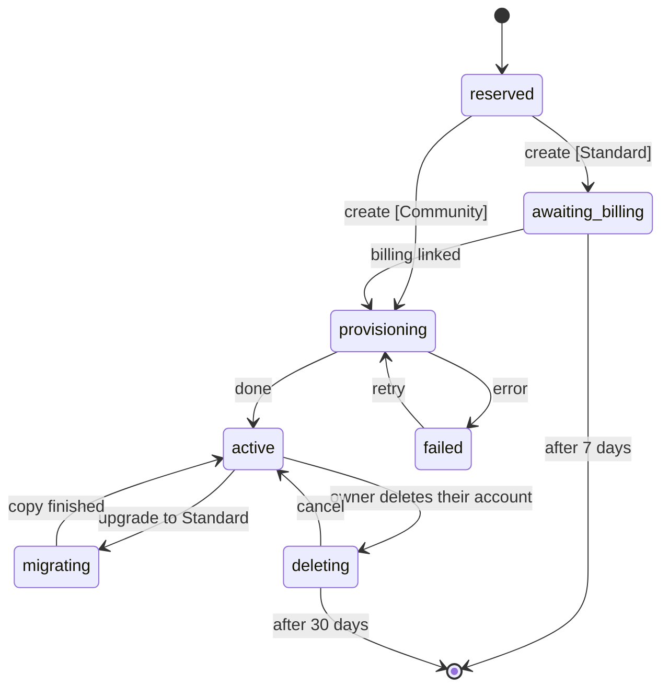

# One app, many partners

MonAmie publishes one app, `org.monamienet.app` ("MonAmie"). Each partner (a client organization) keeps its own Firebase project, its own data and its own bill. The app learns which partner a user belongs to **after** the user signs in, and only then shows the partner's name, colors and logo.

This guide explains how that works, what MonAmie sets up once, and how to onboard a partner without releasing the app. The decisions behind it are in issue #28.

## 1. Partner vs. user

| | Partner | User |
|---|---|---|
| What | a client organization | a person |
| Example | AquariusTur | Maria |
| Owns | branding, Firebase project `monamienet-<id>`, root group `<id>00@monamienet.org` | a Google account |
| Signs in? | no | yes |

A Google account says nothing about a partner. The bridge is the **groups**, in three levels, with everyone a plain `MEMBER`:

- `<id>00@monamienet.org`, the **root group**: only the owner, who watches every team;
- `<id>01@` … `<id>99@`, one per **team**: holds the team's name, no direct members;
- `<id>NNr@` (**watch** the team's map) and `<id>NNw@` (**share** one's own location in the team), the two leaves of each team. Being in both is "both".

Adding a person's e-mail to a leaf (or to the root) is what makes them a user of that partner; what they can do comes from which group it is. A group address splits by `^([a-z]+)(\d{2})([rw])?$`, which works because partner ids are lowercase letters only: `aquariustur01w@monamienet.org` → partner `aquariustur`, team `01`, share.

## 2. What happens when a user signs in

1. **Google sign-in** to the central project `monamienet-app`. The screen is MonAmie-branded: no partner is known yet.
2. **`resolvePartners`** (central function) asks the groups gateway for the user's groups, turns the names into partner ids, keeps the ones whose status in the central registry `partners/{id}` is not `reserved`, and returns each one's status and, for the ones it can bind, its Firebase options. The app enters only `active` partners (section 7).
3. The app reads each partner's **`config/branding`** (public). With no partner the user sees "your account is not linked to any organization"; with one, the app enters it; with several, a picker shows each partner's name and icon.
4. **Binding:** the partner's Firebase project (a named Firebase app `partner-<id>`), its root group and its branding are bound together. The app signs in to the partner project with the same Google ID token (the partner allows the central web client) and runs the partner's `syncClaims`, which decides what the user may see, exactly as before.
5. **Remembering:** the binding is saved on the device. Next launches open directly in the partner's brand, without the central project.

The app **forgets** the partner on sign-out, when a group refresh finds no group of the partner anymore, or when `syncClaims` returns no capability.

The launcher icon, the app name on the home screen, the Play listing and the native splash are always MonAmie: Android reads them from the installed package. The two names are never shown side by side: MonAmie's own screens say "MonAmie", and once a partner is bound the app shows only the partner's name ("AquariusTur", never "MonAmie AquariusTur").

## 3. Where each value lives

| Kind | Examples | Where |
|---|---|---|
| Partner's choice | name (required); colors, logo, icon (optional) | `config/branding` in `monamienet-<id>` |
| MonAmie's choice | partner status (section 7) | `partners/{id}` in `monamienet-app` |
| MonAmie's choice | theme catalog (section 8) | `themes/{id}` in `monamienet-app` |
| Derived by rule | `monamienet-<id>`, `<id>00@monamienet.org`, id from a group name | code |
| Fetched at build time | central `google-services.json` | `android/app/google-services.json` (gitignored) |
| Fetched at runtime | partner's Firebase options | `resolvePartners`, then the device |

Missing optional branding falls back on its own: no primary color → MonAmie blue `#315399`; no background → white; no logo → the name written in the partner's color; no icon → the name's initial in a circle.

## 4. One-time setup of the central project (maintainer)

Done for `monamienet-app` on 2026-10-21; the log is in issue #65. Kept here to rebuild it if ever needed.

1. Create the project and link billing:
   ```sh
   gcloud projects create monamienet-app --organization=<org id> --name="MonAmie"
   gcloud billing projects link monamienet-app --billing-account=<account>
   firebase projects:addfirebase monamienet-app
   ```
   A billing account can only hold a few projects; "Cloud billing quota exceeded" means unlinking one or asking Google for more. The id `app` is reserved: no partner can use it.
2. Enable the APIs and create Firestore in `us-central1`, the region of every function of this app (it only holds `partners/{id}`, no personal data):
   ```sh
   gcloud services enable firestore.googleapis.com identitytoolkit.googleapis.com cloudfunctions.googleapis.com \
     cloudbuild.googleapis.com artifactregistry.googleapis.com run.googleapis.com eventarc.googleapis.com \
     firebase.googleapis.com cloudidentity.googleapis.com --project=monamienet-app
   gcloud firestore databases create --location=us-central1 --project=monamienet-app
   ```
3. Register the Android app `org.monamienet.app` and one web app (`firebase apps:create`), and add the SHA-1s of the debug key, the upload key and, after the first Play upload, Play App Signing (`firebase apps:android:sha:create`; see `publish-internal-testing.md`, steps C1–C3 and C8).
4. Console → Authentication → enable **Google** (public name "MonAmie"). Firebase creates the web OAuth client and already authorizes `localhost`, `localhost:5000` and the `firebaseapp.com` domain; add only a custom hosting domain.
5. The organization gives default service accounts **no roles** (policy `iam.automaticIamGrantsForDefaultServiceAccounts`). Grant the function's account (`<project number>-compute@developer.gserviceaccount.com`) `roles/cloudbuild.builds.builder`, `roles/datastore.user` and `roles/logging.logWriter` on `monamienet-app`, and the custom role `firebaseAppConfigReader` on **each partner project only** (onboarding step 8).
6. Create the service account of `expirePartners` and enable Cloud Scheduler (section 7):
   ```sh
   gcloud services enable cloudscheduler.googleapis.com cloudresourcemanager.googleapis.com --project=monamienet-app
   gcloud iam service-accounts create partner-expirer --project=monamienet-app --display-name="Partner expirer"
   gcloud projects add-iam-policy-binding monamienet-app --role=roles/datastore.user \
     --member=serviceAccount:partner-expirer@monamienet-app.iam.gserviceaccount.com
   ```
   Deploy (answer **1** day to the container image cleanup question on the first deploy), then seed the theme catalog (section 8):
   ```sh
   (cd central/functions && npm ci)
   (cd central && firebase deploy --project monamienet-app --only functions,firestore)
   dart run tool/partner.dart themes
   ```
7. CI: bind `firebaseAppConfigReader` for `wlif-monamie-app-config@ci-cd-management.iam.gserviceaccount.com` on `monamienet-app`. Remove its binding from `monamienet-aquariustur` **only after** PR #74 is merged: until then, `main` still builds the old app from that project.
8. Play Console: create the app `org.monamienet.app`, upload the first bundle manually (`--build-number=100`), fill in Data safety and the **background location** declaration, and give the publisher service account access. Then unpublish `org.monamienet.aquariustur`.
9. Check that the groups gateway accepts Firebase ID tokens from `monamienet-app` (see issue #72).

## 5. Onboarding a partner (no app release)

Steps 1–9 cover the three required things: project, root group and name. Step 10 is the gate.

**Partner's Firebase project**
1. Create `monamienet-<id>` on the partner's billing account.
2. Enable Firestore and the Google sign-in provider. Under **Allowed client IDs** (console only), add the central web client id: central project → Authentication → Google → Web SDK configuration.
3. Register the Android app `org.monamienet.app` **without a SHA-1** (the package + SHA-1 pair can only have an OAuth client in one project: the central one) and **exactly one** web app. `flutterfire configure` creates one web app per platform (e.g. "windows"); remove the extra ones, or `check`, `activate` and `resolvePartners` fail.
4. Grant the function's account (`<partner project number>-compute@developer.gserviceaccount.com`) `roles/firebaseauth.admin` (`syncClaims` writes custom claims), `roles/cloudbuild.builds.builder` and `roles/logging.logWriter`.
5. Deploy the rules and `syncClaims` from the repository root (first deploy: answer **1** day to the cleanup question):
   ```sh
   (cd functions && npm ci)
   firebase deploy --project monamienet-<id> --only firestore:rules,functions
   ```

**Groups and access**

6. Create the root group `<id>00@monamienet.org` with the owner, and for each team `<id>NN@` (inside the root) its leaves `<id>NNr@` and `<id>NNw@` (inside the team), with the people in the leaves. Everyone is a `MEMBER`; allow members outside the organization on every group. A partner set up before the three-level model is moved with `dart run tool/partner.dart migrate-groups <id>` (prints the plan; `--apply` runs it).
7. If the groups gateway keeps a list of accepted projects, add `monamienet-<id>`.
8. Grant `firebaseAppConfigReader` to the central function's account on **this project only**.

**Branding and activation**

9. Download the onboarding submission with `rclone` into a temp folder (see `AGENTS.md`), then publish the branding:
   ```sh
   dart run tool/partner.dart publish <id> --name "<Name>" \
     --primary '#RRGGBB' --secondary '#RRGGBB' \
     --logo <dir>/logo-com-texto.svg --icon <dir>/logo-sem-texto.svg
   ```
   Only `--name` is required; add `--dry-run` to check first. A warning about live `<text>` means the phone may draw the logo's text in another font: ask the partner for a version with the text converted to outlines. Publishing again later updates the brand for every user on their next launch.
10. Check and activate (activation runs the same checks and refuses on failure):
    ```sh
    dart run tool/partner.dart check <id>
    dart run tool/partner.dart activate <id>
    ```
    `activate` sets the partner's status to `active` (section 7). It refuses a retired id and a partner in `awaiting_billing`, `migrating` or `deleting`.

The tool uses your `firebase login` and `gcloud auth login` accounts. Reading the root group needs the Google Workspace admin role **Groups Reader** on your account (admin.google.com → Account → Admin roles); being an organization admin in Google Cloud does not cover it, and without it `check` says the group does not exist. The same misleading message appears when `cloudidentity.googleapis.com` is disabled in `monamienet-app`, the project that pays for the tool's group lookups.

## 6. Building and deploying

- **Android:** `flutter build apk` (no `--flavor`). The build fetches the central `google-services.json` when it is missing; `REFRESH_FIREBASE_CONFIG=1` refreshes it.
- **Web:** `dart run tool/partner.dart web` writes `web/central/firebase.json` (central Firebase options and the Google client id), then `flutter build web`. See `run-web-locally.md`.
- **Functions:** CI only ships the app. After a merge that changes `central/`, redeploy the central project (section 4, step 6); after one that changes `functions/` or `firestore.rules`, redeploy **every** partner project (section 5, step 5).

## 7. Partner status

Each partner's entry in the central registry, `partners/{id}` in `monamienet-app`, has one `status` field. Only the central functions change it, through `transitionPartnerStatus` (`central/functions/partner_status.js`), which refuses any transition not drawn below. The one exception is `tool/partner.dart activate`, MonAmieNet's manual path: it sets `active` on a partner with no status yet, or in `provisioning`, `failed` or `active`.



| `status` | Meaning | The app shows |
| :--- | :--- | :--- |
| `reserved` | id reserved, creation starting (seconds) | nothing yet (`resolvePartners` leaves it out) |
| `awaiting_billing` | Standard only: project created, waiting for the partner to link billing | *Ativar faturamento* |
| `provisioning` | setting up Firestore, rules, functions and groups | *Ativar faturamento*, progress part |
| `active` | working | the map |
| `migrating` | Community → Standard copy in progress | the map, read-only; sharing paused |
| `failed` | a provisioning step failed after retries; MonAmieNet is alerted | *Falha na criação* |
| `deleting` | the owner deleted their account; `deleteAt` = request + 30 days | *Em exclusão* |

**The end is a deleted document, not a status.** Entering `awaiting_billing` or `deleting` sets `deleteAt` (7 or 30 days later); leaving them removes it. Every day at 03:00 (São Paulo) the scheduled function `expirePartners` takes the partners whose `deleteAt` has passed, deletes their Google Cloud project, deletes `partners/{id}` and writes `retiredPartnerIds/{id}` with only `retiredAt`. A deleted project's id can never be reused, so a retired id is refused for good: creation checks it at the name step, and `activate` refuses it too. Google keeps a deleted project restorable for up to 30 more days before erasing it.

`expirePartners` runs as its own service account, `partner-expirer@monamienet-app.iam.gserviceaccount.com`, with `roles/datastore.user` on `monamienet-app`. It can only delete projects where it holds `roles/resourcemanager.projectDeleter`, granted by the in-app creation on the projects it creates. Never grant it on a partner onboarded by hand: those are not meant to expire.

### Migrating from the `active` flag (one-off)

Registries written before the lifecycle have `active: true` and no `status`. After deploying `central/` with this change, run `activate` for every partner listed in `partners/` (Firebase console → `monamienet-app` → Firestore): it runs the checks and rewrites the entry as `status: "active"`, removing `active`. Until then the partner is hidden from sign-in, so run both back to back.

## 8. Theme catalog

Partners pick one of a fixed set of themes, never free colors. The catalog lives in the central project, `themes/{id}`, so MonAmieNet can adjust a tone without an app release:

| id | name | primary | dark | light |
| :--- | :--- | :--- | :--- | :--- |
| `oceano` | Oceano | `#315399` | `#131A34` | `#D4DBE9` |
| `turquesa` | Turquesa | `#0B7F7B` | `#093A3E` | `#CDF0EF` |
| `floresta` | Floresta | `#2F7347` | `#163123` | `#D6E7DC` |
| `oliva` | Oliva | `#5E6B1F` | `#2B3512` | `#E6EAD3` |
| `ambar` | Âmbar | `#9A5B00` | `#433104` | `#F3E2CA` |
| `petroleo` | Petróleo | `#1F6A85` | `#102837` | `#D2E5EB` |
| `ameixa` | Ameixa | `#74408F` | `#2A1730` | `#E1D7E6` |
| `grafite` | Grafite | `#3F4754` | `#1F2128` | `#DCDEE2` |

- Each document also has `onPrimary` and `onDark` (white for all eight: every theme passes WCAG AA for white text on `primary` and `dark`, and for `dark` text on `light`), `order` (picker position) and `active`.
- **Seeding** is repeatable: `dart run tool/partner.dart themes` (add `--dry-run` to print). The tones live in `tool/src/themes_command.dart`; change them there and seed again.
- **Retiring** a theme: set `active: false` (in the tool too, or the next seed revives it). It disappears from the picker but still resolves for the partners that use it; never delete a theme document.
- **Unknown or missing `themeId`**: the app uses Grafite and never blocks. The resolved colors are stored with the binding, so the first screen is branded without network even when the catalog cannot be read.
- **Reading** is public (names and colors only): the app reads it, and the partner functions that save a `themeId` check it against the active themes, because a partner project's rules cannot read the central database.
