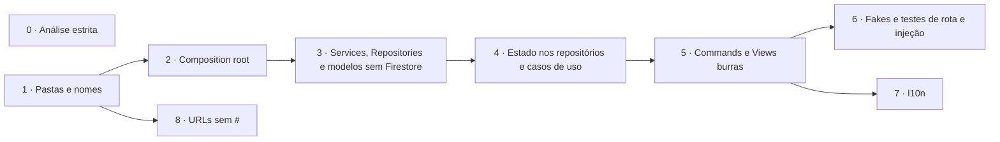

# Plano: alinhar a arquitetura à recomendação oficial do Flutter

Revisão 2 · 2026-11-02 · aprovado pelo João (a revisão 2 troca a A5). Acompanhamento: [#203](https://github.com/monamienet/monamie-app/issues/203), uma sub-issue por fase.

## 1. Objetivo e fontes

**Objetivo:** depois da saída do GetX ([#187](https://github.com/monamienet/monamie-app/issues/187), PR [#202](https://github.com/monamienet/monamie-app/pull/202)), fechar o que ainda separa o app da arquitetura que a Google recomenda para Flutter.

**Fontes:**
- As skills oficiais versionadas em `.agents/skills/` (origem em `skills-lock.json`):
  - `flutter-apply-architecture-best-practices` (camadas, MVVM, Repository + Service, estrutura de pastas);
  - `flutter-setup-declarative-routing`;
  - `dart-run-static-analysis`;
  - `flutter-implement-json-serialization` e `dart-use-pattern-matching`;
  - `flutter-setup-localization`;
  - `dart-add-unit-test`, `dart-generate-test-mocks` e `flutter-add-widget-test`;
  - `retrieving-developer-knowledge`, usada para ler o guia completo.
- O guia oficial: [Guide to app architecture](https://docs.flutter.dev/app-architecture/guide), [Architecture recommendations](https://docs.flutter.dev/app-architecture/recommendations) e o [estudo de caso Compass](https://docs.flutter.dev/app-architecture/case-study).

**Por que o guia, além da skill:** a skill de arquitetura é um resumo de 162 linhas e deixa de fora três recomendações do guia: Commands, repositórios abstratos e fakes nos testes.

**Peso de cada recomendação no guia:**
- *Strongly recommend*: sempre fazer.
- *Recommend*: provavelmente melhora o app.
- *Conditional*: depende do app.

As fases seguem esse peso.

### Vocabulário

| Termo | O que é |
|---|---|
| **View** | O widget da tela. Deve ser "burra": só mostra o estado e repassa os toques. No guia, o arquivo de uma tela se chama `*_screen.dart`. |
| **ViewModel** | A classe com o estado e a lógica de uma tela (hoje, os `*Controller`). |
| **Service** | Classe sem estado que embrulha **uma** fonte externa (Firestore, Cloud Functions, GPS, `permission_handler`…) e devolve `Future`/`Stream`. |
| **Repository** | A fonte da verdade de um tipo de dado (grupos, convites, sessão…): cache, tratamento de erro, conversão para modelos de domínio. Vários ViewModels podem usar o mesmo. |
| **Caso de uso** (*use case*) | Classe opcional entre ViewModel e Repository, para lógica que cruza repositórios. |
| **Command** | Objeto que embrulha uma ação assíncrona e expõe `running`, `error` e `completed`. |
| **Composition root** | O único lugar onde as implementações concretas são criadas e ligadas umas às outras. |

## 2. Ponto de partida (medido em 2026-11-02, `main` em `feed1dd`)

### Já alinhado

| Recomendação oficial | Peso | Onde |
|---|---|---|
| MVVM com `ChangeNotifier` + `ListenableBuilder` | Strongly / Conditional | Todos os controllers e telas |
| Estado imutável com `freezed` | Strongly / Recommend | Arquivos `*_state.dart` |
| Injeção com `provider` só na montagem das rotas | Strongly | `monamie_app.dart`, `organization_scope.dart` |
| `go_router` com `redirect` | Recommend | `app_router.dart`, `session_redirect.dart` |
| `Result` `sealed` | Estudo de caso | `lib/app/utils/result.dart` |
| Testes por camada, espelhando `lib/` | Strongly | 84 arquivos de teste |
| Regra de camadas na CI | Além do guia | `tool/check_layers.dart` |

### Divergências

1. **Dependências concretas como valor padrão** (injeção, *Strongly*).
   - Há 16 construtores no formato `x ?? Concreto()`, por exemplo `tracking_controller.dart:52`.
   - Por isso `auth_google_controller.dart:4-29` importa implementações Firebase e Hive.
   - Um widget cria e chama um backend: `groups_views.dart:628`, com as chamadas em 658, 1418 e 1436.
2. **Sem camada Repository de verdade** (*Strongly*).
   - Os `*Backend` fazem papel de Service e de Repository ao mesmo tempo e lançam exceções que os controllers convertem em `Result`.
   - `FirebaseProvider` (216 linhas) fica em `modules/monamie/data/`.
   - `UserModel` e `LocationPoint` importam `cloud_firestore`.
3. **ViewModels dependem de ViewModels** (no guia, o estado compartilhado pelo app inteiro fica nos repositórios).
   - `TrackingController` (856 linhas) recebe quatro outros controllers.
   - `AuthGoogleController` (726 linhas, cerca de 25 métodos) cuida de login, vínculo com a organização, posse, convites, exclusão de conta e logout.
   - `GroupMapController` age como repositório.
4. **Lógica nos widgets** (*Strongly*).
   - `groups_views.dart`: 1523 linhas, 6 classes, 21 `await` e 8 `setState`.
   - `create_organization_view.dart` (1432 linhas) guarda a etapa do assistente no widget.
5. **Sem Commands** (*Recommend*): cada controller repete `isLoading`, a guarda de reentrada e o `try/finally`.
6. **Pastas e nomes** (*Recommend*).
   - Hoje: `modules/`, `Controller`, `*_view.dart`, `Backend` e uma pasta `widgets/`.
   - Padrão: `ui/`, `ViewModel`, `*_screen.dart`, `Service`/`Repository` e `ui/core/ui/`.
   - Widgets em `config/organization/`; erro de digitação em `color_pallete.dart`.
7. **Análise estática não estrita**: faltam `strict-casts`, `strict-inference` e `strict-raw-types`.
8. **Condicionais:**
   - sem l10n ([#84](https://github.com/monamienet/monamie-app/issues/84));
   - modelos de domínio presos ao Firestore;
   - URLs com `#` no web;
   - lógica que cruza repositórios dentro dos ViewModels.

## 3. Decisões (João, 2026-11-02)

- **A1** Reorganização completa de pastas e nomes, como no app Compass.
- **A2** `Command0`/`Command1` próprios em `lib/utils/command.dart`, sem dependência nova. Substitui a regra manual de ações assíncronas do `AGENTS.md`.
- **A3** mockito para os Services e fakes em memória para os Repositories nos testes de widget. Revê a D5 do [#187](https://github.com/monamienet/monamie-app/issues/187) só para os repositórios.
- **A4** Entram os quatro itens condicionais: l10n, modelos sem Firestore, URLs sem `#` e casos de uso.
- **A5** (revisão 2) Um único PR para as fases 0 a 8, com um ou mais commits por fase, no branch `refactor/architecture-alignment`. As fases seguem sem parada de revisão entre elas; o que for ambíguo é decidido e anotado na seção 7. Antes de pedir o PR: testes, CI e um roteiro no tablet (Galaxy Tab S6 Lite). A revisão 1 previa um PR por fase.

## 4. Como cada fase entra em produção

Todo merge no `main` que toca o app vira uma versão na trilha interna do Play (`AGENTS.md`, *Releases*). Com um PR só, o merge inteiro vira uma versão. Mesmo assim:
- Cada fase (cada commit) precisa terminar com o app funcionando e os testes passando, para que um `git bisect` encontre a fase que quebrou algo.
- As fases 0 a 6 e a 8 são `refactor:`, `ci:`, `test:` ou `docs:`. Elas não exigem notas de versão.
- A fase 7 é `feat:` e reescreve `distribution/whatsnew`; por causa dela, o PR sobe a versão *minor*.

A fase 0 ([#19](https://github.com/monamienet/monamie-app/issues/19), [#20](https://github.com/monamienet/monamie-app/issues/20), [#21](https://github.com/monamienet/monamie-app/issues/21)) e a fase 8 não dependem da cadeia principal.

## 5. Fases

### Fase 0: análise estrita ([#19](https://github.com/monamienet/monamie-app/issues/19), [#20](https://github.com/monamienet/monamie-app/issues/20), [#21](https://github.com/monamienet/monamie-app/issues/21))

- Ligar `strict-casts`, `strict-inference` e `strict-raw-types` no `analysis_options.yaml` e corrigir o que aparecer.
- As três issues continuam sub-issues do [#14](https://github.com/monamienet/monamie-app/issues/14), porque uma issue só tem um pai.

### Fase 1: pastas e nomes ([#205](https://github.com/monamienet/monamie-app/issues/205))

Só renomeações, sem mudar comportamento.

**O que muda:**
- **UI:** `lib/app/modules/<feature>` → `lib/ui/<feature>/{view_models,widgets}`. Os widgets e temas compartilhados vão para `lib/ui/core/{ui,themes}`, incluindo os widgets de `config/organization/`.
- **Dados:** `lib/app/data` → `lib/data/{repositories,services,model}`.
- **Outras pastas:** `lib/domain/models`, `lib/routing` e `lib/utils`.
- **Classes:** `*Controller` → `*ViewModel` e `*View`/`*Page` → `*Screen`.
- **Testes:** `test/` acompanha o novo espelho de `lib/`.

**Precisa mudar no mesmo commit, ou a CI quebra:**
- `tool/src/state_layer_imports.dart:76` reconhece a camada de estado por `_controller.dart`.
- Os 8 imports de `tool/` que apontam para `firestore_paths.dart` e `person_key.dart`.
- O caminho citado em `tool/src/web_central.dart:15`.
- Os caminhos e nomes no `AGENTS.md`.

**Por que renomear tudo agora**, inclusive o que a fase 4 vai dividir: um commit só de nomes é fácil de revisar. Misturar renomeação e remodelação esconderia as mudanças reais.

### Fase 2: composition root ([#206](https://github.com/monamienet/monamie-app/issues/206))

- Criar `lib/config/dependencies.dart`.
- Remover os 16 `?? Concreto()` e tornar os parâmetros obrigatórios.
- Tirar o backend de convites de dentro do widget de grupos.
- Nova regra em `tool/check_layers.dart`: ViewModels e widgets não importam Firebase, `cloud_*`, `geolocator`, `permission_handler`, `flutter_background_service`, Hive nem SharedPreferences.

### Fase 3: Services, Repositories e modelos sem Firestore ([#207](https://github.com/monamienet/monamie-app/issues/207))

- **Services**, um por fonte: Cloud Functions centrais, Firestore da organização, Storage da organização, Google Sign-In, localização, permissões, serviço em segundo plano e armazenamento local.
- **Repositories abstratos** que devolvem `Result`: grupos, convites, administradores, aparência, configurações de rastreamento, posições e trilhas, temas, exclusão de conta. `FirebaseProvider` se divide em Service + Repository.
- **Modelos de domínio:** `lib/domain/models` não importa plugins. A conversão de `Timestamp` e `DocumentSnapshot` vai para os Services, e a regra de camadas verifica isso.
- **Sub-issues:** uma por repositório, criadas no início da fase.

### Fase 4: estado compartilhado nos repositórios e casos de uso ([#208](https://github.com/monamienet/monamie-app/issues/208))

- `SessionRepository` vira o `refreshListenable` do router, como o `AuthRepository` do Compass.
- `AuthGoogleController` se divide em ViewModels por tela.
- `GroupMapController` vira `MembershipRepository`, mantendo os `ValueListenable` (contrato `GroupMapState`).
- O ViewModel de rastreamento passa a ler só repositórios.
- Casos de uso, **só onde a lógica cruza repositórios**. O guia avisa que criar um caso de uso para cada leitura simples só adiciona classes.

| Caso de uso | O que junta |
|---|---|
| `EnterOrganization` | Diretório + vínculo + aparência + checagem de filiação |
| `StartSharing` | Permissões + serviço em segundo plano + configurações de rastreamento |
| `SignOut` | Parar o rastreamento + sessão + autenticação |

### Fase 5: Commands e Views burras ([#209](https://github.com/monamienet/monamie-app/issues/209))

- Escrever `lib/utils/command.dart`, adaptado do Compass, devolvendo o `Result` do projeto.
- Toda ação disparada pelas telas vira um Command.
- A lista de convites do grupo ganha um ViewModel, e `groups_views.dart` se divide em arquivos.
- A etapa do assistente de criação vai para o ViewModel.
- O `AGENTS.md` (*Asynchronous Actions*) passa a descrever os Commands.

### Fase 6: fakes e testes de rota e injeção ([#210](https://github.com/monamienet/monamie-app/issues/210))

- Criar `testing/fakes/` com um fake em memória por repositório. Os fakes só fazem sentido depois da fase 3, quando existem repositórios abstratos para implementar.
- Testes de widget usam fakes; testes de Service continuam com mockito.
- Testar o router real com repositórios falsos.

### Fase 7: internacionalização ([#211](https://github.com/monamienet/monamie-app/issues/211), fecha [#84](https://github.com/monamienet/monamie-app/issues/84))

- `flutter_localizations`, `intl` e `l10n.yaml`, com `app_pt.arb` como arquivo modelo e `app_en.arb`.
- O `Err` passa a levar um tipo de falha `sealed`, e a View escolhe o texto.
- Os textos de `lib/ui/` vão para os ARB.
- `feat:` com notas de versão.

### Fase 8: URLs sem `#` no web ([#212](https://github.com/monamienet/monamie-app/issues/212))

- Chamar `usePathUrlStrategy()`.
- O guia local (`docs/en-us/run-web-locally.md:37` e `:47`) usa `python3 -m http.server` justamente porque as rotas têm `#`.
- Com URLs limpas, recarregar `/monamie` daria 404, porque um app de página única precisa que o servidor devolva o `index.html` para qualquer caminho.
- A fase troca o servidor por um com esse retorno, ainda em `http://localhost:5000`, e atualiza os dois guias de web.
- O `firebase.json` não tem `hosting`, então hoje o ganho é só local.

## 6. Limites desta avaliação

- **Leitura parcial:** a avaliação mediu tamanhos, imports e padrões com `grep` e leu trechos dos arquivos principais, não o `lib/` inteiro. Alguma tela média pode ter lógica que não apareceu.
- **Isolate de segundo plano:** `foreground_service.dart` não foi avaliado a fundo. Ele fica fora do MVVM, e o plano só prevê que use os mesmos Services.
- **Linhas citadas:** referem-se ao `main` em `feed1dd` e mudam a partir da fase 1.
- **Esforço:** ainda não estimado.
- **Fase 8:** não foi verificado se algum teste depende do `#` nas URLs.

## 7. Decisões tomadas durante a implementação

Registro das escolhas feitas sem parada de revisão (A5, revisão 2).

**Fase 1:**
- Os arquivos de ViewModel se chamam `*_view_model.dart` (o Compass usa `*_viewmodel.dart`), para seguir o nome da classe em *snake case*.
- Os `*Backend` foram para `lib/data/repositories/<assunto>/` com o mesmo nome; a fase 3 os divide em Service + Repository.
- `CallController` não guardava estado e só abria o Meet: virou `CallService` em `lib/data/services/`.
- `MonamiePage` virou `HomeScreen`, e a pasta `monamie` virou `home` (mapa) e `history` (calendário).
- `TrackingSettingsController` fica em `lib/data/` com o nome antigo até a fase 4 e leva a marca `// check_layers: state_contract`, para a regra de camadas continuar a valer para ele.
- Os documentos históricos (`migracao-getx.md`, `migracao-grupos-firestore.md` e as seções 2 e 5 deste plano) mantêm os caminhos antigos, porque descrevem o código de quando foram escritos.

**Fase 2:**
- `lib/config/dependencies.dart` cria a camada de dados concreta e a entrega por `provider` acima do roteador, como o `providers` do Compass. A `OrganizationSession` e o leitor de aparência são criados antes, porque o `main` os usa antes de o app rodar.
- O isolate de segundo plano (`foreground_service.dart`) continua sendo a sua própria raiz de composição: não compartilha objetos com a interface.
- `WidgetsBindingAppLifecycleEvents` é criado um por `PermissionsViewModel`, dentro do `OrganizationScope`: ao trocar de organização, o escopo novo começa a ouvir antes de o antigo parar, e um objeto compartilhado perderia o ouvinte.
- O padrão `http.Client()` do leitor de aparência e o `FlutterBackgroundService()` do `FlutterBackgroundServiceTrackingStopper` ficam: são a borda com o plugin, que a fase 3 transforma em Services.
- A regra de camadas que proíbe plugins na UI passa para o fim da fase 3. Hoje três ViewModels ainda usam plugins diretamente (`permission_handler`, `flutter_background_service`, `geolocator`), e os Services que os substituem são da fase 3.
