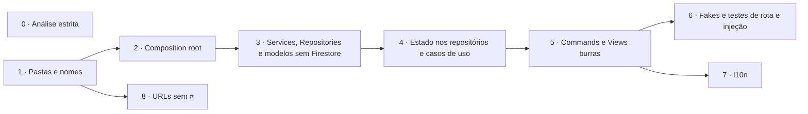

# Plano: alinhar a arquitetura à recomendação oficial do Flutter

Revisão 2 · 2026-11-02 · aprovado pelo João (a revisão 2 troca a A5). Acompanhamento: [#203](https://github.com/monamienet/monamie-app/issues/203), uma sub-issue por fase.

## 1. Objetivo e fontes

**Objetivo:** depois da saída do GetX ([#187](https://github.com/monamienet/monamie-app/issues/187), PR [#202](https://github.com/monamienet/monamie-app/pull/202)), fechar o que ainda separa o app da arquitetura que a Google recomenda para Flutter.

**Fontes:**
- As skills oficiais versionadas em `.agents/skills/` (origem em `skills-lock.json`):
  - `flutter-apply-architecture-best-practices` (camadas, MVVM, Repository + Service, estrutura de pastas);
  - `flutter-setup-declarative-routing`;
  - `dart-run-static-analysis`;
  - `flutter-implement-json-serialization` e `dart-use-pattern-matching`;
  - `flutter-setup-localization`;
  - `dart-add-unit-test`, `dart-generate-test-mocks` e `flutter-add-widget-test`;
  - `retrieving-developer-knowledge`, usada para ler o guia completo.
- O guia oficial: [Guide to app architecture](https://docs.flutter.dev/app-architecture/guide), [Architecture recommendations](https://docs.flutter.dev/app-architecture/recommendations) e o [estudo de caso Compass](https://docs.flutter.dev/app-architecture/case-study).

**Por que o guia, além da skill:** a skill de arquitetura é um resumo de 162 linhas e deixa de fora três recomendações do guia: Commands, repositórios abstratos e fakes nos testes.

**Peso de cada recomendação no guia:**
- *Strongly recommend*: sempre fazer.
- *Recommend*: provavelmente melhora o app.
- *Conditional*: depende do app.

As fases seguem esse peso.

### Vocabulário

| Termo | O que é |
|---|---|
| **View** | O widget da tela. Deve ser "burra": só mostra o estado e repassa os toques. No guia, o arquivo de uma tela se chama `*_screen.dart`. |
| **ViewModel** | A classe com o estado e a lógica de uma tela (hoje, os `*Controller`). |
| **Service** | Classe sem estado que embrulha **uma** fonte externa (Firestore, Cloud Functions, GPS, `permission_handler`…) e devolve `Future`/`Stream`. |
| **Repository** | A fonte da verdade de um tipo de dado (grupos, convites, sessão…): cache, tratamento de erro, conversão para modelos de domínio. Vários ViewModels podem usar o mesmo. |
| **Caso de uso** (*use case*) | Classe opcional entre ViewModel e Repository, para lógica que cruza repositórios. |
| **Command** | Objeto que embrulha uma ação assíncrona e expõe `running`, `error` e `completed`. |
| **Composition root** | O único lugar onde as implementações concretas são criadas e ligadas umas às outras. |

## 2. Ponto de partida (medido em 2026-11-02, `main` em `feed1dd`)

### Já alinhado

| Recomendação oficial | Peso | Onde |
|---|---|---|
| MVVM com `ChangeNotifier` + `ListenableBuilder` | Strongly / Conditional | Todos os controllers e telas |
| Estado imutável com `freezed` | Strongly / Recommend | Arquivos `*_state.dart` |
| Injeção com `provider` só na montagem das rotas | Strongly | `monamie_app.dart`, `organization_scope.dart` |
| `go_router` com `redirect` | Recommend | `app_router.dart`, `session_redirect.dart` |
| `Result` `sealed` | Estudo de caso | `lib/app/utils/result.dart` |
| Testes por camada, espelhando `lib/` | Strongly | 84 arquivos de teste |
| Regra de camadas na CI | Além do guia | `tool/check_layers.dart` |

### Divergências

1. **Dependências concretas como valor padrão** (injeção, *Strongly*).
   - Há 16 construtores no formato `x ?? Concreto()`, por exemplo `tracking_controller.dart:52`.
   - Por isso `auth_google_controller.dart:4-29` importa implementações Firebase e Hive.
   - Um widget cria e chama um backend: `groups_views.dart:628`, com as chamadas em 658, 1418 e 1436.
2. **Sem camada Repository de verdade** (*Strongly*).
   - Os `*Backend` fazem papel de Service e de Repository ao mesmo tempo e lançam exceções que os controllers convertem em `Result`.
   - `FirebaseProvider` (216 linhas) fica em `modules/monamie/data/`.
   - `UserModel` e `LocationPoint` importam `cloud_firestore`.
3. **ViewModels dependem de ViewModels** (no guia, o estado compartilhado pelo app inteiro fica nos repositórios).
   - `TrackingController` (856 linhas) recebe quatro outros controllers.
   - `AuthGoogleController` (726 linhas, cerca de 25 métodos) cuida de login, vínculo com a organização, posse, convites, exclusão de conta e logout.
   - `GroupMapController` age como repositório.
4. **Lógica nos widgets** (*Strongly*).
   - `groups_views.dart`: 1523 linhas, 6 classes, 21 `await` e 8 `setState`.
   - `create_organization_view.dart` (1432 linhas) guarda a etapa do assistente no widget.
5. **Sem Commands** (*Recommend*): cada controller repete `isLoading`, a guarda de reentrada e o `try/finally`.
6. **Pastas e nomes** (*Recommend*).
   - Hoje: `modules/`, `Controller`, `*_view.dart`, `Backend` e uma pasta `widgets/`.
   - Padrão: `ui/`, `ViewModel`, `*_screen.dart`, `Service`/`Repository` e `ui/core/ui/`.
   - Widgets em `config/organization/`; erro de digitação em `color_pallete.dart`.
7. **Análise estática não estrita**: faltam `strict-casts`, `strict-inference` e `strict-raw-types`.
8. **Condicionais:**
   - sem l10n ([#84](https://github.com/monamienet/monamie-app/issues/84));
   - modelos de domínio presos ao Firestore;
   - URLs com `#` no web;
   - lógica que cruza repositórios dentro dos ViewModels.

## 3. Decisões (João, 2026-11-02)

- **A1** Reorganização completa de pastas e nomes, como no app Compass.
- **A2** `Command0`/`Command1` próprios em `lib/utils/command.dart`, sem dependência nova. Substitui a regra manual de ações assíncronas do `AGENTS.md`.
- **A3** mockito para os Services e fakes em memória para os Repositories nos testes de widget. Revê a D5 do [#187](https://github.com/monamienet/monamie-app/issues/187) só para os repositórios.
- **A4** Entram os quatro itens condicionais: l10n, modelos sem Firestore, URLs sem `#` e casos de uso.
- **A5** (revisão 2) Um único PR para as fases 0 a 8, com um ou mais commits por fase, no branch `refactor/architecture-alignment`. As fases seguem sem parada de revisão entre elas; o que for ambíguo é decidido e anotado na seção 7. Antes de pedir o PR: testes, CI e um roteiro no tablet (Galaxy Tab S6 Lite). A revisão 1 previa um PR por fase.

## 4. Como cada fase entra em produção

Todo merge no `main` que toca o app vira uma versão na trilha interna do Play (`AGENTS.md`, *Releases*). Com um PR só, o merge inteiro vira uma versão. Mesmo assim:
- Cada fase (cada commit) precisa terminar com o app funcionando e os testes passando, para que um `git bisect` encontre a fase que quebrou algo.
- As fases 0 a 6 e a 8 são `refactor:`, `ci:`, `test:` ou `docs:`. Elas não exigem notas de versão.
- A fase 7 é `feat:` e reescreve `distribution/whatsnew`; por causa dela, o PR sobe a versão *minor*.

A fase 0 ([#19](https://github.com/monamienet/monamie-app/issues/19), [#20](https://github.com/monamienet/monamie-app/issues/20), [#21](https://github.com/monamienet/monamie-app/issues/21)) e a fase 8 não dependem da cadeia principal.

## 5. Fases

### Fase 0: análise estrita ([#19](https://github.com/monamienet/monamie-app/issues/19), [#20](https://github.com/monamienet/monamie-app/issues/20), [#21](https://github.com/monamienet/monamie-app/issues/21))

- Ligar `strict-casts`, `strict-inference` e `strict-raw-types` no `analysis_options.yaml` e corrigir o que aparecer.
- As três issues continuam sub-issues do [#14](https://github.com/monamienet/monamie-app/issues/14), porque uma issue só tem um pai.

### Fase 1: pastas e nomes ([#205](https://github.com/monamienet/monamie-app/issues/205))

Só renomeações, sem mudar comportamento.

**O que muda:**
- **UI:** `lib/app/modules/<feature>` → `lib/ui/<feature>/{view_models,widgets}`. Os widgets e temas compartilhados vão para `lib/ui/core/{ui,themes}`, incluindo os widgets de `config/organization/`.
- **Dados:** `lib/app/data` → `lib/data/{repositories,services,model}`.
- **Outras pastas:** `lib/domain/models`, `lib/routing` e `lib/utils`.
- **Classes:** `*Controller` → `*ViewModel` e `*View`/`*Page` → `*Screen`.
- **Testes:** `test/` acompanha o novo espelho de `lib/`.

**Precisa mudar no mesmo commit, ou a CI quebra:**
- `tool/src/state_layer_imports.dart:76` reconhece a camada de estado por `_controller.dart`.
- Os 8 imports de `tool/` que apontam para `firestore_paths.dart` e `person_key.dart`.
- O caminho citado em `tool/src/web_central.dart:15`.
- Os caminhos e nomes no `AGENTS.md`.

**Por que renomear tudo agora**, inclusive o que a fase 4 vai dividir: um commit só de nomes é fácil de revisar. Misturar renomeação e remodelação esconderia as mudanças reais.

### Fase 2: composition root ([#206](https://github.com/monamienet/monamie-app/issues/206))

- Criar `lib/config/dependencies.dart`.
- Remover os 16 `?? Concreto()` e tornar os parâmetros obrigatórios.
- Tirar o backend de convites de dentro do widget de grupos.
- Nova regra em `tool/check_layers.dart`: ViewModels e widgets não importam Firebase, `cloud_*`, `geolocator`, `permission_handler`, `flutter_background_service`, Hive nem SharedPreferences.

### Fase 3: Services, Repositories e modelos sem Firestore ([#207](https://github.com/monamienet/monamie-app/issues/207))

- **Services**, um por fonte: Cloud Functions centrais, Firestore da organização, Storage da organização, Google Sign-In, localização, permissões, serviço em segundo plano e armazenamento local.
- **Repositories abstratos** que devolvem `Result`: grupos, convites, administradores, aparência, configurações de rastreamento, posições e trilhas, temas, exclusão de conta. `FirebaseProvider` se divide em Service + Repository.
- **Modelos de domínio:** `lib/domain/models` não importa plugins. A conversão de `Timestamp` e `DocumentSnapshot` vai para os Services, e a regra de camadas verifica isso.
- **Sub-issues:** uma por repositório, criadas no início da fase.

### Fase 4: estado compartilhado nos repositórios e casos de uso ([#208](https://github.com/monamienet/monamie-app/issues/208))

- `SessionRepository` vira o `refreshListenable` do router, como o `AuthRepository` do Compass.
- `AuthGoogleController` se divide em ViewModels por tela.
- `GroupMapController` vira `MembershipRepository`, mantendo os `ValueListenable` (contrato `GroupMapState`).
- O ViewModel de rastreamento passa a ler só repositórios.
- Casos de uso, **só onde a lógica cruza repositórios**. O guia avisa que criar um caso de uso para cada leitura simples só adiciona classes.

| Caso de uso | O que junta |
|---|---|
| `EnterOrganization` | Diretório + vínculo + aparência + checagem de filiação |
| `StartSharing` | Permissões + serviço em segundo plano + configurações de rastreamento |
| `SignOut` | Parar o rastreamento + sessão + autenticação |

### Fase 5: Commands e Views burras ([#209](https://github.com/monamienet/monamie-app/issues/209))

- Escrever `lib/utils/command.dart`, adaptado do Compass, devolvendo o `Result` do projeto.
- Toda ação disparada pelas telas vira um Command.
- A lista de convites do grupo ganha um ViewModel, e `groups_views.dart` se divide em arquivos.
- A etapa do assistente de criação vai para o ViewModel.
- O `AGENTS.md` (*Asynchronous Actions*) passa a descrever os Commands.

### Fase 6: fakes e testes de rota e injeção ([#210](https://github.com/monamienet/monamie-app/issues/210))

- Criar `testing/fakes/` com um fake em memória por repositório. Os fakes só fazem sentido depois da fase 3, quando existem repositórios abstratos para implementar.
- Testes de widget usam fakes; testes de Service continuam com mockito.
- Testar o router real com repositórios falsos.

### Fase 7: internacionalização ([#211](https://github.com/monamienet/monamie-app/issues/211), fecha [#84](https://github.com/monamienet/monamie-app/issues/84))

- `flutter_localizations`, `intl` e `l10n.yaml`, com `app_pt.arb` como arquivo modelo e `app_en.arb`.
- O `Err` passa a levar um tipo de falha `sealed`, e a View escolhe o texto.
- Os textos de `lib/ui/` vão para os ARB.
- `feat:` com notas de versão.

### Fase 8: URLs sem `#` no web ([#212](https://github.com/monamienet/monamie-app/issues/212))

- Chamar `usePathUrlStrategy()`.
- O guia local (`docs/en-us/run-web-locally.md:37` e `:47`) usa `python3 -m http.server` justamente porque as rotas têm `#`.
- Com URLs limpas, recarregar `/monamie` daria 404, porque um app de página única precisa que o servidor devolva o `index.html` para qualquer caminho.
- A fase troca o servidor por um com esse retorno, ainda em `http://localhost:5000`, e atualiza os dois guias de web.
- O `firebase.json` não tem `hosting`, então hoje o ganho é só local.

## 6. Limites desta avaliação

- **Leitura parcial:** a avaliação mediu tamanhos, imports e padrões com `grep` e leu trechos dos arquivos principais, não o `lib/` inteiro. Alguma tela média pode ter lógica que não apareceu.
- **Isolate de segundo plano:** `foreground_service.dart` não foi avaliado a fundo. Ele fica fora do MVVM, e o plano só prevê que use os mesmos Services.
- **Linhas citadas:** referem-se ao `main` em `feed1dd` e mudam a partir da fase 1.
- **Esforço:** ainda não estimado.
- **Fase 8:** não foi verificado se algum teste depende do `#` nas URLs.

## 7. Decisões tomadas durante a implementação

Registro das escolhas feitas sem parada de revisão (A5, revisão 2).

**Fase 1:**
- Os arquivos de ViewModel se chamam `*_view_model.dart` (o Compass usa `*_viewmodel.dart`), para seguir o nome da classe em *snake case*.
- Os `*Backend` foram para `lib/data/repositories/<assunto>/` com o mesmo nome; a fase 3 os divide em Service + Repository.
- `CallController` não guardava estado e só abria o Meet: virou `CallService` em `lib/data/services/`.
- `MonamiePage` virou `HomeScreen`, e a pasta `monamie` virou `home` (mapa) e `history` (calendário).
- `TrackingSettingsController` fica em `lib/data/` com o nome antigo até a fase 4 e leva a marca `// check_layers: state_contract`, para a regra de camadas continuar a valer para ele.
- Os documentos históricos (`migracao-getx.md`, `migracao-grupos-firestore.md` e as seções 2 e 5 deste plano) mantêm os caminhos antigos, porque descrevem o código de quando foram escritos.

**Fase 2:**
- `lib/config/dependencies.dart` cria a camada de dados concreta e a entrega por `provider` acima do roteador, como o `providers` do Compass. A `OrganizationSession` e o leitor de aparência são criados antes, porque o `main` os usa antes de o app rodar.
- O isolate de segundo plano (`foreground_service.dart`) continua sendo a sua própria raiz de composição: não compartilha objetos com a interface.
- `WidgetsBindingAppLifecycleEvents` é criado um por `PermissionsViewModel`, dentro do `OrganizationScope`: ao trocar de organização, o escopo novo começa a ouvir antes de o antigo parar, e um objeto compartilhado perderia o ouvinte.
- O padrão `http.Client()` do leitor de aparência e o `FlutterBackgroundService()` do `FlutterBackgroundServiceTrackingStopper` ficam: são a borda com o plugin, que a fase 3 transforma em Services.
- A regra de camadas que proíbe plugins na UI passa para o fim da fase 3. Hoje três ViewModels ainda usam plugins diretamente (`permission_handler`, `flutter_background_service`, `geolocator`), e os Services que os substituem são da fase 3.

**Fase 3:**
- As seis classes que chamavam funções do servidor (grupos, convites, administradores, aparência, criação e exclusão de conta) viraram um par: o Service (`CentralFunctionsService` ou `OrganizationFunctionsService`, e `OrganizationStorageService` para o logo) faz a chamada e lança `FunctionsFailure`; o Repository devolve `Result` e nunca lança. As mensagens de erro que os ViewModels escreviam para falhas inesperadas foram para os repositórios, com o mesmo texto.
- Duas subclasses de `FunctionsService`, uma por projeto, porque o `provider` encontra cada objeto pelo tipo: assim um repositório não recebe por engano as funções do outro projeto.
- Mudança visível pequena: se a troca de administrador funciona mas a recarga da lista falha por um erro inesperado, a tela diz "Não foi possível carregar os administradores." em vez da mensagem genérica de conexão.
- O `setBranding` passou a declarar 60 s de tempo-limite; é o mesmo padrão do plugin (`cloud_functions_platform_interface`, `HttpsCallableOptions`).
- Os fluxos e futuros do Firestore (`PositionsRepository`, `ThemeRepository`, `TrackingSettingsRepository` e `MembershipService`) continuam lançando exceções em vez de devolver `Result`: as falhas deles só vão para o log dos ViewModels, nunca viram mensagem na tela.
- `FirebaseProvider` virou `PositionsFirestoreService` (consultas e escritas cruas, usado também pelo isolate de segundo plano) mais `PositionsRepository`/`PositionsRepositoryFirestore`, que converte os documentos em `UserModel` e `LocationPoint`. As duas fontes de filiação (`MembershipSource` e `OrganizationMembershipCheck`) viraram um único `MembershipService`, concreto.
- Os nomes dos papéis (`GroupRoles`, `OrganizationRoles`) são vocabulário do domínio: foram para `lib/domain/models/role_names.dart`, e o `firestore_paths.dart` os reexporta, então o `tool/` e a camada de dados não mudam. A leitura das filiações cruas (`capabilitiesFromMemberships`, `rolesOf`, `groupsWithRole`) foi para `membership_service.dart`.
- `TrackingSettings.fromMap` virou `TrackingSettings.validated` (as regras de valores permitidos ficam no domínio); os nomes dos campos guardados (`intervalMinutes`, `distanceMeters`) ficam em `trackingSettingsFromFirestore`/`trackingSettingsToFirestore`, ao lado do repositório.
- A regra `ui_imports_plugin` compara o nome exato do pacote (mais os prefixos `firebase_`, `cloud_` e `hive`): `google_sign_in_web`, que desenha o botão do Google no web, continua permitido em `lib/ui/`.
- `OrganizationConfig.fromBranding`, `OrganizationTheme.fromJson` e os `fromJson` das respostas das funções continuam nos modelos de domínio: leem mapas simples, sem plugin nem `FirestorePaths`.

**Fase 4:**
- Primeira parte (4a): a sessão saiu do ViewModel. `AuthGoogleViewModel` (com `AuthGoogleState`, `SessionFlow` e `SignInActions`) deixou de existir. O `SessionRepository` (`lib/data/repositories/session/`, implementado por `SessionRepositoryGoogle` sobre o `AuthGoogleService`) guarda o `SessionState` que o router ouve, o login no Google do projeto central (o token e o e-mail) e `leaving`, que diz se a pessoa está saindo da organização. Como no Compass, ele é criado na raiz de composição e não depende de outro repositório: quem decide cada transição são os casos de uso e os ViewModels.
- `SessionState` foi para junto do repositório, e cada estado carrega o que a sua tela abre: `noOrganization(reason, invites)`, `picking(choices, invites)`, `deletionPending(deletion)` e `welcome(invite)`. Assim a tela de destino recebe tudo pela sessão, sem um objeto compartilhado entre telas.
- Casos de uso em `lib/domain/use_cases/`, só os dois que cruzam repositórios. `EnterOrganization` junta exclusão pendente, diretório, aparência, vínculo, login no projeto da organização e checagem de filiação. `SignOut` para o rastreamento primeiro e depois encerra a sessão; também cuida de trocar de organização, de perder o acesso e da exclusão da conta. Cada um aceita uma chamada por vez no app inteiro, como fazia o `isLoading`/`isLoggingOut` global do ViewModel antigo.
- A regra `domain_imports_outer` passou a deixar os casos de uso importarem `lib/data/repositories/`, `lib/data/services/` e `lib/data/model/`. O guia põe os casos de uso no domínio, dependendo dos repositórios; `lib/data/model/` entrou porque o `OrganizationBinding` (que tem as `FirebaseOptions`) mora lá. Os modelos de `lib/domain/models/` continuam sem importar outra camada.
- `NoticePresenter` foi de `lib/ui/core/ui/` para `lib/utils/`, porque o `SignOut` mostra o aviso do rastreamento e as falhas das saídas que nenhuma tela espera (perda de acesso, exclusão da conta), e o domínio não importa a UI.
- ViewModels por tela, criados pela rota (`_owned`): `LoginViewModel` (também ouve os logins do botão web, que só aparece no *Login*), `OrganizationChoiceViewModel` (um só para *Sem organização* e *Escolher organização*, que têm os mesmos convites, cabeçalho e entrada), `DeletionPendingViewModel`, `WelcomeViewModel` e `HomeSessionViewModel` (menu do mapa: sair, trocar, posse e a camada "Encerrando sessão…"). O `MyAccountViewModel` recebe o `OrganizationDirectory` e o `SignOut` no lugar das duas funções que vinham do ViewModel antigo.
- A posse (*titular*) virou a extensão `ownsOrganization` do `OrganizationDirectory`. O cache por organização mora no `HomeSessionViewModel` e some com o mapa, em vez de durar até o logout: no máximo uma leitura a mais depois de trocar de organização.
- O tema do app segue a sessão: o `MonAmieApp` o refaz a cada mudança de `SessionState`. A cor da organização passa a entrar junto com o mapa, e não logo depois da checagem de filiação (antes de salvar o perfil). Quem foi removido continua sem ver a marca (#78).
- O parâmetro `alwaysPick` sumiu: todas as chamadas passavam `true`, então o seletor já aparecia mesmo com uma organização só. O caso de uma organização entrar direto continua sendo a restauração da sessão no *Login*.
- `LoginViewModel.logoutGoogle` saiu: nenhuma tela o usava.
- Segunda parte (4b): o estado compartilhado da organização saiu dos ViewModels. Ficam no `OrganizationScope`, antes dos ViewModels, quatro repositórios com escopo de organização e o caso de uso que os junta; cada ViewModel recebe só repositórios e casos de uso, nunca outro ViewModel.
- `GroupMapViewModel` virou `MembershipRepositoryFirestore`, atrás do contrato `MembershipRepository` (que substitui `GroupMapState`, com os mesmos `ValueListenable`), em `lib/data/repositories/membership/`, junto com `map_groups.dart`. O nome do contrato mudou para seguir o par "classe abstrata + implementação" dos outros repositórios. O grupo destacado no mapa (`highlightedObservedUsers`) e o marcador selecionado continuam nele: o repositório os limpa ao trocar de grupo, e mudá-los de lugar separaria essa regra.
- `PermissionsViewModel` virou `PermissionsRepository` (`lib/data/repositories/permissions/`), com o mesmo código: o mapa, o `TrackingViewModel` e o `StartSharing` leem os mesmos estados de permissão. As perguntas no meio dos fluxos continuam passando pelo contrato `PermissionPrompts`, que foi para `lib/utils/` pelo mesmo motivo do `NoticePresenter`.
- O dia observado saiu do `CalendarViewModel` para o `ObservedDayRepository` (`lib/data/repositories/observed_day/`, só em memória, como o `ItineraryConfigRepository` do Compass), porque o calendário o escolhe e o `TrackingViewModel` o segue. O `CalendarViewModel` continua expondo `observedDay`, `isObservingToday`, `goToToday` e `selectDay`, repassando ao repositório.
- `TrackingSettingsController` deixou de existir: o `FirestoreTrackingSettingsRepository` guarda o valor atual em `settings` (`start`/`dispose`) e passou a ser criado pelo `OrganizationScope`, não mais pela raiz de composição. O isolate de segundo plano continua só chamando `watch()`. A marca `// check_layers: state_contract` dele saiu, porque ninguém reage a esse valor: a rota de *Ajustes de acompanhamento* o lê uma vez.
- Caso de uso `StartSharing` (`lib/domain/use_cases/start_sharing.dart`): restrição de bateria (abre as configurações), GPS ligado (avisa), permissão de publicar em algum grupo, primeira posição (5 s) e início do serviço com a notificação, nessa ordem e com as mesmas mensagens. Diferente dos outros dois, é criado pelo `OrganizationScope`, porque lê repositórios da organização. Quem guarda as inscrições do serviço (`ready`, `localPositions`) e marca o compartilhamento como ligado continua sendo o `TrackingViewModel`, que também evita duas chamadas ao mesmo tempo.
- O `TrackingViewModel` lê o perfil salvo no login pelo `UserGoogleRepository` (uma leitura do Hive a mais por organização, além da do `UserViewModel`). O nome publicado ("Nome não informado" quando falta) virou `UserModel.publishedName`, usado pelos dois.
- O `UserViewModel` continua como ViewModel das telas (cabeçalho, menu, lista), agora sobre o `MembershipRepository`.
- A `HomeScreen` recebe `permissions` (`PermissionsRepository`) no lugar de `permissionsCtrl`; o marcador da própria pessoa compara com `userCtrl.user` em vez de `trackingCtrl.userCtrl.user`.
- O arquivo do `TrackingViewModel` não foi dividido: a animação dos marcadores mexe no mesmo mapa que a troca de dia, e separá-los agora mudaria mais código do que esta fase pede.

**Fase 5:**
- Primeira parte (5a): os Commands. `Command0`/`Command1` (`lib/utils/command.dart`) seguem o do Compass, com quatro diferenças: `execute` devolve o `Result` (`null` quando a chamada é ignorada), para a tela mostrar o `Err` logo depois do `await`, como antes; um predicado opcional `blocked`, para os Commands de um mesmo ViewModel que não podem rodar juntos (a regra "uma operação por vez" dos grupos, ou entrar numa organização enquanto um convite é aceito); `Command1.argument`, que diz qual item está rodando (a linha com o indicador de progresso em *Administradores*, o convite sendo aceito); e um `dispose` que silencia o fim de uma ação que termina depois de o ViewModel sumir.
- Os campos de estado que só diziam "em andamento" saíram (`isLoading`, `isWorking`, `isSaving`, `isSending`, `isCreating`, `isDeleting`, `isCheckingOwner`, `cancellingDeletion`, `isChoosingAccount`, `isLoadingThemes`, `workingEmail`, `acceptingInvite`, `isTrackingLoading`). Ficaram os que dizem outra coisa: o `isLoading` do *Login* (a conta já foi escolhida e a organização está sendo procurada, também nos logins do botão web), o `isRestoringSession` (verdadeiro antes de a restauração começar), o `isLoggingOut` (vem da sessão, de qualquer saída) e a etapa `LogoSheet.processing` da folha do logo.
- As mensagens de erro mostradas na própria tela (`errorMessage`, `deletionError`, `inviteError`) continuam no estado, e o Command também devolve o `Err`. Assim uma faixa de erro compartilhada por várias ações (carregar e mudar, nos grupos e em *Administradores*) não muda.
- O `runReportingErrors` aceita o `null` de uma chamada ignorada e não mostra nada. As folhas de confirmação dos grupos e de *Administradores* mostram a mensagem genérica "Não foi possível concluir agora. Tente de novo." nesse caso, como antes quando a operação não rodava.
- O contrato `TrackingToggleViewModel` trocou `isTrackingLoading` e `toggleService()` por um só `Command0<UserNotice?> toggleService`.
- Ações síncronas (`selectDay`, `showMonth`, `finishWelcome`, `centerMapOnCurrentLocation`) e as que o `OrganizationScope` dispara, não uma tela (`UserViewModel.start`), continuam métodos.
- O `_loadingImpact` da tela do grupo virou `deletionImpact.running`.
- Segunda parte (5b): Views burras. As telas só guardam os `TextEditingController`s, o foco e o estado puro da interface (a aba do grupo, a folha do mapa recolhida, a escolha de papéis dentro da folha antes de salvar); o resto foi para os ViewModels, e as telas recebem só ViewModels.
- `groups_screen.dart` se dividiu: `groups_screen.dart` (*Grupos*), `create_group_screen.dart`, `group_screen.dart` (*Grupo*, que guarda o histórico do arquivo antigo, porque era a maior parte), `group_people_tab.dart` (aba *No grupo*, com as folhas de papéis e de remoção), `group_invites_tab.dart` (aba *Convidados*, com as folhas de reenviar e cancelar), `group_list.dart` (o cartão e a linha de pessoa das duas abas) e `open_invite.dart` (`InviteRequest` e `openInvite`). A barra, o botão principal, a folha de confirmação e o aviso curto, que *Administradores* também usa, foram para `lib/ui/core/ui/admin_ui.dart`, com `sheetFailureOf` (a mensagem que a folha mostra, antes repetida nas duas telas).
- A aba de convites ganhou o `GroupInvitesViewModel` (`load`, `resend` e `cancel`), criado pela rota `:groupId` (`_owned`); a `GroupScreen` o recebe no lugar do `invitesRepository`. O "Grupo excluído" saiu do `setState` da tela: o `delete` guarda `GroupsState.deleted` (id, nome e quantos perderam o acesso, contados pelo último `deletionImpact` do mesmo grupo). O "Grupo criado" passou a vir do resultado do `create`, limpo quando *Criar grupo* abre, porque o ViewModel vive mais que a tela. As regras de nome e de papéis das folhas (`canCreate`, `canRename`, `renameProblem`, `tidyName`, `rolesProblem`, `canSetRoles`) foram para o `GroupsViewModel`.
- Pequena diferença: uma falha de reenviar ou cancelar convite com mensagem vazia passa a mostrar a mensagem genérica "Não foi possível concluir agora. Tente de novo." (antes a folha ficava sem texto). O repositório de convites não devolve mensagem vazia hoje.
- *Criar organização*: a etapa (`step`), o aceite dos termos (`acceptedTerms`) e o aviso de identificador ajustado (`idAdjusted`) foram para o `CreateOrganizationState`, com `next`, `back`, `goToStep`, `acceptTerms` e `markIdAdjusted`; a prévia (`preview`) e o que o campo de identificador diz (`idTooShort`, `idShownProblem`) também. Entrar na organização criada virou o Command `enter`, sobre o `EnterOrganization`, e o titular vem do `SessionRepository` (`ownerEmail`): a tela perdeu os parâmetros `ownerEmail` e `onReady`. Ela mesma volta ao seletor quando a sessão para nele (`landedOnPicker`), como fazia a rota. O arquivo se dividiu por etapa (`creation_name_step.dart`, `creation_theme_step.dart`, `creation_plan_step.dart`, `creation_review_step.dart`) mais `creation_ui.dart` (cores, título, botão, rótulo).
- O mapa ganhou o `HomeViewModel`, criado pela rota do mapa: repassa os `ValueListenable` do `MembershipRepository` e do `PermissionsRepository` (os mesmos objetos, então cada widget continua reconstruindo só pelo valor que lê), as ações deles e a chamada pelo Meet (`call`, sobre o `CallService`). A `HomeScreen`, o cabeçalho, o menu, a folha, a lista e o botão de grupos recebem `home` no lugar de `groups`/`groupMap`, `permissions` e `calls`. O `HomeViewModel` não guarda estado nem notifica: é `ChangeNotifier` só para a rota o descartar como os outros.
- Quem aparece no mapa (`markedUsers`), se o próprio marcador já sai com o grupo (`isDrawnWithTheGroup`) e se um marcador fica apagado (`isFaded`) foram para o `TrackingViewModel`, que já lê as filiações; a lista do grupo pergunta ao `HomeViewModel` quem mostrar (`listedMembers`). O `groupRows` e o `presence.dart` continuam em `lib/ui/home/widgets/`: são funções puras de apresentação, já testadas.
- *Aparência*: o `setName` passou a limpar os espaços e ignorar nomes com menos de 2 caracteres, regra que estava no diálogo.

**Fase 6:**
- Os fakes ficam em `testing/fakes/repositories/`, na raiz do projeto, como no Compass: um `Fake<Nome>` por repositório de `lib/data/repositories/` (grupos, convites, administradores, aparência, criação, exclusão de conta, sessão, filiações, posições, temas, ajustes de acompanhamento, diretório, sessão da organização, leitor de aparência, dados locais, vínculo guardado, permissões e perfil do Google). Os testes os importam por caminho relativo (`../../testing/fakes/...`), também como o Compass; o `flutter analyze` já cobre a pasta, e ela não tem código gerado, então o `build.yaml` e o `analysis_options.yaml` não mudaram.
- O que os fakes têm em comum mora no mixin `FakeOutcomes` (`fake_outcomes.dart`): registra cada chamada (`callCount`, `argumentsOf`), falha quando o teste pede (`fail('create', 'mensagem')` devolve esse `Err`, ou lança `FakeFailure` nos repositórios que lançam) e segura a resposta para o teste ver o estado pendente (`hold('create')` devolve um `Completer`). Uma chamada que falha ou ainda está pendente não muda os dados do fake.
- Também ganharam fake as classes concretas que os testes de widget e de rota recebem no lugar de um contrato (`PermissionsRepository`, `UserGoogleRepository`, `OrganizationSession`, `OrganizationBrandingLoader`): o fake as implementa como interface. O `ObservedDayRepository` já é só memória e é usado como está. O `FakeOrganizationSession` muda o `Organization.current` como o real; os testes que entram ou saem por ele o devolvem à organização de teste no `tearDown`.
- O `SessionDouble` (`test/support/session_double.dart`) continua nos testes unitários de ViewModels e casos de uso, que verificam interações com o mockito; os testes de widget e de rota usam o `FakeSessionRepository`.
- Migrados para fakes: os testes de widget de *Minha conta*, *Grupos*, *Administradores*, *Aparência*, *Ajustes de acompanhamento* e *Criar organização*, o `HomeDoubles` do mapa (filiações e permissões), o `router_test.dart` e o `organization_scope_test.dart`. Continuam mocks os Services, os casos de uso (`EnterOrganization`, `SignOut`) e os ViewModels que as telas recebem. Nenhum cenário saiu; só o `verify` do mockito virou `callCount`/`argumentsOf`.
- `TestApp` (`test/support/test_app.dart`) monta o router real com os casos de uso reais sobre os fakes e os mocks dos Services, nos mesmos tipos do `appDependencies`. Fica em `test/support/`, não em `testing/`, porque usa mocks gerados pelo `build_runner`, que só olha `test/`, `lib/` e `tool/`.
- `test/routing/session_flow_test.dart` percorre a sessão como a pessoa: o botão do Google leva a *Sem organização*; "verificar de novo", com duas organizações, ao seletor; escolher uma abre o mapa; e "Sair" no menu volta ao *Login*. Também cobre uma organização só (seletor), conta em exclusão, escolha do Google fechada, *Boas-vindas* e um caminho desconhecido digitado em cada tela da sessão.
- O teste da raiz de composição (`test/config/dependencies_test.dart`) compara os tipos dos providers (`Provider<GroupsRepository>`) em vez de ler os objetos: o `appDependencies` cria cada um na primeira leitura, e criar tocaria Firebase, Hive e plugins, que o teste não tem. A lista de referência é a do `TestApp`, com a qual os testes de rota abrem todas as telas: se uma rota ler um tipo que não está nela, eles falham; se o `appDependencies` não fornecer um tipo dela, este falha.
- `test/testing/` testa os fakes com lógica própria (`FakeOutcomes`, `FakePositionsRepository`, `FakeGroupsRepository`). Total: 2507 testes (27 novos).

**Fase 7:**
- Primeira parte (7a): a configuração e os textos das telas. `flutter_localizations` e `intl` (`^0.20.3`, a versão que o `flutter_localizations` fixa) entraram no `pubspec.yaml`, com `generate: true` e o `l10n.yaml`: `app_pt.arb` é o modelo, `app_en.arb` a tradução, a classe gerada é `AppLocalizations` e `AppLocalizations.of(context)` nunca devolve nulo (`nullable-getter: false`). `required-resource-attributes: true` obriga cada chave a ter a sua entrada `@chave`, com descrição.
- O código gerado (`lib/l10n/app_localizations*.dart`) é versionado, como as classes do freezed e os mocks. O `flutter pub get` do CI e do deploy já o gera de novo, então não versioná-lo também funcionaria no build; mas o passo "Generated files up to date" do PR falharia com arquivos novos não rastreados, e versionado ele mostra no diff do PR o que mudou nas mensagens. O mesmo `flutter pub get` do CI regenera os arquivos antes da checagem, então um ARB alterado sem `flutter gen-l10n` faz o PR falhar. `format: true` deixa os arquivos gerados no formato que o passo "Formatting" exige.
- `MaterialApp.router` (`MonAmieApp`) e o `OrganizationErrorApp` declaram `AppLocalizations.localizationsDelegates` (os do app mais Material, Widgets e Cupertino) e `appSupportedLocales` (`lib/ui/core/app_locales.dart`): português do Brasil primeiro, depois inglês. O Flutter usa a primeira língua da lista quando a do aparelho não existe no app, então um aparelho em espanhol ou em português de Portugal vê o app em português do Brasil.
- Verificado num teste descartável: num aparelho pt-BR o seletor de data fica em português ("novembro de 2026", "Cancelar", D S T Q Q S S, 02/11/2026). A semana começa no **domingo**, não na segunda como diz a #84: é o que o CLDR define para o Brasil (`FIRSTDAYOFWEEK` de `pt` no `intl`), e o calendário do histórico também começa no domingo.
- 332 chaves. As datas usam placeholders `DateTime` com formato do `intl` (`yMMMMd`, `MMMMd`) ou o `MaterialLocalizations` (`formatMonthYear`, `formatCompactDate`, `narrowWeekdays`) no lugar das listas de meses escritas à mão. As contagens usam `plural` do ICU, sempre com `=0{…}` escrito: no português a categoria `one` do CLDR inclui o 0, e sem o caso explícito o `intl` escreveria "1 pessoa" para zero e as variações de frase usam `select` (papel do convite, situação do dia no calendário, nível de bateria). Uma frase com uma parte em negrito continua sendo uma chave só: `spansAround` (`lib/ui/core/ui/rich_message.dart`) divide o texto traduzido onde fica o valor.
- Os nomes que o domínio dava aos seus valores saíram dele: os papéis (`GroupRole.label` e `description`), os perfis de acompanhamento (`TrackingPreset.label`), `peopleLabel`, `groupRolesLabel`, `pendingInvitesLabel`, `rolesLabel` e `statusLabel` do convite, `dayMonth`, `longDate`, `inDays`, `groupDeletionLines` e `deletedGroupText`. Quem os nomeia agora é a extensão `DomainLabels` sobre `AppLocalizations` (`lib/ui/core/ui/domain_labels.dart`). As funções puras de apresentação (`presenceOf`, `agoLabel`, `dayPresence`, `groupRows`, `shareCardState`, `groupChipLabel`, `menuSubtitle`, `sheetFailureOf`, `adminOrganizationName`) recebem o `AppLocalizations`. O `CalendarViewModel` trocou `observedDayFormatted` ("Hoje", "Ontem", dd/MM/aaaa) por `observedRelativeDay`, e a tela escreve o texto. O lema do login saiu do `MonAmieBrand` e foi para o ARB.
- Ficam literais as marcas: "MonAmie", "Google", "Google Meet" e "OpenStreetMap". Os nomes dos planos (Community, Standard) e o crédito "OpenStreetMap contributors" foram para o ARB com o mesmo texto nas duas línguas, para um tradutor poder mudá-los. O botão do Google no web é desenhado pelo próprio Google, na língua do navegador.
- Nova regra `ui_hard_coded_text` no `dart run tool/check_layers.dart` (`tool/src/ui_text_literals.dart`): em arquivo escrito à mão sob `lib/ui/`, fora dos ViewModels e contratos de estado, qualquer literal com letra é apontado, menos em contextos que nunca são texto (diretivas, anotações, `toString`, `assert`, logs, `RegExp`, chaves de widget, `Locale`, `Uri.parse`, caminhos de asset, URLs, `fontFamily`, `heroTag` e afins, comparações com `==`, padrões constantes, chaves de mapa) e menos as marcas. Ela nega por padrão, em vez de olhar só `Text(...)` e argumentos como `title:`, porque metade dos textos chegava às telas por funções próprias (`adminAppBar`, `adminToast`, `creationTitle`, `_section`) que uma lista de nomes não alcançaria. Um literal que não é texto e não cabe em nenhum contexto leva `// check_layers: not_ui_text` (hoje dois: as letras do logotipo e as iniciais de exemplo da prévia do tema).
- Limites da regra: só lê literais, então texto que chega à tela como valor (a mensagem de um ViewModel, um nome vindo do domínio) não é visto; os ViewModels e contratos de estado ficam de fora até a parte 7b; literais sem letras ("·", "…") passam; e uma palavra única em minúsculas sem acento (`'agora'`) também passa, porque é a forma dos identificadores e dos casos de `select` (`'community'`, `'both'`).
- Mudanças de texto: nenhuma frase em pt-BR mudou, nem nos casos de zero ("0 pessoas", "0 grupos", "Enviar convite"). O texto do convite e o "Vale até …" viraram duas chaves, juntadas com um espaço como antes; "Grupo sem nome" e as outras mensagens de fora de `lib/ui/` não mudaram.
- Continuam em pt-BR, fora do ARB, as mensagens montadas por ViewModels, repositórios e casos de uso (`Err`, `UserNotice`, erros guardados nos estados), que a parte 7b transforma em falhas tipadas; e os textos sem `BuildContext` fora de `lib/ui/`: a notificação do serviço em segundo plano (`StartSharing`), "Nome não informado" (`UserModel.noName`, publicado na posição), "Grupo sem nome" (`map_groups.dart`), o "Grupo" padrão do convite e as mensagens do `LogoException`.
- Segunda parte (7b): as falhas viram tipos, e a View escolhe o texto. `Err` passou a ser `Err(Failure failure, {error, stackTrace})`, sem `message` nem `title`. `Failure` (`lib/utils/failure.dart`) é uma classe `sealed` do freezed, com um caso por coisa distinta que pode dar errado e os valores de que o texto precisa: `connection(FailedAction)` ("Não foi possível salvar agora. Verifique a conexão…"), `load(LoadTarget)` ("Não foi possível carregar os grupos."), `serverRefusal(String)`, `unexplainedRefusal(RefusedAction)`, `unexpectedResponse`, `organizationId(OrganizationIdProblem)`, os de nome de grupo, papel, e-mail de convite e logo, os de entrada (`entry(EntryStage, detail)`, `organizationEntry`, `googleAuth`, `googleRenewal`), `signOut`, `accessLost`, `removedFromOrganization`, `sharingNotAllowed` e `sharingNotChanged`. Ela fica em `lib/utils/`, ao lado de `Result`, porque todas as camadas que criam falhas (domínio, dados e UI) podem importar dali.
- `UserNotice` também virou `sealed` (`lib/utils/user_notice.dart`): `waitingForGps`, `trackingAtRisk`, `trackingStopUnconfirmed`, `backgroundStillRestricted` e `failure(Failure)`, este para as falhas que nenhuma tela espera (o login no web, a saída depois de perder o acesso).
- O texto sai de um lugar só: as extensões `FailureText` e `UserNoticeText` (`lib/ui/core/ui/failure_text.dart`), com `message(l10n)` e `title(l10n)`. O título é função do tipo ("Erro de Login" para as falhas de entrada, "Trocar de organização", "Erro ao sair", "Compartilhamento"), como já era na prática: cada mensagem sempre saía com o mesmo título. `showErrorOf`, `showNotice` e o `ScaffoldNoticePresenter` leem o `AppLocalizations` do contexto do próprio `ScaffoldMessenger`, que fica abaixo do `Localizations` do `MaterialApp`; `sheetFailureOf` e os textos de erro das telas usam a mesma extensão.
- Os estados guardam `Failure?` (`null` quando nada falhou) no lugar das strings vazias: `errorMessage` virou `failure`, `sheetError` virou `sheetFailure`, `draftError` virou `draftFailure`, `deletionError` virou `deletionFailure`, `inviteError` virou `inviteFailure`; `idProblem` e `noAccessReason` mantiveram o nome, agora `Failure?`, e `SessionState.noOrganization(reason:)` também. Os validadores do domínio (`groupNameProblem`, `rolesChoiceProblem`, `inviteEmailProblem`) e o `idFormatProblem` devolvem `Failure?`; `LogoException` leva um `Failure`.
- As explicações das Cloud Functions continuam vindo do servidor em pt-BR e aparecem como chegaram, em qualquer língua (`ServerRefusal`): traduzi-las pede que o servidor mande um código, o que fica fora desta fase. O mesmo vale para o motivo que `checkOrganizationId` dá para recusar um identificador.
- Textos sem `BuildContext`: a notificação do serviço em segundo plano vem da tela. `StartSharing.call` recebe um `SharingNotification` (título e texto) e `toggleService` passou a ser `Command1<UserNotice?, SharingNotification>`, que o cartão de compartilhamento monta com o `AppLocalizations`. "Grupo sem nome" e o "Grupo" padrão do convite saíram dos dados: `MapGroup.name` fica vazio e `Invite.groupName` fica `null`, e as telas os nomeiam (`DomainLabels.mapGroupName` e `inviteGroupName`). A prévia de *Criar organização* virou `preview(placeholderName:)`, para a tela dar o "Organização".
- `UserModel.noName` ("Nome não informado") ficou como está: ele não é texto de tela, é o nome que o serviço publica na posição, e os aparelhos dos outros o leem e mostram. Se cada aparelho publicasse na sua língua, o mesmo grupo misturaria "Nome não informado" e "No name"; a versão já instalada também só conhece o texto em pt-BR.
- A regra `ui_hard_coded_text` passou a valer para os ViewModels e estados em `lib/ui/`, e não só para as telas. `startsWith` e `endsWith` entraram nos contextos que nunca são texto (o "monamie " que o nome da organização não pode ter no começo).
- 67 chaves novas no ARB, com o texto em pt-BR exatamente igual ao anterior (conferido por script contra o `HEAD`); "Mínimo 3 letras" reusa a chave que a tela já tinha. Mudanças de comportamento: um grupo de nome vazio agora vai para o começo da lista do mapa, porque a ordenação é feita antes de a tela nomeá-lo (antes ele ficava entre os "G"); os logs de desenvolvimento mostram o tipo da falha em vez da frase.
