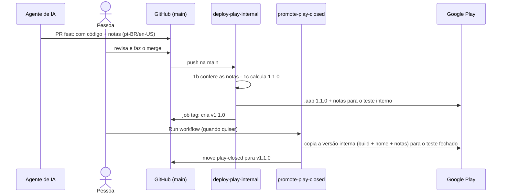

# Entendendo o CI: deploy automático para o teste interno

Este documento explica, para quem nunca trabalhou com CI, como funciona o workflow
[`.github/workflows/deploy-play-internal.yml`](../../.github/workflows/deploy-play-internal.yml).
Ele publica o app na faixa de **teste interno** do Google Play a cada merge na `main` que altera o app.

> **Resumo para explicar a alguém:** a cada merge na `main` que altera o app, o GitHub liga uma máquina limpa, roda os
> testes, gera o `.aab` assinado com a keystore guardada nos secrets e o envia para o teste interno. Para
> falar com o Google Play, ele não usa senha nem chave: troca um token temporário do GitHub por um token
> temporário de uma service account dedicada (Workload Identity Federation).

O passo a passo operacional (configuração, verificação e solução de problemas) está em
[publicar-teste-interno.md](publicar-teste-interno.md). A configuração do CI corresponde aos passos A2 a A6, C4 e C9 a C12.

---

## 1. Conceitos

**CI/CD** (Integração Contínua / Entrega Contínua) é a ideia de que uma máquina, e não uma pessoa,
executa os passos repetitivos de verificar, compilar e publicar o código. Isso acontece sempre que algo
muda no repositório. O que antes era feito à mão no terminal (`flutter build appbundle`) e no navegador
(upload no Play Console) vira uma "receita" que roda sozinha.

No GitHub, essa ferramenta se chama **GitHub Actions**. O vocabulário:

| Termo | O que é | Neste projeto |
| :--- | :--- | :--- |
| **Workflow** | Um arquivo YAML em `.github/workflows/` que descreve *quando* rodar e *o que* fazer. O GitHub detecta o arquivo automaticamente. | `deploy-play-internal.yml` |
| **Trigger** (`on:`) | O evento que dispara o workflow. | um push na `main` que altera arquivos do app, ou o clique manual em "Run workflow" |
| **Runner** | A máquina virtual que o GitHub liga para executar o workflow. Ela começa **vazia**: não tem Flutter, Java, nem os arquivos que estão fora do git. Depois de terminar, ela é destruída. | `ubuntu-latest` (Linux) |
| **Job** | Um grupo de passos que rodam em sequência no mesmo runner. | um único job, `deploy` |
| **Step** | Um passo do job. Pode ser um comando de shell (`run:`) ou uma **action** (`uses:`). | 12 passos |
| **Action** | Um passo pronto e reutilizável, publicado por alguém, como uma "função" que você chama. | `actions/checkout` baixa o código; `subosito/flutter-action` instala o Flutter; `r0adkll/upload-google-play` envia ao Play |
| **Secret** | Um valor sensível guardado criptografado no GitHub. O workflow lê com `${{ secrets.NOME }}`, e o GitHub mascara o valor nos logs (aparece `***`). | a keystore e as senhas dela. A credencial do Play **não** é um secret: a autenticação é sem chave (seção 6) |
| **Environment** | Um "cofre" com nome (Settings → Environments) que agrupa secrets e pode ter regras, como exigir aprovação manual antes de rodar. | `play-internal` |
| **Artifact** | Um arquivo gerado no runner que o GitHub guarda para download depois que o runner é destruído. | **não usamos**: o repositório é público, e qualquer pessoa logada no GitHub poderia baixar builds de teste ainda não lançados. O Play Console já guarda cada versão enviada. |

## 2. O fluxo de ponta a ponta

```
PR aberta ──► PR aprovada ──► "Merge" no GitHub
                                    │
               o merge cria um commit novo na main = evento "push na main"
                                    │
                 o push mexeu em algum arquivo do app? ── não ──► nada roda
                                    │ sim
                                    ▼
             GitHub Actions liga um runner Ubuntu vazio
                                    │
   ┌────────────────────────────────┴─────────────────────────────────┐
   │ 1. baixa o código (com histórico e tags)                          │
   │ 1b. confere as notas   1c. calcula o versionName                  │
   │ 2. instala Java 17                                                │
   │ 3. instala Flutter       4. ajusta a memória do Gradle            │
   │ 5. recria a keystore e o key.properties                           │
   │ 6. baixa dependências    7. roda os testes unitários              │
   │ 8. instala o Firebase CLI                                         │
   │ 9. autentica no Google: conta que só lê a config do Firebase      │
   │ 10. flutter build appbundle (busca o google-services.json,        │
   │     assina, versionCode novo)                                     │
   │ 11. autentica no Google: conta que publica (WIF, sem chave)       │
   │ 12. envia ao Play (faixa internal, com as notas)                  │
   │ 13. (job separado) cria a tag vX.Y.Z                              │
   └────────────────────────────────┬─────────────────────────────────┘
                                    ▼
         Testadores internos recebem a atualização pela Play Store
```

Se **qualquer** passo falhar (um teste quebrado, um secret faltando, erro de compilação), os passos
seguintes não rodam e **nada é enviado ao Play**. O GitHub mostra um ❌ no commit e manda e-mail para quem
fez o push.

**Por que "push na main" e não "PR aceita"?** O GitHub não tem um evento chamado "PR aprovada". O merge
de uma PR sempre gera um push na `main`, e esse é o evento mais simples e confiável de escutar. Uma
consequência: um push feito **direto** na `main`, sem PR, também dispara o deploy. As regras do
[AGENTS.md](../../AGENTS.md) já proíbem pushes diretos.

### Quais mudanças disparam o deploy

Nem todo merge muda o app. Editar um `.md`, uma skill em `.agents/`, as Cloud Functions ou o código do
iOS gera um `.aab` **idêntico** ao anterior. Publicar isso só gastaria minutos de CI e mandaria aos
testadores uma "atualização" vazia. Por isso o trigger tem um filtro `paths`: o workflow só roda se o
push alterar pelo menos um destes caminhos, que são as entradas do build Android:

| Caminho | Por que entra no `.aab` |
| :--- | :--- |
| `lib/**` | o código Dart |
| `android/**` | Gradle, manifest |
| `assets/**` | imagens declaradas no `pubspec.yaml` |
| `tool/**` | a ferramenta dos parceiros: o build roda `tool/partner.dart firebase` para buscar o `google-services.json` (seção 6) |
| `pubspec.yaml`, `pubspec.lock` | dependências e lista de assets |
| `distribution/**` | não entra no `.aab`, mas as notas da versão são enviadas junto com ele (seção 5.1) |
| `.github/scripts/check-release-notes.sh`, `.github/workflows/deploy-play-internal.yml` | o próprio pipeline: se ele muda, precisa rodar para provar que ainda funciona |

O `**` significa "qualquer arquivo, em qualquer subpasta". Num merge de PR, o GitHub considera **todos**
os arquivos que o PR mudou: um PR que mexe no `AGENTS.md` **e** em `lib/` publica normalmente.

**Por que listar o que entra (`paths`) e não o que fica de fora (`paths-ignore`)?** As entradas do build
são poucas e mudam raramente. Já o que **não** entra no app é uma lista grande (docs, skills, outras
plataformas, backend do Firebase) e que cresce a cada ferramenta nova. Uma lista do que fica de fora
precisaria de manutenção constante, e cada esquecimento viraria um build inútil.

O custo dessa escolha é o erro oposto. Se alguém criar uma entrada nova do build fora da lista (um
`l10n.yaml`, uma pasta `fonts/`, um pacote local em `packages/`), mudanças só nela **não** publicam.
Nesse caso:
1. adicione o caminho à lista `paths` do workflow (há um comentário lembrando disso no arquivo);
2. para publicar na hora, use o botão **Run workflow**, que ignora o filtro.

Mudanças só em `test/` também não publicam, porque não alteram o app. Uma consequência: hoje os testes
só rodam dentro do deploy, então um PR que mexe **apenas** em testes não é verificado por nenhum CI.
Rode `flutter test` localmente nesses casos.

## 3. Como ler o arquivo do workflow

### 3.1 O básico de YAML

YAML é só uma forma de escrever dados estruturados, parecida com JSON, mas sem chaves e aspas. As regras:

| Regra | Exemplo | Equivale a (em JSON) |
| :--- | :--- | :--- |
| `chave: valor` define um campo | `name: Deploy` | `{"name": "Deploy"}` |
| **Indentação** (espaços) põe um campo **dentro** de outro | `on:`<br>`  push:` | `{"on": {"push": ...}}` |
| `-` no início da linha é um **item de lista** | `steps:`<br>`  - run: a`<br>`  - run: b` | `{"steps": [{"run":"a"}, {"run":"b"}]}` |
| `[a, b]` é uma lista numa linha só | `branches: [main]` | `{"branches": ["main"]}` |
| `#` começa um comentário (ignorado) | `# explica algo` | — |

Mais duas notações aparecem no arquivo:
- `run: |`: o `|` indica que as linhas indentadas abaixo formam **um texto de várias linhas**, no caso
  um pequeno script de shell.
- `${{ ... }}`: não é YAML, é uma **expressão do GitHub**. Antes de executar, o GitHub troca isso pelo
  valor real. Por exemplo, `${{ secrets.ANDROID_KEY_ALIAS }}` vira o valor desse secret e
  `${{ github.run_number }}` vira o número da execução.

### 3.2 Dicionário das palavras-chave

As palavras à esquerda são **fixas**, definidas pelo GitHub Actions. Os valores à direita são escolhas nossas.

| Palavra-chave | O que faz | Valor no nosso arquivo |
| :--- | :--- | :--- |
| `name` (no topo) | Nome do workflow que aparece na aba Actions. | `Deploy to Play (internal)` |
| `on` | Lista os **eventos** que disparam o workflow. | `push` e `workflow_dispatch` |
| `on.push.branches` | Restringe o evento `push` a certas branches. Um push em outra branch não dispara. | `[main]` |
| `on.push.paths` | Restringe o evento `push` a pushes que alteram certos arquivos. Se nenhum arquivo alterado combinar com a lista, o workflow não roda. | as entradas do build Android (seção 2) |
| `on.workflow_dispatch` | Cria o botão "Run workflow" para disparar à mão. Não precisa de valor e ignora o filtro `paths`. | vazio |
| `concurrency` | Controla execuções **simultâneas** (seção 3.4). | — |
| `jobs` | Lista os jobs. Cada chave dentro dele é o **nome** de um job, à nossa escolha. | um job chamado `deploy` |
| `runs-on` | O sistema operacional do runner. | `ubuntu-latest` |
| `environment` | Qual Environment (cofre de secrets) o job usa. Sem isso, `secrets.X` vem vazio. | `play-internal` |
| `permissions` | O que o token automático do job pode fazer. Tudo o que não for listado fica proibido. | `contents: read` (ler o código) e `id-token: write` (pedir o token OIDC da seção 6) |
| `steps` | A **lista** de passos, executados de cima para baixo. Cada `-` é um passo. | 12 passos |
| `name` (dentro de um step) | Rótulo opcional do passo nos logs. | ex.: `Raise Gradle memory` |
| `id` (dentro de um step) | Um apelido para o passo. Passos seguintes leem as saídas dele com `${{ steps.<id>.outputs.<nome> }}`. | `auth`: o upload lê `steps.auth.outputs.credentials_file_path` |
| `uses` | O passo **chama uma action pronta**, no formato `dono/repositório@versão`. | ex.: `actions/setup-java@v6` |
| `with` | Os **parâmetros** passados à action do `uses` (seção 3.3). | ex.: `java-version: '17'` |
| `run` | O passo **executa comandos de shell**, como num terminal. | ex.: `flutter test test/unit` |
| `env` | **Variáveis de ambiente** disponíveis para os comandos do `run` daquele passo. | as senhas lidas dos secrets |

Um passo usa **ou** `uses` (+ `with`) **ou** `run` (+ `env`, se precisar). Os dois pares têm o mesmo
papel: o que executar e com quais dados.

### 3.3 `with`: os argumentos de uma action

Uma action funciona como uma **função** escrita por outra pessoa. O `uses` diz **qual função** chamar,
e o `with` passa os **argumentos**:

```yaml
- uses: actions/setup-java@v6     # a função: "instalar Java", versão 6 da action
  with:                           # os argumentos:
    distribution: temurin         #   qual distribuição do Java (Temurin, a gratuita da Eclipse)
    java-version: '17'            #   qual versão do Java
```

Em Dart, isso seria algo como `setupJava(distribution: 'temurin', javaVersion: '17')`.

Quais argumentos existem é **cada action que define**, e eles ficam listados no README do repositório
dela. Por exemplo, `track` e `packageName` existem porque a `r0adkll/upload-google-play` os aceita. Para
a `actions/setup-java`, eles não significariam nada. O `'17'` vai entre aspas para o YAML tratar como
texto, e não como número.

### 3.4 `concurrency`: uma fila de execuções

```yaml
concurrency:
  group: play                   # um "nome de fila" qualquer, escolhido por nós
  cancel-in-progress: false     # não interromper quem já está rodando
```

- **`group`** é um rótulo. O GitHub garante que, entre todas as execuções com o **mesmo rótulo**, só
  **uma** roda por vez. As outras esperam na fila. O texto `play` não tem significado especial:
  ele só precisa ser igual entre as execuções que não podem se sobrepor. O workflow de promoção ao teste
  fechado (seção 5.1) usa o mesmo grupo, para nunca mexer no Play no meio de um upload.
- **`cancel-in-progress`** decide o que acontece com a execução **que já está rodando** quando chega
  uma nova:
  - `true`: a que está rodando é **cancelada** e a nova assume o lugar;
  - `false`, a nossa escolha: a que está rodando **termina normalmente**, e a nova espera a vez.
    Cancelar um deploy no meio do upload pode deixar um release pela metade no Play.

Um detalhe do GitHub: a fila guarda no máximo **uma** execução esperando. Se chegarem três merges
seguidos, a do meio é descartada e só a mais nova sobe depois da primeira. Isso não perde nada, porque
a `main` mais nova já contém as mudanças da do meio.

### 3.5 Os passos, um a um

| # | Passo | O que faz e por quê |
| :--- | :--- | :--- |
| 1 | `actions/checkout` | O runner começa vazio; este passo baixa o código do commit que disparou o workflow. Com `fetch-depth: 0`, baixa também o histórico e as tags, que os passos 1b e 1c usam. |
| 1b | `Check release notes` | Confere as notas da versão em `distribution/whatsnew/` (seção 5.1). Roda antes de tudo para falhar rápido: sem notas válidas, nada é compilado nem enviado. |
| 1c | `Compute versionName` | Calcula o versionName a partir dos commits desde a última tag `v…` (seção 5.1). |
| 2 | `actions/setup-java` | O Gradle do Android precisa de Java. O projeto compila para JVM 17 ([build.gradle.kts](../../android/app/build.gradle.kts)). |
| 3 | `subosito/flutter-action` | Instala a **mesma** versão do Flutter usada no desenvolvimento, para o CI não gerar um app diferente. Com `cache: true`, o SDK é reaproveitado e as próximas execuções ficam mais rápidas. |
| 4 | `Raise Gradle memory` | O [android/gradle.properties](../../android/gradle.properties) limita o heap do Gradle a 2 GB (`-Xmx2g`), pensando nos notebooks de 8 GB. O runner tem mais RAM, então o CI aumenta para 4 GB; o `~/.gradle/gradle.properties` tem prioridade sobre o arquivo do projeto, então a mudança vale só no CI. |
| 5 | `Restore release signing` | Recria a keystore e o `android/key.properties`, que não estão no git (seção 4). Antes disso, confere que nenhum secret está vazio. |
| 6 | `flutter pub get` | Baixa as dependências do `pubspec.yaml`. |
| 7 | `flutter test test/unit` | Roda os testes unitários. Se algum falhar, o deploy para aqui. Os testes de integração ficam de fora porque dependem dos emuladores do Firebase. |
| 8 | `Install Firebase CLI` | Instala o `firebase-tools` numa versão fixa. O build usa o CLI para buscar a config do Firebase do projeto central. |
| 9 | `google-github-actions/auth` (`auth-config`) | Troca o token OIDC do GitHub por credenciais temporárias de uma service account que **só lê** a config dos apps do Firebase (seção 6). |
| 10 | `flutter build appbundle` | Gera o `.aab` de release do app único `org.monamienet.app`, assinado com a keystore do passo 5, com o versionName do passo 1c e com um versionCode novo (seção 5). Antes de compilar, o Gradle busca o `google-services.json` do projeto central com as credenciais do passo 9. Os parceiros são ligados em tempo de execução, então nenhum parceiro é escolhido aqui. |
| 11 | `google-github-actions/auth` (`auth`) | Troca o token OIDC do GitHub por credenciais temporárias da service account que publica, sem chave (seção 6). |
| 12 | `r0adkll/upload-google-play` | Envia o `.aab` para a faixa `internal` com as credenciais do passo 11. `status: completed` lança o release direto para os testadores. `whatsNewDirectory` envia as notas da versão, e `releaseName` dá à versão o nome do versionName, que a promoção lê de volta. |
| 13 | job `tag` | Só quando o versionName é novo: cria a tag `vX.Y.Z` no commit. Fica num job separado, o único com permissão de escrever no repositório, para que o código de terceiros que roda no build (Gradle, pacotes pub) nunca tenha essa permissão. |

## 4. Como a keystore chega ao runner (por que base64)

O runner só tem o que está no git, e a keystore e o `key.properties` ficam de fora de propósito: esses
são segredos de verdade. Quem tiver a keystore e as senhas consegue assinar versões do app em nome da
MonAmieNet.

Um secret do GitHub, porém, só guarda **texto**, e a keystore (`.jks`) é um arquivo **binário**. A
solução comum é a **base64**: uma codificação que transforma qualquer arquivo num texto só com letras e
números, e que pode ser desfeita sem perda.

- **Na máquina de quem configura, uma única vez:** `base64 -w0 upload.jks` gera um texto. Esse texto vai
  para o secret `ANDROID_KEYSTORE_B64`.
- **No runner, a cada execução:** `base64 -d` transforma o texto de volta no arquivo `.jks` original.
  Ele é gravado numa pasta temporária (`$RUNNER_TEMP`) que é apagada com o runner.

O `key.properties` não precisa de secret próprio: ele é montado ali mesmo, com as senhas e o alias,
apontando `storeFile` para a keystore recém-decodificada.

### Fail-fast em duas camadas

Um build release **nunca** cai para a chave debug, o que geraria um bundle que o Play rejeita. Há duas
proteções:

1. **No workflow:** o passo 5 diz *qual* secret do GitHub está vazio e para a execução.
2. **No Gradle:** a task `validateReleaseSigning` ([build.gradle.kts](../../android/app/build.gradle.kts))
   roda antes de **qualquer** build release, no CI ou numa máquina local. Ela falha se faltar o
   `key.properties`, alguma propriedade dele ou o arquivo da keystore.

Builds debug (`flutter run`) não são afetados e funcionam sem keystore.

### E o `google_config.dart`?

O [lib/app/config/google_config.dart](../../lib/app/config/google_config.dart) é versionado
normalmente porque seus valores **não são segredos**: o endereço e os caminhos do gateway de grupos. Os
IDs de cliente OAuth não estão mais no código: vêm da config do projeto central, buscada no build. Tudo o que é compilado no app pode ser extraído do binário por qualquer
pessoa. A proteção do gateway é o token Google (`Bearer`) que o app envia em cada requisição.

## 5. Como o versionCode é definido

O Play exige que cada `.aab` enviado tenha um `versionCode` **maior** que todos os anteriores. Antes do
CI, isso era o número depois do `+` no `version:` do `pubspec.yaml`, incrementado à mão.

O GitHub dá a cada execução de um workflow um contador, `GITHUB_RUN_NUMBER` (1, 2, 3...), que **só
cresce**. O flag `--build-number` do `flutter build` substitui o número depois do `+` sem tocar no
pubspec. Assim, a 1ª execução gera versionCode **101**, a 2ª gera **102**, e assim por diante. O `+100`
reserva os números abaixo de 101 para envios manuais, como o primeiro envio de um app.

- O **versionName** (`1.0.0`, o que o usuário vê na loja) também é substituído, por `--build-name`
  (seção 5.1). O `version:` do `pubspec.yaml` só vale para builds locais.
- Execuções que falham também consomem um número. Isso cria "buracos" (101, 103...), o que é normal:
  o Play só exige que o número cresça.
- Pushes barrados pelo filtro `paths` (seção 2) **não** consomem número: o workflow nem chega a rodar.
- ⚠️ **Não renomeie o arquivo do workflow.** O contador pertence ao arquivo. Se ele for renomeado, o
  contador volta a 1 e o upload falha por versionCode repetido.

### 5.1 versionName, notas da versão e teste fechado

O **versionName** (`1.0.0`, o que o usuário vê na loja) é calculado pelo próprio deploy, no passo 1c
([next-version.sh](../../.github/scripts/next-version.sh)), e entra no build com `--build-name`. O
script lê os commits desde a última tag `v…` que mexem no app, que seguem o padrão *Conventional
Commits*:
- `feat:` sobe o número do meio (`1.1.0`);
- `fix:` sobe o último (`1.0.1`);
- o rodapé `Release-As: X.Y.Z` num commit força um número, e é assim que uma pessoa decide uma versão
  maior;
- sem nenhum deles, o nome continua igual.

Depois do envio, o job `tag` marca o commit com `vX.Y.Z`, e essa tag é o ponto de partida do próximo
cálculo. Cada build com novidade vira uma versão, então nome e notas sempre batem.

As **notas da versão** (`distribution/whatsnew/whatsnew-pt-BR` e `whatsnew-en-US`) são escritas pelos
agentes de IA em cada PR com mudança visível (regra em `AGENTS.md`, *Releases*). Elas cobrem tudo
desde a tag `play-closed`, a última versão promovida ao teste fechado. O passo 1b
([check-release-notes.sh](../../.github/scripts/check-release-notes.sh)) confere que elas existem, que
têm até 500 caracteres e que foram atualizadas desde a última tag `v…` se o app mudou. O passo 12 as
envia junto com o `.aab`.

O workflow [promote-play-closed.yml](../../.github/workflows/promote-play-closed.yml) roda só pelo botão
*Run workflow*. Ele copia a versão do teste interno (build, nome e notas) para o teste fechado, sem
recompilar, e move a tag `play-closed` para ela.



## 6. Como o GitHub ganha permissão para publicar no Play (sem chave)

Para publicar, o GitHub precisa se autenticar na API do Play sem usar a conta Google de uma pessoa. A
identidade que a API enxerga é uma **service account**: uma "conta de robô" do Google Cloud. O caminho
mais comum seria gerar uma chave JSON para ela e guardá-la como secret, mas **não usamos chave**: ela não
expira e, se vazar, dá acesso até alguém revogá-la. O Google recomenda evitar chaves sempre que possível.

Usamos **Workload Identity Federation (WIF)**, em que o GitHub troca um "crachá" temporário por um token
do Google, também temporário:

```
 GitHub Actions                          Google Cloud (projeto ci-cd-management)
 ──────────────                          ───────────────────────────────────────
 1. o job, no environment play-internal,
    pede ao GitHub um token OIDC:
    "sou o repo monamienet/monamie-app,
     environment play-internal"  ──────► 2. o provider "github" confere: o token
                                            foi assinado pelo GitHub? veio da
                                            organização de ID 336690459?
                                         3. a service account wlif-monamie-app-play
                                            aceita ser assumida por esse subject?
 4. recebe um token de acesso    ◄────── sim: devolve um token válido por ~1 hora
    da service account
 5. chama a API do Play com ele  ──────► Play Console: essa conta foi convidada e
                                         pode lançar em faixas de teste do app?
```

| Termo | O que é | Neste projeto |
| :--- | :--- | :--- |
| **Token OIDC** | "Crachá" assinado pelo GitHub que descreve o job: repositório, branch, environment. O job só pode pedi-lo com a permissão `id-token: write`. | emitido a cada execução |
| **Workload identity pool** | Agrupa as identidades externas (de fora do Google) aceitas no projeto. | `github-actions` |
| **Provider** | Diz em qual emissor o pool confia e quais tokens aceita, por meio de uma *condição de atributo*. | `github`: só tokens da organização `monamienet` |
| **Subject** | O campo do token que identifica o job. Num job com environment, ele tem a forma `repo:<org>@<id da org>/<repo>@<id do repo>:environment:<nome>`. Os IDs aparecem porque o repositório usa o formato *imutável* do GitHub. | `repo:monamienet@336690459/monamie-app@1407450217:environment:play-internal` |
| **Impersonação** | Assumir temporariamente a identidade de uma service account. Quem pode fazer isso é definido pelo papel `roles/iam.workloadIdentityUser` na própria service account. | só o subject acima |
| **Service account** | A identidade que a API do Play enxerga. As permissões dela ficam no Play Console, não no Google Cloud. | `wlif-monamie-app-play@ci-cd-management.iam.gserviceaccount.com` |

No workflow, isso corresponde a duas mudanças: `permissions: id-token: write` no job e o passo
`google-github-actions/auth`. Esse passo gera um arquivo de credencial temporário, e o caminho dele
(`steps.auth.outputs.credentials_file_path`) é passado para a action de upload.

### Três camadas decidem quem pode publicar

1. **Provider:** só aceita tokens da organização `monamienet`. A condição usa o ID numérico (`336690459`)
   e não o nome, porque o nome de uma organização apagada pode ser registrado por outra pessoa, e o ID
   nunca é reutilizado.
2. **Permissão na service account:** só o subject `repo:monamienet@336690459/monamie-app@1407450217:environment:play-internal`
   pode assumi-la. Outros repositórios da organização, ou jobs sem esse environment, são recusados. Como o
   subject inclui os IDs, um repositório recriado com o mesmo nome também é recusado.
3. **Environment `play-internal`:** o GitHub só deixa jobs da branch `main` usarem esse environment.

O ID do provider e o e-mail da service account ficam escritos no próprio workflow, e isso não é um
problema: sem um token OIDC emitido pelo GitHub para este repositório e environment, eles não servem para nada.

### Por que uma service account dedicada

A `wlif-monamie-app-play` existe só para este pipeline e não tem nenhum papel no Google Cloud. A única
permissão dela é a do Play Console, de lançar em faixas de teste. Isso segue as recomendações oficiais do Google:

- [Best practices for using service accounts in deployment pipelines](https://docs.cloud.google.com/iam/docs/best-practices-for-using-service-accounts-in-deployment-pipelines):
  *"Use dedicated service accounts per deployment pipeline"*, mantendo uma relação 1:1 entre pipelines e
  service accounts, e *"Use Workload Identity Federation whenever possible"*.
- [Best practices for using service accounts](https://docs.cloud.google.com/iam/docs/best-practices-service-accounts):
  *"Create single-purpose service accounts"*. Compartilhar uma conta entre aplicações dificulta saber se
  ela pode ser desativada, faz as permissões crescerem e deixa os logs de auditoria ambíguos. O prefixo
  `wlif-` segue a convenção de nomes do mesmo guia para contas usadas por Workload Identity Federation.
- [Best practices for using Workload Identity Federation](https://docs.cloud.google.com/iam/docs/best-practices-for-using-workload-identity-federation):
  usar condição de atributo com provedores multi-tenant como o GitHub, e atributos que não podem ser reutilizados.

### Duas service accounts: uma lê a config, a outra publica

O build também precisa falar com o Google. O `google-services.json` do app não é versionado: ele contém
chaves de API, e uma cópia no repositório ficaria desatualizada em relação à fonte da verdade, o projeto
do Firebase central (`monamienet-app`). Por isso o Gradle busca o arquivo nesse projeto quando ele não
existe. O workflow se autentica **duas vezes**, com o mesmo provider e o mesmo subject:

| Passo | Service account | O que pode fazer | Quando |
| :--- | :--- | :--- | :--- |
| 9 (`auth-config`) | `wlif-monamie-app-config` | listar os apps do Firebase e ler a config deles (papel customizado `firebaseAppConfigReader`: `firebase.clients.list` e `firebase.clients.get`), só em `monamienet-app`, onde o papel foi vinculado | antes do build |
| 11 (`auth`) | `wlif-monamie-app-play` | lançar em faixas de teste do Play | depois do build |

A ordem importa. O build roda código de terceiros (plugins do Gradle, pacotes do pub), e cada passo tem
acesso às credenciais já criadas no runner. Como a conta que publica só é autenticada depois do build,
esse código nunca tem em mãos a credencial do Play. Com a outra, o máximo que ele consegue é ler configs
que já vão dentro de qualquer APK publicado. O papel predefinido `roles/firebase.viewer` não é usado porque
também lê dados do produto, como o histórico de localização das equipes no Firestore.

O Firebase CLI aceita as credenciais do WIF: sem `firebase login`, ele usa as *Application Default
Credentials* do Google, que o passo de autenticação configura na variável `GOOGLE_APPLICATION_CREDENTIALS`.
O passo 11 sobrescreve essa variável, mas só depois do build.

### Por que esta action de upload

Usamos a `r0adkll/upload-google-play` em vez do **fastlane**, outra ferramenta popular de deploy mobile,
porque ela faz só o upload, não exige instalar Ruby e aceita as credenciais de Workload Identity Federation.
