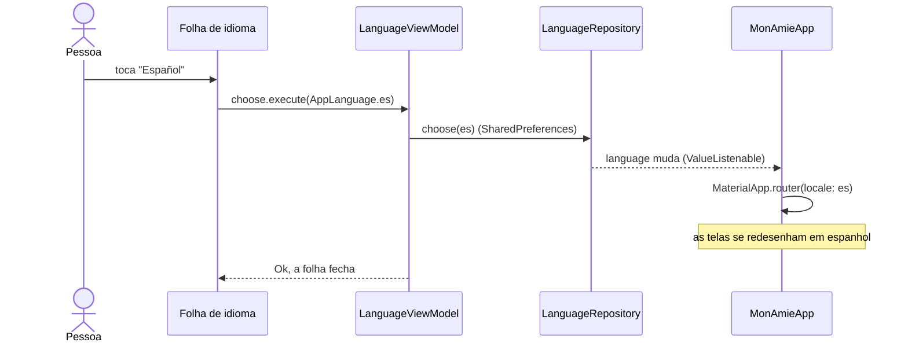

# Plano: o app em português, inglês, espanhol e francês

Revisão 1 · 2026-11-03 · decisões D1–D4 do João. Acompanhamento: [#228](https://github.com/monamienet/monamie-app/issues/228), uma sub-issue por etapa.

## 1. Objetivo

O pedido:
- o app fala **português, inglês, espanhol e francês**;
- por padrão, usa o idioma do dispositivo e, se o app não tiver esse idioma, usa **inglês**;
- a troca de idioma fica num lugar intuitivo;
- a tela é intuitiva, bonita e segue o estilo atual do app.

### Vocabulário

- **Locale**: a combinação de idioma e região que o sistema informa, por exemplo `pt_BR` (português do Brasil) ou `fr_CA` (francês do Canadá).
- **ARB** (*Application Resource Bundle*): um arquivo JSON por idioma com todos os textos do app (`lib/l10n/app_<idioma>.arb`). O `flutter gen-l10n` gera a classe `AppLocalizations` a partir deles.
- **Template**: o ARB de referência. Ele tem todas as chaves e uma descrição de cada uma (`@chave.description`). Aqui o template é o `app_pt.arb`.
- **Fallback** (idioma de reserva): o idioma usado quando o app não tem o idioma do dispositivo. No Flutter, é o **primeiro item** de `supportedLocales`.

## 2. Ponto de partida (`main` em `6e2f54d`, versão `v1.3.0`)

A base de idiomas entrou com [#225](https://github.com/monamienet/monamie-app/pull/225):
- os textos estão em `app_pt.arb` (template) e `app_en.arb`;
- os erros são tipados (`Failure`, `UserNotice`) e só a interface os transforma em texto;
- a regra `ui_hard_coded_text` do `tool/check_layers.dart` recusa texto fixo nas telas.

Por isso, acrescentar um idioma é principalmente acrescentar um ARB.

O que ainda falta:
- **O fallback é o português.** `appSupportedLocales` começa por `pt_BR` (`lib/ui/core/app_locales.dart:12`).
- **Não há como escolher o idioma.** O app segue sempre o dispositivo.
- **O calendário do histórico sempre começa no domingo** (`lib/domain/models/history_month.dart:53`, e `narrowWeekdays`, que o Flutter documenta como sempre começando no domingo). Em espanhol e em francês, a semana começa na segunda-feira.
- **O texto da notificação de compartilhamento é fixado quando o serviço começa** (`initialNotificationTitle` em `background_tracking_service.dart`). Se o idioma mudar enquanto a pessoa compartilha, a notificação continua no idioma antigo.
- **O botão do Google na web segue o idioma do navegador**, e não o do app (`google_button_web.dart`).

## 3. Decisões

Do João (2026-11-03):
- **D1 Onde trocar.** No **menu lateral**: um item *Idioma* abaixo de *Trocar de organização*, com o idioma atual à direita. E num **botão de globo** nas telas do MonAmie anteriores à organização (Login, Sem organização, Escolher organização), para que quem não lê o idioma do dispositivo consiga trocar antes de entrar.
- **D2 Como escolher.** Uma **folha inferior** (bottom sheet) no estilo de `adminActionSheet` (`lib/ui/core/ui/admin_ui.dart`). Ela traz a opção *Idioma do dispositivo*, mostrando em qual idioma isso resulta agora, e os quatro idiomas, cada um escrito nele mesmo. A troca vale na hora, sem botão Salvar.
- **D3 Qualidade da tradução.** Um agente tradutor e um agente revisor, com contextos separados e um glossário fixo (seção 6). Depois, **uma pessoa nativa revisa** antes de a versão ir para o teste fechado.
- **D4 Loja.** As notas de versão da Play também saem em espanhol e francês.

Tomadas pelo agente (podem ser contestadas):
- **D5** A escolha fica **no aparelho** (`SharedPreferences`), e não na conta. As telas de entrada precisam dela antes do login, e assim nada muda no esquema do Firestore.
- **D6** O template continua sendo `app_pt.arb`. Só o fallback passa a ser inglês.
- **D7** Um espanhol neutro (`app_es.arb`, com "tú") e um francês (`app_fr.arb`, com "vous").
- **D8** Por enquanto, sem idioma por app do Android 13+ (`localeConfig`), porque ele criaria uma segunda fonte de verdade ([#239](https://github.com/monamienet/monamie-app/issues/239)).
- **D9** Uma branch, um commit por etapa e um único PR no fim, como em [#203](https://github.com/monamienet/monamie-app/issues/203).

## 4. Desenho

Cada peça segue as regras do `AGENTS.md`:
- **`AppLanguage`** (`lib/domain/models/`): um enum `pt, en, es, fr`, com o `Locale` de cada um. O valor `null` significa "idioma do dispositivo".
- **`LanguageRepository`** (`lib/data/repositories/language/`, contrato e implementação sobre `SharedPreferences`): expõe um `ValueListenable<AppLanguage?>`. Fica no **escopo do app**, e não no da organização, porque o Login também usa.
- **`LanguageViewModel`**: estado freezed e um `Command1 choose`. A folha abre no navegador raiz e recebe o view model como parâmetro.
- **`MonAmieApp`** escuta o repositório e passa `locale:` ao `MaterialApp.router`, do mesmo jeito que já faz com o tema.
- **O nome de cada idioma vem do próprio ARB** (chave `languageName`). A folha lê `lookupAppLocalizations(Locale('es')).languageName`, e com isso nenhum texto fica fixo no código.

Diagrama de sequência (UML) de uma troca de idioma:

O diagrama fica curto porque os dados correm num sentido só: a tela pede, o repositório guarda e avisa, e o app redesenha. Ele omite o caminho de erro: se a gravação falhar, o comando devolve um `Err` e a folha mostra a falha.

## 5. Etapas

Cada etapa deixa o app funcionando e a CI verde.

| # | Etapa | Issue | Skills e ferramentas de IA |
|---|---|---|---|
| 1 | Desenhar a folha, o item do menu e o globo no canvas de design, para aprovação | [#229](https://github.com/monamienet/monamie-app/issues/229) | Artifact *Design* (canvas), skill `artifact-design` |
| 2 | Fallback em inglês e escolha guardada no aparelho; a CI passa a recusar chave sem tradução | [#230](https://github.com/monamienet/monamie-app/issues/230) | `flutter-setup-localization`, `flutter-apply-architecture-best-practices`, `dart-use-pattern-matching`, `dart-add-unit-test`, `dart-generate-test-mocks`, `dart-write-documentation` |
| 3 | Seletor no menu e nas telas de entrada; a notificação e o botão do Google na web acompanham o idioma | [#231](https://github.com/monamienet/monamie-app/issues/231) | `flutter-add-widget-test`, `flutter-add-widget-preview`, MCP **dart** (hot reload, widget inspector), adb no Moto g35 |
| 4 | O calendário começa a semana no primeiro dia do idioma | [#232](https://github.com/monamienet/monamie-app/issues/232) | `dart-add-unit-test`, `flutter-add-widget-test` |
| 5 | Espanhol (`app_es.arb`), mais testes de texto estourando o espaço | [#233](https://github.com/monamienet/monamie-app/issues/233) | subagentes tradutor e revisor, `flutter-fix-layout-issues`, `flutter-build-responsive-layout`, `dart-run-static-analysis` |
| 6 | Francês (`app_fr.arb`) | [#234](https://github.com/monamienet/monamie-app/issues/234) | os mesmos da etapa 5 |
| 7 | Notas de versão da Play em espanhol e francês | [#235](https://github.com/monamienet/monamie-app/issues/235) | `retrieving-developer-knowledge`, MCP **google-developer-knowledge** (códigos de idioma da Play) |
| 8 | Passeio pelo app nos quatro idiomas e revisão nativa | [#236](https://github.com/monamienet/monamie-app/issues/236) | MCP **dart** (capturas pelo Flutter driver), navegador do app ou Claude in Chrome em `localhost:5000`, `dart-collect-coverage`, `flutter-add-integration-test` (opcional) |

Ferramentas usadas em todas as etapas:
- MCP **github**, para issues, projetos e PR;
- um **subagente que escreve os testes**, com contexto diferente do que implementou (regra do `AGENTS.md`);
- `dart run tool/check_layers.dart`, `flutter analyze` e `nice -n 15 flutter test -j 2`.

O MCP **firebase** não entra no plano, porque nada muda no backend.

## 6. Glossário

As colunas pt e en reproduzem o que está hoje nos ARBs. As colunas es e fr são **propostas** que as etapas 5 e 6 confirmam e que a revisão nativa pode mudar. Uma palavra do domínio usa sempre o mesmo termo em todas as telas.

| pt (template) | en | es (proposta) | fr (proposta) |
|---|---|---|---|
| organização | organization | organización | organisation |
| grupo | group | grupo | groupe |
| administrador | administrator | administrador | administrateur |
| Gestor do grupo | Group manager | Gestor del grupo | Gestionnaire du groupe |
| Titular | Owner | Titular | Titulaire |
| Em campo | In the field | En campo | Sur le terrain |
| Vê o mapa | Sees the map | Ve el mapa | Voit la carte |
| compartilhar a localização | share your location | compartir tu ubicación | partager votre position |
| convite | invite | invitación | invitation |
| histórico | history | historial | historique |
| Ajustes de acompanhamento | Tracking settings | Ajustes de seguimiento | Réglages de suivi |
| Aparência da organização | Organization appearance | Apariencia de la organización | Apparence de l'organisation |
| Trocar de organização | Switch organization | Cambiar de organización | Changer d'organisation |
| Minha conta | My account | Mi cuenta | Mon compte |
| Sair | Sign out | Cerrar sesión | Se déconnecter |
| Idioma | Language | Idioma | Langue |
| Idioma do dispositivo | Device language | Idioma del dispositivo | Langue de l'appareil |

Cuidados por idioma:
- **Espanhol:** usa "tú". Os textos ficam de 20% a 30% mais longos.
- **Francês:** usa "vous", com espaço inseparável antes de `:`, `?`, `!` e `;`. Na categoria de plural `one` entram **0 e 1**, por isso todo `plural` mantém o `=0{…}` exigido pelo `AGENTS.md`.

## 7. Fora do escopo

- [#238](https://github.com/monamienet/monamie-app/issues/238): as recusas do servidor (`ServerRefusal`) chegam sempre em português, porque as funções as escrevem em pt-BR. A correção é as funções devolverem um código que o app traduz.
- [#239](https://github.com/monamienet/monamie-app/issues/239): idioma por app do Android 13+ (D8).

## 8. O que não foi verificado

- Se a Play recorre de `es-419` para `es-ES` (e de `fr-CA` para `fr-FR`) ou direto para o idioma padrão. A etapa 7 confere isso na documentação antes de escolher os códigos.
- Se o espanhol e o francês cabem em todas as telas. Só os testes das etapas 5 e 6 vão dizer.

## 9. Situação

| Etapa | Issue | Situação |
|---|---|---|
| 1 | #229 | a fazer |
| 2 | #230 | a fazer |
| 3 | #231 | a fazer |
| 4 | #232 | a fazer |
| 5 | #233 | a fazer |
| 6 | #234 | a fazer |
| 7 | #235 | a fazer |
| 8 | #236 | a fazer |
