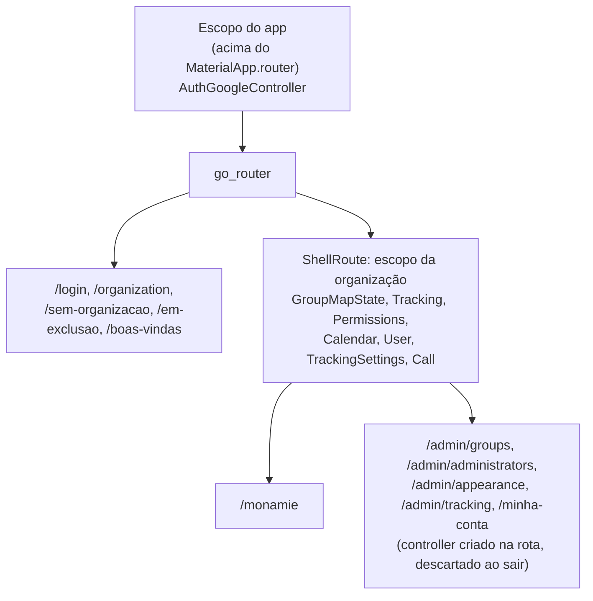

# Plano: sair do GetX para a arquitetura oficial do Flutter

Revisão 7 · 2026-11-02 · aprovado pelo João. Acompanhamento: [#187](https://github.com/monamienet/monamie-app/issues/187), uma sub-issue por fase.
- A revisão 7 traz o plano para o repositório (Fase 0) e acrescenta à CI em PR a checagem de formatação pedida no [#17](https://github.com/monamienet/monamie-app/issues/17).
- A revisão 6 incorpora a revisão independente das revisões 3 a 5 e a decisão D9 (atualizar o Flutter antes da migração).
- A revisão 2 incorporou uma revisão independente das afirmações técnicas: código do `get-4.7.3`, docs do go_router e de dart.dev, e o repositório.
- A revisão 3 acrescenta as decisões D4–D7 (testes com mockito, freezed, skills oficiais acima das diretrizes do projeto) e a nova Fase 1, que renumera as seguintes. A revisão 4 acrescenta D8 (testes em `test/`, espelhando `lib/` e `tool/`). A revisão 5 troca a reescrita das diretrizes de teste pela remoção delas (D4 revista). As revisões 3 a 5 passaram por revisão independente na revisão 6; a D9 e o pré-requisito, não.

## 1. Objetivo e decisão

**Objetivo:** melhorar a qualidade do código e a garantia dessa qualidade. Na prática: todo controller testável sem estado global, dependências visíveis no construtor, lógica sem tela, e regras que a CI verifica sozinha.

**Destino escolhido** (decidido na conversa de 2026-11-01/02, não reabrir):

| Papel | Hoje (GetX) | Destino |
|---|---|---|
| Estado | `GetxController`, `Rx`/`.obs`, `Obx`, `ever` | `ChangeNotifier` / `ValueNotifier`, `ListenableBuilder`, `addListener`; estados imutáveis com `freezed` |
| Injeção | `Get.put`/`lazyPut`/`find`, `Bindings` | construtor nos controllers + `provider` só na montagem das rotas |
| Navegação | `GetMaterialApp`, `GetPage`, `Get.to`/`off`/`back` | `MaterialApp.router` + `go_router` (`redirect` no fluxo de entrada) |
| Avisos | `Get.snackbar`/`dialog`/`bottomSheet` | `ScaffoldMessenger`, `showDialog`, `showModalBottomSheet`, chamados só pelas telas |
| Erros | `try/catch` espalhados | tipo `Result` (classe `sealed` do próprio Dart) devolvido pelos controllers |
| Dublês de teste | 55 *fakes* escritos à mão | só `mockito` (`@GenerateNiceMocks`) |
| Garantia | nenhuma checagem em PR | CI em PR (`flutter analyze`, testes, gerados atualizados) e regra de imports |

Motivos:
- É a arquitetura das skills do Flutter disponíveis aos agentes: `flutter-apply-architecture-best-practices`, `flutter-setup-declarative-routing`, `dart-add-unit-test` e `dart-generate-test-mocks` (estas duas usam mockito). Nenhuma skill cobre Riverpod ou Bloc.
- A regra de imports fecha o ponto fraco do `provider`: o `context.read` exige `BuildContext`, que um controller sem `widgets.dart` não tem.

**Fora do plano:** `mocktail` (D6), `json_serializable` (a leitura do Firestore continua em `fromMap` escrito à mão, com as regras de conversão testadas), Crashlytics/Sentry (a Fase 2 só deixa o ponto de registro pronto), DCM, e o adaptador Hive órfão ([#186](https://github.com/monamienet/monamie-app/issues/186), issue próprio; ver riscos).

## 2. Ponto de partida (medido em 2026-11-02, branch `fix/themed-home-sheet`)

Essa branch entrou em `main` pelo PR #185 (`61baf74`). Conferido no mesmo dia: `main` não tem diferença em `lib/`, `test/`, `pubspec.yaml`, `.github/`, `AGENTS.md`, `CLAUDE.md` nem `.agents/`, então os números abaixo valem para `main`.

- 43 de 139 arquivos de `lib/` e 17 arquivos de teste importam `package:get`.
- 16 controllers. Os que ainda chamam avisos/navegação ou `Get.find` por dentro:

| Controller | Linhas | `Get.find` | Avisos/navegação | `ever` | Testes |
|---|---:|---:|---:|---:|---|
| `auth_google_controller` | 686 | 0 | 17 (6 snackbars, 8 `offAllNamed`, `toNamed`, `to`, `changeTheme`) + `Get.put`/`delete` do `CreateOrganizationController` (linhas 406–418) | 0 | 4 arquivos |
| `tracking_controller` | 689 | 7 | 3 | 8 | **nenhum** |
| `permissions_controller` | 292 | 0 | 9 (inclui 3 diálogos) | 0 | 3 |
| `group_map_controller` | 376 | 1 | 0 | 0 | 1 |
| `calendar_controller` | 93 | 1 | 0 | 0 | **nenhum** |
| `user_controller` | 50 | 1 | 0 | 0 | **nenhum** |
| `login_controller` | 65 | 1 | 2 | 0 | 1 |

  Os outros 9 (`groups`, `administrators`, `appearance`, `tracking_settings_edit`, `invite`, `create_organization`, `my_account`, `tracking_settings`, `call`) já recebem tudo pelo construtor e não mostram avisos. `tracking_settings_controller` e `call_controller` não têm teste; o segundo só abre o Meet (pouca decisão).
- `GroupMapState` (contrato da tela inicial) expõe tipos `Rx…`; `TrackingToggleController` (contrato) também importa `get`.
- Fora dos controllers: 28 `Get.find` e 38 `Obx` em telas e widgets (home, `login_view`, `app_pages`); 7 `Get.lazyPut` e 2 `Get.isRegistered` nos `Bindings`.
- **Rotas sem nome**, fora das 11 `GetPage`: `Get.to`/`Get.off` de `CreateGroupView` e `GroupView` (`groups_views.dart:186, 197, 365, 1449`) e de `CreateOrganizationView` (no `auth_google_controller`); `Get.offNamed` em `login_controller.dart:33`.
- **Os testes dependem do GetX:** 31 `expect(Get.currentRoute, …)`, 12 `Get.isSnackbarOpen`/`isDialogOpen`, 10 `Get.put`, e `GetMaterialApp` em 6 arquivos.
- **Dublês de teste:** 55 classes escritas à mão em 23 arquivos de `test/unit/` (69 arquivos de teste no total). Três tipos:
  - **(a) ~40 implementam um contrato** (`implements GroupsBackend`, `AuthGoogleService`…). Vários se repetem entre arquivos: `_FakeAuthGoogleService` (3×), `_MemoryBindingStore` (3×), `FakeBackgroundRestrictionChecker` (3×).
  - **(b) Guardam estado ou emitem *streams*:** `_MemoryBindingStore`, `InMemoryOrganizationBindingStore`, `RecordingFirestoreDocuments`, `FakeMembershipSource`, `FakePositionsSource`.
  - **(c) Herdam de uma classe real e trocam só uma parte:** `_FakeAuthGoogleController`, `_FakeLoginController`, `_FakeOrganizationSession` (2×), `_FailingListBackend`, `WebListFailingCli`; mais `_LoggingNavigatorObserver` (espião de navegação) e `_FakeBackgroundService` (classe de plugin).
- **Organização dos testes:** os 69 arquivos ficam em `test/unit/`, espelhando `lib/` só em parte (ex.: `test/unit/admin/groups/` para `lib/app/modules/admin/groups/`).
  - 16 não têm o nome de uma unidade: 15 em `test/unit/` e o de `test/integration/`. Destinos propostos pela revisão independente:
    - os 4 do `auth_google_controller` e os 3 do `permissions_controller` viram um arquivo para cada unidade;
    - `login_controller_session_restore` → `login_controller_test.dart`;
    - `organization_palette_fallback` → `organization_palette_test.dart`;
    - `app_theme_and_colors` → `test/app/utils/app_theme_test.dart`;
    - `organization_tool_firebase_cli_output` → `test/tool/src/process_firebase_cli_test.dart`;
    - `web_client_id` → `android_firebase_config_test.dart`;
    - `central_web_config` → `test/app/data/firebase/central_firebase_test.dart`;
    - `tracking_marker_visibility` → a definir na fase;
    - `location_history_deduplication` e `firebase_provider_flow` → ver Fase 1.
  - Os testes de `tool/` ficam em `test/unit/organization_tool/` e importam por caminho relativo (`../../../tool/src/…`). Seis testes do app importam `'../support/test_organization.dart'`, também por caminho relativo.
  - `location_history_deduplication_test.dart` testa uma classe de simulação definida dentro do próprio teste e só importa o `geolocator`: não cobre código do app.
  - `test/integration/firebase_provider_flow_test.dart` não roda na CI (o deploy só roda `test/unit`). Apesar do nome, é um teste de unidade que define no próprio teste o conjunto de chaves permitidas.
  - `test/rules/` é o projeto Node dos testes de regras, com 8.068 arquivos em `node_modules`.
  - O caminho `test/unit` aparece em `AGENTS.md`, `README.md`, `deploy-play-internal.yml:106`, `docs/pt-br/entendendo-o-ci.md`, `docs/en-us/understanding-ci.md` e em `.agents/rules/AI_UNIT_TESTING_GUIDELINES.md`.
- O app não usa `Get.arguments`, `Get.parameters`, middlewares, traduções, `GetxService`, `GetBuilder`, nem workers além do `ever`. Não há deep links (o manifesto só tem MAIN/LAUNCHER, e não há `app_links`).
- O serviço de rastreamento em segundo plano (isolate próprio) não importa `get`: os 19 arquivos que ele importa foram conferidos, e ele fica fora da migração.
- **Não há CI em PR.** O único workflow que roda testes é `deploy-play-internal.yml`, disparado por `push` em `main`; `flutter analyze` não roda em lugar nenhum. Hoje ele acusa 18 avisos de nível *info*, nenhum *warning* ou *error*.
- **Não há geração de código:** nem `build_runner` nas dependências. O deploy só faz `flutter pub get` (`deploy-play-internal.yml:103`), então arquivos gerados que o app usa precisam estar versionados.
- **Flutter 3.44.4 (Dart 3.12.2)**, fixado também na CI (`deploy-play-internal.yml:72`). O Flutter estável em 2026-11-02 é o 3.47.9 (Dart 3.13.7). As versões atuais e estáveis dos geradores, conferidas no pub.dev em 2026-11-02, não cabem no Dart 3.12:
  - `freezed` 4.x exige Dart ≥ 3.13; o último que roda no 3.12 é o 3.2.5, preso ao `analyzer` < 11;
  - `mockito` 5.8.x e `build_runner` ≥ 2.15.2 exigem `analyzer` ≥ 13.3.
  
  Daí a D9.

## 3. Como cada fase entra em produção

- Cada fase é **um issue** (sub-issue de um issue de acompanhamento) e **um commit**: `refactor:` em geral, `ci:`/`docs:` na Fase 0, `test:` na Fase 1 e `fix:` na Fase 2 (D2).
- Duas fases têm dois commits:
  - **Fase 1:** a mudança de pasta vai num commit só de renomeação, para o git reconhecer cada arquivo movido e preservar o histórico; os mocks vêm no segundo.
  - **Fase 7:** 7a e 7b.
- O issue da Fase 1 vai para o projeto "MonAmie App" (#2), porque mexe em testes, CI e regras juntos.
- **Entrega (D1):** uma branch e **um PR único** com um commit por fase, revisado fase a fase.
  - O PR abre (com a aprovação do João) logo depois da Fase 0, para que cada fase seguinte chegue como um commit novo, com revisão própria.
  - O merge preserva os commits, para o `next-version.sh` enxergar o `fix:` da Fase 2.
  - Como o `pr-checks.yml` da Fase 0 vive na própria branch do PR, ele roda a cada fase enviada.
- **Build:** o app só vai para a faixa interna do Play no merge final (`deploy-play-internal.yml:125-131`). Até lá, o teste em aparelho de cada fase usa um build local.
- **Versão:** `refactor:` e `test:` mantêm o versionName (`next-version.sh:33-38`) e não exigem *whatsnew*, porque o `check-release-notes.sh` só olha `feat`/`fix` (linhas 32–33). O `fix:` da Fase 2 sobe o patch e reescreve o *whatsnew* (D2).
- Toda fase deixa o app funcionando: GetX e o código novo convivem até a Fase 9.
  - Um controller `ChangeNotifier` pode continuar sendo criado por `Get.put` e lido por `Get.find` até a Fase 8.
  - `Obx` e `ListenableBuilder` coexistem na mesma árvore.
- Os testes de cada fase são escritos por um agente com janela de contexto diferente da do agente que fez a fase. Até a Fase 1, a regra vem do arquivo de diretrizes; depois dela, do AGENTS.md. A partir da Fase 1, todo dublê é um mock do mockito.
- Teste em aparelho (Moto g35 e Tab S6 Lite) nas fases que tocam a entrada (6, 8) e a tela inicial (7, 8), com o roteiro da seção 6.

## 4. Fases

### Pré-requisito: atualizar o Flutter (D9; issue e PR próprios, fora deste PR)

- Subir o Flutter de 3.44.4 para o 3.47.x estável (Dart 3.13), localmente e no `flutter-version` do `deploy-play-internal.yml:72`. O `sdk: ^3.12.0` do `pubspec.yaml` já aceita o Dart 3.13.
- É um `chore:` que toca o build do app. Ele vai para a faixa interna do Play sozinho, com o roteiro de aparelho completo (seção 6), antes de a migração começar.
- Riscos próprios: plugins que mudem de comportamento com o Flutter novo. Ler as notas de versão do 3.45 ao 3.47 antes.
- Fica fora da estimativa da seção 5 (~0,5 a 1 dia, mais o teste em aparelho).
- **Pronto quando:** `flutter --version` local e da CI mostram 3.47.x, testes e `flutter analyze` verdes, e o app passa o roteiro de aparelho.

### Fase 0: plano no repositório e CI em PR (~0,5 dia)

- Copiar este plano para `docs/pt-br/migracao-getx.md` (a documentação de projeto fica lá; o AGENTS.md não ganha nota de "migração em andamento").
- Novo workflow `.github/workflows/pr-checks.yml`, disparado em `pull_request` para `main`: `dart format --set-exit-if-changed`, `flutter analyze` e `flutter test test/unit -j 2`. Ele cumpre os issues [#16](https://github.com/monamienet/monamie-app/issues/16), [#17](https://github.com/monamienet/monamie-app/issues/17) e [#18](https://github.com/monamienet/monamie-app/issues/18), que já planejavam essa CI.
- Zerar os 18 avisos *info* para o `flutter analyze` passar: ele trata *info* como falha por padrão (`--fatal-infos` vem ligado, e a execução local terminou com código 1). Vários são `constant_identifier_names` em `app_routes.dart`/`app_pages.dart`, que a Fase 8 reescreve; esses ficam silenciados ali até lá (D3).
- **Pronto quando:** um PR de teste mostra o check verde, e um PR com erro de análise mostra vermelho.

### Fase 1: base de testes e geração de código (~3,5 dias)

**Estrutura (D8), primeiro commit, só renomeações com `git mv`:**
- Espelhar exatamente `lib/` e `tool/` dentro de `test/`, como manda a skill `dart-add-unit-test`:
  - `lib/app/modules/admin/groups/groups_controller.dart` → `test/app/modules/admin/groups/groups_controller_test.dart`;
  - `tool/src/activate_command.dart` → `test/tool/src/activate_command_test.dart`.
- No mesmo commit, ajustar os imports relativos: os dos testes de `tool/` e os seis `'../support/test_organization.dart'` dos testes do app. Sem isso, o commit de renomeação não compila. `test/flutter_test_config.dart` e `test/support/` ficam onde estão; o `flutter_test_config.dart` já vale para todas as subpastas. `test/unit/support/fake_firebase_cli.dart` perde a classe *fake* e vira `test/support/firebase_config_fixtures.dart`, que guarda só os `google-services.json` de exemplo usados por três testes de `tool/`.
- `test/rules/` (Node) fica onde está, porque `lib/` não tem pasta `rules`.

**Estrutura, segundo commit:**
- **Um arquivo por unidade** (D8, escolha do projeto; a skill `dart-add-unit-test` pede o espelhamento e o sufixo `_test.dart`, não um arquivo por unidade): os 16 arquivos com nome de cenário vão para os destinos listados na seção 2, com um `group()` por cenário.
- `test/integration/firebase_provider_flow_test.dart` e `location_history_deduplication_test.dart`: se só conferem algo definido no próprio teste, não testam código do app e saem. Se exercitarem código real, vão para o arquivo da unidade testada. O primeiro passa a rodar na CI, coisa que hoje não acontece.
- **Comando de teste:** `flutter test -j 2` (todo o `test/`), no lugar de `flutter test test/unit -j 2`. Conferido no código do `flutter_tools` (`commands/test.dart:871-878`): ele percorre `test/` inteiro e só pega nomes terminados em `_test.dart`. O `node_modules` não tem nenhum, e percorrê-lo leva 0,04 s.
- Atualizar o caminho em `AGENTS.md` (*Testing* e *Resource Limits*), `README.md:17`, `deploy-play-internal.yml:106`, `pr-checks.yml` (criado na Fase 0 com `test/unit`), `docs/pt-br/entendendo-o-ci.md` e `docs/en-us/understanding-ci.md`. Nos dois guias de CI, reescrever também a frase que explica que os testes de integração ficam de fora (`entendendo-o-ci.md:214`, `understanding-ci.md:212`).
- O `docs/pt-br/migracao-grupos-firestore.md` não muda, porque é o registro de um plano já executado. As citações dele à "diretriz §2/§5" (linhas 770 e 772) vão apontar para um arquivo apagado; isso é aceitável num registro histórico.

**Regras de teste só nas skills (D4).**
- Apagar `.agents/rules/AI_UNIT_TESTING_GUIDELINES.md`. O arquivo só é citado em dois lugares: a linha `@.agents/rules/AI_UNIT_TESTING_GUIDELINES.md` do `CLAUDE.md` (linha 6), que sai, e a seção *Testing* do `AGENTS.md` (linha 65), reescrita abaixo.
- **AGENTS.md, seção *Testing*,** reescrita com só três pontos:
  1. Os testes seguem as skills versionadas em `.agents/skills/`: `dart-add-unit-test`, `dart-generate-test-mocks`, `flutter-add-widget-test`, `flutter-add-integration-test` (e `dart-collect-coverage` para cobertura).
  2. Os testes de uma tarefa são escritos por um agente com janela de contexto diferente da do agente que executou a tarefa principal.
  3. O parágrafo dos testes de regras no emulador (`test/rules/`, Node) continua como está, porque nenhuma skill cobre esses testes.
- **Saem do AGENTS.md** as regras que eram só do projeto: testar só código que toma decisões (nunca configuração lida por regex), o orçamento de 2 minutos e apagar os testes junto com a funcionalidade.
- As cópias versionadas das skills de teste são iguais às que serviram de base a este plano: `diff` em 2026-11-02 entre `.agents/skills/*/SKILL.md` e `~/.gemini/config/plugins/flutter/skills/`.
- Consequências de seguir as skills sem as diretrizes antigas:
  - mocks com `@GenerateNiceMocks` no próprio arquivo de teste;
  - `thenAnswer` para `Future`/`Stream`;
  - `verify()` das interações além do `expect()` do resultado;
  - `group()` e `setUp()`;
  - testes espelhando `lib/` em `test/` (D8).
- Continua valendo, por ser regra do AGENTS.md fora da seção *Testing* (*Avoid Transitive Bloat*): testes de tela e componentes visuais só dependem de contratos leves. Por isso, mocks são de **contratos** sempre que existe um. Classes concretas sem contrato (`AuthGoogleService`, `UserGoogleRepository`, `OrganizationBrandingLoader`, `OrganizationSession`) podem ser imitadas em testes de controller, mas nunca um controller concreto pesado num teste de tela.
- **AGENTS.md, *Resource Limits*:** `nice -n 15 flutter test -j 2` com o caminho novo, e `nice -n 15 dart run build_runner build`, sem o modo `watch`. Desde o 2.16 o `build_runner` substitui sozinho os gerados antigos, e a opção `--delete-conflicting-outputs` foi removida.

**Geração de código:**
- `dev_dependencies`: `mockito` 5.8.x, `build_runner` 2.16.x, `freezed` 4.0.x; `dependencies`: `freezed_annotation`. Com o Flutter 3.47 (D9), os três resolvem para o `analyzer` 14: `freezed` 4.0.3 pede ≥ 14.0 < 15; `mockito` 5.8.1, ≥ 13.3 < 15 (pub.dev, 2026-11-02). O `build_runner` fica no 2.16.2: o 2.17.1 exige o pacote `build` 5, e o `mockito` 5.8.1 ainda exige `build` < 5 (achado ao instalar, na Fase 1). Hoje o `pubspec.lock` não fixa `analyzer`, `build` nem `source_gen`. Se o `pub get` falhar, seguir a skill `dart-resolve-package-conflicts`.
- `build.yaml` com `sources: exclude: [test/rules/**]`: sem isso, o `build_runner` varre os 8.068 arquivos do `node_modules`, o que pesa nos notebooks de 8 GB.
- O `build_runner` não toca no `user_google_model.g.dart` ([#186](https://github.com/monamienet/monamie-app/issues/186)). O construtor que escreve `.g.dart` só roda quando outro gerador o aciona, e o freezed não aciona; rodar o `build_runner` também não apaga o arquivo (conferido na Fase 1).
- **Arquivos gerados versionados** (`*.mocks.dart`, `*.freezed.dart`): o deploy não roda `build_runner`.
- `analysis_options.yaml` exclui `**/*.mocks.dart`, `**/*.freezed.dart` e `**/*.g.dart`.
- `pr-checks.yml` ganha um passo que roda o `build_runner` e falha se o resultado diferir do versionado (`git diff --exit-code`).

**Trocar os 55 dublês por mocks, por tipo (ver seção 2):**
- Nenhum dos tipos imitados tem modificador que impeça o mock (`final`, `base`, `sealed`). O gerador do mockito roda em todo `test/**`, então `@GenerateNiceMocks` funciona nas subpastas.
- **(a) contratos:** `MockX` com `when`/`thenAnswer`. Os repetidos somem, porque cada arquivo declara seu `MockSpec`. Getters que devolvem `RxBool`/`Rx…` (hoje) ou `ValueListenable` (depois) precisam ser configurados (`when(m.isLoading).thenReturn(RxBool(false))`): sem isso, o mock "bonzinho" devolve um falso que quebra ao ler `.value`. O `FakeTrackingToggleController` (`share_card_test.dart:7`) guarda um `RxBool` que o próprio toggle inverte, então o mock reproduz isso com `thenAnswer`.
- **(b) estado e *streams*:** o teste guarda um `StreamController` (*broadcast*, se for escutado mais de uma vez) e o devolve com `thenAnswer((_) => controller.stream)`. O que era gravado num dublê de memória passa a ser conferido com `verify(...)` e `captureAny`.
- **(c) heranças parciais:** um mock não roda código real, então não dá para "trocar só uma parte".
  - `_LoggingNavigatorObserver` vira `MockNavigatorObserver` e some na Fase 8. `_FakeBackgroundService` vira `MockFlutterBackgroundService`.
  - **Ficam para a Fase 3** os dublês que precisam de uma mudança em `lib/`, impossível num commit só de teste:
    - `_FakeLoginController` herda da própria classe testada para trocar o `hasActiveGoogleBond`, que lê FirebaseAuth e Hive, e por isso precisa de um verificador injetado;
    - `_FakeAuthGoogleController` é registrado com `Get.put`. Registrar um mock de `GetxController` com `Get.put` chama o `onStart` do mock, que quebraria sem configuração (`get_instance.dart:253-254`);
    - os `_FakeOrganizationSession` chamam código real (`super.forget()`).
- Os testes de `tool/` (`test/tool/`, `test/support/firebase_config_fixtures.dart`) seguem a mesma regra.
- `freezed` só é instalado nesta fase; o uso começa na Fase 5.
- **Feito (2026-11-02):** 47 dublês trocados; o número 55 era de antes de juntar as cópias repetidas. Três arquivos de teste saíram por testarem só funções definidas no próprio teste (`firebase_provider_flow`, `location_history_deduplication`, `tracking_marker_visibility`). O `auth_google_controller_test.dart` confere a ordem das chamadas entre vários mocks com um registro compartilhado, porque o `verify` não enxerga ordem entre mocks diferentes. O `build_runner` levou 79 s e cerca de 720 MB numa geração completa.
- **Pronto quando:**
  - `test/unit/` e `test/integration/` não existem mais, e cada arquivo de teste tem o caminho e o nome da sua unidade em `lib/` ou `tool/`;
  - nenhuma classe dublê escrita à mão (`grep -rE "class \w+ (implements|extends)" test --include=*_test.dart`), exceto `_FakeLoginController`, `_FakeAuthGoogleController` e os dois `_FakeOrganizationSession`, que saem na Fase 3;
  - `.agents/rules/AI_UNIT_TESTING_GUIDELINES.md` não existe, e nada no repositório o cita;
  - testes verdes;
  - o passo de gerados atualizados da CI fica verde, e vermelho quando um `*.mocks.dart` está velho.

### Fase 2: controllers devolvem resultados, telas mostram avisos (~2 dias)

- Criar `Result<T>` (`sealed`: `Ok`, `Err` com mensagem para o usuário e erro original) em `lib/app/utils/result.dart`. É uma classe `sealed` do próprio Dart, sem `freezed`. É ali que o Crashlytics vai se ligar depois.
- Tirar dos controllers os avisos (`Get.snackbar`, `Get.dialog`, `Get.back`): `auth_google_controller` (só os snackbars; a navegação fica para a Fase 8), `tracking_controller`, `permissions_controller`, `login_controller`.
- Os três diálogos do `permissions_controller` perguntam algo **no meio** de um fluxo. Eles viram um contrato injetado (`PermissionPrompts`, com `Future<bool> confirmBackgroundLocation()` etc.) implementado pela camada de tela; nos testes, `MockPermissionPrompts`.
- Nas telas, trocar `Get.snackbar`/`dialog`/`bottomSheet`/`back` pelos equivalentes do Flutter. Isso inclui `appearance_view.dart:310` e os painéis de `groups_views.dart:394` e `history_calendar_sheet.dart:34`. Este último faz `Get.find` **dentro** do painel; ele passa a receber o controller por parâmetro, porque na Fase 8 painéis e diálogos abrem no navegador raiz, fora dos `provider` da organização.
- Os avisos que não têm `BuildContext` à mão usam uma `GlobalKey<ScaffoldMessengerState>` passada ao `GetMaterialApp` (parâmetro `scaffoldMessengerKey`, confirmado em `get-4.7.3/lib/get_navigation/src/root/get_material_app.dart:13`).
- Reescrever os 12 testes que verificam `Get.isSnackbarOpen`/`isDialogOpen` para verificar o `Result` devolvido.
- **Pronto quando:** nenhum `*_controller.dart` chama `Get.snackbar`/`dialog`/`bottomSheet`/`back`, e os testes que dependiam disso verificam o `Result` em vez do aviso.

### Fase 3: dependências explícitas e testes que faltam (~2 dias)

- Trocar os 11 `Get.find` de dentro dos controllers por parâmetros do construtor: `tracking` (7), `calendar`, `user`, `group_map`, `login`. Os `Bindings` e o `app_pages.dart` passam as dependências.
- Trocar por mocks os quatro dublês que a Fase 1 deixou: o `LoginController` recebe o `AuthGoogleController` (ou um contrato dele) e um verificador do vínculo Google pelo construtor, e a `OrganizationSession` ganha um contrato onde o teste precisa dele. Com isso, nenhum teste registra mock com `Get.put`, e o estilo único (D5) fica completo.
- `tracking_controller` reage a outros controllers com 8 `ever(...)`. Nesta fase eles continuam `ever`, mas sobre objetos recebidos no construtor.
- Testes novos (agente independente, com mockito): `tracking_controller` (decisões: quando inicia/para, reação a permissão revogada, troca de grupo), `calendar_controller`, `user_controller`, `tracking_settings_controller`. `call_controller` só se houver decisão a testar.
- **Pronto quando:** `grep "Get.find" lib/**/*_controller.dart` vazio, nenhuma classe dublê escrita à mão em `test/`, e as decisões dos quatro controllers acima estão cobertas por testes.

### Fase 4: regra de imports na CI (~1 dia)

- Regra: arquivos `*_controller.dart` e contratos de estado não importam `package:flutter/material.dart`, `widgets.dart` nem `cupertino.dart`. `foundation.dart` é permitido (`ChangeNotifier`).
- Implementar como plugin do analisador num pacote local (ex.: `tools/monamie_lints/`), ligado na seção `plugins:` do `analysis_options.yaml`. O sistema existe desde o Dart 3.10, aceita pacote por `path:`, e os diagnósticos aparecem no editor, no `dart analyze` e no `flutter analyze` (dart.dev/tools/analyzer-plugins).
- Escrever a regra como **warning**, não como *lint*: lints de plugin vêm desligados até serem ativados em `diagnostics:`, e warnings vêm ligados.
- A regra ignora os arquivos gerados (`*.mocks.dart`, `*.freezed.dart`).
- Acrescentar o pacote local ao `paths:` do `deploy-play-internal.yml`, como pede o comentário nas linhas 16–17.
- **Verificar:** se um `path:` relativo funciona (o exemplo da doc usa caminho absoluto). Plano B: `dart run tool/check_layers.dart` como passo do `pr-checks.yml`, sem aviso no editor.
- O import de `package:get` continua permitido até a Fase 9.
- **Feito (2026-11-02), pelo plano B:** o plugin funcionou com `path:` relativo e no editor, mas o `flutter analyze`/`dart analyze` do Dart 3.13.7 termina antes de o plugin olhar todos os arquivos. O plugin refaz a análise num isolate próprio. No projeto inteiro, o CLI saiu em ~25 s, e o plugin só tinha passado por 1 arquivo de `lib/`; num servidor de linguagem mantido aberto, ele achou as 5 violações aos ~41 s. Um check que deixa passar violações de vez em quando é pior que nenhum. Além disso, o plugin custou ~140 s de compilação na primeira vez e subiu o pico de memória do `flutter analyze` de ~0,9 GB para ~1,4 GB. A regra virou `dart run tool/check_layers.dart`, um script em Dart puro (`tool/src/state_layer_imports.dart`), rodado num passo do `pr-checks.yml`. Os contratos de estado são marcados com a linha `// check_layers: state_contract`, e os controllers são achados pelo nome. O `deploy-play-internal.yml` já cobre `tool/**`. Para o código passar na regra, o `permissions_controller` recebe o ciclo de vida do app pelo contrato `AppLifecycleEvents`, o `tracking_controller` perdeu um `WidgetsBindingObserver` que não usava, e a escolha da cor do pin (`setMarkerColor`) foi para a `monamie_page`. Nenhum `// ignore:` ficou.
- **Pronto quando:** um controller que importa `material.dart` faz o check do PR ficar vermelho.

### Fase 5: estado, piloto nas telas de administração (~1,75 dia)

- `groups`, `administrators`, `appearance`, `tracking_settings_edit`, `invite`, `create_organization` e `my_account`: `GetxController` → `ChangeNotifier`.
- **Estado imutável com `freezed`:** cada controller guarda um estado (`@freezed abstract class GroupsState`) e o troca inteiro com `copyWith`, avisando com `notifyListeners()` só quando o novo estado é diferente. O `==` gerado compara listas e mapas pelo conteúdo (`DeepCollectionEquality`), mas isso só funciona se os **itens** também tiverem `==` por conteúdo. Por isso, cada fase torna `freezed` os modelos que seus estados guardam. `onInit`/`onClose` → construtor/`dispose`. Nas telas, `Obx` → `ListenableBuilder`.
- O freezed torna as listas do estado **imutáveis**: código que hoje altera uma lista no lugar (`add`, `remove`, `[i] =`) quebra em tempo de execução. Cada controller migrado troca essas alterações por uma lista nova no `copyWith`.
- Continuam criados por `Get.put` no `app_pages.dart`. Duas coisas do GetX deixam de acontecer quando a classe não é mais `GetxController` (`get_instance.dart:381-383, 454-456`):
  - **`onInit` não é chamado:** cinco dos sete carregam dados no `onInit` (ex.: `groups_controller.dart:45`, `appearance_controller.dart:48`). A carga passa para um `load()` chamado pela tela ao abrir.
  - **Nada é descartado ao fechar a rota** (o GetX só chama `onDelete` de `GetLifeCycleBase`, nunca `dispose()`). Nenhum dos sete segura assinatura do Firestore. Só o `create_organization_controller` segura um `Timer` (linhas 91 e 120), que a tela cancela ao sair até a Fase 8.
- Registrar a convenção no AGENTS.md (estado atual: "controllers são `ChangeNotifier` com estado `freezed`, recebem dependências pelo construtor e devolvem `Result`"), sem nota de progresso.
- **Pronto quando:** os sete controllers e suas telas não importam `get`, testes verdes.

### Fase 6: estado, fluxo de entrada (~1,75 dia)

- `auth_google_controller` e `login_controller` → `ChangeNotifier` com estado `freezed`; telas de login, escolha de organização, sem organização, exclusão pendente, boas-vindas e `invite_card` → `ListenableBuilder`. `GetView` → `StatelessWidget` com o controller por parâmetro.
- O estado da sessão que a Fase 8 vai usar no `redirect` nasce aqui, como uma união `freezed` declarada `sealed class SessionState` (`.signedOut`, `.noOrganization`, `.picking`, `.deletionPending`, `.welcome`, `.bound`).
- A navegação (`Get.offAllNamed` etc.) e o `Get.changeTheme` continuam até a Fase 8.
- **Pronto quando:** testes verdes e roteiro de aparelho, itens 1–3 da seção 6.

### Fase 7: estado, tela inicial (~3,25 dias, em dois commits)

- **7a, contrato e leitores:**
  - `GroupMapState` passa a expor `ValueListenable<T>` no lugar de `Rx<T>`/`RxList`/`Rxn`.
  - Os modelos de valor da home (`MapGroup`, `GroupMember`, `UserModel`, `LocationPoint`) viram classes `freezed`, para que as listas possam ser comparadas pelo conteúdo. A leitura do Firestore continua no `fromMap` atual.
  - `GroupMapController`, `calendar_controller`, `user_controller` e as telas da home (`monamie_page`, `home_menu`, `home_header`, `people_list`, `share_card`, `group_menu_button`, `home_sheet`, `history_calendar_sheet`) mudam juntos, porque todos leem o contrato.
- **7b, rastreamento:** `tracking_controller`, `permissions_controller`, `TrackingToggleController`, `tracking_settings_controller`, `call_controller`. Os 8 `ever` viram `addListener` no construtor e `removeListener` no `dispose`.
- **Pronto quando:** nenhum controller ou widget da home importa `get` (exceto o registro em `MonamieBindings`), e o roteiro de aparelho passa completo.

### Fase 8: navegação e injeção (~3,5 dias)

- `GetMaterialApp` → `MaterialApp.router` com `go_router`. Uma rota por `GetPage` (11), mantendo os caminhos de `app_routes.dart`. As rotas sem nome (`CreateGroupView`, `GroupView`, `CreateOrganizationView`) viram sub-rotas, por exemplo `/admin/groups/new` e `/admin/groups/:groupId`.
- Reescrever os 31 testes que verificam `Get.currentRoute`. O destino do fluxo de entrada vira uma função pura (`SessionState` → caminho), testada sem montar tela; poucos testes de roteador ficam para o resto.
- **Fluxo de entrada por `redirect`:** o `AuthGoogleController` deixa de navegar e expõe o `SessionState` da Fase 6. O `redirect` lê esse estado, e o roteador o escuta por `refreshListenable`. Os 9 `Get.offAllNamed`/`toNamed` do controller somem.
- **Dois escopos de `provider`** (substituem `Bindings`, `permanent: true` e os `Get.isRegistered`):

  O `builder` do `ShellRoute` recebe o `Navigator` filho (`child`), então os `provider` colocados ali são ancestrais de todas as telas do shell. Isso substitui o comentário de `MonamieBindings` sobre o `TrackingSettingsController` precisar existir antes de *Ajustes de acompanhamento*. Três cuidados que a doc do go_router mostra:
  - **Diálogos e painéis escapam do shell:** `showDialog` e `showModalBottomSheet` abrem no navegador raiz por padrão, assim como rotas com `parentNavigatorKey` do raiz. Eles recebem o controller por parâmetro (já feito na Fase 2), nunca por `context.read`.
  - **Sair do shell descarta tudo só com `go`:** um `push` de rota de fora mantém o shell vivo. Regra: do shell para fora, sempre `go`.
  - A doc não afirma explicitamente o descarte ao sair do shell. **Verificar** com um teste: sair da conta chama `dispose()` dos controllers da organização.
- `Get.changeTheme` → um `ValueNotifier<ThemeData>` no escopo do app, que o `MaterialApp.router` escuta.
- Com `ChangeNotifierProvider`, o `dispose()` é chamado ao sair da rota; o cancelamento provisório do `Timer` da Fase 5 volta para o `dispose()` do controller.
- **Pronto quando:** nenhum `Get.` em `lib/` e roteiro de aparelho completo.
- **Feito (2026-11-02), falta o roteiro de aparelho:** `go_router` 18.1.2 e `provider` 6.1.5+1. Nenhum `Get.` nem `package:get` em `lib/`; os testes de controller ainda fazem `Get.testMode = true`, que sai na Fase 9 com o pacote.
  - **Caminhos** (`app_routes.dart`, nomes em lowerCamelCase, sem o `ignore_for_file`): os 11 de antes, mais as sub-rotas `/admin/groups/new`, `/admin/groups/invite` e `/admin/groups/:groupId`, e *Criar organização* como `nova-organizacao` debaixo de `/sem-organizacao` e de `/organization` (voltar retorna à tela de baixo).
  - **Função do `redirect`:** `sessionRedirect(SessionState, String location)` em `session_redirect.dart`, pura. Cada sessão tem uma tela (`sessionLocation`); `bound` aceita `/monamie`, `/minha-conta` e `/admin/...`; `noOrganization` e `picking` aceitam a própria tela e a criação aberta sobre ela; as outras, só a própria tela. O roteador escuta `AuthGoogleController.session`, um `ValueListenable<SessionState>` que só avisa quando a sessão muda, e as telas leem o controller pelo contrato `SessionFlow` (#196).
  - **Escopos:** o do app é o `MonAmieApp` (cria e dá `start()` no `AuthGoogleController`, guarda o tema e o roteador); o da organização é o `OrganizationScope`, no `builder` do `ShellRoute`, com um `provider` por controller (criado e iniciado na primeira leitura, o `TrackingSettingsController` logo ao abrir; descartados ao sair do shell, os de baixo primeiro). Os controllers de administração, login, conta, convite e criação nascem na própria rota (`ChangeNotifierProvider`) e morrem com ela.
  - **Dentro do shell, `push`:** as telas de administração e *Minha conta* abrem com `push` sobre o mapa (o `go` montaria só a rota pedida e o voltar fecharia o app). As sub-rotas de grupos recebem o `GroupsController` da tela *Grupos* como `extra` do `push`; sem ele (caminho digitado na web), voltam para `/admin/groups`.
  - **Casos da Fase 6:** o seletor deixou de ser empilhado sobre *Sem organização* ou *Login*; ele vira a tela única, e o voltar do Android sai do app em vez de mostrar uma tela que já não vale. A criação abre sobre a tela atual sem mudar a sessão; se a organização criada ainda não aparece na lista, a sessão vai para o seletor e a rota de criação volta para ele. Na abertura, *Login* restaura a sessão lembrada (`sessionRestored` → `bound`) e o `redirect` abre o mapa.

### Fase 9: remoção (~0,5 dia)

- Tirar `get` do `pubspec.yaml`; tirar `Get.testMode`/`Get.reset` dos testes.
- Estender a regra da Fase 4: `package:get` proibido em todo `lib/`.
- Atualizar os 2 comentários que citam GetX e a doc. O AGENTS.md hoje não cita GetX; conferir se algo nele descreve o registro antigo.
- **Pronto quando:** `grep -r "package:get/" lib test` vazio; CI e aparelho verdes.
- **Feito (2026-11-02):** `get` saiu do `pubspec.yaml` e dos testes, e o `tool/check_layers.dart` ganhou a regra `lib_imports_get`, que proíbe `package:get` em todo arquivo escrito à mão de `lib/`. Nenhum comentário de `lib/` citava mais o GetX depois da Fase 8.

## 5. Esforço

| Fase | Dias |
|---|---:|
| 0 · CI em PR | 0,5 |
| 1 · Base de testes: pastas, regras nas skills, mockito, freezed, 55 dublês | 3,5 |
| 2 · Resultados no lugar de avisos (inclui 12 testes) | 2 |
| 3 · Dependências explícitas + testes | 2 |
| 4 · Regra de imports | 1 |
| 5 · Estado, administração | 1,75 |
| 6 · Estado, entrada | 1,75 |
| 7 · Estado, tela inicial | 3,25 |
| 8 · Navegação e injeção (inclui 31 testes de rota) | 3,5 |
| 9 · Remoção | 0,5 |
| **Total** | **~20 (17 a 22)** |

As fases somam 19,75 dias; a faixa de 17 a 22 é a incerteza dessa soma. A atualização do Flutter (pré-requisito) fica de fora, porque é um PR próprio.

Como a estimativa cresceu:
- **Primeira conversa (6 a 10 dias):** só a troca de pacotes.
- **Revisão 2 (~15 dias):** soma o trabalho de garantia (CI em PR, regra de imports, `Result`, testes dos controllers sem nenhum) e a reescrita dos testes que verificam rotas e avisos do GetX.
- **Revisão 3 (~19 dias):** soma a Fase 1 e o `freezed` nos estados.
- **Revisões 4 a 6 (~20 dias):** soma a mudança de pasta. Apagar as diretrizes custa o mesmo que reescrevê-las, e passar 4 dublês da Fase 1 para a Fase 3 só muda o trabalho de lugar.

## 6. Roteiro de teste em aparelho

1. Instalação limpa → entrar com Google → escolher organização → mapa.
2. Reabrir o app (organização lembrada) → abre direto no mapa.
3. Sair da conta → volta ao login; entrar numa conta sem organização → *Sem organização*.
4. Ligar o compartilhamento → permissões → publicação chega no outro aparelho; desligar.
5. Trocar de grupo no mapa; histórico (calendário e trilha).
6. Administração: criar grupo, convidar, mudar papéis, aparência, ajustes de acompanhamento.
7. Erros: sem rede ao salvar → aviso aparece; permissão negada → aviso explica.

## 7. Riscos

- **Ciclo de vida durante a convivência (Fases 5–7):** o GetX não chama `onInit` nem `dispose()` de quem não é `GetxController`. Mitigação: `load()` chamado pela tela e o cancelamento provisório do `Timer` (Fase 5), até a Fase 8.
- **Reações a mais no `tracking_controller`:** o `ever` e o `addListener` disparam os dois de forma síncrona (`get_stream.dart:43-50`), então a ordem não muda. Muda o filtro: um `Rx` ignora um valor igual ao atual (`rx_impl.dart:101`), e um `notifyListeners()` avisa sempre. Mitigação: estados `freezed` comparados antes de notificar (`ValueNotifier` já faz isso), e os testes da Fase 3 vêm antes da troca na 7b.
- **Testes de interação são frágeis:** com o `verify` que as skills pedem (D4), uma refatoração que muda as chamadas sem mudar o comportamento quebra testes. É o custo aceito ao seguir as skills. Mitigação: verificar só as chamadas ao colaborador mockado, com *matchers* (`any`, `captureAny`) em vez de argumentos exatos quando o detalhe não importa.
- **Memória do `build_runner` em 8 GB:** não foi medido neste projeto. Mitigação: `nice -n 15`, sem `watch`, um processo pesado por vez (AGENTS.md).
- **Versões:** `mockito`, `freezed` e `build_runner` dependem do pacote `analyzer`. No Dart 3.12, as versões estáveis atuais não cabem juntas (seção 2), e a D9 resolve isso atualizando o Flutter antes. Se o `hive_generator` voltar por causa do [#186](https://github.com/monamienet/monamie-app/issues/186) (opção 1), ele também entra nessa conta e é antigo. **Verificar** antes de escolher a opção do #186; a opção 2 (adaptador escrito à mão) evita o conflito.
- **Atualização do Flutter:** o pré-requisito pode mudar o comportamento de plugins (localização em segundo plano, login Google). Mitigação: PR próprio, notas de versão lidas e roteiro de aparelho completo antes da Fase 0.
- **Fase 8 é a maior em risco** (fluxo de entrada inteiro). Mitigação: os estados da sessão viram testes do `redirect` (função pura: estado → caminho).
- **Avisos mudam de lugar:** o `Get.snackbar` aparece no topo; o `SnackBar` do Material, embaixo (D2).

## 8. Decisões (João, 2026-11-02)

- **D1. Entrega:** PR único, um commit por fase (as Fases 1 e 7 têm dois), uma revisão por fase (seção 3).
- **D2. Avisos:** `SnackBar` padrão do Material, embaixo. É uma mudança visível, então a Fase 2 é `fix:` e reescreve o *whatsnew* nos dois idiomas.
- **D3. Os 18 avisos *info*:** corrigidos na Fase 0. Os `constant_identifier_names` das rotas ficam silenciados no arquivo até a Fase 8.
- **D4. Regras de teste só nas skills** (revista na revisão 5): o `AI_UNIT_TESTING_GUIDELINES.md` é apagado. A seção *Testing* do AGENTS.md só cita as skills de teste, exige que os testes sejam escritos por um agente com janela de contexto diferente da do que fez a tarefa principal e mantém os testes de regras no emulador. As regras próprias do projeto (só código que decide, orçamento de 2 minutos, apagar testes com a funcionalidade) saem.
- **D5. Um só estilo de dublê:** mockito; os 55 *fakes* escritos à mão são removidos (Fase 1).
- **D6. mockito, não mocktail.**
- **D7. freezed adotado:** estados dos controllers e modelos de valor da home (Fases 5–7); não para o `Result`, que usa `sealed` do Dart.
- **D8. Testes em `test/`,** espelhando exatamente `lib/` e `tool/`, sem o prefixo `unit/`, com um arquivo por unidade (Fase 1).
- **D9. Flutter atualizado antes:** do 3.44.4 para o 3.47.x estável (Dart 3.13), num issue e PR próprios antes da Fase 0, para usar as versões estáveis atuais de `freezed` (4.0.x), `mockito` (5.8.x) e `build_runner` (2.16.x; ver Fase 1).
