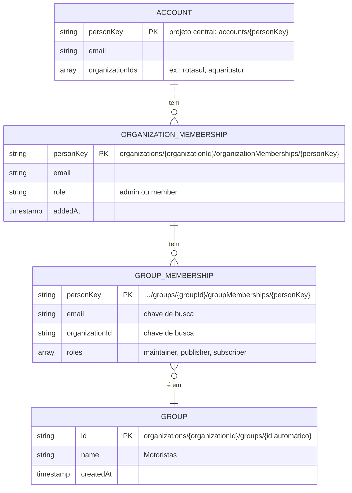
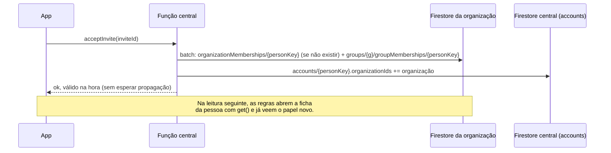
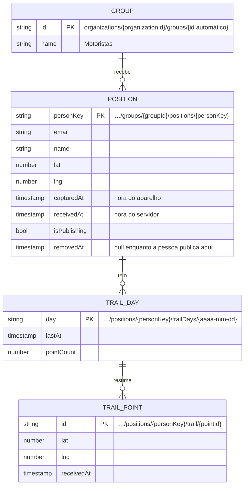
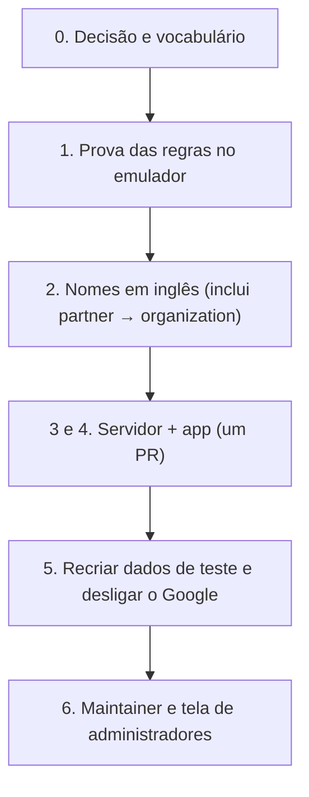

# Plano: trocar o Google Groups pelo Firestore nos grupos e papéis

> Status: **aprovado em 31/10/2026** (revisão 16). Acompanhamento: [monamienet/monamie-app#159](https://github.com/monamienet/monamie-app/issues/159), uma issue por fase (seção 5).
> **Concluído em 31/10/2026:** todas as fases estão feitas. O código entrou com o [#172](https://github.com/monamienet/monamie-app/pull/172), e a limpeza manual da fase 5 ([#164](https://github.com/monamienet/monamie-app/issues/164)) apagou os Google Groups antigos, o projeto do gateway e os dados antigos em `partners/`. O [AGENTS.md](../../AGENTS.md) e o [white-label.md](white-label.md) descrevem o sistema como ele é agora; este plano guarda o porquê das decisões.

**Vocabulário:** nas telas e neste texto usamos só a palavra **grupo**, nunca "equipe". "Grupo" é o grupo do MonAmie, guardado no Firestore; o sistema velho é chamado de "Google Group". **No backend:** *organization* (no lugar de *partner*) e *group*; o gestor do grupo é o *maintainer*.

**Premissa:** a migração é **radical**. Não há nada em produção, então não existe escrita dupla nem compatibilidade com versões antigas do app. O app está no teste fechado, mas o único usuário é o João (confirmado em 31/10). Mesmo assim, cada merge na `main` vira uma versão no teste interno, então **regras, índices e funções de cada fase são publicados na mesma janela que a versão do app** que depende deles.

**Papéis são substantivos:** todo papel nomeia **quem a pessoa é** (`maintainer`, `publisher`…), não o que ela faz.

---

## 1. Por que mudar (resumo)

Os testes de 30/10 mostraram que o Google Group só nos dá "uma lista de quem pertence a quê", e com restrições:
- papéis personalizados não aparecem em nenhuma API;
- não há Chat com pessoas de fora no Business Starter;
- pessoas de fora nem enxergam os grupos;
- grupos nascem abertos (#153);
- um e-mail de "cancelar inscrição" tira a pessoa do app (#154).

E traz custos:
- o gateway sem CORS (#49), que aceita token de qualquer projeto (#72);
- a cota da Directory API (#88);
- grupos esquecidos ao aposentar uma organização (#106);
- a demora de propagação nos convites;
- a conta `groups-admin@`, que pode alterar **qualquer** grupo da empresa.

O login continua sendo com o Google. Só a lista de membros e papéis muda de lugar.

---

## 2. Vocabulário técnico

- **Documento / coleção**: no Firestore, um documento é uma ficha com campos; uma coleção é a pasta que agrupa fichas do mesmo tipo. Toda ficha tem um **id** (o "nome do arquivo"), que é **sempre um texto**.
- **Regras (`firestore.rules`)**: o "porteiro" do banco. Para cada leitura ou escrita vinda do app, decide se a pessoa pode.
- **`get()` nas regras**: o porteiro pode abrir **outra** ficha para decidir. Por exemplo, antes de deixar Ana gravar a posição no grupo X, abre a ficha "Ana no grupo X" e confere se ela é `publisher`. Cada `get()` conta como uma leitura paga, e há um limite de 10 por pedido.
- **Claims**: etiquetas gravadas dentro do token de login. Hoje as permissões viajam nelas. **Neste plano elas deixam de ser usadas** (seção 4.5).
- **Consulta de grupo de coleções (*collection group query*)**: uma busca que olha todas as coleções com o mesmo nome, em qualquer lugar do banco.
- **Batch**: várias gravações que acontecem juntas ou não acontecem.

---

## 3. Perguntas respondidas

### 3.1 Usar o e-mail como id do documento é boa prática?

Um bom id de documento cumpre quatro condições:

1. **é único**;
2. **não muda** com o tempo;
3. **não é segredo**;
4. **é conhecido por quem precisa achar a ficha**, sem consultar outra coisa antes.

Ser legível no console é um bônus, não uma condição.

| Candidato a id | Único | Não muda | Não é segredo | Conhecido por quem busca | Veredito |
|---|---|---|---|---|---|
| id da organização (`rotasul`) | sim | sim | sim | sim | **ótimo** |
| e-mail da pessoa | sim | quase sempre¹ | é dado pessoal, mas não secreto² | **sim** | bom, mas o Google desaconselha dado pessoal no id (abaixo) |
| hash do e-mail (`personKey`) | sim | quase sempre¹ | não é legível | **sim**, calculado do e-mail do login | **escolhido** |
| `uid` do Firebase | sim | sim | sim | **não**³ | ruim aqui |
| nome do grupo (`Motoristas`) | não garantido | **não** (renomeia) | sim | sim | ruim |
| número do grupo (`01`) | sim | sim, mas é **reaproveitado**⁴ | sim | sim | ruim |
| id automático do Firestore | sim | sim | sim | sim (fica gravado onde é usado) | **bom para grupos** |

1. Um Gmail nunca muda de endereço. Uma conta de empresa pode ser renomeada, mas é raro; se acontecer, a pessoa é tratada como nova, exatamente como no Google Group hoje.
2. O e-mail já aparece para quem administra a organização, e o console do Firebase só é acessível para a MonAmieNet.
3. **O motivo decisivo.**
   - O `uid` não existe antes do primeiro login, e o convite é feito para alguém que talvez nunca tenha entrado.
   - Cada projeto Firebase gera um `uid` **diferente** para a mesma pessoa (o central `monamienet-app` e o projeto da organização têm cadastros separados).
   - Já o e-mail vem pronto no token (`request.auth.token.email`), e o porteiro monta o caminho da ficha direto: `organizationMemberships/{personKey}`.
4. Hoje, `nextTeamNumber` reaproveita o menor número livre. Um convite antigo para o `03` apagado cairia no novo `03`. Por isso existe a gambiarra `predatesTeam`.

**O que o Google recomenda (correção da revisão 14).** A tabela acima esqueceu uma recomendação oficial:
- A seção *Privacy* das [boas práticas do Firestore](https://firebase.google.com/docs/firestore/best-practices) diz, como prática de conformidade, para **não guardar informação sensível no nome dos documentos**.
- A página de [conformidade do Firestore](https://docs.cloud.google.com/firestore/docs/firestore-regulatory-compliance) põe o `document.name` entre os campos "não feitos para dados protegidos".
- O e-mail é **dado pessoal** pela LGPD (não "sensível" no sentido do art. 5º, II, mas pessoal). Com ele no id, o e-mail aparece em todo caminho, em todo índice e em toda mensagem de erro que cite o documento.

**A alternativa documentada: o hash do e-mail como id.**
- As regras têm [`hashing.sha256()`](https://firebase.google.com/docs/reference/rules/rules.hashing), e a [nota de lançamento](https://firebase.google.com/support/release-notes/security-rules) dá como exemplo justamente comparar o hash de um e-mail com o e-mail do login.
- O id seria `sha256(e-mail em minúsculas)` em hexadecimal: continua único, imutável e **calculável** por quem busca, inclusive pelo porteiro, a partir de `request.auth.token.email`.
- O e-mail continua **dentro** da ficha, no campo `email` (que a seção 4.2 já exige por outro motivo), visível só a quem as regras deixam ler.

| | E-mail como id | Hash do e-mail como id |
|---|---|---|
| Segue a recomendação do Google | não | sim |
| Console legível | sim | não (é preciso olhar o campo `email`) |
| Exposição em caminhos, índices e erros | o e-mail | um código; ainda é dado pessoal pela LGPD (pseudônimo), mas não legível |
| Trabalho a mais | nenhum | uma função `personKey()` no Dart, no JavaScript e nas regras, e um teste de que as três dão o mesmo resultado |

**Decidido (31/10): o id das fichas de pessoas é o hash do e-mail**, chamado de **`personKey`** em todo o plano.

**A receita da chave**, igual nos três lugares:
1. pegar o e-mail do login e passar para minúsculas;
2. calcular o SHA-256 dos bytes UTF-8;
3. escrever o resultado em hexadecimal **minúsculo** (64 caracteres).

| Onde | Como |
|---|---|
| Regras do Firestore e do Storage | `function personKey() { return hashing.sha256(request.auth.token.email.lower()).toHexString().lower(); }` (o último `.lower()` garante o passo 3 sem depender de como `toHexString()` escreve as letras) |
| Funções (JavaScript) | `createHash('sha256').update(email.toLowerCase(), 'utf8').digest('hex')`, do módulo `crypto` do Node |
| App (Dart) | `sha256.convert(utf8.encode(email.toLowerCase())).toString()`, do pacote `crypto` |

**O que muda por causa do hash:**
- **Toda ficha de pessoa guarda o campo `email`**, porque o id não diz mais de quem ela é: `accounts`, `organizationMemberships`, `groupMemberships`, `positions` e `accountDeletions`. As telas (lista de membros, mapa) mostram o campo, nunca o id.
- **As regras de gravação conferem** que o campo `email` é o de quem grava, e que o id é `personKey()` dele. Assim ninguém grava uma ficha com o e-mail de outra pessoa.
- **No console**, para achar a ficha de alguém, filtra-se pelo campo `email`. O comando `check` da ferramenta imprime o e-mail ao lado de cada chave.
- **O hash não é segredo nem anonimização.** Quem tem uma lista de e-mails consegue calcular os hashes e comparar. Ele só tira o e-mail legível de caminhos, índices e mensagens de erro, que é o que a recomendação do Google pede.

**Conclusão:**
- A chave das fichas de pessoas é o `personKey`, o hash do e-mail em minúsculas (e as regras exigem `email_verified`).
- Mantém o id da organização como id de organização.
- **Muda** o id do grupo para o id automático do Firestore.
- O prefixo da organização no grupo (`rotasul01`) sai. Ele só existia porque todos os Google Groups do domínio dividem um único espaço de nomes. No Firestore, o caminho `organizations/rotasul/groups/…` já diz de quem é o grupo.

### 3.2 Os grupos precisam ser strings numéricas de 2 dígitos? Não seria melhor inteiro?

No Firestore, **o id de um documento é sempre texto**: um id `1` é o texto `"1"`. Os dois dígitos vinham do endereço do Google Group (`rotasul01@`) e do limite de 99 grupos.

O **id automático** do Firestore (20 caracteres aleatórios):
- não precisa de contador;
- nunca é reaproveitado, e com isso `predatesTeam` desaparece;
- não tem limite de 99.

Para ordenar os grupos na tela usamos o campo `name` ou `createdAt`. Se alguém quiser um "número do grupo" para falar ao telefone, ele vira um **campo** inteiro, não o id.

### 3.3 Papéis: organização × grupo

Todos os papéis são **substantivos**.

**Na organização:**

| Papel | Valor gravado | Pode | Onde fica |
|---|---|---|---|
| **titular** | `owner` | tudo do administrador, mais **excluir a organização**, nomear e remover administradores e, futuramente, transferir a titularidade | `organizations/{id}.ownerEmail`, no registro **central** (é a relação contratual com a MonAmieNet) |
| **administrador** | `admin` | criar e **excluir grupos**, gerenciar qualquer pessoa de qualquer grupo, aparência, configurações de rastreamento, ver todos os grupos | `role` da ficha `organizationMemberships/{personKey}` |
| **membro** | `member` | só o que os papéis nos grupos dão | `role` da ficha `organizationMemberships/{personKey}` |

**No grupo** (lista `roles` da ficha `groupMemberships/{personKey}`). Os valores são **nomes do backend**; os rótulos das telas são decididos à parte.

| Valor gravado | Pode | Hoje |
|---|---|---|
| `maintainer` | convidar e remover pessoas **daquele** grupo, mudar os papéis delas e renomear o grupo | não existe |
| `publisher` | publicar (compartilhar) a própria posição no grupo | folha `w` ("em campo") |
| `subscriber` | receber as posições publicadas no grupo: ver o mapa e o histórico | folha `r` ("vê o mapa") |

- **Uma pessoa pode ter vários papéis no mesmo grupo**, por exemplo `["publisher", "subscriber"]`.
- **Por que não um "superadministrador de grupo"?** Excluir um grupo é decisão sobre um bem da **organização**, então fica com os administradores.
- **O titular é o "superadministrador da organização".** Ele não ganha uma cópia em `organizationMemberships`: a regra é que o titular é sempre `admin`, e as funções centrais recusam rebaixá-lo.
- **Decidido:** o `maintainer` e a tela de administradores entram na **fase 6**, depois da migração.

#### `publisher` e `subscriber` fazem sentido?

**Sim, e é uma escolha melhor que `sharer`/`viewer`.**

Na arquitetura de software, ***publish/subscribe*** (pub/sub) é o padrão em que:
- quem **publica** manda mensagens para um **tópico**, sem saber quem vai recebê-las;
- quem **assina** o tópico recebe todas as mensagens publicadas nele.

O exemplo clássico é o Google Cloud Pub/Sub. O MonAmie encaixa quase ponto a ponto:

| Pub/sub | MonAmie |
|---|---|
| tópico | grupo |
| mensagem | posição |
| publisher | quem compartilha a posição |
| subscriber | quem vê o mapa do grupo |
| broker (o intermediário que entrega) | o Firestore, com as regras decidindo quem recebe |

Três propriedades do padrão valem aqui, e é por isso que os nomes ajudam quem chega ao código:
1. **Um para muitos:** cada posição publicada chega a todos os subscribers do grupo.
2. **Desacoplamento:** quem publica não escolhe quem vê. Quem decide é o grupo, ou seja, o administrador ou o `maintainer`.
3. **Papéis independentes:** dá para publicar sem assinar (quem está em campo e não vê o mapa) e assinar sem publicar (quem só acompanha do escritório).

**Onde a analogia não é perfeita, e o que fazer:**

| Diferença | O que fazer |
|---|---|
| No pub/sub mais simples, o subscriber só recebe mensagens **a partir de quando assinou**. Aqui ele também vê a **última posição** de cada pessoa ao abrir o mapa, e lê o **histórico**. | O MQTT, um protocolo de pub/sub, tem um nome para o primeiro caso: **mensagem retida** (*retained message*), a última mensagem do tópico, entregue a quem acaba de assinar. O histórico corresponde a um tópico com **retenção** (como no Kafka). Dizer isso no comentário de documentação do papel. |
| Em produtos por assinatura, *subscriber* também quer dizer **cliente pagante** ("assinante"). | O MonAmie chama o cliente de *organization* e o que ele contrata de *plan*. Regra: nunca usar *subscription* para plano ou cobrança. |
| O Dart usa `StreamSubscription` em todo lugar (por exemplo `_positionSubscription`, em [foreground_service.dart](../../lib/app/data/services/foreground_service.dart)). | É até coerente: o mapa de um subscriber guarda uma `StreamSubscription` das posições do grupo. Basta nomear as variáveis pelo que elas ouvem e o papel como `GroupRole.subscriber`. |
| A ferramenta tem o comando `tool/partner.dart publish` (depois da troca de nomes, `tool/organization.dart publish`), que publica a marca da organização. | É um verbo com outro sentido, e o risco de confusão é baixo. Dá para renomear depois, se incomodar. |

**Correção da revisão anterior.** Eu tinha listado como diferença "no pub/sub o subscriber se inscreve sozinho; aqui o papel é concedido". Não é diferença. Nos sistemas de pub/sub reais, **a permissão de publicar ou assinar é concedida por um administrador**, e o cliente só exerce essa permissão:
- O Google Cloud Pub/Sub tem os papéis de IAM `roles/pubsub.publisher` e `roles/pubsub.subscriber`, que um administrador concede num tópico.
- Os servidores MQTT têm listas de acesso (ACL) que dizem, por tópico, quem pode publicar e quem pode assinar.

No MonAmie é igual: o papel `subscriber` é a permissão, e o app "assina" de fato quando abre o mapa.

**A arquitetura mais próxima** é o pub/sub de **telemetria**, no estilo **MQTT**. É o que se usa para dispositivos que mandam a própria localização ou leituras de sensores:
- tópicos por dispositivo ou por grupo;
- ACL por tópico;
- mensagem retida para a "última posição conhecida".

Há até um produto quase igual ao MonAmie feito assim: o **OwnTracks**, um app de código aberto de compartilhamento de localização. Cada aparelho publica em `owntracks/<usuário>/<aparelho>` e os amigos assinam. Um componente à parte, o *Recorder*, guarda o histórico. Os nomes que essa arquitetura usa são exatamente **publisher**, **subscriber**, **topic**, **retained message** e **ACL**. Isso confirma `publisher`/`subscriber`.

**Alternativas descartadas** (todas mais distantes):
- *producer/consumer*: é o padrão de **fila**, em que cada mensagem vai para **um** consumidor só. No Kafka, que guarda histórico, os nomes são esses, mas lá "grupo" quer dizer *consumer group*, que colidiria com os nossos grupos.
- *subject/observer* (o padrão Observer): é acoplado, porque quem é observado conhece os observadores. E "subject" colide com o *data subject* da LGPD (o titular dos dados) e com o campo `sub` do token de login.
- *reader/writer* (permissões sobre dados, como no Google Drive): descreve o acesso a um arquivo, não o fluxo de posições. Era o modelo das folhas `r`/`w`.
- *follower* (redes sociais): é de pessoa para pessoa, e aqui o acompanhamento é por grupo.

### 3.4 A redundância entre fichas vale a pena?

Duplicar só vale a pena quando três coisas valem ao mesmo tempo:
1. a leitura é muito mais frequente que a escrita;
2. sem a cópia, a leitura seria cara ou impossível;
3. as cópias podem ser gravadas juntas.

Aqui a condição 2 não vale, então **cada fato mora num lugar só**. As exceções são duas **chaves de busca** no `GroupMembership`, `email` e `organizationId`, que repetem o caminho porque uma consulta de grupo de coleções só filtra por campos (seção 4.2). Elas nunca mudam, então não podem divergir. O `GroupMembership` exige o `OrganizationMembership` da mesma pessoa, e os dois são gravados no mesmo batch. Isso é uma **referência** (como uma chave estrangeira), não uma cópia.

A única cópia que sobra é o índice central `accounts/{personKey}`, inevitável porque o login acontece no projeto central e nenhuma consulta atravessa projetos (seção 4.3).

### 3.5 `people` é o melhor nome?

Não. O nome de uma coleção deve dizer **o que é um documento dela**, e "people" é vago. E "users" confundiria com a antiga coleção `users/{uid}` dos projetos de organização (removida na migração, seção 4.7).

Proposta: **`accounts/{personKey}`**, com o campo `organizationIds`. Cada documento é uma conta Google, e o nome fica par com a coleção central que já existe, `accountDeletions/{personKey}`.

### 3.6 Quanto custa no Firestore

Preços oficiais de **São Paulo (southamerica-east1)**, conferidos em 31/10/2026, em dólar. A cota grátis é diária e por projeto:

| | Grátis por dia | Depois da cota |
|---|---|---|
| leitura | 50.000 | US$ 0,045 por 100 mil |
| gravação | 20.000 | US$ 0,135 por 100 mil |
| armazenamento | 1 GiB | cerca de US$ 0,14 por GiB por mês |

**Premissas:**
- cada posição gera 3 gravações (a posição atual, o ponto do trajeto e o resumo do dia) **por grupo** em que a pessoa publica; os cenários supõem um grupo por pessoa, e quem publica em dois grupos dobra as gravações dela;
- cada subscriber com o mapa aberto recebe 1 leitura por posição nova das pessoas que acompanha;
- a migração soma leituras de regra (o `get()` das fichas) em **dois** momentos:
  - quando alguém publica: 1 a 2 leituras por posição;
  - **a cada atualização do mapa ao vivo**: mais 1 a 2 leituras (a inscrição de quem assiste e, para um administrador, a ficha dele na organização). A página de [preços](https://firebase.google.com/docs/firestore/pricing) diz que, numa consulta escutada, a avaliação das regras é cobrada de novo "cada vez que o resultado é atualizado". A revisão 13 tinha esquecido esse segundo momento;
- jornada de 10 horas, 22 dias úteis por mês.

| Cenário | Volume por dia | Por mês, antes da migração | Só o que a migração acrescenta (estimativa) |
|---|---|---|---|
| **A. Community pequeno**: 3 organizações, 30 publishers a cada 15 min, 3 subscribers | 1.200 posições | **US$ 0** (cabe na cota) | **US$ 0** |
| **B. Community cheio**: 20 organizações, 500 publishers a cada 15 min, 50 subscribers (cada um acompanha 10 pessoas) | 20.000 posições e 20.000 atualizações no mapa | cerca de **US$ 1,20** (gravações acima da cota) | cerca de **US$ 0,30** (as leituras de regra passam um pouco da cota) |
| **C. Standard grande**: 200 publishers a cada 5 min, 20 administradores com o mapa de todos aberto | 24.000 posições e 480.000 atualizações no mapa | cerca de **US$ 6** (US$ 4,50 só do mapa ao vivo) | **até cerca de US$ 10** (quase tudo das regras reavaliadas no mapa) |
| **D. Standard parado**: sem uso no mês | 0 | **US$ 0** (mais centavos do armazenamento acumulado) | **US$ 0** |

**Como ler a tabela:**
- O que mais pesa é o **mapa ao vivo** (cenário C), e é também ali que a troca de claims por `get()` mais pesa: as regras são cobradas de novo a cada atualização que o mapa recebe.
- Nos cenários pequenos a migração custa centavos; no cenário C, até uns US$ 10 por mês. É o preço de a remoção valer na hora.
- "Até" porque a página não diz se várias mudanças que chegam juntas ao mapa contam uma avaliação só; a fase 1 mede.
- Se o celular do subscriber ficar mais de 30 minutos sem conexão, o mapa é cobrado como uma consulta nova ao voltar (mesma página de preços).

Não medi o tamanho real dos documentos nem o armazenamento do histórico.

---

## 4. O modelo novo

### 4.1 As entidades e os nomes delas

**Por que `member` e `participant` não funcionavam:**
- Os dois nomes descrevem **a pessoa**, e em português "membro do grupo" e "participante do grupo" querem dizer a mesma coisa.
- A diferença real não está na pessoa, e sim **naquilo a que ela pertence**: a organização ou um grupo.
- Para piorar, `member` também era um valor de papel: "um *member* com papel *member*".

**Proposta: as duas entidades são *memberships* (vínculos), e o nome diz de quê.**

| Entidade | Coleção | O que é | Papéis |
|---|---|---|---|
| `OrganizationMembership` | `organizations/{organizationId}/organizationMemberships/{personKey}` | o vínculo da pessoa com a **organização** | `role`: `admin` ou `member` |
| `GroupMembership` | `organizations/{organizationId}/groups/{groupId}/groupMemberships/{personKey}` | o vínculo da pessoa com **um grupo** | `roles`: `maintainer`, `publisher`, `subscriber` |

**Por que *membership*:** é o termo de mercado para a entidade que liga uma pessoa a um "contêiner" e carrega o papel dela lá dentro.
- A API do GitHub tem exatamente os nossos dois níveis: *organization membership* (papel `admin` ou `member`) e *team membership* (papel `maintainer` ou `member`). Adotamos *organization* e *maintainer* como ele; para o segundo nível ficamos com *group*, a palavra que já usamos nas telas, em vez de *team*.
- O próprio Cloud Identity, que usamos hoje, chama de *memberships* os vínculos com um Google Group.

Quem vier de qualquer um dos dois reconhece o modelo.

**Por que os dois nomes têm prefixo**, em vez de `memberships` nos dois níveis: a consulta de grupo de coleções olha todas as coleções **com o mesmo nome**. Com nomes iguais, "meus vínculos com grupos" traria também os vínculos com organizações.

O custo é o caminho repetir a palavra (`organizations/rotasul/organizationMemberships/…`). Em troca, cada nome se explica sozinho, inclusive fora do caminho: num log ou numa variável. Com a troca de *partner* por *organization* (fase 2), o backend e as telas passam a dizer a mesma coisa.

**A intuição, numa analogia de escola:**
- a **conta** (`Account`) é a pessoa;
- o **`OrganizationMembership`** é a **matrícula** dela numa escola (organização), e diz se ela é da direção (`admin`) ou não (`member`). Uma pessoa pode estar matriculada em várias escolas, com uma matrícula em cada;
- o **grupo** (`Group`) é uma **turma** da escola;
- o **`GroupMembership`** é a **inscrição** da pessoa numa turma, com os papéis que ela tem **naquela** turma.

Não existe inscrição sem matrícula: para estar numa turma, é preciso estar matriculado na escola.

**Exemplo concreto, a Ana:**

```text
monamienet-app (projeto central)
└─ accounts/9b1f…                         { email: "ana@gmail.com", organizationIds: ["rotasul", "aquariustur"] }

monamienet-community (projeto da organização)
├─ organizations/rotasul/
│  ├─ organizationMemberships/9b1f…       { email: "ana@gmail.com", role: "admin" }
│  └─ groups/Xk3f…                        { name: "Motoristas" }
│     └─ groupMemberships/9b1f…           { email, organizationId: "rotasul", roles: ["subscriber"] }
└─ organizations/aquariustur/
   ├─ organizationMemberships/9b1f…       { email: "ana@gmail.com", role: "member" }
   ├─ groups/P9qa…                        { name: "Guias" }
   │  ├─ groupMemberships/9b1f…           { email, organizationId, roles: ["publisher", "subscriber"] }
   │  └─ positions/9b1f…                  { email, name, lat, lng, capturedAt, receivedAt, isPublishing, removedAt: null }
   │     ├─ trail/{pointId}               { lat, lng, receivedAt }
   │     └─ trailDays/2026-10-31          { lastAt, pointCount }
   └─ groups/T7mb…                        { name: "Recepção" }
      ├─ groupMemberships/9b1f…           { email, organizationId, roles: ["publisher"] }
      └─ positions/9b1f…                  { … a mesma posição, publicada também aqui }
         ├─ trail/{pointId}
         └─ trailDays/2026-10-31
```

`9b1f…` é o `personKey` de `ana@gmail.com`: 64 caracteres hexadecimais, encurtados aqui (seção 3.1). Os ids dos grupos (`Xk3f…`) são ids automáticos, também encurtados.

**Lendo o exemplo:**
- Ana administra a Rotasul e, lá, assina o grupo Motoristas: vê o mapa, mas não publica a posição. Por isso ela **não tem posição** na Rotasul.
- Na AquariusTur, Ana não administra nada, mas é `publisher` em **dois** grupos, Guias e Recepção. Cada envio da posição dela é publicado **nos dois**, e cada grupo guarda a própria cópia, com o próprio trajeto e os próprios resumos do dia.
- Em Guias ela também é `subscriber`: vê o mapa de Guias. Em Recepção, não.
- O índice central só diz "procure a Ana na Rotasul e na AquariusTur".

### 4.2 O diagrama (notação pé de galinha)



**Como ler cada linha.** Em `A ||--o{ B : "verbo"`, a frase se lê **da caixa de cima (A) para a de baixo (B)**: "A verbo B". O símbolo encostado em cada caixa diz **quantas daquela caixa** participam:
- `||`: exatamente uma;
- `o{`: zero ou muitas;
- linha cheia: dentro do mesmo projeto; pontilhada: entre projetos.

Cada relação, lida nos dois sentidos:

| Linha | De cima para baixo | De baixo para cima |
|---|---|---|
| ACCOUNT – ORGANIZATION_MEMBERSHIP | uma conta tem **zero ou muitas** matrículas (uma por organização) | cada matrícula é de **exatamente uma** conta |
| ORGANIZATION_MEMBERSHIP – GROUP_MEMBERSHIP | uma matrícula tem **zero ou muitas** inscrições (uma por grupo) | cada inscrição pertence a **exatamente uma** matrícula |
| GROUP_MEMBERSHIP – GROUP | cada inscrição é em **exatamente um** grupo | um grupo tem **zero ou muitas** inscrições |

**Fora do diagrama:**
- `ORGANIZATION_MEMBERSHIP`, `GROUP` e `GROUP_MEMBERSHIP` ficam dentro de `organizations/{organizationId}/`, no **projeto da organização**, onde as regras estão.
- O titular continua em `organizations/{id}.ownerEmail`, no projeto central.
- **Por que `email` e `organizationId` dentro de `GROUP_MEMBERSHIP`?** Para o app perguntar "em quais grupos **desta** organização eu estou?" numa consulta de grupo de coleções:

  ```dart
  collectionGroup('groupMemberships')
      .where('email', isEqualTo: myEmail)
      .where('organizationId', isEqualTo: organizationId)
  ```

  - `organizationId` porque o projeto Community tem várias organizações no mesmo banco.
  - `email` porque uma consulta de grupo de coleções filtra por **campos**, não pelo pedaço do caminho que diz de quem é a ficha. É o padrão do exemplo oficial em [consultas seguras](https://firebase.google.com/docs/firestore/security/rules-query): lá o documento repete o dono num campo "mesmo sabendo, pelo caminho, de quem ele é". Sem esse campo, nem a consulta nem a regra que a protege podem ser escritas.
  - As duas são chaves de busca que nunca mudam, não cópias que possam divergir. A regra de gravação (só as funções centrais gravam) e a de leitura conferem que `email` é o de quem pede.
  - A consulta precisa de um índice e de uma regra próprios (seção 4.8).

### 4.3 O índice central e quando ele discorda

As funções centrais gravam primeiro no projeto da organização e depois em `accounts/{personKey}`. **A organização manda:**
- **Índice com uma organização a mais:** a pessoa tenta entrar e o app não acha o próprio `OrganizationMembership`. Ele trata como "removido", pelo `forgetRemovedOrganization` que já existe.
- **Índice com uma organização a menos:** a pessoa não vê a organização. Por isso a função repete a gravação em caso de erro, e o comando `check` da ferramenta lista divergências.

### 4.4 Como os fluxos ficam



**Remover alguém** é apagar o `GroupMembership` dela, ou o `OrganizationMembership` e todos os `GroupMembership` dela. A próxima leitura ou escrita da pessoa já é recusada.

### 4.5 Sem claims: as regras leem as fichas

- Uma posição só é gravada em `groups/{groupId}/positions/{personKey}` se o `GroupMembership` da pessoa **naquele** grupo tiver `publisher`.
- Uma posição (e o histórico dela) só é lida se o `GroupMembership` de quem lê, **naquele** grupo, tiver `subscriber`, ou se o `OrganizationMembership` de quem lê for `admin`.

| | Com claims (hoje) | Com `get()` (proposta) |
|---|---|---|
| Remoção vale | no próximo `syncClaims`, ou em até 1 hora | **na hora** |
| Partes móveis | `syncClaims`, renovação de token, `capabilities.js` | **nenhuma** |
| Limite de tamanho | 1000 bytes; uma pessoa em muitos grupos estoura | sem limite |
| Custo | zero leituras extras | 1 a 2 leituras por pedido, **e de novo a cada atualização do mapa ao vivo** (de centavos a uns US$ 10 por mês; seção 3.6) |

**Por que essas regras são seguras de escrever:** com as posições **dentro do grupo** (seção 4.6), o grupo está no **caminho** do documento. Toda regra depende só do caminho e de quem pede, nunca de um campo do próprio documento lido.

Isso importa nas **consultas** (o mapa e o calendário): o Firestore só aceita uma regra de consulta se conseguir prová-la **antes** de olhar os documentos, e uma regra que só usa o caminho sempre passa nessa prova. O risco que a versão anterior do plano deixava para a fase 1 (um `get()` montado a partir do campo `groupId` da posição) deixa de existir.

### 4.6 As posições

**Decidido:**
- cada posição fica no **tópico (grupo) em que foi publicada**;
- **uma pessoa publica em todos os grupos em que é `publisher`**, não em um só.

As duas decisões levam ao mesmo desenho: **as posições moram dentro do grupo.** Hoje elas moram debaixo da pessoa, com uma etiqueta `grupo_ativo` dizendo o grupo, e a pessoa escolhe **um** grupo ativo de cada vez.



**Lendo o diagrama:**

| Linha | De cima para baixo | De baixo para cima |
|---|---|---|
| GROUP – POSITION | um grupo recebe **zero ou muitas** posições, uma por pessoa que publica nele | cada posição é de **exatamente um** grupo, o do caminho |
| POSITION – TRAIL_DAY | cada posição tem **zero ou muitos** resumos, um por dia com envios **neste grupo** | cada resumo é de **exatamente uma** posição |
| TRAIL_DAY – TRAIL_POINT | cada resumo resume os **zero ou muitos** pontos daquele dia | cada ponto entra em **exatamente um** resumo, o do dia dele |

**O que some com esse desenho:**
- **O campo `groupId`** (antes `grupo_ativo`), em todas as fichas: o grupo é o caminho.
- **O "grupo ativo"** e o seletor dele no app.
- **O id composto dos resumos** (`{groupId}_{aaaa-mm-dd}`): o resumo já mora dentro do grupo, e o id volta a ser só a data. O calendário de um grupo busca o intervalo de `2026-10-01` a `2026-10-31` em `groups/{groupId}/positions/{personKey}/trailDays`.
- **O risco das regras em consultas** (seção 4.5).

**Como fica um envio.** O serviço em segundo plano sabe em quais grupos a pessoa é `publisher`, porque ouve os próprios `GroupMembership`. A cada envio, para **cada** um desses grupos, ele grava um batch com três fichas:
- a posição atual (`positions/{personKey}`);
- um ponto novo (`trail`);
- o resumo do dia (`trailDays`).

**Um batch por grupo, não um batch para todos.** Cada batch tem limite de 20 leituras de regra (`get()`), e cada grupo consome umas duas: a própria inscrição e a posição depois da gravação. Num batch só, uma pessoa em muitos grupos estouraria esse limite. Separados, cada grupo é tudo ou nada sozinho. Se um falhar (por exemplo, porque a pessoa acabou de perder o papel naquele grupo), os outros seguem.

**Em termos de pub/sub:**
- `positions/{personKey}` dentro do grupo é a **mensagem retida** do tópico: a última publicação, entregue a quem abre o mapa;
- `trail` é o **tópico com retenção**, de onde sai o histórico;
- `trailDays` é um índice para o calendário ler **um** documento por pessoa, grupo e dia;
- publicar em vários grupos é publicar a **mesma mensagem em vários tópicos**, o que o pub/sub sempre permitiu.

**Por que isso resolve o histórico.** Hoje a regra que libera a leitura do histórico olha o grupo **atual** da pessoa ([firestore.rules:170](../../firestore.rules:170)). Por isso, quando Ana passa de Guias para Motoristas, quem assina Motoristas passa a ler o histórico antigo dela, e quem assina Guias perde o acesso. Com o histórico **dentro** de cada grupo, quem assina Guias lê o que foi publicado em Guias, e só isso. Não há regra a acertar: é a estrutura dos dados.

**O que acontece quando alguém perde o papel `publisher` num grupo, ou sai dele:** a função central que tira o papel **marca** a posição atual da pessoa naquele grupo com `removedAt`, em vez de apagá-la, e ela some do mapa na hora.

- **Por que marcar e não apagar (correção da revisão 14).** Apagar um documento **não** apaga as subcoleções dele, e o documento pai inexistente **não aparece nas consultas** ([exclusão de dados](https://firebase.google.com/docs/firestore/manage-data/delete-data)). Se a posição fosse apagada, o trajeto continuaria no banco, mas a tela de histórico, que lista as pessoas pelas posições do grupo, não acharia mais a pessoa.
- **Como o mapa esconde a marcada:** o mapa consulta `positions` com `where('removedAt', isNull: true)`. Por isso o campo é gravado **sempre**, com `null` enquanto a pessoa publica: o Firestore só encontra num filtro de `null` os documentos que têm o campo com valor `null`, não os que não têm o campo. Se a pessoa voltar a ser `publisher`, a próxima publicação grava `removedAt: null` de novo.
- **O histórico** lista todas as posições do grupo, marcadas ou não.

O trajeto já publicado continua no grupo até o prazo de guarda ([monamienet/monamie-app#155](https://github.com/monamienet/monamie-app/issues/155)). E, quando o grupo é excluído, ele vai junto com o grupo ou fica para os administradores, conforme [monamienet/monamie-app#156](https://github.com/monamienet/monamie-app/issues/156). Com o histórico dentro do grupo, a primeira opção vira uma exclusão recursiva de `groups/{groupId}`:

- é feita por uma função central com `recursiveDelete` do Admin SDK, nunca pelo app (a [documentação](https://firebase.google.com/docs/firestore/manage-data/delete-data) desaconselha apagar coleções a partir do aparelho);
- **não é atômica**: pode parar no meio, então a função precisa poder ser repetida até terminar;
- custa uma leitura e uma exclusão por documento apagado.

**Custo.** Quem publica em N grupos faz N vezes as gravações (3 por grupo a cada envio). A tabela da seção 3.6 supõe um grupo por pessoa.

**O que muda na migração:**
- `partners/` vira `organizations/`, e os nomes viram inglês (fase 2).
- As posições, o trajeto e os resumos saem de debaixo da pessoa e vão para dentro de cada grupo (fases 3 e 4).
- O app deixa de ter "grupo ativo": quem compartilha publica em todos os seus grupos de `publisher`. O botão de ligar e desligar o compartilhamento continua, e vale para todos.
- As posições de teste existentes ficam órfãs; você as apaga.
- Os nomes em inglês de todas as coleções e campos estão na seção 4.7.

### 4.7 Nomes em inglês para tudo o que já existe no Firestore

Como não há nada em produção, **todos** os nomes passam para o inglês na fase 2, junto com a troca de *partner* por *organization*. A escolha segue três regras:
1. o nome diz **o que é um documento** da coleção, não como ele é usado;
2. o mesmo conceito tem o mesmo nome em todo lugar;
3. a mesma palavra nunca quer dizer duas coisas.

#### Onde mora a antiga `usuarios/`

Ela continua no **projeto da organização**, mas passa a morar **dentro de cada grupo** (seção 4.6) e se chama **`positions`**:

```text
organizations/{organizationId}/
├─ organizationMemberships/{personKey}      quem é a pessoa na organização (só as funções centrais gravam)
├─ groups/{groupId}/                    um grupo
│  ├─ groupMemberships/{personKey}          quem está no grupo e com quais papéis (só as funções centrais gravam)
│  └─ positions/{personKey}                 a última posição da pessoa neste grupo (a própria pessoa grava)
│     ├─ trail/{pointId}                um ponto por envio: o trajeto
│     └─ trailDays/{aaaa-mm-dd}         um resumo por dia, para o calendário
└─ config/…                             branding, tracking, plan
```

- **Por que `positions`:** um documento é **a posição atual de uma pessoa num grupo**. O nome antigo, "usuários", descrevia a pessoa, mas o documento guarda onde ela está. O id é o `personKey` da pessoa (seção 3.1), a mesma do `GroupMembership` que mora ao lado.
- **Por que não juntar com o `GroupMembership`**, já que os dois têm o mesmo id e moram no mesmo grupo:
  - quem grava é diferente: a inscrição só pelas funções centrais, a posição só pela própria pessoa, e regras separadas ficam mais simples e seguras;
  - a frequência é diferente: a posição muda a cada envio, e o app ouve as próprias inscrições para saber em quais grupos publica. Juntas, cada envio dispararia esse ouvinte à toa, e cada disparo é uma leitura paga.
- **Por que `trail` e `trailDays`:** o código já fala em *trail* (por exemplo `trailDays` em [firebase_provider.dart:184](../../lib/app/modules/monamie/data/provider/firebase_provider.dart:184)), e "trajeto" é o que o histórico mostra.

#### Projeto da organização

| Hoje | Depois | Observação |
|---|---|---|
| `partners/{partnerId}` | `organizations/{organizationId}` | fase 2 |
| `usuarios/{email}` | `groups/{groupId}/positions/{personKey}` | dentro de cada grupo (seção 4.6) |
| `usuarios/{email}` · `nome` | `name` | |
| `usuarios/{email}` · `timestamp` (relógio do **aparelho**) | `capturedAt` | hoje `timestamp` quer dizer coisas diferentes na posição (aparelho) e no ponto (servidor); os nomes novos separam os dois relógios |
| `usuarios/{email}` · `positionAt` (relógio do **servidor**) | `receivedAt` | |
| `usuarios/{email}` · `isTracked` | `isPublishing` | alinha com o papel `publisher` |
| `usuarios/{email}` · `grupo_ativo` | **removido** | o grupo é o caminho |
| `usuarios/{email}` · `email`, `lat`, `lng` | iguais | |
| — | `removedAt` | novo: marca a posição de quem deixou de publicar no grupo (seção 4.6) |
| `historico_posicoes/{pontoId}` | `trail/{pointId}` | debaixo da posição, dentro do grupo |
| `historico_posicoes` · `timestamp` (relógio do **servidor**) | `receivedAt` | o mesmo nome do campo da posição, com o mesmo sentido |
| `historico_posicoes` · `grupo_ativo` | **removido** | o grupo é o caminho |
| `dias/{aaaa-mm-dd}` | `trailDays/{aaaa-mm-dd}` | debaixo da posição, dentro do grupo: já é um por grupo e dia |
| `dias` · `points` | `pointCount` | é uma contagem, não uma lista de pontos |
| `dias` · `grupo_ativo` | **removido** | o grupo é o caminho |
| `dias` · `lastAt` | igual | |
| `users/{uid}` | **removida** | veja abaixo |
| `config/branding`, `config/tracking`, `config/plan` e seus campos | iguais | já estão em inglês |
| Cloud Storage: `partners/{id}/logo.png` | `organizations/{id}/logo.png` | não é Firestore, mas muda junto |

#### Por que `users/{uid}` sai

Hoje ela só é **gravada**: o app cria `users/{uid}` (`name`, `email`, `urlImage`, `createdAt`) no primeiro login em cada organização ([user_google_provider.dart](../../lib/app/data/provider/user_google_provider.dart)). Nada a usa para mostrar alguma coisa. Os únicos leitores são:
- o próprio login, para reaproveitar o documento se ele já existir;
- a exclusão de conta, para apagá-lo ([account_deletion.js](../../central/functions/account_deletion.js)).

O mapa tira o nome de cada pessoa do campo `name` da posição, e não de `users/`. O comentário das regras que diz o contrário está desatualizado.

O que sai na fase 2:
- a gravação em [user_google_provider.dart](../../lib/app/data/provider/user_google_provider.dart) (o perfil guardado **no aparelho**, no Hive, continua, porque o login o lê; por exemplo, o e-mail de quem entrou em [auth_google_controller.dart:677](../../lib/app/modules/login/controllers/auth_google_controller.dart:677));
- o bloco `users/{userId}` de [firestore.rules](../../firestore.rules) e os testes dele em `test/rules/`;
- a busca e a remoção de `users` em `eraseDueAccounts` ([account_deletion.js](../../central/functions/account_deletion.js)).

Se um dia o mapa precisar de foto, o lugar é `profiles/{personKey}`, com o mesmo id das outras fichas da pessoa.

#### Projeto central

| Hoje | Depois | Observação |
|---|---|---|
| `partners/{id}` | `organizations/{id}` | campos já em inglês; sai o legado `active` |
| `retiredPartnerIds/{id}` | `retiredOrganizationIds/{id}` | |
| `invites` · `partnerId`, `partnerName` | `organizationId`, `organizationName` | |
| `invites` · `team` (`"01"`), `teamName` | `groupId`, `groupName` | o convite aponta para o id automático |
| `invites` · `roles` (`share`, `watch`) | `roles` (`publisher`, `subscriber`) | |
| `accountDeletions/{email}` | `accountDeletions/{personKey}`, com o campo `email` | o id passa a ser o hash (seção 3.1) |
| `accountDeletions` · `memberships` (lista de endereços de Google Group) | `memberships`: os `OrganizationMembership` e `GroupMembership` removidos, para o "cancelar exclusão" devolvê-los | muda de formato, não só de nome |
| `accountDeletions` · `ownedPartners`, `ownedNames` | `ownedOrganizationIds`, `ownedOrganizationNames` | |
| `accounts/{personKey}` | novo | seção 4.3 |
| `themes/{id}` e seus campos | iguais | já estão em inglês |

**Para nenhum nome escapar:** os nomes de coleções e campos ficam em **um lugar só** no código:
- uma classe de constantes no Dart, por exemplo `FirestorePaths`;
- o equivalente em JavaScript nas funções.

Hoje eles estão espalhados como texto solto (`'dias'`, `'historico_posicoes'`), e um nome esquecido numa troca dessas só aparece quando falha em produção.

### 4.8 Índices, prazo de guarda e regras do Storage

Esta seção junta o que a documentação oficial exige e que as seções anteriores não diziam.

**Índice** é a lista ordenada que o Firestore mantém para responder a uma consulta sem ler o banco inteiro. Por padrão ele cria, sozinho, índices de cada campo **dentro de uma coleção**, mas não para um grupo de coleções ([índices](https://firebase.google.com/docs/firestore/query-data/index-overview)).

**1. A consulta "meus grupos" precisa de três coisas** ([consultas seguras](https://firebase.google.com/docs/firestore/security/rules-query)):
- índices com **escopo de grupo de coleções** em `groupMemberships` para `email` e `organizationId`, declarados em `firestore.indexes.json` e publicados junto com as regras em cada projeto de organização;
- `rules_version = '2';` na primeira linha de `firestore.rules`;
- uma regra para o grupo de coleções, que só deixa ler as próprias fichas:

  ```
  match /{path=**}/groupMemberships/{key} {
    allow read: if request.auth.token.email_verified
                && resource.data.email == request.auth.token.email;
  }
  ```

  Uma regra com `{path=**}` vale para **toda** coleção `groupMemberships`, em qualquer lugar do banco. Por isso ela só olha o campo `email`, e a regra que deixa administradores e `maintainer` lerem as fichas dos outros fica no caminho completo do grupo.

**2. Tirar do índice o que nunca é consultado.** O guia de [boas práticas](https://firebase.google.com/docs/firestore/best-practices) diz que o índice é o que mais pesa no tempo de cada gravação, e que tirar campos dele reduz o armazenamento.
- `lat` e `lng` em `positions` e `trail`: o mapa nunca filtra por eles.
- Por coleção, desligar os modos descendente e de lista, que nada usa. O guia sugere isso como padrão fácil.
- Fica no índice só o que alguma consulta usa: `receivedAt` no `trail` (o trajeto de um dia), `removedAt` em `positions` (o mapa), `email` e `organizationId` em `groupMemberships`.
- Os ids dos resumos do dia são datas, ou seja, sequenciais, o que o guia desaconselha. Aqui não faz mal: cada pessoa cria um por dia, e cada um mora debaixo de uma posição diferente, então as gravações não se concentram num trecho só.

**3. Prazo de guarda com TTL**, para quando [monamienet/monamie-app#155](https://github.com/monamienet/monamie-app/issues/155) decidir o prazo. TTL (*time to live*) é uma política que apaga sozinha os documentos cuja data num campo já passou ([TTL](https://firebase.google.com/docs/firestore/ttl)):
- os pontos do `trail` e os `trailDays` ganham um campo `expireAt`, gravado no mesmo batch da publicação;
- a exclusão acontece em até 24 horas depois da data, não na hora;
- **não apaga subcoleções**. Aqui não importa, porque `trail` e `trailDays` não têm subcoleções;
- não tem cota grátis: cada exclusão é cobrada;
- o campo `expireAt` deve ficar fora do índice, como o guia recomenda.

**4. O logo no Storage** ([regras do Storage com Firestore](https://firebase.google.com/docs/storage/security/rules-conditions)):
- cada avaliação lê no máximo **2** documentos do Firestore; a regra do logo lê 1;
- só lê o banco `(default)`, que é o que o MonAmie usa;
- no primeiro deploy, o Firebase pede para ligar uma permissão que deixa o Storage ler o Firestore. Esse vira um passo do onboarding no [white-label.md](../../docs/en-us/white-label.md).

---

## 5. Fases

Cada fase é uma issue. As fases 3 e 4 mudam o "contrato" entre servidor e app ao mesmo tempo, então ficam num **único PR**: todo merge na `main` gera uma versão no teste interno e não pode ficar quebrado.



### Fase 0: decisão e vocabulário (João) ([#160](https://github.com/monamienet/monamie-app/issues/160))

- **Decidido:** cada posição fica no grupo em que foi publicada, e a pessoa publica em todos os grupos em que é `publisher` (seção 4.6).
- **Decidido:** o modelo (seção 4) e os papéis (seção 3.3), incluindo os nomes de backend `maintainer`, `publisher` e `subscriber`.
- **Decidido:** a chave das fichas de pessoas é o hash do e-mail, o `personKey` (seção 3.1).
- **Vocabulário:**
  - nas telas, os rótulos dos papéis são decididos à parte; o backend usa `maintainer`, `publisher` e `subscriber`;
  - no código, `Team` vira `Group`, `TeamRole.share/watch` vira `GroupRole.publisher/subscriber`, e as fichas viram `OrganizationMembership` e `GroupMembership`;
  - "grupo" nas telas e `group` no backend: a mesma palavra nos dois lados;
  - "grupo" no lugar de "equipe" nas telas, nos documentos em pt-br e nas release notes.
- Este plano entra no repositório como `docs/pt-br/migracao-grupos-firestore.md`, para cada fase (e cada sessão de trabalho) partir do mesmo texto.
- O [AGENTS.md](../../AGENTS.md) ganha só um aviso de que a migração está em andamento, apontando para o plano. Ele continua descrevendo o sistema **de hoje**, e cada fase atualiza a parte que muda no mesmo PR que muda o código: a fase 2 troca os nomes, e as fases 3 e 4 trocam "administration powers come from Google Groups, never from Firebase" por "…come from `organizations/{id}/organizationMemberships`, written only by the central functions". Assim as instruções nunca descrevem um sistema que ainda não existe.
- **Pronto quando:** a decisão está numa issue do "MonAmie Docs" (#3), o plano está em `docs/pt-br/` e o AGENTS.md tem o aviso.

### Fase 1: prova das regras (pequena, decide o desenho) ([#161](https://github.com/monamienet/monamie-app/issues/161))

- Escrever em [firestore.rules](../../firestore.rules) as regras de `organizationMemberships`, `groups`, `groupMemberships` e `groups/{groupId}/positions` (com `trail` e `trailDays`), todas com `get()`.
- Testar em [test/rules/](../../test/rules/), no emulador:
  - gravar a própria posição com e sem `publisher`;
  - ler o mapa como `subscriber`, como `admin` e sem papel;
  - ler o próprio `OrganizationMembership`, mesmo inexistente (para o app saber que foi removido);
  - acesso a outra organização;
  - a **consulta** do mapa e a do calendário (seção 4.5);
  - uma pessoa `publisher` em dois grupos: grava nos dois; quem assina só um deles lê só aquele (seção 4.6);
  - o histórico de um grupo continua com os subscribers dele depois que a pessoa sai do grupo, e a posição marcada com `removedAt` some da consulta do mapa mas aparece na do histórico (seção 4.6);
  - a consulta de grupo de coleções "meus grupos desta organização" passa para as próprias fichas e é recusada para as de outra pessoa (seções 4.2 e 4.8);
  - o `personKey` calculado pelas regras do Firestore e do Storage é igual ao calculado em Dart e em JavaScript para o mesmo e-mail, inclusive um e-mail com letras maiúsculas;
  - uma ficha gravada com o id ou o campo `email` de outra pessoa é recusada.
- Medir as leituras extras **ao publicar e a cada atualização de um mapa escutado**, e comparar com os cenários da seção 3.6.
- **Pronto quando:** os testes passam, e as leituras extras por envio e por atualização do mapa estão anotadas.

### Fase 2: nomes em inglês em tudo, incluindo *partner* → *organization* (um PR mecânico) ([#162](https://github.com/monamienet/monamie-app/issues/162))

**Por que agora:** sem nada em produção, renomear caminhos de dados não exige migrar dados. Depois do lançamento exigiria. E, feita antes das fases 3 e 4, a troca deixa o código novo nascer com os nomes finais.

- **Dados:** todas as coleções e campos da seção 4.7, nas regras, no app, nas funções e nos testes do emulador:
  - `partners/{id}/…` vira `organizations/{id}/…`, e o registro central `partners/{id}` vira `organizations/{id}`;
  - `usuarios`, `historico_posicoes` e `dias` viram `positions`, `trail` e `trailDays`, com os campos renomeados;
  - a coleção `users/{uid}` sai (seção 4.7);
  - os nomes passam a morar em `FirestorePaths` (Dart) e no equivalente em JavaScript.
  - Nesta fase só os **nomes** mudam, e as posições continuam debaixo da pessoa (com `grupo_ativo` renomeado provisoriamente para `groupId`). A **mudança de lugar** para dentro dos grupos chega nas fases 3 e 4, junto com os grupos no Firestore.
- **Funções:**
  - `resolvePartners` vira `resolveOrganizations`, `createPartner` vira `createOrganization`, `expirePartners` vira `expireOrganizations`;
  - os módulos `partner_*.js` viram `organization_*.js`.
- **App:**
  - `PartnerSession`, `PartnerConfig` e `partnerIdProblem` mudam de nome;
  - as pastas `lib/app/config/partner/` e `lib/app/data/partner/` também;
  - o app Firebase nomeado `partner-<id>` passa a se chamar `organization-<id>`. A regra de nunca apagar esse app continua valendo.
- **Ferramenta:**
  - `tool/partner.dart` vira `tool/organization.dart`;
  - sai o `migrate-layout`, que só copiava dados antigos da raiz e não serve mais sem produção.
- **Documentos:** o [AGENTS.md](../../AGENTS.md) e o [white-label.md](../../docs/en-us/white-label.md), em en-us e pt-br.
- **Não muda:** os ids dos projetos Firebase (`monamienet-<id>`, `monamienet-community`) e os nomes dos planos (Standard, Community).
- Os dados de teste em `partners/…` ficam órfãos e são recriados na fase 5.
- **Pronto quando:** `rg -i "partner|usuarios|historico_posicoes|grupo_ativo|'dias'"` não acha mais uso no código, e os quatro conjuntos de testes passam.

### Fases 3 e 4: servidor e app (um PR) ([#163](https://github.com/monamienet/monamie-app/issues/163))

**Funções centrais** ([central/functions/](../../central/functions/)):
- Novo `person_key.js`, com `personKey()` (seção 3.1); toda ficha de pessoa gravada pelas funções usa essa chave e o campo `email`.
- Novo `membership_store.js`: grava `organizationMemberships`, `groupMemberships` e `accounts` no projeto certo, do mesmo jeito que `communityFirestore()` e `eraseAccounts` já abrem o banco de outro projeto em [index.js](../../central/functions/index.js).
- Trocar o Google Group pelo Firestore:

  | Hoje | Depois |
  |---|---|
  | `team_service.js` | `group_service.js`: grupos com id automático; criar, renomear e excluir só como `admin`; excluir usa `recursiveDelete` e pode ser repetido até terminar (seção 4.6); tirar o papel `publisher` marca a posição com `removedAt` |
  | `invite_service.js` | o convite aponta para `groupId` e carrega os papéis (`subscriber`, `publisher`); sem `predatesTeam` |
  | `creation_service.js` | o criador ganha `organizationMemberships/{personKey}` com `role: "admin"` e entra em `accounts` |
  | `partner_admin.js` | lê `organizationMemberships/{personKey}.role` |
  | `account_deletion.js` | guarda as fichas removidas, para o "cancelar exclusão" devolvê-las |
  | `resolveOrganizations` (antes `resolvePartners`) | lê `accounts/{personKey}` |
  | aposentar organização | também limpa `accounts` (resolve #106) |

- **Apagar:** `groups_api.js`, `team_names.js`, `partner_groups.js`, `teams.js` (o que sobrar vai para `group_service.js`), o parâmetro do gateway e `parseGroupAddress`. Fica só `isValidOrganizationId`.
- **Permissão:** uma conta de serviço dedicada com `roles/datastore.user` em cada projeto de organização, como novo passo do onboarding no [white-label.md](../../docs/en-us/white-label.md). Verificar no início qual conta o `eraseAccounts` usa hoje.

**Funções da organização** ([functions/](../../functions/)):
- Apagar `syncClaims`, `capabilities.js`, `group_address.js` e o gateway.
- `setBranding` confere `organizationMemberships/{personKey}.role == "admin"`.

**Regras do Storage** ([storage.rules](../../storage.rules)):
- O logo exige `firestore.get(…organizationMemberships/{personKey}).data.role == "admin"`.
- No primeiro deploy, ligar a permissão que deixa o Storage ler o Firestore; isso entra no onboarding do [white-label.md](../../docs/en-us/white-label.md) (seção 4.8).

**Índices** (`firestore.indexes.json`, publicado junto com as regras em cada projeto de organização):
- escopo de grupo de coleções em `groupMemberships` para `email` e `organizationId`;
- as exceções da seção 4.8 (`lat` e `lng` fora do índice; modos descendente e de lista desligados).

**App** ([lib/](../../lib/)):
- **Sai:**
  - as chamadas ao gateway (`google_service.dart`, `GoogleGroupsRepository` e o cache de 7 dias);
  - `MonAmieClaimsService`;
  - o legado `gdiGroupsGoogle` no Hive;
  - `group_address.dart`, exceto `organizationIdProblem`.
- **Entra:** as capacidades vêm de ouvir o próprio `organizationMemberships/{personKey}` e os próprios `groupMemberships`.
  - Matrícula some: `forgetRemovedOrganization`.
  - Algo muda: as telas atualizam sozinhas.
- O mapa de um grupo lê `groups/{groupId}/positions` com `removedAt == null`; o histórico lista todas as posições do grupo, e o calendário lê `trailDays` dentro do grupo.
- O app acha os próprios grupos com a consulta de grupo de coleções da seção 4.2.
- `personKey()` mora num arquivo próprio, e o pacote `crypto` entra como dependência direta no `pubspec.yaml` (hoje ele só vem por tabela, no `pubspec.lock`).
- O serviço em segundo plano publica em **todos** os grupos em que a pessoa é `publisher`, um batch por grupo (seção 4.6). Saem o "grupo ativo" e o seletor dele.
- `GoogleGroupsController` vira um controlador com nome fiel, por exemplo `GroupMapController` (o `TeamsController` da tela de administração vira `GroupsController`), atrás de um contrato em arquivo próprio.
- Textos: "Equipe" → "Grupo", e os novos rótulos dos papéis. As release notes acompanham.
- Saem as repetições à espera de propagação (`_enterWhenListed` e `acceptInvite` em [auth_google_controller.dart](../../lib/app/modules/login/controllers/auth_google_controller.dart)).

**Ferramenta** ([tool/](../../tool/)):
- Apagar `migrate-groups` e `GcloudGroupDirectory`.
- `check` passa a comparar `organizationMemberships` × `accounts`.
- Novo `add-admin <id> <email>`, que calcula o `personKey`.

**Testes:**
- Os *fakes* de grupos viram *fakes* de Firestore.
- `personKey()` em Dart e em JavaScript ganha um teste com um valor fixo conhecido (o hash de um e-mail de exemplo, calculado uma vez à parte), não recalculado com a mesma fórmula (diretriz §2).
- Os testes de `capabilities` e `group_address` saem no mesmo commit que o código.
- A lógica nova é testada por um agente com contexto independente (diretriz §5).

**Pronto quando:** nenhuma linha chama Google Group ou gateway, e os quatro conjuntos de testes passam.

### Fase 5: recriar dados de teste e desligar o Google (manual) ([#164](https://github.com/monamienet/monamie-app/issues/164))

- Para cada organização de teste: `dart run tool/organization.dart add-admin <id> <email>`, e recriar os grupos pelo app.
- Você apaga:
  - os Google Groups;
  - as posições de teste órfãs;
  - o gateway no Cloud Run;
  - o papel *Groups Administrator* da `groups-admin@`.
- Documentos:
  - [white-label.md](../../docs/en-us/white-label.md), em en-us e pt-br;
  - apagar `docs/GOOGLE_GROUPS_INTEGRATION_GUIDE.md`.
- Fechar as issues que perdem o sentido: #49, #72, #73, #88, #106, #117, #153 e #154.

### Fase 6: maintainer e tela de administradores ([#165](https://github.com/monamienet/monamie-app/issues/165))

- **Gestor (`maintainer`):** vê a tela do grupo dele (convidar, remover, mudar papéis, renomear). As regras e as funções centrais passam a aceitar o gestor nessas operações, só no grupo dele.
- **Tela de administradores**, só para o titular: nomear e remover administradores.
- Transferir a titularidade fica para uma issue própria, depois.

---

## 6. Verificação

- **Em cada fase:**
  - `cd central/functions && npm test`
  - `cd functions && npm test`
  - `cd test/rules && npm ci && nice -n 10 npm test`
  - `nice -n 15 flutter test test/unit -j 2`
- **Fase 1:** a consulta do mapa e a de "meus grupos" passam no emulador, e as leituras extras ficam anotadas.
- **Fases 3 e 4, numa organização de teste, no Moto g35 e no Tab S6 Lite ao mesmo tempo**, uma conta de teste em cada aparelho (`jvlgoncalves@gmail.com` e `jvlgoncalves@id.uff.br`), para ver as duas visões: quem publica e quem assina.
  - criar organização, criar grupo, convidar e aceitar;
  - mudar papel;
  - remover alguém **e ver a pessoa perder o mapa sem reiniciar o app**;
  - pedir e cancelar exclusão de conta.
- **Fase 5:** `rg -i "google.?group|gateway|syncClaims"` não acha uso real no código.

---

## 7. O que não verifiquei

- O tamanho real dos documentos e o custo de armazenamento do histórico, que agora se multiplica pelo número de grupos em que cada pessoa publica.
- Por quanto tempo o histórico precisa ficar guardado ([monamienet/monamie-app#155](https://github.com/monamienet/monamie-app/issues/155)).
- Quantas leituras de regra cada batch por grupo consome na prática; a estimativa de duas por grupo vem da leitura das regras atuais, não de medição (fase 1).
- Qual conta de serviço já grava nos projetos das organizações.
- Se várias mudanças que chegam juntas a um mapa escutado contam uma avaliação de regras ou uma por documento; a estimativa da seção 3.6 supõe uma por documento (fase 1).
- Não achei na documentação a frase exata que impede filtrar uma consulta de grupo de coleções pelo id do documento. Sei disso pelo comportamento das bibliotecas, e o campo `email` da seção 4.2 é necessário de qualquer jeito, porque o exemplo oficial usa um campo.
- Se as regras do **Storage** aceitam `hashing.sha256()` como as do Firestore. A referência `rules.hashing` é da linguagem comum das regras, mas não testei no Storage (fase 1).
- Como `toHexString()` escreve as letras. Não importa: a receita da seção 3.1 termina com `.lower()`.
