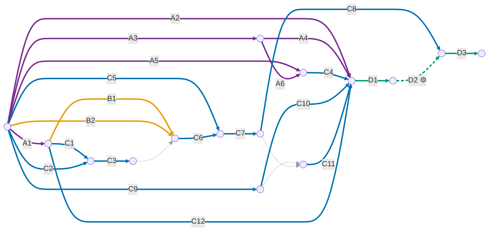
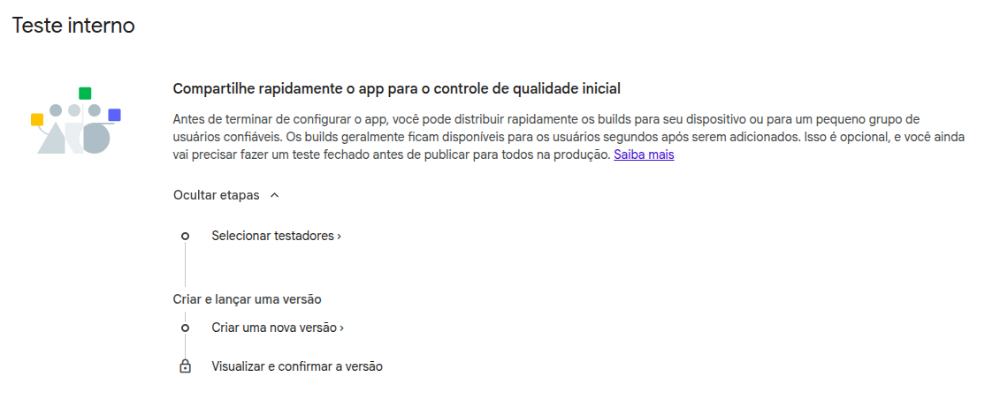

# Publicação no teste interno

Este guia leva um app do zero até a faixa de **teste interno** do Google Play e mostra como cada nova
versão é publicada depois disso. Quase tudo é feito uma única vez. **A cada nova versão, o único passo
manual é fazer o merge de uma PR na `main`**: o resto é automático. Como a automação funciona está em
[entendendo-o-ci.md](entendendo-o-ci.md).

## Visão geral

Os passos são identificados por grupo, de acordo com a frequência com que são feitos:

| Grupo | Frequência | Passos |
| :--- | :--- | :--- |
| **A** | Uma única vez para a empresa | A1 keystore · A2 a A6 base do CI no Google Cloud |
| **B** | Uma vez por máquina ou clone | B1 `key.properties` · B2 login no Firebase CLI |
| **C** | Uma vez para o app (`org.monamienet.app`) | C1 a C4 Firebase · C5 a C7 primeiro envio, manual · C8 SHAs do Play · C9 a C12 CI do app |
| **D** | A cada nova versão | D1 merge da PR · D2 publicação automática ⚙️ · D3 promover ao teste fechado |

| A cada nova versão | Antes do CI | Com o CI |
| :--- | :--- | :--- |
| Passos manuais | 5: atualizar o versionCode, gerar o bundle, enviar, preencher as notas e lançar | 1: fazer o merge da PR (e um clique para chegar ao teste fechado) |

### Dependências entre os passos



**Como ler:**
- **Arestas** são os passos, e o rótulo é o ID do passo. **Nós** são instantes: o momento em que os passos
  seguintes podem começar.
- Um nó só é atingido quando **todas** as arestas que chegam nele terminaram.
- Arestas que saem do mesmo nó podem ser feitas **em paralelo**.
- Uma aresta **pontilhada fina, sem rótulo**, é só uma dependência, sem trabalho. Por exemplo, convidar a
  service account (C11) exige que ela já exista (C9) e que o app já esteja no Play (C7), e o primeiro
  build só deve buscar a configuração do Firebase depois que os SHAs forem registrados (C3).
- Cores:
  - 🟣 uma vez para a empresa;
  - 🟠 uma vez por máquina;
  - 🔵 uma vez para o app;
  - 🟢 a cada versão. A aresta **tracejada** (D2) é executada automaticamente pelo CI. D1 e D2 se repetem a cada build. D3 só acontece quando você quer levar um build ao teste fechado.

## Valores usados

Os comandos deste guia usam as variáveis abaixo. Cole o bloco no terminal antes de começar:

```bash
# Empresa
GCP_PROJECT=ci-cd-management      # projeto do Google Cloud dedicado ao CI
GCP_PROJECT_NUMBER=787253151660   # gcloud projects describe $GCP_PROJECT --format='value(projectNumber)'
POOL=github-actions               # workload identity pool (A3)
PROVIDER=github                   # provider do GitHub (A4)
GITHUB_ORG_ID=336690459           # gh api orgs/monamienet --jq .id
CONFIG_ROLE=firebaseAppConfigReader   # papel customizado que lê a config dos apps do Firebase (A5)
CONFIG_SA_NAME=wlif-monamie-app-config  # service account que busca essa config no CI (A6)
CONFIG_SA_EMAIL=$CONFIG_SA_NAME@$GCP_PROJECT.iam.gserviceaccount.com

# App
REPO=monamienet/monamie-app
SUBJECT_PREFIX=$(gh api repos/$REPO/actions/oidc/customization/sub --jq .sub_claim_prefix)  # início do subject do token (C10)
FIREBASE_PROJECT=monamienet-app        # projeto central: login e registro de organizações
SA_NAME=wlif-monamie-app-play     # service account do deploy (C9)
SA_EMAIL=$SA_NAME@$GCP_PROJECT.iam.gserviceaccount.com
```

Há um único app para todas as organizações. Cadastrar uma organização não muda nada aqui e não exige nova
versão: veja [white-label.md](white-label.md).

---

## A. Uma única vez para a empresa

### A1. Gerar a keystore de upload

A keystore assina os bundles enviados ao Play e é a mesma para todos os apps da empresa. **Guarde um
backup fora da máquina:** sem ela, nenhum app recebe novas versões.

```bash
keytool -genkey -v \
  -keystore <CAMINHO>/upload.jks \
  -keyalg RSA -keysize 2048 -validity 10000 \
  -alias <ALIAS> \
  -dname "CN=MonAmieNet, O=MonAmieNet, C=BR" \
  -storepass '<SENHA>' -keypass '<SENHA>'
```

### A2. Ativar a API do Play no projeto de CI

Sem a API ativada, o Google recusa as chamadas de publicação feitas pelo CI.

```bash
gcloud services enable androidpublisher.googleapis.com --project=$GCP_PROJECT
```

### A3. Criar o workload identity pool

O pool agrupa as identidades externas (aqui, os workflows do GitHub) que o Google Cloud aceita. Ele serve
a todos os pipelines da organização.

```bash
gcloud iam workload-identity-pools create $POOL \
  --project=$GCP_PROJECT \
  --location=global \
  --display-name="GitHub Actions" \
  --description="GitHub Actions workflows of the monamienet organization"
```

### A4. Criar o provider do GitHub

O provider faz o pool confiar nos tokens do GitHub Actions, mas só nos da organização `monamienet`. A
condição usa o ID numérico porque, ao contrário do nome, ele nunca é reutilizado.

```bash
gcloud iam workload-identity-pools providers create-oidc $PROVIDER \
  --project=$GCP_PROJECT \
  --location=global \
  --workload-identity-pool=$POOL \
  --display-name="GitHub" \
  --issuer-uri="https://token.actions.githubusercontent.com/" \
  --attribute-mapping="google.subject=assertion.sub,attribute.repository_id=assertion.repository_id,attribute.repository_owner_id=assertion.repository_owner_id" \
  --attribute-condition="assertion.repository_owner_id=='$GITHUB_ORG_ID'"
```

**Conferir A2 a A4:**

```bash
gcloud services list --enabled --project=$GCP_PROJECT --filter="config.name=androidpublisher.googleapis.com"
gcloud iam workload-identity-pools providers describe $PROVIDER --workload-identity-pool=$POOL \
  --location=global --project=$GCP_PROJECT --format="yaml(state,attributeCondition)"
```

O resultado esperado é a API listada, `state: ACTIVE` e a condição com o ID da organização.

### A5. Criar o papel `firebaseAppConfigReader`

Todo build busca o `google-services.json` do projeto central (C4). O CI faz isso com um papel que tem exatamente as duas permissões que o Firebase CLI usa para isso: listar os apps
(`firebase.clients.list`) e ler a configuração de um app (`firebase.clients.get`). O papel predefinido
`roles/firebase.viewer` **não** é usado: ele também lê dados do produto, como os documentos do Firestore
com o histórico de localização das equipes. A função central `resolveOrganizations` usa o mesmo papel,
vinculado em cada projeto de organização, para ler as opções do Firebase das organizações em tempo de execução
(white-label.md).

O papel já existe na organização monamienet.org
(`organizations/666407655233/roles/firebaseAppConfigReader`); os comandos abaixo só servem para recriá-lo.
Ele é criado uma única vez, na organização, para que todo projeto possa vinculá-lo. Isso exige
`roles/iam.organizationRoleAdmin`, que o Administrador da organização **não** inclui. Se você não tiver
esse papel e puder editar o IAM da organização, conceda-o a si mesmo só para este passo e revogue-o logo
depois (último comando):

```bash
ORG_ID=<ID>
ME=$(gcloud config get-value account)
gcloud organizations add-iam-policy-binding $ORG_ID --member=user:$ME \
  --role=roles/iam.organizationRoleAdmin --condition=None --format=none
gcloud iam roles create $CONFIG_ROLE \
  --organization=$ORG_ID \
  --title="Firebase app config reader" \
  --description="Lists Firebase apps and reads their config at build time. Not roles/firebase.viewer, which also reads product data. Docs: docs/pt-br/publicar-teste-interno.md" \
  --permissions=firebase.clients.list,firebase.clients.get \
  --stage=GA
gcloud iam roles describe $CONFIG_ROLE --organization=$ORG_ID --format='value(includedPermissions)'
gcloud organizations remove-iam-policy-binding $ORG_ID --member=user:$ME \
  --role=roles/iam.organizationRoleAdmin --condition=None --format=none
CONFIG_ROLE_PATH=organizations/$ORG_ID/roles/$CONFIG_ROLE
```

O `describe` deve listar exatamente `firebase.clients.get` e `firebase.clients.list`. Rode-o antes de
revogar a concessão: depois dela, você não consegue mais ler o papel.

Definir o papel na organização não concede nada: a permissão só existe onde o papel é vinculado (C4), e o
vínculo é feito por projeto, nunca na organização ou em uma pasta.

Se depois uma chamada do CI falhar com 403, adicione **só** a permissão citada no erro
(`gcloud iam roles update ... --add-permissions=<permissão>`) e registre o motivo na descrição do papel.

### A6. Criar a service account da config do Firebase

É a identidade que o CI usa para buscar a config do Firebase **antes** do build. Ela é separada da
service account que publica (C9): o build roda código de terceiros (plugins do Gradle, pacotes do pub),
então só tem em mãos uma credencial que lê configs, e o vazamento de uma credencial não permite fazer o
trabalho da outra.

```bash
# Chamadas de uma service account contam na API do projeto dono da conta.
gcloud services enable firebase.googleapis.com --project=$GCP_PROJECT

gcloud iam service-accounts create $CONFIG_SA_NAME \
  --project=$GCP_PROJECT \
  --display-name="monamie-app Firebase config reader" \
  --description="Reads the central project's Firebase app config at build time for $REPO from GitHub Actions via WIF. Docs: docs/pt-br/publicar-teste-interno.md"

# Mesmo subject de C10: só jobs no environment play-internal deste repositório.
gcloud iam service-accounts add-iam-policy-binding $CONFIG_SA_EMAIL \
  --project=$GCP_PROJECT \
  --role=roles/iam.workloadIdentityUser \
  --member="principal://iam.googleapis.com/projects/$GCP_PROJECT_NUMBER/locations/global/workloadIdentityPools/$POOL/subject/$SUBJECT_PREFIX:environment:play-internal"
```

**Conferir:** `gcloud iam service-accounts get-iam-policy $CONFIG_SA_EMAIL --project=$GCP_PROJECT` deve listar
só o binding `roles/iam.workloadIdentityUser` com esse `principal://...`.

## B. Uma vez por máquina ou clone

### B1. Criar o `android/key.properties`

Esse arquivo diz ao Gradle onde está a keystore. Ele está no `.gitignore`, então cada máquina precisa do
seu. Ele só é necessário para builds release **locais**, como o primeiro envio (C6), porque o CI monta o
dele a partir dos secrets (C12).

```properties
storePassword=<SENHA>
keyPassword=<SENHA>
keyAlias=<ALIAS>
storeFile=<CAMINHO>/upload.jks
```

> **Fail-fast:** sem esse arquivo, ou com alguma propriedade vazia, todo build release falha com a mensagem
> `Release signing: ...`. Não há fallback para a chave debug, cujo bundle o Play rejeitaria. Builds debug
> (`flutter run`) não precisam da keystore.

### B2. Entrar no Firebase CLI

Todo build precisa do `google-services.json` do projeto central (`monamienet-app`, usado no login), que
não é versionado: ele contém chaves de API. Os projetos das organizações não entram aqui: o app os liga em
tempo de execução. Quando o arquivo não existe, o Gradle o busca com
`dart run tool/organization.dart firebase`, que chama o Firebase CLI com a **sua própria** conta:

```bash
firebase --version || npm install -g firebase-tools
firebase login            # ou firebase login --reauth quando as credenciais expirarem
```

O arquivo fica em `android/app/google-services.json` (ignorado pelo git) e é reaproveitado nos builds
seguintes, mesmo offline. Para buscá-lo de novo, por exemplo depois de registrar novos SHAs (C3, C8),
faça o build com `REFRESH_FIREBASE_CONFIG=1` ou rode `dart run tool/organization.dart firebase`. O
comando confere o projeto, o pacote e o cliente OAuth web antes de gravar, e só mostra o ID do app.

## C. Uma vez para o app

São três frentes que podem andar em paralelo: Firebase (C1 a C4), primeiro envio (C5 a C8) e CI do app
(C9 a C12). O diagrama mostra o que depende do quê.

### C1. Obter os SHAs da chave de upload

```bash
keytool -list -v -keystore <CAMINHO>/upload.jks -alias <ALIAS> | grep -E "SHA1|SHA256"
```

### C2. Obter o ID do app Android no Firebase

O app `org.monamienet.app` é registrado na configuração do projeto central (white-label.md, seção 4).

```bash
firebase apps:list ANDROID --project $FIREBASE_PROJECT
APP_ID=<valor da coluna "App ID">
```

### C3. Registrar os SHAs no Firebase

O login com Google só funciona em apps cuja assinatura o Firebase conhece.

```bash
firebase apps:android:sha:create $APP_ID <SHA1> --project $FIREBASE_PROJECT
firebase apps:android:sha:create $APP_ID <SHA256> --project $FIREBASE_PROJECT
```

### C4. Permitir que o CI leia a config do Firebase

Nada é commitado: cada build busca o `google-services.json` em `$FIREBASE_PROJECT` (B2). Para o CI fazer o
mesmo, vincule o papel de A5 à service account da config (A6) **só neste projeto**:

```bash
gcloud projects add-iam-policy-binding $FIREBASE_PROJECT \
  --member=serviceAccount:$CONFIG_SA_EMAIL \
  --role=$CONFIG_ROLE_PATH \
  --condition=None
```

**Conferir:** o comando abaixo deve mostrar só o papel `firebaseAppConfigReader`:

```bash
gcloud projects get-iam-policy $FIREBASE_PROJECT --flatten=bindings \
  --filter="bindings.members:serviceAccount:$CONFIG_SA_EMAIL" --format='value(bindings.role)'
```

### C5. Criar a lista de testadores

No Play Console, abra **Testar e lançar → Teste interno**. A tela mostra os dois passos deste guia:
**Selecionar testadores** (este passo) e **Criar uma nova versão** (C7).



Em **Selecionar testadores**, crie uma lista de e-mails de testadores e associe-a à faixa de **teste interno**.

### C6. Gerar o primeiro bundle

O Play só aceita envios pela API depois que o app recebe o primeiro bundle pelo Play Console, então
**a primeira versão é manual**.

1. Busque a config do Firebase central: `dart run tool/organization.dart firebase`.
2. Gere o bundle com um *versionCode* **menor que 101**, porque os números a partir de 101 são usados
   pelo CI:

    ```bash
    nice -n 15 flutter build appbundle --release --build-number=100
    ```

    O resultado fica em `build/app/outputs/bundle/release/app-release.aab`.

### C7. Enviar e lançar o primeiro bundle

No Play Console, abra o **teste interno** → **Criar uma nova versão**. Quando o Play perguntar sobre a
assinatura do app, aceite a **chave gerenciada pelo Google** (o padrão). Envie o `.aab`, preencha as notas
da versão e clique em **Salvar → Revisar → Lançar**. Se o Play listar pendências em **Conteúdo do app**
(política de privacidade, Segurança dos dados, acesso ao app, localização em segundo plano), preencha-as
antes de lançar.

### C8. Registrar no Firebase os SHAs da assinatura do Google Play

O Play reassina o app com uma chave do Google (*Play App Signing*). Sem os SHAs dessa chave no Firebase, o
login com Google falha nos aparelhos dos testadores. Copie o SHA1 e o SHA256 em *Play Console → Protegido
com o Google Play → Assinatura de apps* e registre:

```bash
firebase apps:android:sha:create $APP_ID <SHA1_DO_PLAY> --project $FIREBASE_PROJECT
firebase apps:android:sha:create $APP_ID <SHA256_DO_PLAY> --project $FIREBASE_PROJECT
```

O CI busca a config atualizada em toda execução. Na sua máquina, busque-a de novo como descrito em B2.

### C9. Criar a service account do deploy

É a identidade que publica no Play. Cada pipeline tem a sua, e ela não recebe nenhum papel no Google
Cloud. O motivo está em [entendendo-o-ci.md](entendendo-o-ci.md#por-que-uma-service-account-dedicada).

```bash
gcloud iam service-accounts create $SA_NAME \
  --project=$GCP_PROJECT \
  --display-name="monamie-app Play publisher" \
  --description="Publishes $REPO to the Play internal track from GitHub Actions via WIF. Docs: docs/pt-br/publicar-teste-interno.md"
```

### C10. Permitir que só o environment `play-internal` assuma a service account

O `--member` é o *subject* exato que o GitHub coloca no token de um job que roda no environment
`play-internal` deste repositório. Qualquer outro job é recusado. O subject tem a forma
`<prefixo>:environment:play-internal`. Este repositório usa o formato **imutável** do GitHub, em que o
prefixo inclui os IDs numéricos da organização e do repositório (`repo:monamienet@336690459/monamie-app@1407450217`).
Por isso o prefixo é lido da API (`SUBJECT_PREFIX`) em vez de escrito à mão: com o formato antigo,
`repo:monamienet/monamie-app`, o Google recusa o job.

```bash
gcloud iam service-accounts add-iam-policy-binding $SA_EMAIL \
  --project=$GCP_PROJECT \
  --role=roles/iam.workloadIdentityUser \
  --member="principal://iam.googleapis.com/projects/$GCP_PROJECT_NUMBER/locations/global/workloadIdentityPools/$POOL/subject/$SUBJECT_PREFIX:environment:play-internal"
```

**Conferir:** `gcloud iam service-accounts get-iam-policy $SA_EMAIL --project=$GCP_PROJECT` deve listar um
binding `roles/iam.workloadIdentityUser` com esse `principal://...`. Se aparecer só o `etag`, o comando não
foi aplicado.

### C11. Convidar a service account no Play Console

1. No Play Console, abra **Usuários e permissões → Convidar novos usuários**.
2. Informe o e-mail da service account (`echo $SA_EMAIL`).
3. Em **Permissões do app**, adicione o app e marque **apenas** a permissão de lançar em faixas de teste.
4. Clique em **Convidar usuário**.

A permissão pode levar até 48 horas para valer.

### C12. Criar o environment e os secrets no GitHub

O environment `play-internal` guarda os secrets de assinatura e só pode ser usado pela `main`. **Essa
restrição é obrigatória:** a permissão de C10 confia no environment, e é a restrição que impede outras
branches de publicar.

| Secret | Valor |
| :--- | :--- |
| `ANDROID_KEYSTORE_B64` | a keystore codificada em base64 |
| `ANDROID_KEYSTORE_PASSWORD` | o `storePassword` do `key.properties` |
| `ANDROID_KEY_PASSWORD` | o `keyPassword` do `key.properties` |
| `ANDROID_KEY_ALIAS` | o `keyAlias` do `key.properties` |

Pela interface, use *Settings → Environments*. Pelo terminal, a partir da raiz do repositório, os valores
vão direto do `key.properties` para o GitHub, sem aparecer na tela:

```bash
prop() { grep "^$1=" android/key.properties | cut -d= -f2- | tr -d '\r\n'; }

gh api -X PUT repos/$REPO/environments/play-internal \
  -F 'deployment_branch_policy[protected_branches]=false' \
  -F 'deployment_branch_policy[custom_branch_policies]=true'
gh api -X POST repos/$REPO/environments/play-internal/deployment-branch-policies -f name=main

prop storePassword | gh secret set ANDROID_KEYSTORE_PASSWORD --env play-internal --repo $REPO
prop keyPassword   | gh secret set ANDROID_KEY_PASSWORD      --env play-internal --repo $REPO
prop keyAlias      | gh secret set ANDROID_KEY_ALIAS         --env play-internal --repo $REPO
base64 -w0 "$(prop storeFile)" | gh secret set ANDROID_KEYSTORE_B64 --env play-internal --repo $REPO
```

**Conferir:** `gh secret list --env play-internal --repo $REPO` deve listar os 4 secrets, e
`gh api repos/$REPO/environments/play-internal/deployment-branch-policies --jq '.branch_policies[].name'`
deve mostrar `main`.

## D. A cada nova versão

### D1. Fazer o merge da PR na `main`

É o único passo manual de todo build. Antes do merge, confira no diff da PR as **notas da versão**, o
texto "O que há de novo" que aparece no Play:

- Ficam em `distribution/whatsnew/whatsnew-pt-BR` e `whatsnew-en-US`, com até 500 caracteres cada,
  o limite do Play por idioma.
- Quem as escreve são os agentes de IA, na mesma PR da mudança (regra em `AGENTS.md`, seção
  *Releases*). Elas resumem, em linguagem de quem usa o app, tudo o que mudou desde a **última versão
  promovida ao teste fechado** (a tag `play-closed`). Assim quem está no teste fechado lê todas as
  novidades, mesmo que tenha pulado versões.

### D2. Publicação automática ⚙️

O merge dispara o workflow. Ele confere as notas, **calcula o versionName**, roda os testes, gera e
assina o bundle, envia-o ao Play **com as notas** e lança a versão para os testadores. Por fim, marca o
commit com a tag da versão (`v1.1.0`, por exemplo).

O versionName sai das mensagens dos commits desde a última tag `v…`, que seguem o padrão
*Conventional Commits*. Só contam os commits que mexem no app (`lib/`, `android/`, `assets/`):

| Commits desde a última versão | Próxima versão |
| :--- | :--- |
| algum `feat:` (funcionalidade nova) | sobe o do meio: `1.0.0` → `1.1.0` |
| só `fix:` (correções) | sobe o último: `1.0.0` → `1.0.1` |
| nenhum dos dois (ex.: só `chore:`) | continua igual; o build sai com o mesmo nome e um versionCode novo |
| um commit com o rodapé `Release-As: 2.0.0` | exatamente `2.0.0` |

O primeiro número (`1.x.x` → `2.0.0`) **só muda quando você decide**: peça a um agente um commit com o
rodapé `Release-As: 2.0.0`. Os agentes nunca usam `feat!:` nem `BREAKING CHANGE:`. O `version:` do
`pubspec.yaml` não é mais editado: o CI o substitui.

Nada precisa ser feito, mas vale saber:

- **Acompanhar:** em *Actions → Deploy to Play (internal)*, cada execução mostra os logs de cada passo.
  Se algo falhar, nada é enviado, nenhuma tag é criada e quem fez o push recebe um e-mail.
- **Publicar de novo sem merge**, por exemplo depois de corrigir uma permissão: use *Run workflow* na `main`.
- ⚠️ **Não renomeie o arquivo do workflow.** O número da execução, usado como versionCode, é contado por
  arquivo. Renomeá-lo reinicia a contagem em 1, e o Play recusa versionCodes repetidos.

### D3. Promover ao teste fechado

Em *Actions → Promote to Play (closed) → Run workflow*, com a `main` selecionada:

- **track:** o nome da faixa de teste fechado no Play. O padrão `alpha` é o nome interno da faixa
  fechada que o Play cria ("Teste fechado - Alpha" no Console). Se você criou outra faixa fechada, use o
  nome dela.
- **version_code:** deixe vazio para promover o build que está no teste interno.

O workflow não recompila nada. Pela API do Google Play, ele copia o versionCode, o versionName **e as
notas** da versão interna para a faixa fechada, que é revisada pelo Google antes de chegar aos
testadores. Depois, move a tag `play-closed` para a versão promovida: as notas seguintes começam dali.

Ele roda no environment `play-internal`, porque é nele que a service account de C10 confia. A permissão
de C11 (lançar em faixas de teste) já cobre o teste fechado.

O teste fechado pode **pular números** (de `1.0.0` direto para `1.3.0`, por exemplo). Isso é normal: o
Play só exige que o versionCode cresça, e as notas cobrem tudo desde a última promoção.

⚠️ A promoção **substitui** as versões da faixa fechada. Um rascunho que alguém tenha começado no
Console nessa faixa é descartado.

**Sem o CI:** se o workflow estiver indisponível, repita C6 e C7 com um versionCode maior que o da última
versão enviada, que aparece no Play Console.

---

## Problemas comuns

| Mensagem | Causa e solução |
| :--- | :--- |
| `Release signing: ...` | O `key.properties` ou a keystore estão incompletos. Localmente, confira B1. No CI, confira os secrets de C12. |
| `Secret ANDROID_... is empty` | O secret não foi cadastrado no environment `play-internal`, ou foi cadastrado como secret do repositório (C12). |
| `The given credential is rejected by the attribute condition` | O token não veio da organização `monamienet`. Confira a condição do provider (A4). |
| `Permission 'iam.serviceAccounts.getAccessToken' denied` | O subject liberado em C10 não é o que o GitHub envia. Confira se o binding usa o prefixo da API (`echo $SUBJECT_PREFIX`) e se o job rodou no environment `play-internal`. |
| `The caller does not have permission` | A service account ainda não tem permissão no Play Console, ou a permissão ainda não propagou (C11). |
| `Release notes missing or empty` / `... has N characters` | Faltam as notas em `distribution/whatsnew/`, ou uma passa de 500 caracteres (D1). Corrija numa PR; nada foi enviado. |
| `App changes since vX.Y.Z but distribution/whatsnew was not updated` | Entraram commits `feat:`/`fix:` no app sem atualizar as notas (D1). Uma PR que as atualize libera o próximo deploy. |
| `No matching release on the internal track` (promoção) | O teste interno não tem versão concluída, ou o `version_code` informado não está nele (D3). |
| `No tag vX.Y.Z; play-closed was not moved` (promoção) | A versão promovida foi enviada antes deste fluxo e não tem tag. A promoção valeu; aponte a tag à mão: `git tag -f play-closed <commit> && git push -f origin play-closed`. |
| `Version code ... has already been used` | O versionCode já foi usado. Normalmente o arquivo do workflow foi renomeado. Aumente o `+ 100` no workflow. |
| `Only releases with status draft may be created on draft app` | O app ainda está em rascunho no Play. Conclua o primeiro lançamento (C7). |
| O app instala, mas o login com Google falha | Faltam SHAs no Firebase: da chave de upload (C3) ou da assinatura do Google Play (C8). Localmente, busque a config de novo (B2). |
| `'firebase apps:list' failed: ...` (tarefa `fetchFirebaseConfig`) | Localmente, entre de novo no Firebase CLI (B2). No CI, a service account da config não consegue ler o projeto: confira A6 e C4. |
| `No Android app with package 'org.monamienet.app' ...` | O projeto central (`monamienet-app`) não tem um app Android com esse pacote. Registre o app (C2). |
| `Could not run 'firebase'` | O Firebase CLI não está instalado (B2). |
