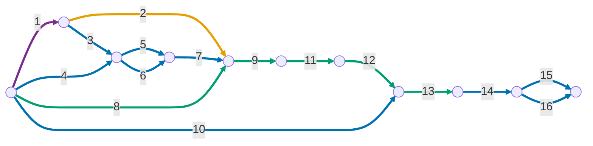

# Publicação teste interno

### No projeto Flutter

1. Gerar uma keystore com o comando 

    ```
    keytool -genkey -v \
      -keystore <OUTPUT_PATH> \
      -keyalg RSA -keysize 2048 -validity 10000 \
      -alias <ALIAS> \
      -dname "CN=MonAmieNet, O=MonAmieNet, C=BR" \
      -storepass '<SENHA>' -keypass '<SENHA>'
    ```

    > [!IMPORTANT]
    > Fazer o backup da keystore gerada no passo anterior!

1. Dentro do projeto Dart/Flutter criar o arquivo `android/key.properties` contendo o seguinte conteúdo:

    ```
    storePassword=<SENHA>
    keyPassword=<SENHA>
    keyAlias=<ALIAS>
    storeFile=<OUTPUT_PATH>
    ```

    > [!IMPORTANT]
    > Adicionar `key.properties` e arquivos `.jks` ao `.gitignore`.

1. Consultar as chaves SHA1 e SHA256 através do comando `keytool -list -v -keystore <keystore_path> -alias <ALIAS> | grep -E "SHA1|SHA256"`

1. Consultar o `<APP_ID>` usando `firebase apps:list ANDROID --project PROJECT_ID`

1. Cadastrar a chave SHA1 no app android no projeto Firebase com `firebase apps:android:sha:create <APP_ID> <SHA1> --project <PROJECT_ID>`

1. Cadastrar a chave SHA256 no app android no projeto Firebase com `firebase apps:android:sha:create <APP_ID> <SHA256> --project <PROJECT_ID>`

1. Atualize o `google-services.json` usando `firebase apps:sdkconfig ANDROID <APP_ID> --project <PROJECT_ID> --out android/app/google-services.json`

1. Atualizar a versão em `pubspec.yaml`, sabendo que:
    - a versão é da forma `a.b.c+d`, onde `a.b.c` é o ***versionName*** e d é o ***versionCode***
    - alterar a ***versionName*** é opcional
    - alterar ***versionCode*** de forma estritamente crescente é obrigatório

1. Gerar bundle com `flutter build appbundle --release`

### No Google Play Console:

10. Criar lista de testadores e associar à faixa de teste interno

1. Enviar o bundle gerado no passo anterior

1. Preencher notas de versão

1. Salvar → Lançar

1. Copiar as chaves SHA1 e SHA256, assinadas no app pela Google, em *Play Console > Protegido com o Google Play > Assinatura de apps*

1. Cadastrar a chave SHA1 (assinada pela Google) no app android no projeto Firebase com `firebase apps:android:sha:create <APP_ID> <SHA1> --project <PROJECT_ID>`

1. Cadastrar a chave SHA256 (assinada pela Google) no app android no projeto Firebase com `firebase apps:android:sha:create <APP_ID> <SHA256> --project <PROJECT_ID>`


### Sobre a frequência dos passos

Numeração conforme os passos acima (1 a 9 no projeto Flutter, 10 a 16 no Google Play Console).

| Frequência | Passos | Observação |
| :--- | :--- | :--- |
| Uma única vez para a empresa | 1 | A keystore é a mesma para todos os apps e faixas. Faça o backup logo após gerá-la. |
| Uma vez por máquina ou clone do repositório | 2 | O `key.properties` não é versionado, então cada ambiente precisa do seu. |
| Uma vez por app (cliente) | 3, 4, 5, 6, 7, 10, 14, 15, 16 | Os passos 14 a 16 só podem ser feitos depois do primeiro envio ao Play Console. |
| A cada nova versão | 8, 9, 11, 12, 13 | O passo 8 exige um `versionCode` maior que o de qualquer bundle já enviado. |

### Dependência temporal entre os passos

A numeração dos passos é a mesma deste guia.

#### Como ler

- **Arestas** são as etapas (rótulo = número do passo, conforme a lista acima). **Nós** são instantes: o início de etapas que dependem do que terminou.
- Um nó só é atingido quando **todas** as arestas que chegam nele terminarem.
- Arestas que saem do mesmo nó podem ser feitas **em paralelo**.



Cor das arestas, conforme a tabela de frequência:

- 🟣 Uma única vez para a empresa (passo 1)
- 🟠 Uma vez por máquina ou clone do repositório (passo 2)
- 🔵 Uma vez por app (passos 3, 4, 5, 6, 7, 10, 14, 15 e 16)
- 🟢 A cada nova versão (passos 8, 9, 11, 12 e 13)
