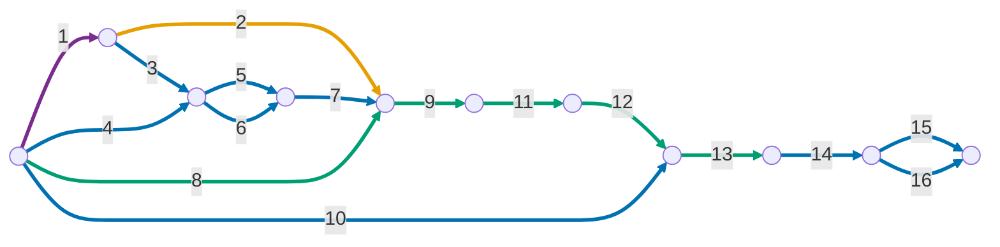

# Publicação teste interno

### No projeto Flutter

1. Gerar uma keystore com o comando 

    ```
    keytool -genkey -v \
      -keystore <OUTPUT_PATH> \
      -keyalg RSA -keysize 2048 -validity 10000 \
      -alias <ALIAS> \
      -dname "CN=MonAmieNet, O=MonAmieNet, C=BR" \
      -storepass '<SENHA>' -keypass '<SENHA>'
    ```

    > **Importante:** Fazer o backup da keystore gerada no passo anterior!

1. Dentro do projeto Dart/Flutter criar o arquivo `android/key.properties` contendo o seguinte conteúdo:

    ```
    storePassword=<SENHA>
    keyPassword=<SENHA>
    keyAlias=<ALIAS>
    storeFile=<OUTPUT_PATH>
    ```

    > **Importante:** Adicionar `key.properties` e arquivos `.jks` ao `.gitignore`.

    > **Fail-fast:** sem esse arquivo, ou com alguma propriedade vazia, **todo build release falha** com a
    > mensagem `Release signing: ...`, gerada pela task `validateReleaseSigning` do `android/app/build.gradle.kts`.
    > Não existe mais o fallback para a chave debug, cujo bundle o Play rejeitaria. Builds debug não exigem a keystore.

1. Consultar as chaves SHA1 e SHA256 através do comando `keytool -list -v -keystore <keystore_path> -alias <ALIAS> | grep -E "SHA1|SHA256"`

1. Consultar o `<APP_ID>` usando `firebase apps:list ANDROID --project PROJECT_ID`

1. Cadastrar a chave SHA1 no app android no projeto Firebase com `firebase apps:android:sha:create <APP_ID> <SHA1> --project <PROJECT_ID>`

1. Cadastrar a chave SHA256 no app android no projeto Firebase com `firebase apps:android:sha:create <APP_ID> <SHA256> --project <PROJECT_ID>`

1. Atualize o `google-services.json` usando `firebase apps:sdkconfig ANDROID <APP_ID> --project <PROJECT_ID> --out android/app/google-services.json`

1. Atualizar a versão em `pubspec.yaml`, sabendo que:
    - a versão é da forma `a.b.c+d`, onde `a.b.c` é o ***versionName*** e d é o ***versionCode***
    - alterar a ***versionName*** é opcional
    - alterar ***versionCode*** de forma estritamente crescente é obrigatório

1. Gerar bundle com `flutter build appbundle --release`

### No Google Play Console:

10. Criar lista de testadores e associar à faixa de teste interno

1. Enviar o bundle gerado no passo anterior

1. Preencher notas de versão

1. Salvar → Lançar

1. Copiar as chaves SHA1 e SHA256, assinadas no app pela Google, em *Play Console > Protegido com o Google Play > Assinatura de apps*

1. Cadastrar a chave SHA1 (assinada pela Google) no app android no projeto Firebase com `firebase apps:android:sha:create <APP_ID> <SHA1> --project <PROJECT_ID>`

1. Cadastrar a chave SHA256 (assinada pela Google) no app android no projeto Firebase com `firebase apps:android:sha:create <APP_ID> <SHA256> --project <PROJECT_ID>`


### Publicação automática (CI)

O workflow [`.github/workflows/deploy-play-internal.yml`](../../.github/workflows/deploy-play-internal.yml)
publica na faixa de teste interno a cada merge na `main`. O que ele faz, linha por linha, está em
[entendendo-o-ci.md](entendendo-o-ci.md).

Com o CI configurado, **os passos 8, 9, 11 e 13 deixam de ser manuais**:
- o versionCode passa a ser `número da execução + 100`, e o `+N` do pubspec é ignorado no CI;
- o build, o upload e o lançamento são feitos pelo workflow.

O passo 12 (notas de versão) é opcional na faixa interna, e o workflow não o preenche. Os passos únicos
(1 a 7, 10, 14 a 16) continuam valendo.

#### Configuração única

A autenticação no Google Play é feita **sem chave**, por Workload Identity Federation. A explicação de cada
peça está em [entendendo-o-ci.md](entendendo-o-ci.md#6-como-o-github-ganha-permissão-para-publicar-no-play-sem-chave).
Os comandos usam o `gcloud` com uma conta que possa administrar IAM no projeto `ci-cd-management`.

1. **Ativar a API do Play no projeto:**

    ```bash
    gcloud services enable androidpublisher.googleapis.com --project=ci-cd-management
    ```

1. **Criar o workload identity pool**, que agrupa as identidades do GitHub aceitas no projeto. Ele é
   criado uma vez e pode servir a outros pipelines da organização:

    ```bash
    gcloud iam workload-identity-pools create github-actions \
      --project=ci-cd-management \
      --location=global \
      --display-name="GitHub Actions" \
      --description="GitHub Actions workflows of the monamienet organization"
    ```

1. **Criar o provider do GitHub** no pool `github-actions`. A condição aceita apenas tokens da
   organização `monamienet`, identificada pelo ID numérico `336690459`, porque o ID, ao contrário do nome,
   nunca é reutilizado:

    ```bash
    gcloud iam workload-identity-pools providers create-oidc github \
      --project=ci-cd-management \
      --location=global \
      --workload-identity-pool=github-actions \
      --display-name="GitHub" \
      --issuer-uri="https://token.actions.githubusercontent.com/" \
      --attribute-mapping="google.subject=assertion.sub,attribute.repository_id=assertion.repository_id,attribute.repository_owner_id=assertion.repository_owner_id" \
      --attribute-condition="assertion.repository_owner_id=='336690459'"
    ```

    > Se o provider `github` já existir porque outro pipeline da organização o criou, pule este passo e
    > confira que a condição dele restringe a organização.

1. **Criar a service account dedicada** a este pipeline. Ela não recebe nenhum papel no Google Cloud:

    ```bash
    gcloud iam service-accounts create wlif-monamie-app-play \
      --project=ci-cd-management \
      --display-name="monamie-app Play publisher" \
      --description="Publishes monamie-app to the Play internal track from GitHub Actions via WIF. Docs: monamienet/monamie-app docs/pt-br/publicar-teste-interno.md"
    ```

1. **Permitir que só o environment `play-internal` deste repositório assuma a service account:**

    ```bash
    gcloud iam service-accounts add-iam-policy-binding \
      wlif-monamie-app-play@ci-cd-management.iam.gserviceaccount.com \
      --project=ci-cd-management \
      --role=roles/iam.workloadIdentityUser \
      --member="principal://iam.googleapis.com/projects/787253151660/locations/global/workloadIdentityPools/github-actions/subject/repo:monamienet/monamie-app:environment:play-internal"
    ```

1. **Convidar a service account no Play Console:** em *Usuários e permissões → Convidar novos usuários*:
   - informe o e-mail `wlif-monamie-app-play@ci-cd-management.iam.gserviceaccount.com`;
   - em *Permissões do app*, adicione o app e marque **apenas** *Lançar para faixas de teste*;
   - envie o convite. Segundo o Google, mudanças de permissão podem levar até 48 horas para valer.

1. **Environment e secrets no GitHub:** em *Settings → Environments → `play-internal`*:
   - em *Deployment branches and tags*, escolha *Selected branches and tags* e adicione a `main`. **Essa regra
     é obrigatória:** a permissão do passo 5 confia no environment, e é ela que impede outras branches de publicar;
   - em *Environment secrets*, cadastre os secrets de assinatura:

    | Secret | Valor |
    | :--- | :--- |
    | `ANDROID_KEYSTORE_B64` | a saída de `base64 -w0 <storeFile do key.properties>` |
    | `ANDROID_KEYSTORE_PASSWORD` | o `storePassword` do `key.properties` |
    | `ANDROID_KEY_PASSWORD` | o `keyPassword` do `key.properties` |
    | `ANDROID_KEY_ALIAS` | o `keyAlias` do `key.properties` |

    Pelo terminal, sem copiar e colar senhas, a partir da raiz do repositório:

    ```bash
    REPO=monamienet/monamie-app
    prop() { grep "^$1=" android/key.properties | cut -d= -f2- | tr -d '\r\n'; }

    gh api -X PUT repos/$REPO/environments/play-internal \
      -F 'deployment_branch_policy[protected_branches]=false' \
      -F 'deployment_branch_policy[custom_branch_policies]=true'
    gh api -X POST repos/$REPO/environments/play-internal/deployment-branch-policies -f name=main

    prop storePassword | gh secret set ANDROID_KEYSTORE_PASSWORD --env play-internal --repo $REPO
    prop keyPassword   | gh secret set ANDROID_KEY_PASSWORD      --env play-internal --repo $REPO
    prop keyAlias      | gh secret set ANDROID_KEY_ALIAS         --env play-internal --repo $REPO
    base64 -w0 "$(prop storeFile)" | gh secret set ANDROID_KEYSTORE_B64 --env play-internal --repo $REPO
    ```

1. **Pré-requisito do Play:** a API só aceita envios depois do primeiro envio manual do app (passos 10 a 13).

#### Executar e acompanhar

- **Automático:** todo merge de PR na `main`.
- **Manual:** *Actions → Deploy to Play (internal) → Run workflow*, na branch `main`. Em outras branches a
  execução para no environment, que só aceita a `main`.
- Cada execução mostra os logs de cada passo. As versões enviadas ficam no Play Console, em *Teste interno*.

> ⚠️ **Não renomeie o arquivo do workflow.** O número da execução, usado como versionCode, é contado por
> arquivo: renomeá-lo reinicia a contagem em 1, e o Play recusaria versionCodes repetidos.

#### Problemas comuns

| Mensagem | Causa e solução |
| :--- | :--- |
| `Secret ANDROID_... is empty` | O secret não foi cadastrado no environment `play-internal`, ou foi cadastrado como secret do repositório em vez do environment. |
| `Release signing: ...` | O `key.properties` ou a keystore estão incompletos. Confira os secrets de assinatura. |
| `The given credential is rejected by the attribute condition` | O token não veio da organização `monamienet`. Confira a condição do provider (passo 3). |
| `Permission 'iam.serviceAccounts.getAccessToken' denied` | Falta a permissão do passo 5, ou o job não rodou no environment `play-internal` (o subject do token muda). |
| `Version code ... has already been used` | Já existe um bundle com esse versionCode. Normalmente isso acontece porque o arquivo do workflow foi renomeado. Aumente o offset `+ 100` no workflow. |
| `The caller does not have permission` | A service account ainda não tem permissão no app no Play Console, ou a permissão ainda não propagou (passo 6). |
| `Only releases with status draft may be created on draft app` | O app ainda está em rascunho no Play. Conclua o primeiro lançamento manual. |
| O app instala, mas o login Google falha | Faltam os SHAs da assinatura do Google Play no Firebase (passos 14 a 16), não é um problema do CI. |

### Sobre a frequência dos passos

Numeração conforme os passos acima (1 a 9 no projeto Flutter, 10 a 16 no Google Play Console).

| Frequência | Passos | Observação |
| :--- | :--- | :--- |
| Uma única vez para a empresa | 1 | A keystore é a mesma para todos os apps e faixas. Faça o backup logo após gerá-la. |
| Uma vez por máquina ou clone do repositório | 2 | O `key.properties` não é versionado, então cada ambiente precisa do seu. |
| Uma vez por app (cliente) | 3, 4, 5, 6, 7, 10, 14, 15, 16 | Os passos 14 a 16 só podem ser feitos depois do primeiro envio ao Play Console. |
| A cada nova versão | 8, 9, 11, 12, 13 | O passo 8 exige um `versionCode` maior que o de qualquer bundle já enviado. |

### Dependência temporal entre os passos

A numeração dos passos é a mesma deste guia.

#### Como ler

- **Arestas** são as etapas (rótulo = número do passo, conforme a lista acima). **Nós** são instantes: o início de etapas que dependem do que terminou.
- Um nó só é atingido quando **todas** as arestas que chegam nele terminarem.
- Arestas que saem do mesmo nó podem ser feitas **em paralelo**.



Cor das arestas, conforme a tabela de frequência:

- 🟣 Uma única vez para a empresa (passo 1)
- 🟠 Uma vez por máquina ou clone do repositório (passo 2)
- 🔵 Uma vez por app (passos 3, 4, 5, 6, 7, 10, 14, 15 e 16)
- 🟢 A cada nova versão (passos 8, 9, 11, 12 e 13)
