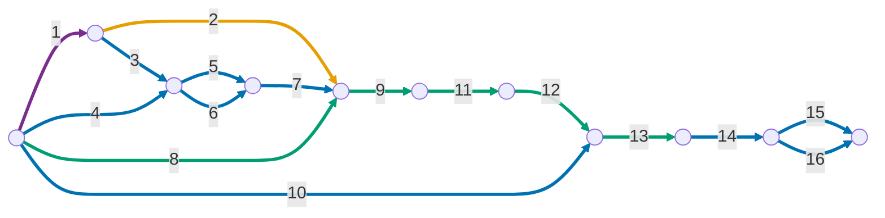

# Publicação teste interno

### No projeto Flutter

1. Gerar uma keystore com o comando 

    ```
    keytool -genkey -v \
      -keystore <OUTPUT_PATH> \
      -keyalg RSA -keysize 2048 -validity 10000 \
      -alias <ALIAS> \
      -dname "CN=MonAmieNet, O=MonAmieNet, C=BR" \
      -storepass '<SENHA>' -keypass '<SENHA>'
    ```

    > **Importante:** Fazer o backup da keystore gerada no passo anterior!

1. Dentro do projeto Dart/Flutter criar o arquivo `android/key.properties` contendo o seguinte conteúdo:

    ```
    storePassword=<SENHA>
    keyPassword=<SENHA>
    keyAlias=<ALIAS>
    storeFile=<OUTPUT_PATH>
    ```

    > **Importante:** Adicionar `key.properties` e arquivos `.jks` ao `.gitignore`.

    > **Fail-fast:** sem esse arquivo, ou com alguma propriedade vazia, **todo build release falha** com a
    > mensagem `Release signing: ...`, gerada pela task `validateReleaseSigning` do `android/app/build.gradle.kts`.
    > Não existe mais o fallback para a chave debug, cujo bundle o Play rejeitaria. Builds debug não exigem a keystore.

1. Consultar as chaves SHA1 e SHA256 através do comando `keytool -list -v -keystore <keystore_path> -alias <ALIAS> | grep -E "SHA1|SHA256"`

1. Consultar o `<APP_ID>` usando `firebase apps:list ANDROID --project PROJECT_ID`

1. Cadastrar a chave SHA1 no app android no projeto Firebase com `firebase apps:android:sha:create <APP_ID> <SHA1> --project <PROJECT_ID>`

1. Cadastrar a chave SHA256 no app android no projeto Firebase com `firebase apps:android:sha:create <APP_ID> <SHA256> --project <PROJECT_ID>`

1. Atualize o `google-services.json` usando `firebase apps:sdkconfig ANDROID <APP_ID> --project <PROJECT_ID> --out android/app/google-services.json`

1. Atualizar a versão em `pubspec.yaml`, sabendo que:
    - a versão é da forma `a.b.c+d`, onde `a.b.c` é o ***versionName*** e d é o ***versionCode***
    - alterar a ***versionName*** é opcional
    - alterar ***versionCode*** de forma estritamente crescente é obrigatório

1. Gerar bundle com `flutter build appbundle --release`

### No Google Play Console:

10. Criar lista de testadores e associar à faixa de teste interno

1. Enviar o bundle gerado no passo anterior

1. Preencher notas de versão

1. Salvar → Lançar

1. Copiar as chaves SHA1 e SHA256, assinadas no app pela Google, em *Play Console > Protegido com o Google Play > Assinatura de apps*

1. Cadastrar a chave SHA1 (assinada pela Google) no app android no projeto Firebase com `firebase apps:android:sha:create <APP_ID> <SHA1> --project <PROJECT_ID>`

1. Cadastrar a chave SHA256 (assinada pela Google) no app android no projeto Firebase com `firebase apps:android:sha:create <APP_ID> <SHA256> --project <PROJECT_ID>`


### Publicação automática (CI)

O workflow [`.github/workflows/deploy-play-internal.yml`](../../.github/workflows/deploy-play-internal.yml)
publica na faixa de teste interno a cada merge na `main`. O que ele faz, linha por linha, está em
[entendendo-o-ci.md](entendendo-o-ci.md).

Com o CI configurado, **os passos 8, 9, 11 e 13 deixam de ser manuais**:
- o versionCode passa a ser `número da execução + 100`, e o `+N` do pubspec é ignorado no CI;
- o build, o upload e o lançamento são feitos pelo workflow.

O passo 12 (notas de versão) é opcional na faixa interna, e o workflow não o preenche. Os passos únicos
(1 a 7, 10, 14 a 16) continuam valendo.

#### Configuração única

Ela é feita uma vez para a conta de desenvolvedor, mais o passo 3 para cada app novo.

1. **Service account (a "conta de robô" que publica):**
   1. No [Google Cloud Console](https://console.cloud.google.com), escolha um projeto da MonAmieNet, e
      não um projeto de cliente, já que a conta de desenvolvedor do Play é da MonAmieNet.
   1. Em *APIs e serviços → Biblioteca*, ative a **Google Play Android Developer API**.
   1. Em *IAM e administrador → Contas de serviço → Criar conta de serviço*, use um nome como
      `play-publisher`. Ela não precisa de papéis no Cloud.
   1. Na conta criada, abra *Chaves → Adicionar chave → Criar nova chave → JSON*. O arquivo é baixado.
      Se a organização bloquear a criação de chaves (política `iam.disableServiceAccountKeyCreation`),
      será preciso uma exceção para esse projeto.
1. **Permissão no Play Console:** em *Usuários e permissões → Convidar novos usuários*:
   - informe o e-mail da service account (`...@<projeto>.iam.gserviceaccount.com`);
   - em *Permissões do app*, adicione o app e marque **apenas** a permissão de lançar para faixas de teste;
   - envie o convite. A permissão pode levar algum tempo para valer.
1. **Secrets no GitHub:** no repositório, abra *Settings → Environments → New environment*, crie o
   environment `play-internal` e, em *Environment secrets → Add secret*, cadastre:

    | Secret | Valor |
    | :--- | :--- |
    | `PLAY_SERVICE_ACCOUNT_JSON` | o conteúdo inteiro do JSON baixado no passo 1 |
    | `ANDROID_KEYSTORE_B64` | a saída de `base64 -w0 <storeFile do key.properties>` |
    | `ANDROID_KEYSTORE_PASSWORD` | o `storePassword` do `key.properties` |
    | `ANDROID_KEY_PASSWORD` | o `keyPassword` do `key.properties` |
    | `ANDROID_KEY_ALIAS` | o `keyAlias` do `key.properties` |

    > **Importante:** depois de cadastrar, apague o JSON da pasta de downloads. Ele dá acesso de
    > publicação ao app e não deve ser versionado.

1. **Pré-requisito do Play:** a API só aceita envios depois do primeiro envio manual do app (passos 10 a 13).

#### Executar e acompanhar

- **Automático:** todo merge de PR na `main`.
- **Manual:** *Actions → Deploy to Play (internal) → Run workflow*, escolhendo a branch. Isso serve para
  testar o workflow numa branch antes do merge.
- Cada execução mostra os logs de cada passo. O `.aab` enviado fica em *Artifacts* por 14 dias.

> ⚠️ **Não renomeie o arquivo do workflow.** O número da execução, usado como versionCode, é contado por
> arquivo: renomeá-lo reinicia a contagem em 1, e o Play recusaria versionCodes repetidos.

#### Problemas comuns

| Mensagem | Causa e solução |
| :--- | :--- |
| `Secret ANDROID_... is empty` | O secret não foi cadastrado no environment `play-internal`, ou foi cadastrado como secret do repositório em vez do environment. |
| `Release signing: ...` | O `key.properties` ou a keystore estão incompletos. Confira os secrets de assinatura. |
| `Version code ... has already been used` | Já existe um bundle com esse versionCode. Normalmente isso acontece porque o arquivo do workflow foi renomeado. Aumente o offset `+ 100` no workflow. |
| `The caller does not have permission` | A service account ainda não tem permissão no app, ou o convite não foi aceito ou ainda não propagou (passo 2 acima). |
| `Only releases with status draft may be created on draft app` | O app ainda está em rascunho no Play. Conclua o primeiro lançamento manual. |
| O app instala, mas o login Google falha | Faltam os SHAs da assinatura do Google Play no Firebase (passos 14 a 16), não é um problema do CI. |

### Sobre a frequência dos passos

Numeração conforme os passos acima (1 a 9 no projeto Flutter, 10 a 16 no Google Play Console).

| Frequência | Passos | Observação |
| :--- | :--- | :--- |
| Uma única vez para a empresa | 1 | A keystore é a mesma para todos os apps e faixas. Faça o backup logo após gerá-la. |
| Uma vez por máquina ou clone do repositório | 2 | O `key.properties` não é versionado, então cada ambiente precisa do seu. |
| Uma vez por app (cliente) | 3, 4, 5, 6, 7, 10, 14, 15, 16 | Os passos 14 a 16 só podem ser feitos depois do primeiro envio ao Play Console. |
| A cada nova versão | 8, 9, 11, 12, 13 | O passo 8 exige um `versionCode` maior que o de qualquer bundle já enviado. |

### Dependência temporal entre os passos

A numeração dos passos é a mesma deste guia.

#### Como ler

- **Arestas** são as etapas (rótulo = número do passo, conforme a lista acima). **Nós** são instantes: o início de etapas que dependem do que terminou.
- Um nó só é atingido quando **todas** as arestas que chegam nele terminarem.
- Arestas que saem do mesmo nó podem ser feitas **em paralelo**.



Cor das arestas, conforme a tabela de frequência:

- 🟣 Uma única vez para a empresa (passo 1)
- 🟠 Uma vez por máquina ou clone do repositório (passo 2)
- 🔵 Uma vez por app (passos 3, 4, 5, 6, 7, 10, 14, 15 e 16)
- 🟢 A cada nova versão (passos 8, 9, 11, 12 e 13)
