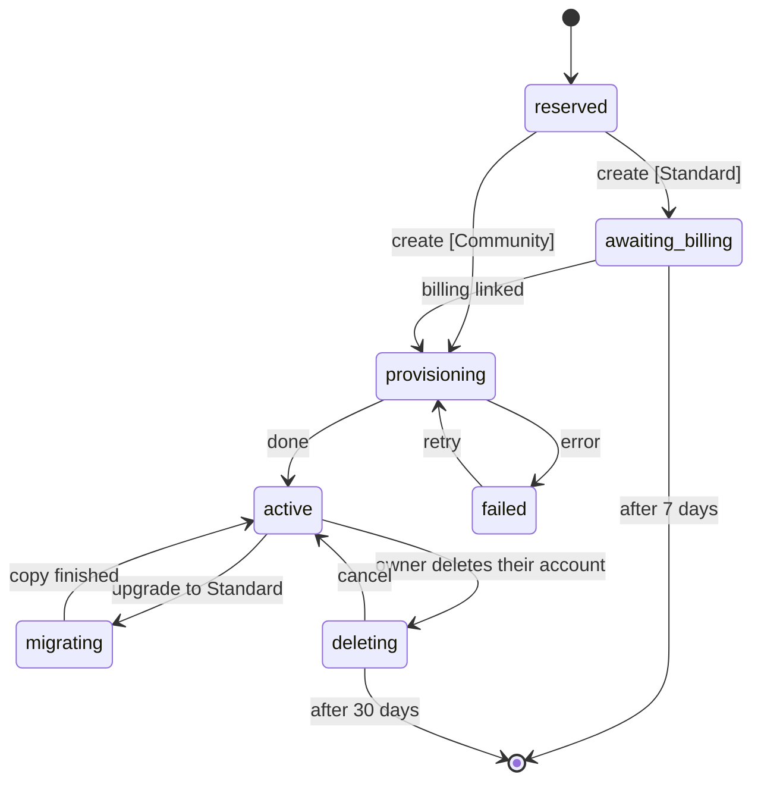

# Um app, várias organizações

A MonAmie publica um único app, `org.monamienet.app` ("MonAmie"). Cada organização (um cliente) mantém o próprio projeto Firebase, os próprios dados e a própria cobrança. O app descobre a qual organização o usuário pertence **depois** do login, e só então mostra o nome, as cores e o logo da organização.

Este guia explica como isso funciona, o que a MonAmie configura uma única vez e como cadastrar uma organização sem publicar uma nova versão do app. As decisões por trás disso estão na issue #28.

## 1. Organização não é usuário

| | Organização | Usuário |
|---|---|---|
| O que é | um cliente da MonAmie | uma pessoa |
| Exemplo | AquariusTur | Maria |
| O que tem | marca, projeto Firebase `monamienet-<id>` (ou sua parte do `monamienet-community`), seus grupos | uma conta Google |
| Faz login? | não | sim |

A conta Google não diz nada sobre a organização. A ponte são **fichas de participação** no projeto da organização, com a chave `personKey(email)`: o SHA-256 em hexadecimal minúsculo do e-mail sem espaços nas pontas e em minúsculas (por exemplo, `ana@example.com` → `8e43ca37…a018e11`), para que nenhum e-mail apareça no nome de um documento:

- `organizations/<id>/organizationMemberships/<personKey>` = `{email, role, addedAt}`. Ter essa ficha é pertencer à organização. O `role` é `admin` (um **administrador**: gerencia a organização e vê todos os grupos; o titular, que a criou, é o primeiro) ou `member`;
- `organizations/<id>/groups/<groupId>` = `{name, createdAt}`, um por **grupo** (id automático do Firestore, nunca reaproveitado), e dentro dele `groupMemberships/<personKey>` = `{email, organizationId, roles, addedAt}`. `publisher` compartilha a própria localização no grupo e `subscriber` vê o mapa do grupo; ter os dois é "os dois". `maintainer` (*Gestor do grupo*) cuida das pessoas, dos convites e do nome daquele grupo (seção 10) e só vê o mapa dele se também for `subscriber`.

Só as funções centrais (convites, grupos, criação, exclusão de conta) e o `dart run tool/organization.dart add-admin` gravam essas fichas; as regras não deixam nenhum cliente gravar. O projeto central guarda um índice, `accounts/<personKey>` = `{email, organizationIds}`, para o login achar as organizações de uma pessoa sem abrir todos os projetos. Ele é gravado depois do projeto da organização, então, quando os dois discordam, vale o projeto da organização: o app descarta um id para o qual não acha ficha, e o `check` aponta uma ficha que falta no índice.

## 2. O que acontece no login

1. **Login Google** no projeto central `monamienet-app`. A tela tem a marca MonAmie: ainda não se sabe a organização.
2. **`resolveOrganizations`** (função central) lê o `accounts/<personKey>` do usuário no projeto central, mantém as organizações que têm, no registro central `organizations/{id}`, um status diferente de `reserved` e devolve o status de cada um e, para os que o app pode vincular, as opções do Firebase. O app só entra em organizações `active` (seção 7).
3. O app lê o **`organizations/<id>/config/branding`** (público) de cada organização. Sem organização, o usuário cai em *Sem organização*, ainda conectado à MonAmie, onde pode criar sua organização ou verificar de novo depois de ser convidado; com uma ou mais, *Escolher organização* mostra o nome e o logo de cada uma, abaixo dos convites pendentes. Essas telas são da própria MonAmie (identidade "Encontro": marinho, creme e coral); a marca da organização só aparece quando se sabe que o usuário pertence a ela.
4. **Ligação:** o projeto Firebase da organização (um app Firebase nomeado `organization-<id>`) e a marca são ligados juntos. O app entra no projeto da organização com o mesmo ID token do Google (o projeto aceita o cliente web central). Dali em diante, as regras de segurança leem as fichas da pessoa a cada pedido para decidir o que ela pode ver e gravar; não há claims para atualizar.
5. **Lembrança:** a ligação fica salva no aparelho. As próximas aberturas já começam com a marca da organização, sem consultar o projeto central.

O app **esquece** a organização quando a pessoa sai (volta ao login), em *Trocar de organização* (sai, abre o seletor de contas e depois o de organizações) e quando o acesso acaba: o `organizationMemberships/<personKey>` da pessoa some (o app fica ouvindo essa ficha). Perder o acesso, no login ou depois, sempre leva a *Sem organização* com uma mensagem que nomeia a organização, nunca ao login com um erro genérico (#78). Não há cache: uma remoção vale a partir da próxima leitura.

O ícone e o nome na tela inicial do celular, a ficha na Play e a splash nativa são sempre MonAmie: o Android os lê do pacote instalado. Os dois nomes nunca aparecem lado a lado: as telas da própria MonAmie dizem "MonAmie" e, depois que a organização é vinculada, o app mostra só o nome dela ("AquariusTur", nunca "MonAmie AquariusTur").

## 3. Onde cada valor mora

| Tipo | Exemplos | Onde |
|---|---|---|
| Escolha da organização | nome (obrigatório), tema do catálogo, logo (opcional) | `organizations/<id>/config/branding` no projeto da organização (seção 9) |
| Escolha da MonAmie | status da organização (seção 7) | `organizations/{id}` em `monamienet-app` |
| Escolha da MonAmie | catálogo de temas (seção 8) | `themes/{id}` em `monamienet-app` |
| Derivado por regra | `monamienet-<id>`, `personKey(email)` | código |
| Gravado só pelas funções centrais (e pelo `add-admin`) | fichas de participação e grupos (seção 1) | o projeto da organização; o índice `accounts/{personKey}` no `monamienet-app` |
| Buscado no build | `google-services.json` central | `android/app/google-services.json` (ignorado pelo git) |
| Buscado em tempo de execução | opções do Firebase da organização | `resolveOrganizations`, depois o aparelho |

A marca é um **nome**, um **tema** do catálogo (seção 8) e, opcionalmente, **um logo**: um PNG quadrado de 512 px em `organizations/<id>/logo.png` no Cloud Storage da organização (leitura pública; só um administrador grava, `image/png` de até 1 MB). Os administradores mudam os três no app, em *Aparência*: o aparelho converte qualquer arquivo escolhido (SVG, PNG, JPEG, WebP, HEIC quando o Android decodifica) nesse PNG, então um SVG nunca é guardado; a função `setBranding` confere o tema contra o catálogo ativo e avança o `logoVersion`, que avisa os aparelhos para buscar o logo novo. Planos B: sem tema ou tema desconhecido → Grafite; sem logo, ou logo que não abre → a inicial do nome num quadrado na cor do tema; sem nome → o id com a primeira letra maiúscula. As cores resolvidas e o logo ficam guardados com a ligação, então a primeira tela sai com a marca sem rede; as mudanças chegam a cada aparelho na próxima abertura.

## 4. Configuração única do projeto central (mantenedor)

Feita para o `monamienet-app` em 21/10/2026; o registro está na issue #65. Fica aqui para reconstruí-lo, se um dia for preciso.

1. Crie o projeto e ligue a cobrança:
   ```sh
   gcloud projects create monamienet-app --organization=<id da organização> --name="MonAmie"
   gcloud billing projects link monamienet-app --billing-account=<conta>
   firebase projects:addfirebase monamienet-app
   ```
   Uma conta de cobrança aceita poucos projetos; "Cloud billing quota exceeded" quer dizer desligar um projeto dela ou pedir aumento ao Google. O id `app` é reservado: nenhuma organização pode usá-lo.
2. Ative as APIs e crie o Firestore em `us-central1`, a região de todas as funções deste app (ele guarda o registro, o catálogo de temas, os convites, as exclusões de conta agendadas e o índice `accounts`; só as funções centrais leem os três últimos):
   ```sh
   gcloud services enable firestore.googleapis.com identitytoolkit.googleapis.com cloudfunctions.googleapis.com \
     cloudbuild.googleapis.com artifactregistry.googleapis.com run.googleapis.com eventarc.googleapis.com \
     firebase.googleapis.com cloudidentity.googleapis.com --project=monamienet-app
   gcloud firestore databases create --location=us-central1 --project=monamienet-app
   ```
3. Registre o app Android `org.monamienet.app` e um app web (`firebase apps:create`) e cadastre os SHA-1 da chave de debug, da chave de upload e, depois do primeiro envio à Play, da assinatura da Play (`firebase apps:android:sha:create`; veja `publicar-teste-interno.md`, passos C1–C3 e C8).
4. Console → Authentication → ative o **Google** (nome público "MonAmie"). O Firebase cria o cliente OAuth web e já autoriza `localhost`, `localhost:5000` e o domínio `firebaseapp.com`; adicione só um domínio de hospedagem próprio.
5. A organização do Google Cloud não dá **nenhum papel** às contas de serviço padrão (política `iam.automaticIamGrantsForDefaultServiceAccounts`). Dê à conta da função (`<número do projeto>-compute@developer.gserviceaccount.com`) `roles/cloudbuild.builds.builder`, `roles/datastore.user` e `roles/logging.logWriter` no `monamienet-app`, e o papel customizado `firebaseAppConfigReader` **só em cada projeto de organização** (passo 8 do cadastro).
6. Crie a conta de serviço da `expireOrganizations` e ative o Cloud Scheduler (seção 7):
   ```sh
   gcloud services enable cloudscheduler.googleapis.com cloudresourcemanager.googleapis.com --project=monamienet-app
   gcloud iam service-accounts create partner-expirer --project=monamienet-app --display-name="Partner expirer"
   gcloud projects add-iam-policy-binding monamienet-app --role=roles/datastore.user \
     --member=serviceAccount:partner-expirer@monamienet-app.iam.gserviceaccount.com
   ```
   Publique (no primeiro deploy, responda **1** dia à pergunta de limpeza de imagens) e carregue o catálogo de temas (seção 8):
   ```sh
   (cd central/functions && npm ci)
   (cd central && firebase deploy --project monamienet-app --only functions,firestore)
   dart run tool/organization.dart themes
   ```
7. CI: vincule `firebaseAppConfigReader` à conta `wlif-monamie-app-config@ci-cd-management.iam.gserviceaccount.com` no `monamienet-app`. Remova o vínculo dela no `monamienet-aquariustur` **só depois** do merge do PR #74: até lá, a `main` ainda gera o app antigo a partir desse projeto.
8. Play Console: crie o app `org.monamienet.app`, envie o primeiro bundle manualmente (`--build-number=100`), preencha a Segurança dos dados e a declaração de **localização em segundo plano**, e dê acesso a ele à conta de serviço de publicação. Depois, despublique o `org.monamienet.aquariustur`.

## 5. Cadastro de uma organização (sem nova versão do app)

Os passos 1 a 8 cuidam dos três obrigatórios: projeto, um administrador e nome. O passo 9 é o portão.

**Projeto Firebase da organização**
1. Crie `monamienet-<id>` na conta de cobrança da organização.
2. Ative o Firestore e o provedor de login Google. Em **Allowed client IDs** (só pelo console), adicione o client id web central: projeto central → Authentication → Google → Configuração do SDK da Web.
3. Registre o app Android `org.monamienet.app` **sem SHA-1** (o par pacote + SHA-1 só pode ter cliente OAuth num projeto: o central) e **exatamente um** app web. O `flutterfire configure` cria um app web por plataforma (ex.: "windows"); remova os extras, senão `check`, `activate` e `resolveOrganizations` falham.
4. Dê à conta da função (`<número do projeto da organização>-compute@developer.gserviceaccount.com`) `roles/datastore.user` (a `setBranding` lê a ficha de quem chama e grava a marca), `roles/cloudbuild.builds.builder` e `roles/logging.logWriter`. Dê `roles/datastore.user` neste projeto às contas centrais: `groups-admin@monamienet-app.iam.gserviceaccount.com` (as funções centrais gravam aqui as fichas e os grupos) e `partner-expirer@monamienet-app.iam.gserviceaccount.com` (com `roles/firebaseauth.admin` também: apagar contas, seção 12). Ative o Cloud Storage (o bucket padrão guarda o logo).
5. Publique as regras, os índices, as regras do Storage e a `setBranding` a partir da raiz do repositório (no primeiro deploy, responda **1** dia à pergunta de limpeza):
   ```sh
   (cd functions && npm ci)
   firebase deploy --project monamienet-<id> --only firestore:rules,firestore:indexes,storage,functions
   ```
   No **primeiro** deploy do `storage.rules`, a CLI pede para deixar o Cloud Storage ler o Firestore, porque a regra do logo lê a ficha de quem envia (uma regra "entre serviços"). Responda **sim**: isso dá ao agente de serviço do Cloud Storage do projeto um papel para ler o Firestore (a CLI diz qual). Sem isso, todo envio de logo é recusado. O console oferece a mesma permissão em Storage → Regras. Os índices de `groupMemberships` e `positions` levam alguns minutos para ficar prontos depois do deploy; até lá, a consulta "meus grupos" do app e a exclusão de contas falham com "index not ready".

**Administradores**

6. Crie o primeiro administrador (o titular):
   ```sh
   dart run tool/organization.dart add-admin <id> <e-mail>
   ```
   Ele grava a ficha `admin` da pessoa no projeto da organização e depois põe a organização no `accounts` dela no `monamienet-app`, as mesmas duas gravações das funções centrais. Use `--community` enquanto uma organização Community ainda não tiver entrada no registro. Todos os outros entram por convite no app, e os grupos são criados no app (seção 10); nenhum Google Group entra nisso.
7. Conceda `firebaseAppConfigReader` à conta da função central **só neste projeto**.

**Marca e ativação**

8. Publique o nome e o tema (um administrador põe o logo depois, no app):
   ```sh
   dart run tool/organization.dart publish <id> --name "<Nome>" --theme <themeId>
   ```
   O `--theme` é um dos ids do catálogo (seção 8); use `--dry-run` para conferir antes. Publicar de novo atualiza a marca na próxima abertura de cada aparelho e também remove os campos do formato antigo (`colors`, `logoSvg`, `iconSvg`).
9. Confira e ative (a ativação roda as mesmas conferências e recusa se alguma falhar):
    ```sh
    dart run tool/organization.dart check <id>
    dart run tool/organization.dart activate <id>
    ```
    O `activate` põe o status da organização em `active` (seção 7). Ele recusa um identificador aposentado e uma organização em `awaiting_billing`, `migrating` ou `deleting`.

O `check` lista todos os problemas de uma vez: os dois apps, pelo menos um administrador, cada ficha presente no `accounts` da pessoa (cada problema mostra o e-mail ao lado da chave, porque a chave sozinha é um hash) e o nome da marca.

A ferramenta usa as contas do seu `firebase login` e `gcloud auth login`. O `check` e o `add-admin` leem e gravam fichas e `accounts`, que nenhum cliente pode ler, então sua conta precisa de acesso ao Firestore (`roles/datastore.user`, ou proprietário) no projeto da organização e no `monamienet-app`.

## 6. Build e deploy

- **Android:** `flutter build apk` (sem `--flavor`). O build busca o `google-services.json` central quando ele não existe; `REFRESH_FIREBASE_CONFIG=1` força a atualização.
- **Web:** `dart run tool/organization.dart web` grava `web/central/firebase.json` (opções do Firebase central e o client id do Google); depois, `flutter build web`. Veja `rodar-web-localmente.md`.
- **Funções:** a CI só publica o app. Depois de um merge que mude `central/`, publique de novo o projeto central (seção 4, passo 6); depois de um que mude `functions/`, `firestore.rules`, `firestore.indexes.json` ou `storage.rules`, publique de novo **todos** os projetos de organização e o `monamienet-community` (seção 5, passo 5).

## 7. Status da organização

A entrada de cada organização no registro central, `organizations/{id}` em `monamienet-app`, tem um único campo `status`. Só as funções centrais o alteram, pela `transitionOrganizationStatus` (`central/functions/organization_status.js`), que recusa qualquer transição fora do diagrama abaixo. A única exceção é o `tool/organization.dart activate`, o caminho manual da MonAmieNet: ele põe `active` numa organização ainda sem status, ou em `provisioning`, `failed` ou `active`.



| `status` | Significado | O app mostra |
| :--- | :--- | :--- |
| `reserved` | identificador reservado, criação começando (segundos) | nada ainda (`resolveOrganizations` não o devolve) |
| `awaiting_billing` | só Standard: projeto criado, esperando a organização vincular o faturamento | *Ativar faturamento* |
| `provisioning` | configurando Firestore, regras, funções e a ficha do titular | *Ativar faturamento*, parte do andamento |
| `active` | funcionando | o mapa |
| `migrating` | cópia de Community para Standard em andamento | o mapa, só leitura; compartilhamento pausado |
| `failed` | uma etapa da criação falhou depois das novas tentativas; a MonAmieNet é avisada | *Falha na criação* |
| `deleting` | o titular excluiu a conta; `deleteAt` = pedido + 30 dias | *Em exclusão* |

**O fim é um documento apagado, não um status.** Entrar em `awaiting_billing` ou `deleting` grava `deleteAt` (7 ou 30 dias depois); sair deles remove o campo. Todo dia às 03:00 (São Paulo), a função agendada `expireOrganizations` pega as organizações cujo `deleteAt` já passou, apaga o projeto do Google Cloud (ou a subárvore no Community), tira o id de todo `accounts`, apaga `organizations/{id}` e grava `retiredOrganizationIds/{id}` só com `retiredAt`. O id de um projeto apagado nunca pode ser reutilizado, então um identificador aposentado é recusado para sempre: a criação confere isso na etapa do nome, e o `activate` também recusa. O Google ainda deixa um projeto apagado recuperável por até 30 dias antes de apagá-lo de vez.

A `expireOrganizations` roda com uma conta de serviço própria, `partner-expirer@monamienet-app.iam.gserviceaccount.com`, com `roles/datastore.user` no `monamienet-app`. Ela só consegue apagar projetos onde tem `roles/resourcemanager.projectDeleter`, papel que a criação pelo app concede nos projetos que cria. Nunca dê esse papel numa organização cadastrada à mão: essas não expiram.

### Migração do campo `active` (uma vez só)

Registros gravados antes do ciclo de vida têm `active: true` e nenhum `status`. Depois de publicar o `central/` com esta mudança, rode o `activate` para cada organização listada em `organizations/` (console do Firebase → `monamienet-app` → Firestore): ele roda as verificações e regrava a entrada como `status: "active"`, removendo `active`. Até lá a organização some do login, então rode os dois passos em seguida.

## 8. Catálogo de temas

As organizações escolhem um tema de um conjunto fixo, nunca cores livres. O catálogo mora no projeto central, `themes/{id}`, para a MonAmieNet poder ajustar um tom sem nova versão do app:

| id | nome | primary | dark | light |
| :--- | :--- | :--- | :--- | :--- |
| `oceano` | Oceano | `#315399` | `#131A34` | `#D4DBE9` |
| `turquesa` | Turquesa | `#0B7F7B` | `#093A3E` | `#CDF0EF` |
| `floresta` | Floresta | `#2F7347` | `#163123` | `#D6E7DC` |
| `oliva` | Oliva | `#5E6B1F` | `#2B3512` | `#E6EAD3` |
| `ambar` | Âmbar | `#9A5B00` | `#433104` | `#F3E2CA` |
| `petroleo` | Petróleo | `#1F6A85` | `#102837` | `#D2E5EB` |
| `ameixa` | Ameixa | `#74408F` | `#2A1730` | `#E1D7E6` |
| `grafite` | Grafite | `#3F4754` | `#1F2128` | `#DCDEE2` |

- Cada documento também tem `onPrimary` e `onDark` (branco nos oito: todo tema passa no WCAG AA para texto branco sobre `primary` e `dark`, e para texto `dark` sobre `light`), `order` (posição no seletor) e `active`.
- **Carga** repetível: `dart run tool/organization.dart themes` (com `--dry-run` só imprime). Os tons ficam em `tool/src/themes_command.dart`; mude lá e rode de novo.
- **Aposentar** um tema: `active: false` (na ferramenta também, senão a próxima carga o reativa). Ele some do seletor, mas continua valendo para as organizações que o usam; nunca apague o documento de um tema.
- **`themeId` desconhecido ou ausente**: o app usa o Grafite e nunca trava. As cores resolvidas ficam guardadas com a ligação, então a primeira tela já sai com a marca mesmo sem rede e sem conseguir ler o catálogo.
- **Leitura** pública (só nomes e cores): o app lê, e as funções da organização que gravam um `themeId` o conferem contra os temas ativos, porque as regras do projeto da organização não leem o banco central.

## 9. Planos e o layout dos dados

| | **Community** (gratuito) | **Standard** |
| :--- | :--- | :--- |
| Projeto Firebase | `monamienet-community`, compartilhado por todas as organizações Community, pago pela MonAmieNet | o `monamienet-<id>` da própria organização, na conta de faturamento dela |
| Acompanhamento | no máximo uma posição a cada 15 minutos (*Economia*) | todas as opções |
| Registro | `organizations/{id}.plan = "community"` | `plan = "standard"` (ou sem `plan`, nas entradas anteriores aos planos) |

**Um layout para os dois.** Toda organização guarda seus dados em `organizations/{organizationId}/` do seu projeto:

```
organizations/{organizationId}/config/branding      público: nome e aparência
organizations/{organizationId}/config/plan          só Community: {minIntervalMinutes: 15}
organizations/{organizationId}/config/tracking      escolha dos administradores: {intervalMinutes, distanceMeters}; padrão 15 min, 100 m (Economia)
organizations/{organizationId}/organizationMemberships/{personKey}   quem participa: {email, role}
organizations/{organizationId}/groups/{groupId}                      um grupo: {name, createdAt}
organizations/{organizationId}/groups/{groupId}/groupMemberships/{personKey}   {email, organizationId, roles}
organizations/{organizationId}/groups/{groupId}/positions/{personKey}          última posição no grupo (receivedAt = hora do servidor; removedAt gravado quando a pessoa deixa de publicar ali)
organizations/{organizationId}/groups/{groupId}/positions/{personKey}/trail/{pointId}
organizations/{organizationId}/groups/{groupId}/positions/{personKey}/trailDays/{yyyy-mm-dd}  um resumo por dia com trajetos (pontos do calendário do histórico)
```

- **Regras** separam todo caminho por organização: leem o `organizationMemberships/<personKey>` de quem chama **naquela organização** (e, nas posições, o `groupMemberships/<personKey>` daquele grupo). Membros leem `config/tracking` e `config/plan`; administradores gravam `config/tracking` e leem todos os grupos; as posições, o trajeto e o calendário de um grupo exigem `subscriber` nele (ou ser administrador); gravar a própria posição exige `publisher`. Cada pessoa só lê os grupos de que participa.
- **Intervalo do Community, garantido pelas regras**: uma posição nova precisa ter `receivedAt == request.time` e vir pelo menos `minIntervalMinutes` depois da anterior; um ponto do trajeto só é aceito no mesmo batch da posição que ele registra (`getAfter`). O app lê o mesmo valor e não tenta antes.
- **`resolveOrganizations`** devolve as opções do Firebase do projeto Community para as organizações Community (cada uma continua com seu app nomeado `organization-<id>` no aparelho).
- **Expiração** (seção 7) apaga `organizations/{id}/**` de uma organização Community no projeto compartilhado, em vez de um projeto; a conta `partner-expirer` precisa de `roles/datastore.user` no `monamienet-community`.

**Configurar o `monamienet-community`** (uma vez): crie o projeto na conta de faturamento da MonAmieNet (precisa de uma vaga livre nela), adicione o Firebase, o Firestore em `southamerica-east1`, o provedor Google com o cliente web central em *IDs de cliente permitidos*, o app Android `org.monamienet.app` sem SHA-1 e exatamente um app web, o mesmo IAM de um projeto de organização (seção 5, passos 4 e 7; `groups-admin@` e `partner-expirer@` incluídas), e publique o `firestore.rules`, o `firestore.indexes.json`, o `storage.rules` e o `functions/` nele. Crie um **alerta de orçamento**: a cota gratuita do Firestore (50.000 leituras e 20.000 gravações por dia) é dividida entre todas as organizações Community.

**Levar uma organização Standard para o Community** (à mão; ainda não há ferramenta). Como os dois planos usam o mesmo layout, a mudança é uma cópia para os mesmos caminhos em outro projeto, mais um campo no registro:

1. Copie todo documento de `organizations/<id>/` do `monamienet-<id>` (fichas e grupos incluídos) para o mesmo caminho no `monamienet-community`, mantendo campos e tipos (`batchWrite` da API REST do Firestore).
2. Grave `organizations/<id>/config/plan` = `{minIntervalMinutes: 15}` e, se `config/tracking.intervalMinutes` for menor que 15, suba para 15 (as regras recusam um valor menor no próximo salvamento; use 15 min / 100 m, *Economia*).
3. Copie `organizations/<id>/logo.png` para o bucket do Community com tipo `image/png`. Um projeto sem faturamento responde HTTP 402 até no link público da logo; se o faturamento foi removido, ligue-o antes.
4. Compare a cópia com a origem documento por documento e só então grave `plan: "community"` no registro central `organizations/<id>` (`monamienet-app`). A `resolveOrganizations` lê o plano a cada chamada, então a próxima escolha de organização já recebe o projeto Community.
5. Avise as pessoas da organização para tocar em *Trocar de organização* e escolhê-la de novo (no Android, feche o app antes): até lá os aparelhos continuam no projeto em que estavam (#145).
6. Apague o `monamienet-<id>` (`gcloud projects delete`); o Google permite restaurá-lo por 30 dias.

**Aqui o id não tem volta**: o projeto de uma organização Standard é sempre `monamienet-<id>` (`projectIdFor` em `central/functions/organization_options.js`), e o id de um projeto apagado nunca pode ser reaproveitado. Depois do passo 6 a organização não volta ao Standard com o mesmo id, a não ser que essa regra mude (#104). `aquariustur` e `monamietest` foram levados assim em 30/10/2026.

## 10. Grupos e convites (pelo app)

Os administradores gerenciam grupos e convites no app, e o gestor de um grupo (*Gestor do grupo*) cuida do próprio grupo. O trabalho acontece nas funções do projeto central, nunca no aparelho:

- **Quem pode fazer o quê**:

  | | Titular | Administrador | Gestor do grupo | Membro |
  |---|---|---|---|---|
  | Ver as pessoas do grupo, convidar para ele (em campo/vê o mapa), listar/reenviar/cancelar os convites dele, mudar em campo/vê o mapa, tirar pessoas, renomear | todos os grupos | todos os grupos | **só o próprio grupo** | não |
  | Tirar um gestor do grupo, dar ou tirar `maintainer` | sim | sim | não | não |
  | Criar ou excluir grupos (inclusive o primeiro grupo junto com os primeiros convites) | sim | sim | não | não |
  | Aparência, ajustes de acompanhamento, ver todos os grupos no mapa | sim | sim | não | não |
  | Escolher os administradores (*Administradores*) | sim | não | não | não |

  O direito vem das fichas de quem chama, enquanto a entrada `organizations/{id}` do registro estiver `active`: administrador = `organizationMemberships/<personKey>` com `role: "admin"`; gestor = `maintainer` no `groupMemberships/<personKey>` do grupo; titular = `ownerEmail` no registro (e-mail verificado). Cada chamada só mexe naquela organização. `listGroups`, `createGroup`, `renameGroup`, `groupDeletionImpact`, `deleteGroup`, `setMemberRoles`, `removeMember`, `sendInvites`, `listInvites`, `resendInvite` e `cancelInvite` recebem `{organizationId}` (e o `groupId` do grupo quando agem sobre um; o `listInvites` de um gestor precisa dele); os erros voltam como `invalid-argument` com `{field}` (`name`, `duplicate`, `roles`, `group`, `member`, …) e `permission-denied` para quem não tem o direito (`field: "forbidden"` quando a pessoa gerencia a organização, mas não aquela ação ou aquele grupo).
- **Administradores** (só o titular): `listAdministrators {organizationId}` → `{administrators: [{email, owner}], members: [{email}]}` e `setAdministrator {organizationId, email, admin}` → `{email, role}`. A pessoa escolhida já precisa ser membro (só se entra por convite) e nunca é o titular (`field: "owner"`). Promover ou rebaixar mantém a pessoa na organização e nos grupos dela; um administrador rebaixado que não está em nenhum grupo continua como membro sem grupo (não vê mapa até ser convidado para um grupo), em vez de sair sem aviso.
- **Identidade**: `groups-admin@monamienet-app.iam.gserviceaccount.com` (nome antigo; uma conta dedicada fica para depois), com `roles/datastore.user` no `monamienet-app` (registro, convites, `accounts`), no `monamienet-community` e em cada projeto Standard (fichas e grupos). Ela chega ao projeto de cada organização por um segundo app do Admin SDK apontado para aquele projeto, escolhido pelo `plan` do registro.
- **Grupos**: um documento do Firestore com id automático; o nome tem de 2 a 40 caracteres, pelo menos 2 letras, e não pode repetir outro ignorando maiúsculas, acentos e espaços. Renomear muda só o nome. Excluir primeiro mostra quem sai da organização (quem não está em outro grupo; nunca um administrador), tira essas pessoas dela, cancela os convites pendentes do grupo e então apaga o grupo com tudo o que há dentro (fichas, posições, trajetos); repetir termina uma exclusão que parou no meio. Mudar os papéis de alguém: um administrador manda o conjunto inteiro (`maintainer` incluído, pelo menos um papel); um gestor manda `publisher`/`subscriber` (pelo menos um) e o `maintainer` da pessoa fica como está; perder `publisher` (ou sair do grupo) marca a posição dela ali com `removedAt`, então o mapa a esconde e o histórico a guarda. Tirar alguém do último grupo também o tira da organização, a menos que seja administrador. O app lê os nomes dos grupos direto do Firestore.
- **Convites**: `invites/{id}` no projeto central (a pessoa convidada ainda não participa de nada, então o projeto da organização não pode guardá-lo): `{organizationId, organizationName, groupId, groupName, email, roles, inviterEmail, inviterName, createdAt, expiresAt, status}`, com papéis entre `publisher` e `subscriber`. Valem **14 dias** (*Reenviar* recomeça os 14 dias; *Cancelar* anula). **A participação começa no aceite**: a pessoa entra com a conta convidada, vê o convite em *Sem organização* ou no alto de *Escolher organização*, toca em *Aceitar e entrar*, e o `acceptInvite` grava, num só batch no projeto da organização, a ficha da organização (`member`, se ela ainda não tiver uma) e a ficha do grupo (os papéis do convite somados aos dela), e depois a organização no `accounts` dela. Vale na hora: as regras leem essas fichas, então não há o que esperar. Um convite cujo grupo foi excluído é recusado.
- **E-mail**: enviado pela API do Gmail do Workspace como a caixa `MAIL_SENDER_SUBJECT`, aparecendo como `MAIL_FROM` (um alias "enviar e-mail como" dessa caixa), os dois em `central/functions/.env`. As funções assinam o JWT da delegação pela API IAM Credentials como `mail-sender@monamienet-app.iam.gserviceaccount.com` (sem chave; o `groups-admin@` tem `roles/iam.serviceAccountTokenCreator` nela). No Admin console, Segurança → Controle de acesso e dados → Controles de API → Delegação em todo o domínio, o ID do cliente do `mail-sender@` deve ter **só** `https://www.googleapis.com/auth/gmail.send`. A delegação vale para o domínio inteiro no Workspace; o código só usa a caixa configurada. Sem ela o convite funciona (a pessoa o vê ao entrar) e o administrador é avisado de que o e-mail não saiu.

## 11. Criar uma organização pelo app

Qualquer pessoa conectada pode criar uma organização a partir de *Sem organização* ou *Escolher organização*: *Nome* (com o identificador sugerido a partir do nome e conferido enquanto se digita: só letras, de 3 a 20, livre e nunca aposentado), *Tema*, *Plano*, *Revisão*. A função central `createOrganization` (rodando como `groups-admin@`) confere tudo de novo, reserva o identificador no registro (`null → reserved`, que recusa identificadores em uso ou aposentados) e grava quem criou como `ownerEmail`. Quem cria vira o titular e o primeiro administrador: os administradores gerenciam grupos, convites e aparência. O titular é sempre administrador, e nenhuma função o rebaixa nem o tira; ser titular também quer dizer que excluir a própria conta exclui a organização.

- **Community**: `provisioning`, depois `organizations/<id>/config/branding` e `config/plan` (mínimo de 15 minutos) no `monamienet-community`, depois a ficha `organizationMemberships/<personKey>` do titular com `role: "admin"` e a organização no `accounts` dele, e então `active`; o app entra na organização nova na hora. Uma falha nas primeiras gravações é a etapa `data`; na da ficha, `membership`.
- **Standard**: ainda não automatizado. Criar um projeto na organização do Google Cloud, dar ao titular `roles/billing.projectManager`, esperar o faturamento (Cloud Workflows com a verificação agendada de `getBillingInfo`) e publicar regras e funções exigem uma identidade de provisionamento que a MonAmieNet ainda não configurou. Até lá, uma criação Standard para em `failed` (etapa `project`) com o identificador reservado, e a MonAmieNet termina à mão com as seções 5 e 7 (o `add-admin` faz do titular o administrador).
- **Falha**: qualquer etapa que falhe deixa `failed` com `failure: {step, message}` no registro e o erro no log da função; o app mostra *Falha na criação* ("a MonAmieNet foi avisada"), e o identificador continua reservado. Tentar de novo (`failed → provisioning`) é, por enquanto, uma ação da MonAmieNet.

## 12. Excluir uma conta

Qualquer pessoa pode excluir a própria conta pelo app (*Minha conta* → *Excluir conta*). Nada é apagado na hora: há **30 dias** para cancelar, e o app mostra *Em exclusão* (com *Cancelar exclusão*) sempre que a pessoa entra nesse período. Quem faz o trabalho são as funções centrais:

- **`requestAccountDeletion`** (como `groups-admin@`): em cada organização do `accounts` da pessoa, tira as fichas de grupo dela (as posições ficam marcadas com `removedAt`, então ela sai dos mapas) e, se não for a titular, a ficha da organização e aquele id do `accounts`, na hora; guarda o que tirou em `accountDeletions/{personKey}` (`email`, `deleteAt`, `memberships`: `[{organizationId, role, groups: [{groupId, roles}]}]`, `ownedOrganizationIds`). O **titular** exclui a organização junto com a conta (ela não pode ficar sem titular) e confirma digitando o identificador: continua administrador dela, a organização passa de `active` para `deleting`, ninguém mais entra nela, e o `expireOrganizations` a apaga quando terminam os 30 dias dela (seção 7).
- **`cancelAccountDeletion`**: dentro dos 30 dias, grava de volta as fichas guardadas (pulando grupos excluídos no meio tempo), traz as organizações dela de volta a `active` e apaga o registro.
- **`eraseAccounts`** (diário, como `partner-expirer@`): para cada registro com `deleteAt` vencido, apaga em cada organização de que a pessoa fazia parte as fichas dela, as posições dela em todos os grupos com o trajeto e os resumos por dia (uma consulta de grupo de coleções em `positions` pelo `email`) e o login naquele projeto; depois o `accounts` dela, o login central e o próprio registro. O `partner-expirer@` precisa de `roles/datastore.user` e `roles/firebaseauth.admin` em cada projeto de organização e no `monamienet-community`, e de `roles/firebaseauth.admin` no `monamienet-app`.

A página pública de pedido de exclusão exigida pelo Google Play (para quem não tem o app instalado) fica no site, não neste repositório.
