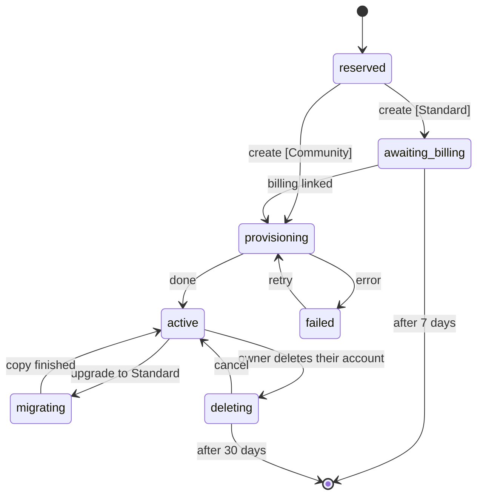

# Um app, vários parceiros

A MonAmie publica um único app, `org.monamienet.app` ("MonAmie"). Cada parceiro (uma organização cliente) mantém o próprio projeto Firebase, os próprios dados e a própria cobrança. O app descobre a qual parceiro o usuário pertence **depois** do login, e só então mostra o nome, as cores e o logo do parceiro.

Este guia explica como isso funciona, o que a MonAmie configura uma única vez e como cadastrar um parceiro sem publicar uma nova versão do app. As decisões por trás disso estão na issue #28.

## 1. Parceiro não é usuário

| | Parceiro | Usuário |
|---|---|---|
| O que é | uma organização cliente | uma pessoa |
| Exemplo | AquariusTur | Maria |
| O que tem | marca, projeto Firebase `monamienet-<id>`, grupo raiz `<id>00@monamienet.org` | uma conta Google |
| Faz login? | não | sim |

A conta Google não diz nada sobre o parceiro. A ponte são os **grupos**, em três níveis, com todo mundo como `MEMBER` simples:

- `<id>00@monamienet.org`, o **grupo raiz**: só o responsável, que acompanha todas as equipes;
- `<id>01@` … `<id>99@`, um por **equipe**: guarda o nome da equipe, sem membros diretos;
- `<id>NNr@` (**vê o mapa** da equipe) e `<id>NNw@` (**em campo**: compartilha a própria localização na equipe), as duas folhas de cada equipe. Estar nas duas é "os dois".

Pôr o e-mail de uma pessoa numa folha (ou na raiz) é o que a torna usuária daquele parceiro; o que ela pode fazer vem de qual grupo é. Um endereço de grupo se divide por `^([a-z]+)(\d{2})([rw])?$`, o que funciona porque o id do parceiro só tem letras minúsculas: `aquariustur01w@monamienet.org` → parceiro `aquariustur`, equipe `01`, em campo.

## 2. O que acontece no login

1. **Login Google** no projeto central `monamienet-app`. A tela tem a marca MonAmie: ainda não se sabe o parceiro.
2. **`resolvePartners`** (função central) pede ao gateway os grupos do usuário, transforma os nomes em ids de parceiro, mantém os que têm, no registro central `partners/{id}`, um status diferente de `reserved` e devolve o status de cada um e, para os que o app pode vincular, as opções do Firebase. O app só entra em parceiros `active` (seção 7).
3. O app lê o **`partners/<id>/config/branding`** (público) de cada parceiro. Sem parceiro, o usuário vê "sua conta não está vinculada a nenhuma organização"; com um, o app entra nele; com vários, um seletor mostra o nome e o ícone de cada um.
4. **Ligação:** o projeto Firebase do parceiro (um app Firebase nomeado `partner-<id>`), o grupo raiz e a marca são ligados juntos. O app entra no projeto do parceiro com o mesmo ID token do Google (o parceiro aceita o cliente web central) e chama a `syncClaims` do parceiro, que decide o que o usuário pode ver, como antes.
5. **Lembrança:** a ligação fica salva no aparelho. As próximas aberturas já começam com a marca do parceiro, sem consultar o projeto central.

O app **esquece** o parceiro quando a pessoa sai, quando uma atualização de grupos não encontra mais nenhum grupo do parceiro, ou quando a `syncClaims` não devolve nenhuma capacidade.

O ícone e o nome na tela inicial do celular, a ficha na Play e a splash nativa são sempre MonAmie: o Android os lê do pacote instalado. Os dois nomes nunca aparecem lado a lado: as telas da própria MonAmie dizem "MonAmie" e, depois que o parceiro é vinculado, o app mostra só o nome dele ("AquariusTur", nunca "MonAmie AquariusTur").

## 3. Onde cada valor mora

| Tipo | Exemplos | Onde |
|---|---|---|
| Escolha do parceiro | nome (obrigatório), tema do catálogo, logo (opcional) | `partners/<id>/config/branding` no projeto do parceiro (seção 9) |
| Escolha da MonAmie | status do parceiro (seção 7) | `partners/{id}` em `monamienet-app` |
| Escolha da MonAmie | catálogo de temas (seção 8) | `themes/{id}` em `monamienet-app` |
| Derivado por regra | `monamienet-<id>`, `<id>00@monamienet.org`, id a partir do nome do grupo | código |
| Buscado no build | `google-services.json` central | `android/app/google-services.json` (ignorado pelo git) |
| Buscado em tempo de execução | opções do Firebase do parceiro | `resolvePartners`, depois o aparelho |

A marca é um **nome**, um **tema** do catálogo (seção 8) e, opcionalmente, **um logo**: um PNG quadrado de 512 px em `partners/<id>/logo.png` no Cloud Storage do parceiro (leitura pública; só o responsável grava, `image/png` de até 1 MB). O responsável muda os três no app, em *Aparência*: o aparelho converte qualquer arquivo escolhido (SVG, PNG, JPEG, WebP, HEIC quando o Android decodifica) nesse PNG, então um SVG nunca é guardado; a função `setBranding` confere o tema contra o catálogo ativo e avança o `logoVersion`, que avisa os aparelhos para buscar o logo novo. Planos B: sem tema ou tema desconhecido → Grafite; sem logo, ou logo que não abre → a inicial do nome num quadrado na cor do tema; sem nome → o id com a primeira letra maiúscula. As cores resolvidas e o logo ficam guardados com a ligação, então a primeira tela sai com a marca sem rede; as mudanças chegam a cada aparelho na próxima abertura.

## 4. Configuração única do projeto central (mantenedor)

Feita para o `monamienet-app` em 21/10/2026; o registro está na issue #65. Fica aqui para reconstruí-lo, se um dia for preciso.

1. Crie o projeto e ligue a cobrança:
   ```sh
   gcloud projects create monamienet-app --organization=<id da organização> --name="MonAmie"
   gcloud billing projects link monamienet-app --billing-account=<conta>
   firebase projects:addfirebase monamienet-app
   ```
   Uma conta de cobrança aceita poucos projetos; "Cloud billing quota exceeded" quer dizer desligar um projeto dela ou pedir aumento ao Google. O id `app` é reservado: nenhum parceiro pode usá-lo.
2. Ative as APIs e crie o Firestore em `us-central1`, a região de todas as funções deste app (ele só guarda `partners/{id}`, sem dados pessoais):
   ```sh
   gcloud services enable firestore.googleapis.com identitytoolkit.googleapis.com cloudfunctions.googleapis.com \
     cloudbuild.googleapis.com artifactregistry.googleapis.com run.googleapis.com eventarc.googleapis.com \
     firebase.googleapis.com cloudidentity.googleapis.com --project=monamienet-app
   gcloud firestore databases create --location=us-central1 --project=monamienet-app
   ```
3. Registre o app Android `org.monamienet.app` e um app web (`firebase apps:create`) e cadastre os SHA-1 da chave de debug, da chave de upload e, depois do primeiro envio à Play, da assinatura da Play (`firebase apps:android:sha:create`; veja `publicar-teste-interno.md`, passos C1–C3 e C8).
4. Console → Authentication → ative o **Google** (nome público "MonAmie"). O Firebase cria o cliente OAuth web e já autoriza `localhost`, `localhost:5000` e o domínio `firebaseapp.com`; adicione só um domínio de hospedagem próprio.
5. A organização não dá **nenhum papel** às contas de serviço padrão (política `iam.automaticIamGrantsForDefaultServiceAccounts`). Dê à conta da função (`<número do projeto>-compute@developer.gserviceaccount.com`) `roles/cloudbuild.builds.builder`, `roles/datastore.user` e `roles/logging.logWriter` no `monamienet-app`, e o papel customizado `firebaseAppConfigReader` **só em cada projeto de parceiro** (passo 8 do cadastro).
6. Crie a conta de serviço da `expirePartners` e ative o Cloud Scheduler (seção 7):
   ```sh
   gcloud services enable cloudscheduler.googleapis.com cloudresourcemanager.googleapis.com --project=monamienet-app
   gcloud iam service-accounts create partner-expirer --project=monamienet-app --display-name="Partner expirer"
   gcloud projects add-iam-policy-binding monamienet-app --role=roles/datastore.user \
     --member=serviceAccount:partner-expirer@monamienet-app.iam.gserviceaccount.com
   ```
   Publique (no primeiro deploy, responda **1** dia à pergunta de limpeza de imagens) e carregue o catálogo de temas (seção 8):
   ```sh
   (cd central/functions && npm ci)
   (cd central && firebase deploy --project monamienet-app --only functions,firestore)
   dart run tool/partner.dart themes
   ```
7. CI: vincule `firebaseAppConfigReader` à conta `wlif-monamie-app-config@ci-cd-management.iam.gserviceaccount.com` no `monamienet-app`. Remova o vínculo dela no `monamienet-aquariustur` **só depois** do merge do PR #74: até lá, a `main` ainda gera o app antigo a partir desse projeto.
8. Play Console: crie o app `org.monamienet.app`, envie o primeiro bundle manualmente (`--build-number=100`), preencha a Segurança dos dados e a declaração de **localização em segundo plano**, e dê acesso a ele à conta de serviço de publicação. Depois, despublique o `org.monamienet.aquariustur`.
9. Confira se o gateway de grupos aceita ID tokens do Firebase de `monamienet-app` (veja a issue #72).

## 5. Cadastro de um parceiro (sem nova versão do app)

Os passos 1 a 9 cuidam dos três obrigatórios: projeto, grupo raiz e nome. O passo 10 é o portão.

**Projeto Firebase do parceiro**
1. Crie `monamienet-<id>` na conta de cobrança do parceiro.
2. Ative o Firestore e o provedor de login Google. Em **Allowed client IDs** (só pelo console), adicione o client id web central: projeto central → Authentication → Google → Configuração do SDK da Web.
3. Registre o app Android `org.monamienet.app` **sem SHA-1** (o par pacote + SHA-1 só pode ter cliente OAuth num projeto: o central) e **exatamente um** app web. O `flutterfire configure` cria um app web por plataforma (ex.: "windows"); remova os extras, senão `check`, `activate` e `resolvePartners` falham.
4. Dê à conta da função (`<número do projeto do parceiro>-compute@developer.gserviceaccount.com`) `roles/firebaseauth.admin` (a `syncClaims` grava claims), `roles/datastore.user` (a `setBranding` grava a marca), `roles/cloudbuild.builds.builder` e `roles/logging.logWriter`. Ative o Cloud Storage (o bucket padrão guarda o logo) e publique o `storage.rules` junto com o resto.
5. Publique as regras e a `syncClaims` a partir da raiz do repositório (no primeiro deploy, responda **1** dia à pergunta de limpeza):
   ```sh
   (cd functions && npm ci)
   firebase deploy --project monamienet-<id> --only firestore:rules,functions
   ```

**Grupos e acesso**

6. Crie o grupo raiz `<id>00@monamienet.org` com o responsável e, para cada equipe `<id>NN@` (dentro da raiz), as folhas `<id>NNr@` e `<id>NNw@` (dentro da equipe), com as pessoas nas folhas. Todos como `MEMBER`; permita membros de fora da organização em todos os grupos. Um parceiro criado antes do modelo de três níveis é migrado com `dart run tool/partner.dart migrate-groups <id>` (mostra o plano; `--apply` executa).
7. Se o gateway de grupos mantiver uma lista de projetos aceitos, inclua `monamienet-<id>`.
8. Conceda `firebaseAppConfigReader` à conta da função central **só neste projeto**.

**Marca e ativação**

9. Publique o nome e o tema (o responsável põe o logo depois, no app):
   ```sh
   dart run tool/partner.dart publish <id> --name "<Nome>" --theme <themeId>
   ```
   O `--theme` é um dos ids do catálogo (seção 8); use `--dry-run` para conferir antes. Publicar de novo atualiza a marca na próxima abertura de cada aparelho e também remove os campos do formato antigo (`colors`, `logoSvg`, `iconSvg`).
10. Confira e ative (a ativação roda as mesmas conferências e recusa se alguma falhar):
    ```sh
    dart run tool/partner.dart check <id>
    dart run tool/partner.dart activate <id>
    ```
    O `activate` põe o status do parceiro em `active` (seção 7). Ele recusa um identificador aposentado e um parceiro em `awaiting_billing`, `migrating` ou `deleting`.

A ferramenta usa as contas do seu `firebase login` e `gcloud auth login`. Ler o grupo raiz exige a função de administrador do Google Workspace **Leitor de grupos** na sua conta (admin.google.com → Conta → Funções de administrador); ser administrador da organização no Google Cloud não basta, e sem ela o `check` diz que o grupo não existe. A mesma mensagem enganosa aparece quando a `cloudidentity.googleapis.com` está desligada no `monamienet-app`, o projeto que paga as consultas de grupos da ferramenta.

## 6. Build e deploy

- **Android:** `flutter build apk` (sem `--flavor`). O build busca o `google-services.json` central quando ele não existe; `REFRESH_FIREBASE_CONFIG=1` força a atualização.
- **Web:** `dart run tool/partner.dart web` grava `web/central/firebase.json` (opções do Firebase central e o client id do Google); depois, `flutter build web`. Veja `rodar-web-localmente.md`.
- **Funções:** a CI só publica o app. Depois de um merge que mude `central/`, publique de novo o projeto central (seção 4, passo 6); depois de um que mude `functions/` ou `firestore.rules`, publique de novo **todos** os projetos de parceiro (seção 5, passo 5).

## 7. Status do parceiro

A entrada de cada parceiro no registro central, `partners/{id}` em `monamienet-app`, tem um único campo `status`. Só as funções centrais o alteram, pela `transitionPartnerStatus` (`central/functions/partner_status.js`), que recusa qualquer transição fora do diagrama abaixo. A única exceção é o `tool/partner.dart activate`, o caminho manual da MonAmieNet: ele põe `active` num parceiro ainda sem status, ou em `provisioning`, `failed` ou `active`.



| `status` | Significado | O app mostra |
| :--- | :--- | :--- |
| `reserved` | identificador reservado, criação começando (segundos) | nada ainda (`resolvePartners` não o devolve) |
| `awaiting_billing` | só Standard: projeto criado, esperando o parceiro vincular o faturamento | *Ativar faturamento* |
| `provisioning` | configurando Firestore, regras, funções e grupos | *Ativar faturamento*, parte do andamento |
| `active` | funcionando | o mapa |
| `migrating` | cópia de Community para Standard em andamento | o mapa, só leitura; compartilhamento pausado |
| `failed` | uma etapa da criação falhou depois das novas tentativas; a MonAmieNet é avisada | *Falha na criação* |
| `deleting` | o responsável excluiu a conta; `deleteAt` = pedido + 30 dias | *Em exclusão* |

**O fim é um documento apagado, não um status.** Entrar em `awaiting_billing` ou `deleting` grava `deleteAt` (7 ou 30 dias depois); sair deles remove o campo. Todo dia às 03:00 (São Paulo), a função agendada `expirePartners` pega os parceiros cujo `deleteAt` já passou, apaga o projeto do Google Cloud, apaga `partners/{id}` e grava `retiredPartnerIds/{id}` só com `retiredAt`. O id de um projeto apagado nunca pode ser reutilizado, então um identificador aposentado é recusado para sempre: a criação confere isso na etapa do nome, e o `activate` também recusa. O Google ainda deixa um projeto apagado recuperável por até 30 dias antes de apagá-lo de vez.

A `expirePartners` roda com uma conta de serviço própria, `partner-expirer@monamienet-app.iam.gserviceaccount.com`, com `roles/datastore.user` no `monamienet-app`. Ela só consegue apagar projetos onde tem `roles/resourcemanager.projectDeleter`, papel que a criação pelo app concede nos projetos que cria. Nunca dê esse papel num parceiro cadastrado à mão: esses não expiram.

### Migração do campo `active` (uma vez só)

Registros gravados antes do ciclo de vida têm `active: true` e nenhum `status`. Depois de publicar o `central/` com esta mudança, rode o `activate` para cada parceiro listado em `partners/` (console do Firebase → `monamienet-app` → Firestore): ele roda as verificações e regrava a entrada como `status: "active"`, removendo `active`. Até lá o parceiro some do login, então rode os dois passos em seguida.

## 8. Catálogo de temas

Os parceiros escolhem um tema de um conjunto fixo, nunca cores livres. O catálogo mora no projeto central, `themes/{id}`, para a MonAmieNet poder ajustar um tom sem nova versão do app:

| id | nome | primary | dark | light |
| :--- | :--- | :--- | :--- | :--- |
| `oceano` | Oceano | `#315399` | `#131A34` | `#D4DBE9` |
| `turquesa` | Turquesa | `#0B7F7B` | `#093A3E` | `#CDF0EF` |
| `floresta` | Floresta | `#2F7347` | `#163123` | `#D6E7DC` |
| `oliva` | Oliva | `#5E6B1F` | `#2B3512` | `#E6EAD3` |
| `ambar` | Âmbar | `#9A5B00` | `#433104` | `#F3E2CA` |
| `petroleo` | Petróleo | `#1F6A85` | `#102837` | `#D2E5EB` |
| `ameixa` | Ameixa | `#74408F` | `#2A1730` | `#E1D7E6` |
| `grafite` | Grafite | `#3F4754` | `#1F2128` | `#DCDEE2` |

- Cada documento também tem `onPrimary` e `onDark` (branco nos oito: todo tema passa no WCAG AA para texto branco sobre `primary` e `dark`, e para texto `dark` sobre `light`), `order` (posição no seletor) e `active`.
- **Carga** repetível: `dart run tool/partner.dart themes` (com `--dry-run` só imprime). Os tons ficam em `tool/src/themes_command.dart`; mude lá e rode de novo.
- **Aposentar** um tema: `active: false` (na ferramenta também, senão a próxima carga o reativa). Ele some do seletor, mas continua valendo para os parceiros que o usam; nunca apague o documento de um tema.
- **`themeId` desconhecido ou ausente**: o app usa o Grafite e nunca trava. As cores resolvidas ficam guardadas com a ligação, então a primeira tela já sai com a marca mesmo sem rede e sem conseguir ler o catálogo.
- **Leitura** pública (só nomes e cores): o app lê, e as funções do parceiro que gravam um `themeId` o conferem contra os temas ativos, porque as regras do projeto do parceiro não leem o banco central.

## 9. Planos e o layout dos dados

| | **Community** (gratuito) | **Standard** |
| :--- | :--- | :--- |
| Projeto Firebase | `monamienet-community`, compartilhado por todos os parceiros Community, pago pela MonAmieNet | o `monamienet-<id>` do próprio parceiro, na conta de faturamento dele |
| Acompanhamento | no máximo uma posição a cada 15 minutos (*Economia*) | todas as opções |
| Registro | `partners/{id}.plan = "community"` | `plan = "standard"` (ou sem `plan`, nas entradas anteriores aos planos) |

**Um layout para os dois.** Todo parceiro guarda seus dados em `partners/{partnerId}/` do seu projeto:

```
partners/{partnerId}/config/branding      público: nome e aparência
partners/{partnerId}/config/plan          só Community: {minIntervalMinutes: 15}
partners/{partnerId}/usuarios/{email}     posição atual (positionAt = hora do servidor da última posição)
partners/{partnerId}/usuarios/{email}/historico_posicoes/{pontoId}
partners/{partnerId}/users/{uid}          perfil Google (nome, foto)
```

- **Regras** separam todo caminho por parceiro. Para ler perfis ou gravar qualquer coisa, a claim `partners` da pessoa precisa conter o parceiro (a `syncClaims` a calcula pelos grupos); posições também exigem `watch`/`share` numa equipe **daquele parceiro**. No projeto Community a `syncClaims` só considera os parceiros cujo `partners/{id}/config/branding` existe lá.
- **Intervalo do Community, garantido pelas regras**: uma posição nova precisa ter `positionAt == request.time` e vir pelo menos `minIntervalMinutes` depois da anterior; um ponto do trajeto só é aceito no mesmo batch da posição que ele registra (`getAfter`). O app lê o mesmo valor e não tenta antes.
- **`resolvePartners`** devolve as opções do Firebase do projeto Community para os parceiros Community (cada um continua com seu app nomeado `partner-<id>` no aparelho).
- **Expiração** (seção 7) apaga `partners/{id}/**` de um parceiro Community no projeto compartilhado, em vez de um projeto; a conta `partner-expirer` precisa de `roles/datastore.user` no `monamienet-community`.

**Levar um parceiro Standard existente para o layout** (uma vez, por projeto): publique as regras e funções novas e depois

```sh
dart run tool/partner.dart migrate-layout <id>          # conta
dart run tool/partner.dart migrate-layout <id> --apply  # copia para partners/<id>/
```

A cópia mantém todos os campos e tipos. Os documentos antigos na raiz continuam lá; apague-os à mão quando todos os aparelhos estiverem na versão nova (as antigas ainda leem a raiz).

**Configurar o `monamienet-community`** (uma vez): crie o projeto na conta de faturamento da MonAmieNet (precisa de uma vaga livre nela), adicione o Firebase, o Firestore em `southamerica-east1`, o provedor Google com o cliente web central em *IDs de cliente permitidos*, o app Android `org.monamienet.app` sem SHA-1 e exatamente um app web, o mesmo IAM de um projeto de parceiro (seção 5, passos 4 e 8) mais `roles/datastore.user` para `partner-expirer@monamienet-app.iam.gserviceaccount.com`, e publique o `firestore.rules` e o `functions/` nele. Crie um **alerta de orçamento**: a cota gratuita do Firestore (50.000 leituras e 20.000 gravações por dia) é dividida entre todos os parceiros Community.
